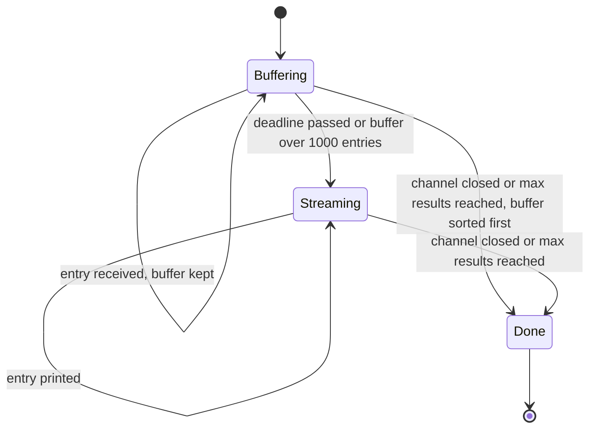

## Overview

When no command is given, the receiver thread started by `walk::scan` turns the stream of entries from the walker threads into lines on stdout. It does two jobs. `ReceiverBuffer` decides when to print: it holds results back briefly so short searches come out sorted, and it stops the search for `--max-results` and `--quiet`. `output::print_entry` decides how to print one entry: plain or coloured, through a `--format` template, with a hyperlink, with control characters escaped. How entries reach the receiver is on [[Parallel Directory Traversal]]; the receiver that runs commands instead is on [[Command Execution]].

Sources: [src/walk.rs:406-440](repo://src/walk.rs#L406-L440), [src/output.rs:16-43](repo://src/output.rs#L16-L43)

## Buffering, then streaming

`receive` wraps a locked stdout in a `BufWriter` and runs `ReceiverBuffer::process`, which calls `poll` until it returns an exit code, then sets `quit_flag` so any walker threads still running stop.

Sources: [src/walk.rs:434-439](repo://src/walk.rs#L434-L439), [src/walk.rs:173-181](repo://src/walk.rs#L173-L181)

Sources: [src/walk.rs:26-35](repo://src/walk.rs#L26-L35), [src/walk.rs:197-293](repo://src/walk.rs#L197-L293)

The receiver starts in `Buffering` mode with a deadline of `max_buffer_time` from now, 100 ms unless the hidden `--max-buffer-time` flag says otherwise. While buffering, `recv` waits at most until the deadline, and each entry is pushed to an in-memory vector. Three things end buffering.

Sources: [src/walk.rs:151-171](repo://src/walk.rs#L151-L171)

- The deadline passes (`RecvTimeoutError::Timeout`): `stream` prints the buffer in arrival order, flushes, and switches to `Streaming`.
- The buffer grows past `MAX_BUFFER_LENGTH` (1000 entries): the same switch happens.
- The channel disconnects because the walk finished: `stop` sorts the buffer by path, then prints it.

Sources: [src/walk.rs:124-171](repo://src/walk.rs#L124-L171), [src/walk.rs:183-195](repo://src/walk.rs#L183-L195), [src/walk.rs:269-293](repo://src/walk.rs#L269-L293)

So a search that finishes within 100 ms with at most 1000 results prints them sorted, and a larger one prints in whatever order the parallel walk produced them, starting within 100 ms. In `Streaming` mode `recv` waits as long as needed, each entry is printed as it arrives, and stdout is flushed whenever the channel is momentarily empty, so output appears promptly without a flush per line.

Sources: [src/walk.rs:208-238](repo://src/walk.rs#L208-L238)

## Stopping early

The receiver counts printed results in `num_results`. When `--max-results` (or `-1`) is reached, `stop` returns at once; the walker threads see `quit_flag` and quit. With `--quiet`, the first entry returns `ExitCode::HasResults(true)` without printing anything, and a walk that ends without results returns `HasResults(false)`; [[Errors and Exit Codes]] maps these to 0 and 1.

Sources: [src/walk.rs:203-226](repo://src/walk.rs#L203-L226), [src/walk.rs:281-293](repo://src/walk.rs#L281-L293)

Worker errors arriving in a batch are printed with `print_error` only if `--show-errors` was given. A write error other than a broken pipe prints "Could not write to output" and ends with `GeneralError`; a failed flush, usually a closed pipe as in `fd | head`, ends quietly with the same code. After every printed entry the receiver checks `interrupt_flag`, so Ctrl-C stops output between two lines, never in the middle of a coloured one.

Sources: [src/walk.rs:227-231](repo://src/walk.rs#L227-L231), [src/walk.rs:251-267](repo://src/walk.rs#L251-L267), [src/walk.rs:295-302](repo://src/walk.rs#L295-L302)

## Formatting one entry

### Line layout

`print_entry` writes one result in four parts.

Sources: [src/output.rs:17-18](repo://src/output.rs#L17-L18)

1. If hyperlinks are on and the path can be made absolute, the OSC 8 opening sequence `ESC ]8;;<url> ESC \`.
2. The path itself, through one of three printers: the `--format` template if one was given, else the colourised printer if `ls_colors` is set, else the plain printer.
3. The OSC 8 closing sequence, if one was opened.
4. A `\0` with `--print0`, otherwise a newline.

Sources: [src/output.rs:16-43](repo://src/output.rs#L16-L43)

Every printer starts from `DirEntry::stripped_path`, which removes a leading `./` when `strip_cwd_prefix` is on, unless the result would begin with `-`; such a path keeps its `./` so no command reading the output can take it for an option. [[Command-Line Options and Configuration]] explains when `strip_cwd_prefix` is on.

Sources: [src/dir_entry.rs:56-80](repo://src/dir_entry.rs#L56-L80), [src/dir_entry.rs:112-114](repo://src/dir_entry.rs#L112-L114)

### Templates

With `--format`, `print_entry_format` expands the template against the stripped path and the custom path separator, converts the result lossily to UTF-8 and writes it through `maybe_sanitize`. No trailing separator is added for directories. The template language is on [[Placeholder Templates]].

Sources: [src/output.rs:68-86](repo://src/output.rs#L68-L86)

### Colours

`print_entry_colorized` splits the path into its parent part and its last component. The offset of the last component is the length of the parent plus any separators after it. The parent is painted with the `LS_COLORS` style for directories (`Indicator::Directory`), with the custom path separator substituted if one was set. The last component is painted with the entry's own style, which the walker thread already computed and cached. Both parts are sanitized before painting.

Sources: [src/output.rs:88-139](repo://src/output.rs#L88-L139)

### Directories and separators

Every printer except `--format` ends a directory with a trailing separator, `actual_path_separator`, painted in the directory style when colours are on. Without colours, `print_entry_uncolorized_base` replaces the platform separator with `--path-separator` in the whole path.

Sources: [src/output.rs:45-66](repo://src/output.rs#L45-L66), [src/output.rs:141-156](repo://src/output.rs#L141-L156)

### Raw bytes on pipes

On Unix, when stdout is not a terminal and no custom separator is set, the plain printer writes the path's raw bytes with `write_all` instead of a lossy UTF-8 string. File names that are not valid UTF-8 therefore reach tools like `xargs` intact. On other platforms the plain printer always goes through the lossy, sanitized path.

Sources: [src/output.rs:158-182](repo://src/output.rs#L158-L182)

## Terminal sanitization

A file name can contain escape sequences that change a terminal's colours, set its clipboard (OSC 52), forge earlier output with a carriage return, or fake a hyperlink. `sanitize_for_terminal` escapes every character for which `needs_escape` is true: all control characters except tab (C0, C1, DEL, newline), and invisible or reordering characters such as the soft hyphen, zero-width spaces, bidi embeddings and overrides, word joiners, the BOM, interlinear annotations and language tags. Characters up to U+00FF are written as `\xNN`, higher ones as `\u{NNNN}`.

Sources: [src/sanitize.rs:1-46](repo://src/sanitize.rs#L1-L46)

`maybe_sanitize` applies this only when the destination is a terminal (`interactive_terminal`), and returns a borrowed string when nothing needs escaping, so the common case costs no allocation. Variation selectors and private-use characters are left alone because legitimate names use them.

Sources: [src/sanitize.rs:48-55](repo://src/sanitize.rs#L48-L55), [src/sanitize.rs:142-156](repo://src/sanitize.rs#L142-L156)

## Hyperlinks

`PathUrl::new` makes the entry's path absolute and its `Display` writes `file://`, the host name, and the path with every byte outside `[0-9A-Za-z/:._~-]` percent-encoded. On Unix the host name comes from `gethostname` once and is cached in a `OnceLock`; on other platforms the host is `/` and backslashes become `/`. Non-ASCII bytes are always encoded because, on Windows, the bytes may not be valid UTF-8.

Sources: [src/hyperlink.rs:1-62](repo://src/hyperlink.rs#L1-L62)

`--hyperlink` defaults to `never`; `auto` turns links on exactly when colours are on, so they only reach terminals that are likely to understand them.

Sources: [src/main.rs:290-294](repo://src/main.rs#L290-L294)
