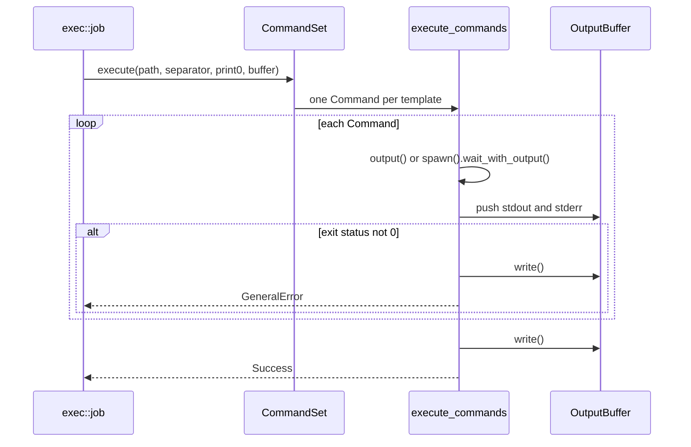

## Overview

Instead of printing results, fd can run programs on them. `-x`/`--exec` runs a command once per result, in parallel; `-X`/`--exec-batch` runs a command once with many results as arguments; `-l`/`--list-details` is a built-in `--exec-batch` that calls `ls`. All three produce a `CommandSet` stored in `Config::command`. When it is present, the receiver side of the pipeline hands the result channel to `exec::job` or `exec::batch` instead of the printer ([[Parallel Search Pipeline]]). Each command word is a template in the syntax described on [[Placeholder Templates]].

Sources: [src/exec/mod.rs:20-74](repo://src/exec/mod.rs#L20-L74), [src/walk.rs:406-433](repo://src/walk.rs#L406-L433)

## Building a CommandSet

### From the command line

The hand-written `Exec` argument parser collects every occurrence of `-x` (or else `-X`) as a list of words, ending at `;`, and calls `CommandSet::new` or `CommandSet::new_batch` ([[Command-Line Interface]]). Because each occurrence becomes its own `CommandTemplate`, `fd -x cmd1 \; -x cmd2` runs both commands for every result, in order.

Sources: [src/cli.rs:861-874](repo://src/cli.rs#L861-L874), [src/exec/mod.rs:35-70](repo://src/exec/mod.rs#L35-L70)

### Template rules

`CommandTemplate::new` parses each word into a `FormatTemplate` and enforces three rules:

Sources: [src/exec/mod.rs:210-256](repo://src/exec/mod.rs#L210-L256)

1. At least one word is required, otherwise "No executable provided for --exec or --exec-batch". clap cannot check this itself, and an empty command would try to execute each result.
2. In batch mode the first word must be fixed text, not a placeholder.
3. If no word contains a placeholder, a `{}` word is appended, so `fd -e zip -x unzip` runs `unzip <path>`.

Sources: [src/exec/mod.rs:210-256](repo://src/exec/mod.rs#L210-L256)

`CommandSet::new_batch` adds a fourth rule: at most one word may contain placeholders ("Only one placeholder allowed for batch commands"), because that word is the one repeated for each result.

Sources: [src/exec/mod.rs:51-70](repo://src/exec/mod.rs#L51-L70), [src/exec/mod.rs:258-260](repo://src/exec/mod.rs#L258-L260)

### --list-details

When neither `-x` nor `-X` is given but `-l` is, `extract_command` builds a batch `CommandSet` from `determine_ls_command`. The `ls` invocation depends on the platform:

Sources: [src/main.rs:395-494](repo://src/main.rs#L395-L494)

| Platform | Command |
| --- | --- |
| Unix other than macOS and the BSDs | `ls -l -h -d --color=always` or `--color=never` (GNU ls assumed) |
| macOS, FreeBSD, NetBSD, OpenBSD, DragonFly | `gls` with the GNU flags if `gls --version` runs; otherwise BSD `ls -l -h -d`, plus `-G` for colour except on NetBSD and OpenBSD |
| Windows | `ls` with the GNU flags if `ls --version` runs; otherwise an error |
| anything else | an error |

Sources: [src/main.rs:395-494](repo://src/main.rs#L395-L494)

Short options are used throughout so the command also works with BusyBox. `-d` makes `ls` list a directory itself rather than its contents. The colour flag follows fd's own colour decision, so `fd -l | less` gets plain output.

Sources: [src/main.rs:412-429](repo://src/main.rs#L412-L429)

## Per-result mode: --exec

### Job threads

For `--exec`, `WorkerState::receive` starts `config.threads` scoped threads, each running `exec::job` on its own clone of the channel receiver, so up to `threads` commands run at once. The sender side sends batches of one item in this mode so that work is spread across the job threads. When the walk ends, each job's `ExitCode` is collected and merged. `-j 1` runs commands one after another.

Sources: [src/walk.rs:415-432](repo://src/walk.rs#L415-L432), [src/walk.rs:449-456](repo://src/walk.rs#L449-L456)

`job` loops over the results it receives. Walk errors are printed only with `--show-errors`. For each entry it calls `CommandSet::execute` with the displayed path (`DirEntry::stripped_path`), the custom path separator and the `--print0` flag. A failing command makes the job's final code an error, but the job carries on with the remaining results.

Sources: [src/exec/job.rs:8-44](repo://src/exec/job.rs#L8-L44)

Commands receive paths with their `./` prefix by default, because `strip_cwd_prefix` in `auto` mode is false whenever a command is configured. A file named `-n` reaches the command as `./-n`, not as an option. [[Output Formatting]] describes the prefix rules.

Sources: [src/main.rs:390](repo://src/main.rs#L390), [src/dir_entry.rs:56-71](repo://src/dir_entry.rs#L56-L71)

### Running and output buffering

`execute` generates one `argmax::Command` per template and passes them to `execute_commands`, which runs them in order and stops at the first failure. Output handling depends on the thread count:

Sources: [src/exec/mod.rs:76-88](repo://src/exec/mod.rs#L76-L88), [src/exec/command.rs:59-99](repo://src/exec/command.rs#L59-L99), [src/exec/job.rs:16-17](repo://src/exec/job.rs#L16-L17)

- With more than one thread, each command runs with `cmd.output()`. Its stdout and stderr are captured in an `OutputBuffer`, and `OutputBuffer::write` writes them while holding both the stdout and stderr locks, so output from parallel commands is never interleaved.
- With one thread, the command is spawned with inherited streams, so its output appears live and interactive programs work.

Sources: [src/exec/mod.rs:76-88](repo://src/exec/mod.rs#L76-L88), [src/exec/command.rs:59-99](repo://src/exec/command.rs#L59-L99), [src/exec/job.rs:16-17](repo://src/exec/job.rs#L16-L17)

With `--print0`, `OutputBuffer::write` appends a `\0` after each result's output, even when nothing was captured, so the output of each result can be told apart downstream.

Sources: [src/exec/command.rs:13-57](repo://src/exec/command.rs#L13-L57)

Sources: [src/exec/command.rs:59-99](repo://src/exec/command.rs#L59-L99)

## Batch mode: --exec-batch

### One receiver, many arguments

For `--exec-batch` and `--list-details`, `receive` calls `exec::batch` directly on the receiver thread. `batch` turns every entry into its displayed path, printing walk errors only with `--show-errors`, and passes the lazy iterator to `CommandSet::execute_batch` together with `--batch-size`.

Sources: [src/walk.rs:412-414](repo://src/walk.rs#L412-L414), [src/exec/job.rs:46-64](repo://src/exec/job.rs#L46-L64)

### CommandBuilder

`execute_batch` creates a `CommandBuilder` per template. The builder splits the template's words into `pre_args` (before the placeholder word), `path_arg` (the placeholder word) and `post_args` (after it), and starts a command from the `pre_args`. All three standard streams are inherited, so `fd -X vim` opens an editor.

Sources: [src/exec/mod.rs:90-172](repo://src/exec/mod.rs#L90-L172)

For each path, `push` first runs the pending command if `--batch-size` is non-zero and that many paths have been added. It also runs it if the new argument plus `post_args` would not fit, according to `argmax`'s `args_would_fit`, which knows the operating system's command-line length limit. Then it appends the expanded `path_arg`. `finish` appends `post_args`, runs the command, records a non-zero status as `GeneralError`, and starts a fresh command. After the last path every builder is finished once more.

Sources: [src/exec/mod.rs:173-207](repo://src/exec/mod.rs#L173-L207), [src/exec/mod.rs:100-117](repo://src/exec/mod.rs#L100-L117)

A command runs only when it has at least one path, so a search with no results runs nothing. A large result set may run the command several times, so commands that must see every path in a single call need care. The order of the paths is not defined.

Sources: [src/exec/mod.rs:191-203](repo://src/exec/mod.rs#L191-L203), [src/cli.rs:932-934](repo://src/cli.rs#L932-L934)

## Errors and exit codes

`handle_cmd_error` reports a command that could not be started. An `io::ErrorKind::NotFound` error prints "Command not found: NAME"; anything else prints "Problem while executing command". Both return `GeneralError`. Shell aliases and functions are not visible to fd, so they produce "Command not found" too.

Sources: [src/exec/command.rs:101-115](repo://src/exec/command.rs#L101-L115)

In batch mode a start error stops the whole batch at once, while non-zero exit statuses are collected per builder and merged with `merge_exitcodes`. In per-result mode the job threads' codes are merged the same way, so fd exits with 1 if any command failed and 0 otherwise. [[Exit Codes and Errors]] lists the codes.

Sources: [src/exec/mod.rs:100-120](repo://src/exec/mod.rs#L100-L120), [src/walk.rs:430-431](repo://src/walk.rs#L430-L431), [src/exit_codes.rs:46-51](repo://src/exit_codes.rs#L46-L51)
