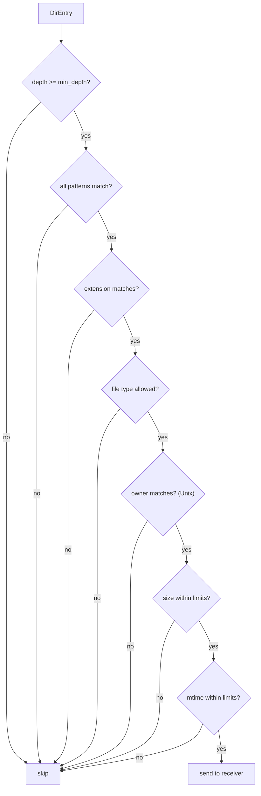

## Overview

Every entry the walker reports goes through a fixed chain of checks in the sender callback inside `WorkerState::spawn_senders`. An entry that fails any check is skipped with `WalkState::Continue`; the walker still descends into a skipped directory, so filters decide what is *shown*, never what is *visited*. Visiting is controlled by the rules on [[Ignore Rules and Traversal]]. An entry that passes every check is sent to the receiver described on [[Parallel Search Pipeline]].

Sources: [src/walk.rs:508-604](repo://src/walk.rs#L508-L604)

The checks are ordered from cheapest to most expensive. The minimum depth, the name patterns and the extension only need the path. The file type usually comes from the directory listing for free. Owner, size and modification time need a `stat` call, which `DirEntry` makes at most once and caches.

Sources: [src/walk.rs:514-591](repo://src/walk.rs#L514-L591), [src/dir_entry.rs:17-22](repo://src/dir_entry.rs#L17-L22), [src/dir_entry.rs:89-96](repo://src/dir_entry.rs#L89-L96)

## The chain



Sources: [src/walk.rs:508-604](repo://src/walk.rs#L508-L604)

| Check | Option | Applies to | Metadata needed |
| --- | --- | --- | --- |
| Minimum depth | `--min-depth`, `--exact-depth` | all entries; broken symlinks have no depth and are dropped | no |
| Patterns | positional pattern, `--and` | file name, or full path with `-p` | no |
| Extension | `-e` | file name | no |
| File type | `-t` | all entries | file type; `executable` and `empty` need more |
| Owner | `-o` (Unix only) | all entries | yes |
| Size | `-S` | regular files only | yes |
| Modification time | `--changed-within`, `--changed-before` | all entries | yes |

Sources: [src/walk.rs:508-591](repo://src/walk.rs#L508-L591)

## Name and extension

### Patterns

Every compiled pattern must match the search string, which is the file name or, with `--full-path`, the absolute path. With `--and`, this makes each additional pattern a further condition on the same name. How the patterns are compiled and what the search string is are explained on [[Search Patterns and Configuration]].

Sources: [src/walk.rs:514-524](repo://src/walk.rs#L514-L524)

### Extensions

With `-e`, the file name must match the case-insensitive `RegexSet` built from all given extensions; any one is enough. An entry without a file name is dropped. The extension check applies to directories too, so `fd -e d` can list a directory called `conf.d`; combine it with `-t f` to get files only.

Sources: [src/walk.rs:526-535](repo://src/walk.rs#L526-L535), [src/cli.rs:380-393](repo://src/cli.rs#L380-L393)

## File types

`-t` values are collected into a `FileTypes` set by `construct_config`. `FileTypes::should_ignore` then drops an entry when its type was not requested, when `executable` was requested and the path is not executable, when `empty` was requested and the entry is not empty, or when the type is none of the known kinds. An entry whose file type cannot be determined is always dropped.

Sources: [src/filetypes.rs:6-43](repo://src/filetypes.rs#L6-L43), [src/main.rs:333-360](repo://src/main.rs#L333-L360)

| Value | Matches |
| --- | --- |
| `f`, `file` | regular files |
| `d`, `dir`, `directory` | directories |
| `l`, `symlink` | symbolic links |
| `b`, `block-device` | block devices (never on Windows) |
| `c`, `char-device` | character devices (never on Windows) |
| `s`, `socket` | sockets (never on Windows) |
| `p`, `pipe` | named pipes (never on Windows) |
| `x`, `executable` | files executable by the current effective user; implies `file` |
| `e`, `empty` | empty files and directories; restricted by `file` or `directory` when given |

Sources: [src/cli.rs:802-823](repo://src/cli.rs#L802-L823), [src/filesystem.rs:62-100](repo://src/filesystem.rs#L62-L100)

`executable` uses the `faccess` crate's `PathExt::executable`, which asks the operating system whether the current user may execute the path, rather than only reading permission bits. Because `construct_config` also sets `files`, `-t x` returns only regular files; add `-t d` to include searchable directories.

Sources: [src/filetypes.rs:4](repo://src/filetypes.rs#L4), [src/filetypes.rs:30](repo://src/filetypes.rs#L30), [src/main.rs:341-344](repo://src/main.rs#L341-L344)

`filesystem::is_empty` treats a directory as empty when `read_dir` yields no entries, and a file as empty when its length is zero. A directory that cannot be read, and every other kind of entry, is not empty.

Sources: [src/filesystem.rs:44-60](repo://src/filesystem.rs#L44-L60)

## Owner

On Unix, `-o user:group` keeps entries owned by a given user, group or both. Either side may be a name or a numeric id, may be omitted, and may be prefixed with `!` to exclude instead. `OwnerFilter::from_string` splits on `:` (more than one `:` is an error), parses each side with `Check::parse` into `Equal`, `NotEq` or `Ignore`, and resolves names with `User::from_name` and `Group::from_name`, failing for unknown names.

Sources: [src/filter/owner.rs:5-58](repo://src/filter/owner.rs#L5-L58), [src/filter/owner.rs:76-103](repo://src/filter/owner.rs#L76-L103)

A value that ignores both sides, such as `""` or `":"`, is turned into no filter by `filter_ignore`. Otherwise `matches` compares the entry's `uid` and `gid` from its metadata; an entry whose metadata cannot be read is dropped.

Sources: [src/filter/owner.rs:60-74](repo://src/filter/owner.rs#L60-L74), [src/walk.rs:544-555](repo://src/walk.rs#L544-L555)

```bash
fd -o john              # owned by user john
fd -o :students         # group students
fd -o '!john:students'  # group students, but not owned by john
```

Sources: [src/cli.rs:460-473](repo://src/cli.rs#L460-L473)

## Size

`-S` takes `<+|-><number><unit>`. `+` means at least, `-` at most, and no sign means exactly. Values are matched by the case-insensitive regex `^([+-]?)(\d+)(b|[kmgt]i?b?)$`, so a unit is required. `k`, `m`, `g`, `t` are powers of 1000; `ki`, `mi`, `gi`, `ti` are powers of 1024; a trailing `b` is optional, so `1kb`, `1K` and `1k` are the same.

Sources: [src/filter/size.rs:8-66](repo://src/filter/size.rs#L8-L66)

The option can be repeated, and every constraint must hold, so `-S +1M -S -10M` selects files between 1 MB and 10 MB inclusive. Size filtering applies only to entries for which `Path::is_file` is true; when any size constraint is present, directories and other entries are dropped.

Sources: [src/filter/size.rs:68-74](repo://src/filter/size.rs#L68-L74), [src/walk.rs:557-575](repo://src/walk.rs#L557-L575)

## Modification time

`--changed-within` (aliases `--changed-after`, `--newer`, `--change-newer-than`) keeps entries modified after a point in time; `--changed-before` (aliases `--older`, `--change-older-than`) keeps entries modified before it. Both may be given; every constraint must hold, and an entry whose modification time cannot be read is dropped.

Sources: [src/cli.rs:419-458](repo://src/cli.rs#L419-L458), [src/walk.rs:577-591](repo://src/walk.rs#L577-L591)

`TimeFilter::from_str` tries these forms in order, using the `jiff` crate:

Sources: [src/filter/time.rs:28-47](repo://src/filter/time.rs#L28-L47)

| Form | Example | Meaning |
| --- | --- | --- |
| Duration (`Span`) | `10h`, `1d`, `2weeks`, `35min` | that long before now |
| RFC 3339 timestamp | `2018-10-27T10:00:00+02:00` | that exact instant |
| Civil date or date-time | `2018-10-27`, `2018-10-27 10:00:00` | in the system time zone; a missing time is midnight |
| Unix seconds | `@1707723412` | seconds since the epoch; the `@` is required |

Sources: [src/filter/time.rs:28-47](repo://src/filter/time.rs#L28-L47)

`applies_to` uses strict comparisons: `Before(limit)` keeps times earlier than the limit, `After(limit)` keeps later ones. For an ambiguous local time, such as during a daylight-saving change, the later instant is used. A value matching none of the forms makes `extract_time_constraints` fail before the search starts.

Sources: [src/filter/time.rs:57-62](repo://src/filter/time.rs#L57-L62), [src/filter/time.rs:35-42](repo://src/filter/time.rs#L35-L42), [src/main.rs:496-519](repo://src/main.rs#L496-L519)

## Cached metadata

`DirEntry` wraps either an `ignore::DirEntry` or the path of a broken symlink. Its `metadata` field is a `OnceCell<Option<Metadata>>`: the first filter that needs metadata triggers the `stat` call (or `symlink_metadata` for a broken symlink), and later filters and the colour lookup reuse the result. A failed `stat` is cached as `None`, which every metadata-based filter treats as a mismatch.

Sources: [src/dir_entry.rs:11-41](repo://src/dir_entry.rs#L11-L41), [src/dir_entry.rs:82-96](repo://src/dir_entry.rs#L82-L96)

The file type of a normal entry comes from the `ignore` crate, which usually knows it from the directory listing without a `stat`; only broken symlinks derive it from metadata. This is why the type check can run before the owner, size and time checks at almost no cost.

Sources: [src/dir_entry.rs:82-87](repo://src/dir_entry.rs#L82-L87)
