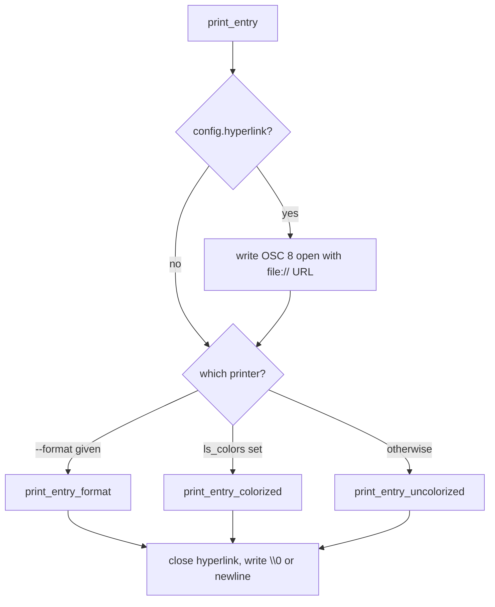

## Overview

When fd is not running a command, the receiver writes each result with `output::print_entry` into a locked, buffered stdout. That function decides how a path looks: relative or with its `./` prefix, coloured by `LS_COLORS` or plain, rewritten through a `--format` template, wrapped in a terminal hyperlink, ended by a newline or a NUL byte. It also guards the terminal against file names that contain escape sequences. When the receiver calls it and how write errors end the search is covered on [[Parallel Search Pipeline]]; the colour and hyperlink decisions are made earlier in `construct_config` ([[Search Patterns and Configuration]]).

Sources: [src/output.rs:16-43](repo://src/output.rs#L16-L43), [src/walk.rs:434-439](repo://src/walk.rs#L434-L439)

## print_entry

`print_entry` writes one result in three steps. It opens a hyperlink if enabled, writes the path with exactly one of three printers, then closes the hyperlink and writes the terminator: `\0` with `--print0`, otherwise a newline.

Sources: [src/output.rs:16-43](repo://src/output.rs#L16-L43)

Sources: [src/output.rs:16-43](repo://src/output.rs#L16-L43)

## The displayed path

### Stripping ./

Every printer starts from `DirEntry::stripped_path`. When `Config::strip_cwd_prefix` is true, it removes a leading `./` with `filesystem::strip_current_dir`. If the stripped path would then begin with `-`, the original path is kept, so a file named `-rf` prints as `./-rf` and cannot be mistaken for an option by the next program in a pipe.

Sources: [src/dir_entry.rs:56-80](repo://src/dir_entry.rs#L56-L80), [src/dir_entry.rs:112-114](repo://src/dir_entry.rs#L112-L114), [src/filesystem.rs:118-121](repo://src/filesystem.rs#L118-L121)

`strip_cwd_prefix` is only ever true when no search path was given. In `auto` mode it is also false with `--print0` or a command, so those outputs keep `./`. With `--absolute-path` the roots themselves are made absolute in `Opts::normalize_path`, so the results are absolute and there is no prefix to strip. [[Command-Line Interface]] shows how both are resolved.

Sources: [src/cli.rs:765-773](repo://src/cli.rs#L765-L773), [src/cli.rs:723-736](repo://src/cli.rs#L723-L736), [src/main.rs:390](repo://src/main.rs#L390)

### Trailing separator for directories

The coloured and plain printers append the path separator after a directory, so a directory prints as `src/`. `print_trailing_slash` writes `Config::actual_path_separator`, which is `--path-separator` or the platform separator. In colour mode it is painted with the directory style. `--format` output does not get a trailing separator.

Sources: [src/output.rs:45-66](repo://src/output.rs#L45-L66)

### Custom separators

With `--path-separator`, the coloured and plain printers rewrite every platform separator in the path using `replace_path_separator`, a plain string replacement of `MAIN_SEPARATOR`. The template printer instead passes the separator to `FormatTemplate::generate`, which rebuilds paths component by component ([[Placeholder Templates]]).

Sources: [src/output.rs:12-14](repo://src/output.rs#L12-L14), [src/output.rs:142-156](repo://src/output.rs#L142-L156)

## The three printers

### Template output

`print_entry_format` expands the `--format` template with the stripped path and the custom separator, converts the result to a string lossily, and writes it after sanitising. `--format` conflicts with `--list-details`.

Sources: [src/output.rs:68-86](repo://src/output.rs#L68-L86), [src/cli.rs:475-487](repo://src/cli.rs#L475-L487)

### Coloured output

`print_entry_colorized` splits the path into a parent part and a final name. It measures the parent's length and extends it past any separators that follow, so the parent part keeps its trailing `/`. The parent part, after any separator replacement, is painted with the `LS_COLORS` directory indicator style; the final name is painted with the entry's own style.

Sources: [src/output.rs:88-139](repo://src/output.rs#L88-L139)

The entry's style was already computed on a sender thread by `DirEntry::style`, so the receiver only reads it from the `OnceCell`. `DirEntry` implements `lscolors::Colorable`, giving `LsColors` its name, file type and cached metadata; for broken symlinks the name is taken from the last path component.

Sources: [src/dir_entry.rs:105-109](repo://src/dir_entry.rs#L105-L109), [src/dir_entry.rs:139-167](repo://src/dir_entry.rs#L139-L167)

### Plain output

On Unix, `print_entry_uncolorized` takes a fast path when stdout is not a terminal and no separator is configured: it writes the path's raw bytes with `as_bytes()`. A file name that is not valid UTF-8 therefore reaches `xargs` or another program unchanged. Otherwise, and always on other platforms, `print_entry_uncolorized_base` converts the path lossily, replaces separators and sanitises the text.

Sources: [src/output.rs:141-182](repo://src/output.rs#L141-L182)

## Terminal sanitising

A file name may contain bytes that a terminal interprets: ANSI escapes, OSC 52 clipboard writes, OSC 8 links, carriage returns that overwrite a line, or bidi overrides that reverse how text is displayed. `sanitize.rs` defines `needs_escape`, which is true for every control character except tab, and for the soft hyphen, zero-width characters, bidi embedding and override marks, invisible formatting characters, the BOM, interlinear annotation marks and Unicode tag characters.

Sources: [src/sanitize.rs:1-24](repo://src/sanitize.rs#L1-L24)

`sanitize_for_terminal` returns the input borrowed when nothing needs escaping. Otherwise it writes each offending character as `\xNN` (code points up to 0xFF) or `\u{NNNN}`, so the output stays readable and keeps enough information to identify the file. `maybe_sanitize` applies this only when `is_terminal` is true; pipes and files receive the original text.

Sources: [src/sanitize.rs:26-55](repo://src/sanitize.rs#L26-L55)

The printers pass `Config::interactive_terminal` (whether stdout is a terminal) to `maybe_sanitize`. Error messages go through the same function in `print_error`, checked against stderr ([[Exit Codes and Errors]]).

Sources: [src/output.rs:84](repo://src/output.rs#L84), [src/output.rs:120-129](repo://src/output.rs#L120-L129), [src/error.rs:1-9](repo://src/error.rs#L1-L9)

## Hyperlinks

With `--hyperlink` (`auto` follows the colour decision), each result is wrapped in an OSC 8 escape, `ESC ] 8 ; ; URL ESC \` before and `ESC ] 8 ; ; ESC \` after, so supporting terminals make the path clickable. `PathUrl::new` makes the path absolute with `filesystem::absolute_path`; if that fails the entry is printed without a link.

Sources: [src/output.rs:18-36](repo://src/output.rs#L18-L36), [src/hyperlink.rs:5-11](repo://src/hyperlink.rs#L5-L11)

The URL is `file://` followed by the host and the percent-encoded path. On Unix the host is the machine's hostname, looked up once with `gethostname` and cached in a `OnceLock`; elsewhere it is `/`, giving `file:///C:/...`. `encode` keeps ASCII letters, digits and `/ : - . _ ~` as they are, turns a Windows `\` into `/`, and percent-encodes every other byte, including all non-ASCII bytes, because they may not be valid UTF-8.

Sources: [src/hyperlink.rs:13-62](repo://src/hyperlink.rs#L13-L62)

`--hyperlink` has no effect on `--exec` and `--exec-batch`, because those modes never call `print_entry`.

Sources: [src/cli.rs:532-548](repo://src/cli.rs#L532-L548), [src/walk.rs:411-433](repo://src/walk.rs#L411-L433)
