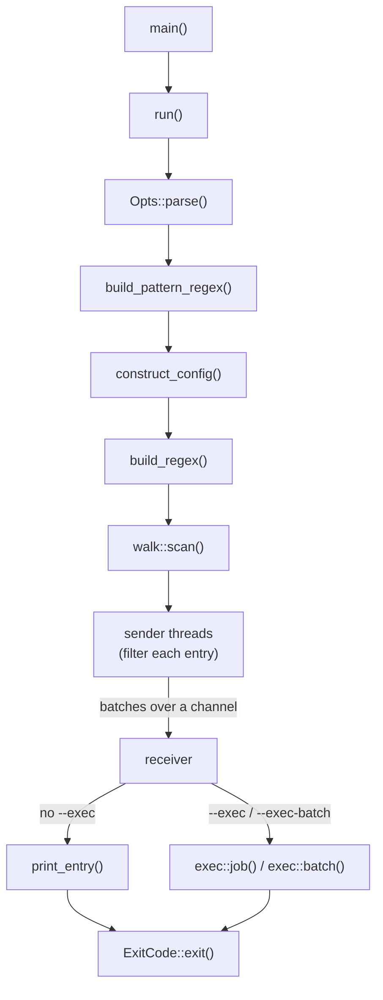

## Overview

`fd` is a command-line program that finds entries in a filesystem. It is a faster, friendlier alternative to `find`: `fd PATTERN` searches the current directory recursively for names that match a regular expression, skips hidden files and anything listed in `.gitignore`, and colours its output like `ls`. The crate is published as `fd-find` and builds a single binary named `fd`.

Sources: [Cargo.toml:1-33](repo://Cargo.toml#L1-L33), [README.md:8-28](repo://README.md#L8-L28)

The whole program is one Rust binary crate with no library target. `src/main.rs` declares every module, parses the command line, builds one immutable `Config` value and hands it, together with the compiled patterns, to `walk::scan`. Everything after that point runs on worker threads that share the `Config` by reference.

Sources: [src/main.rs:1-15](repo://src/main.rs#L1-L15), [src/main.rs:75-112](repo://src/main.rs#L75-L112)

## Parts of fd

| Area | What it does | Page |
| --- | --- | --- |
| Command line | Declares every option with clap, resolves overriding flags, picks the search paths | [[Command-Line Interface]] |
| Patterns and config | Turns patterns into regexes, applies smart case, builds the `Config` struct | [[Search Patterns and Configuration]] |
| Traversal | Configures the `ignore` crate's parallel walker: hidden files, ignore files, excludes, depth | [[Ignore Rules and Traversal]] |
| Search pipeline | Runs sender threads and one receiver, buffers then streams results, stops early | [[Parallel Search Pipeline]] |
| Entry filters | Checks each entry against pattern, extension, type, owner, size and time | [[Entry Filters]] |
| Output | Prints a result with colours, hyperlinks, separators and terminal sanitising | [[Output Formatting]] |
| Templates | Parses `{}`, `{/}`, `{//}`, `{.}`, `{/.}` for `--format` and `--exec` | [[Placeholder Templates]] |
| Command execution | Runs `--exec` per result or `--exec-batch` once for many results | [[Command Execution]] |
| Exit codes | Maps outcomes to process exit codes and prints `[fd error]` messages | [[Exit Codes and Errors]] |
| Tests | Integration tests that run the built binary in a temporary directory tree | [[Testing]] |
| Build and release | Cargo features, CI, packaging and the release checklist | [[Building and Releasing]] |

Sources: [src/main.rs:1-15](repo://src/main.rs#L1-L15), [src/walk.rs:616-687](repo://src/walk.rs#L616-L687)

## How a search runs

Sources: [src/main.rs:62-112](repo://src/main.rs#L62-L112), [src/walk.rs:406-440](repo://src/walk.rs#L406-L440)

1. `main` calls `run` and turns its `Result<ExitCode>` into a process exit; any error is printed and becomes exit code 1 ([[Exit Codes and Errors]]).
2. `Opts::parse` reads the arguments into the clap-derived `Opts` struct, then `run` changes directory for `--base-directory` and resolves the search paths ([[Command-Line Interface]]).
3. `build_pattern_regex` turns the main pattern and every `--and` pattern into regex source text, translating globs and escaping literal strings ([[Search Patterns and Configuration]]).
4. `construct_config` consumes `Opts` and produces `Config`, deciding case sensitivity, colours, filters and the command to run; `build_regex` then compiles each pattern with the chosen case mode (same page).
5. `walk::scan` builds the walker from `Config` ([[Ignore Rules and Traversal]]) and starts the sender threads and the receiver ([[Parallel Search Pipeline]]).
6. Each sender thread checks every entry it visits against the patterns and filters ([[Entry Filters]]) and sends matches in batches.
7. The receiver either prints each result ([[Output Formatting]], with [[Placeholder Templates]] for `--format`) or runs commands on them ([[Command Execution]]).

Sources: [src/main.rs:62-112](repo://src/main.rs#L62-L112), [src/main.rs:218-232](repo://src/main.rs#L218-L232), [src/walk.rs:508-604](repo://src/walk.rs#L508-L604)

## Design decisions

### Parallel traversal through the ignore crate

fd does not walk directories itself. It delegates traversal and all gitignore semantics to the `ignore` crate's `WalkParallel`, the same walker ripgrep uses, and only supplies a per-entry callback. This gives fd parallel directory reading and correct `.gitignore` handling without its own implementation of either. The thread count defaults to the available parallelism, capped at 64 to limit start-up cost on very large machines.

Sources: [src/walk.rs:347-404](repo://src/walk.rs#L347-L404), [src/cli.rs:788-800](repo://src/cli.rs#L788-L800)

### Buffer first, then stream

Parallel workers find results in an unpredictable order. To give a stable, sorted listing when a search is quick, the receiver holds results for up to 100 ms (or 1000 entries) and sorts them if the search ends in that window; after that it switches to streaming so long searches still show results immediately. [[Parallel Search Pipeline]] describes the two modes.

Sources: [src/walk.rs:124-127](repo://src/walk.rs#L124-L127), [src/walk.rs:269-293](repo://src/walk.rs#L269-L293)

### Byte regexes on raw file names

Patterns compile to `regex::bytes::Regex`, and file names are matched as raw bytes through `filesystem::osstr_to_bytes`. On Unix a name that is not valid UTF-8 can still match and be printed unchanged; only Windows converts lossily. Patterns are built with `dot_matches_new_line(true)` so `.` also matches a newline inside a file name.

Sources: [src/main.rs:541-555](repo://src/main.rs#L541-L555), [src/filesystem.rs:102-116](repo://src/filesystem.rs#L102-L116)

### Smart case

A search is case-insensitive unless `--case-sensitive` is given or a pattern contains a literal uppercase character. The check parses each pattern with `regex-syntax` so that escapes such as `\A` or `\x6F` do not count as uppercase text.

Sources: [src/main.rs:248-255](repo://src/main.rs#L248-L255), [src/regex_helper.rs:4-37](repo://src/regex_helper.rs#L4-L37)

### Sanitise only for terminals

File names can contain escape sequences that a terminal would execute. fd escapes control, bidi and zero-width characters only when writing to a terminal, so pipes and files still receive the exact bytes other tools need. [[Output Formatting]] covers the rules.

Sources: [src/sanitize.rs:48-55](repo://src/sanitize.rs#L48-L55), [src/output.rs:167-182](repo://src/output.rs#L167-L182)

### jemalloc on supported platforms

With the `use-jemalloc` feature, fd replaces the system allocator with jemalloc for speed. It is disabled on macOS, Windows, Android, the BSDs, illumos, 32-bit musl and riscv64, and the same `cfg` list must be kept in sync between `Cargo.toml` and `src/main.rs`. [[Building and Releasing]] lists the features.

Sources: [src/main.rs:39-54](repo://src/main.rs#L39-L54), [Cargo.toml:66-73](repo://Cargo.toml#L66-L73)
