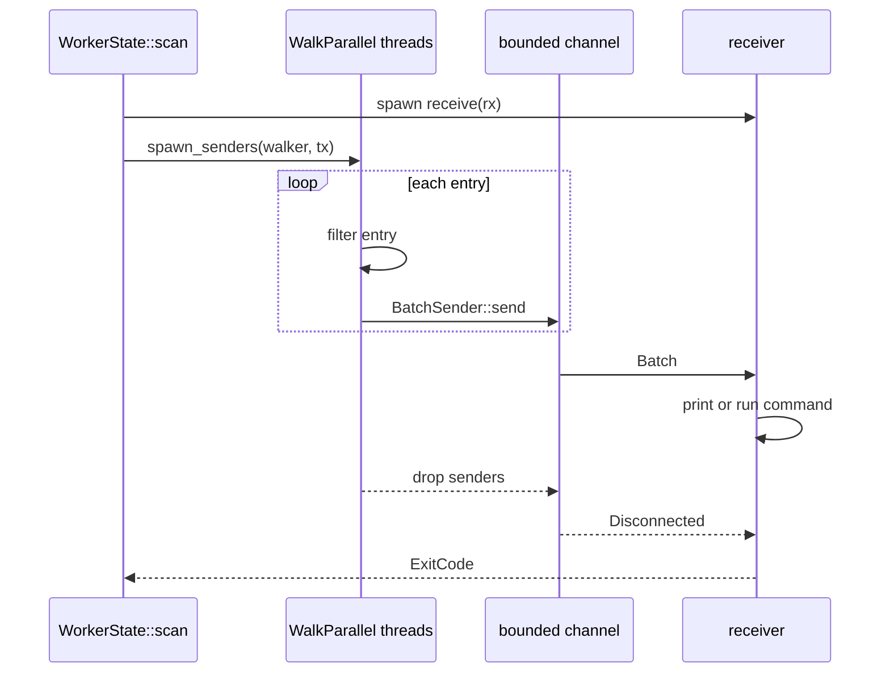
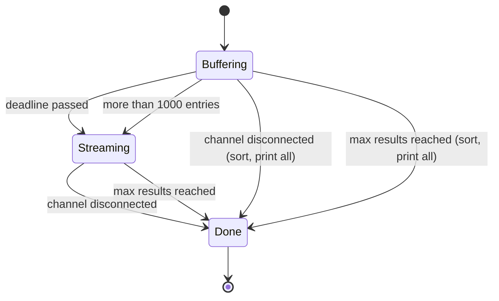

## Overview

`walk::scan` is where the search actually runs. It wraps the compiled patterns and the `Config` in a `WorkerState`, builds the parallel walker, and connects two sides with a bounded channel: the walker's sender threads, which visit entries and filter them, and a receiver, which prints results or feeds them to commands. The receiver also decides whether output can be sorted, stops the search early for `--max-results` and `--quiet`, and reacts to Ctrl-C. Which entries the walker visits is described on [[Ignore Rules and Traversal]]; the checks each entry goes through are on [[Entry Filters]].

Sources: [src/walk.rs:305-328](repo://src/walk.rs#L305-L328), [src/walk.rs:680-687](repo://src/walk.rs#L680-L687)

## Threads and channel

`WorkerState::scan` builds the walker, creates a `crossbeam_channel::bounded` channel holding `2 * threads` batches, and opens a `thread::scope`. Inside it, one scoped thread runs `receive`, while the calling thread runs `spawn_senders`, which blocks inside `WalkParallel::run` until the walk is finished. When all senders have been dropped the channel disconnects, the receiver finishes, and its `ExitCode` becomes the result of the scope.

Sources: [src/walk.rs:616-653](repo://src/walk.rs#L616-L653)

Sources: [src/walk.rs:616-653](repo://src/walk.rs#L616-L653), [src/walk.rs:443-463](repo://src/walk.rs#L443-L463), [src/walk.rs:600-613](repo://src/walk.rs#L600-L613)

The bounded channel is the pipeline's backpressure: when the receiver is slow (a slow terminal or slow commands), senders block on `send` instead of piling up results in memory.

Sources: [src/walk.rs:636](repo://src/walk.rs#L636)

## Sending results in batches

### WorkerResult

Each message item is a `WorkerResult`: either `Entry(DirEntry)` for a match, or `Error(ignore::Error)` for a walk error such as a permission problem. Errors travel through the same channel so the receiver can print them in order with the results when `--show-errors` is set.

Sources: [src/walk.rs:37-45](repo://src/walk.rs#L37-L45)

### Batch and BatchSender

Sending every entry separately would make the channel a bottleneck, so each sender thread owns a `BatchSender`. A `Batch` is a shared `Arc<Mutex<Option<Vec<WorkerResult>>>>`. When the first item is pushed into a fresh batch, `BatchSender::send` puts a clone of that batch on the channel straight away, then keeps pushing later items into the same vector. The receiver takes the vector out of the `Option` when it iterates the batch. Once that has happened, or once the vector reaches the sender's `limit`, `needs_flush` reports true and the sender starts a new batch.

Sources: [src/walk.rs:47-122](repo://src/walk.rs#L47-L122)

This gives low latency (a batch is visible to the receiver as soon as it holds one item) together with cheap bulk transfer while the receiver is busy. The limit is `0x100` items by default. For `--exec` with more than one thread it is 1, so results are spread evenly across the job threads instead of one thread receiving 256 at a time.

Sources: [src/walk.rs:449-457](repo://src/walk.rs#L449-L457)

### The per-entry callback

`spawn_senders` gives `WalkParallel::run` a closure that builds one callback per walker thread. Each callback first checks `quit_flag` and returns `WalkState::Quit` once the receiver has asked to stop. It then handles `--ignore-contain` and the root entry ([[Ignore Rules and Traversal]]), wraps the entry as a `DirEntry`, runs the filters ([[Entry Filters]]), computes the `LS_COLORS` style when printing in colour, and sends the entry. A failed send means the receiver is gone, so the callback returns `Quit`.

Sources: [src/walk.rs:443-463](repo://src/walk.rs#L443-L463), [src/walk.rs:593-604](repo://src/walk.rs#L593-L604)

Computing the colour style here, through `DirEntry::style`, moves the `LS_COLORS` lookup onto the parallel threads; the style is cached in a `OnceCell` so the single receiver thread only writes bytes.

Sources: [src/walk.rs:593-598](repo://src/walk.rs#L593-L598), [src/dir_entry.rs:105-109](repo://src/dir_entry.rs#L105-L109)

### Broken symlinks

When the walker reports a `NotFound` I/O error for a path that is itself a symlink, which happens when following links (`-L`) and the target is missing, the callback turns it into `DirEntry::broken_symlink(path)` instead of an error. The entry then goes through the filters like any other, reading its metadata with `symlink_metadata`. Every other error is sent as `WorkerResult::Error`.

Sources: [src/walk.rs:485-506](repo://src/walk.rs#L485-L506), [src/dir_entry.rs:11-41](repo://src/dir_entry.rs#L11-L41), [src/dir_entry.rs:89-96](repo://src/dir_entry.rs#L89-L96)

## The receiver

`WorkerState::receive` picks one of three consumers based on `config.command`:

Sources: [src/walk.rs:406-440](repo://src/walk.rs#L406-L440)

| Mode | Consumer |
| --- | --- |
| No command | `ReceiverBuffer::process` on a locked, buffered stdout |
| `--exec-batch` or `--list-details` | `exec::batch` on the flattened channel, on the receiver thread |
| `--exec` | `threads` scoped threads each running `exec::job` on a clone of the receiver; their exit codes are merged |

Sources: [src/walk.rs:406-440](repo://src/walk.rs#L406-L440)

The two command modes are covered on [[Command Execution]]. The rest of this page follows `ReceiverBuffer`.

Sources: [src/walk.rs:129-149](repo://src/walk.rs#L129-L149)

## Buffering, then streaming

### Two modes

Results from parallel threads arrive in no particular order. Most searches finish in a few milliseconds, and for those fd prints a sorted list. `ReceiverBuffer` starts in `ReceiverMode::Buffering` with a deadline of `--max-buffer-time` (hidden option, default 100 ms) from start. While buffering, it waits with `recv_deadline` and pushes each entry into a vector.

Sources: [src/walk.rs:26-35](repo://src/walk.rs#L26-L35), [src/walk.rs:124-171](repo://src/walk.rs#L124-L171), [src/walk.rs:183-195](repo://src/walk.rs#L183-L195)

Sources: [src/walk.rs:198-249](repo://src/walk.rs#L198-L249), [src/walk.rs:281-293](repo://src/walk.rs#L281-L293)

### Switching to streaming

If the deadline passes (`RecvTimeoutError::Timeout`) or the buffer grows past `MAX_BUFFER_LENGTH` (1000), `stream` switches the mode to `Streaming`, prints the buffered entries unsorted in arrival order, and flushes. From then on each entry is printed as it arrives, with `recv` waiting without a deadline. To keep output responsive without flushing after every line, the receiver flushes stdout only when the channel is empty after handling a batch.

Sources: [src/walk.rs:208-218](repo://src/walk.rs#L208-L218), [src/walk.rs:235-242](repo://src/walk.rs#L235-L242), [src/walk.rs:269-279](repo://src/walk.rs#L269-L279)

### Finishing

When the channel disconnects, `stop` sorts the buffer if still in buffering mode (`DirEntry` orders by path), streams it, and returns `Success`, or `HasResults` in quiet mode. `process` loops on `poll` until it returns an `Err(ExitCode)` (the receiver uses `Err` for every way of ending) and then sets `quit_flag` so the senders stop.

Sources: [src/walk.rs:173-181](repo://src/walk.rs#L173-L181), [src/walk.rs:281-293](repo://src/walk.rs#L281-L293), [src/dir_entry.rs:116-137](repo://src/dir_entry.rs#L116-L137)

## Stopping early

### --max-results and -1

After each entry the receiver increments `num_results`; when it reaches `max_results` it calls `stop`, so a buffered set is still sorted before printing. Setting `quit_flag` makes every sender callback return `WalkState::Quit` on its next entry, which ends the walk quickly. These options conflict with the command options, since commands consume results in other threads.

Sources: [src/walk.rs:220-225](repo://src/walk.rs#L220-L225), [src/walk.rs:460-462](repo://src/walk.rs#L460-L462)

### --quiet

With `-q`, the first entry received ends the search with `ExitCode::HasResults(true)` and nothing is printed. If the walk finishes without results, `stop` returns `HasResults(false)`. [[Exit Codes and Errors]] maps these to 0 and 1.

Sources: [src/walk.rs:204-206](repo://src/walk.rs#L204-L206), [src/walk.rs:288-292](repo://src/walk.rs#L288-L292)

### Write errors

`print` passes each entry to `output::print_entry` ([[Output Formatting]]). A write error other than a broken pipe is reported as "Could not write to output" and ends the search with `GeneralError`. A broken pipe (for example `fd | head`) is not reported, and the next failed flush ends the search quietly with `GeneralError`.

Sources: [src/walk.rs:251-267](repo://src/walk.rs#L251-L267), [src/walk.rs:295-302](repo://src/walk.rs#L295-L302)

## Ctrl-C handling

When results are printed in colour, `scan` installs a `ctrlc` handler, since an interrupted write could leave the terminal in the middle of a colour escape. The first Ctrl-C sets both `quit_flag` and `interrupt_flag`; the receiver notices `interrupt_flag` after the entry it is printing, flushes, and returns `KilledBySigint`, and the senders quit. A second Ctrl-C finds `interrupt_flag` already set and exits the process immediately. After the scope ends, `scan` returns `KilledBySigint` whenever the flag is set, whatever the receiver returned.

Sources: [src/walk.rs:621-634](repo://src/walk.rs#L621-L634), [src/walk.rs:260-264](repo://src/walk.rs#L260-L264), [src/walk.rs:648-652](repo://src/walk.rs#L648-L652)
