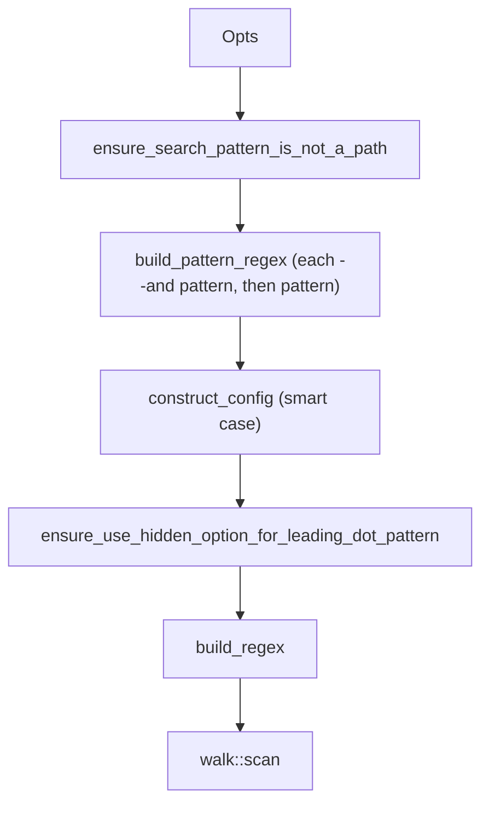

## Overview

Between parsing the arguments and starting the walk, `run` in `src/main.rs` does two jobs: it turns the user's patterns into compiled regular expressions, and it converts the parsed `Opts` into a `Config` value. `Config` is the only state the walker, filters, printer and command runner read, so every decision that depends on several options, the environment or the terminal is made once here. This page follows that sequence; [[Command-Line Interface]] covers how `Opts` is parsed, and the walker's use of `Config` starts on [[Ignore Rules and Traversal]].

Sources: [src/main.rs:75-112](repo://src/main.rs#L75-L112), [src/config.rs:13-72](repo://src/config.rs#L13-L72), [src/config.rs:73-136](repo://src/config.rs#L73-L136)

## From pattern to regex

### Pattern order in run

`run` checks the patterns for path separators, translates each one to regex source text with `build_pattern_regex`, builds the `Config` (which needs that text for smart case), checks for a hidden-only pattern, and finally compiles every pattern with `build_regex`. The `--and` patterns come first in the list and the positional pattern last; an entry must match all of them.

Sources: [src/main.rs:89-111](repo://src/main.rs#L89-L111)

Sources: [src/main.rs:89-111](repo://src/main.rs#L89-L111)

### Pattern modes

`build_pattern_regex` returns regex source text for one pattern. Exactly one branch applies, in this order:

Sources: [src/main.rs:218-232](repo://src/main.rs#L218-L232)

| Option | Translation |
| --- | --- |
| `--glob` (non-empty pattern) | `GlobBuilder` with `literal_separator(true)`, so `*` does not cross `/`; the glob's regex is used |
| `--exact` | `^` + `regex::escape(pattern)` + `$`: the whole name, literally |
| `--fixed-strings` | `regex::escape(pattern)`: a literal substring |
| none | the pattern unchanged, as a regular expression |

Sources: [src/main.rs:218-232](repo://src/main.rs#L218-L232)

An empty pattern with `--glob` falls through to the regex branch, so `fd -g` with no pattern still matches everything.

Sources: [src/main.rs:219-220](repo://src/main.rs#L219-L220)

### Compiling

`build_regex` compiles the text into a `regex::bytes::Regex` with `case_insensitive(!config.case_sensitive)` and `dot_matches_new_line(true)`. Byte regexes let fd match file names that are not valid UTF-8. When compilation fails, the error message adds a note suggesting `--fixed-strings`, `--exact` or `--glob`, since the usual cause is a literal name containing regex metacharacters.

Sources: [src/main.rs:541-555](repo://src/main.rs#L541-L555)

## What a pattern is matched against

By default a pattern sees only the entry's file name. With `--full-path`, `construct_config` stores the current directory in `Config::full_path_base`, and the walker's `search_str_for_entry` joins it with the entry's relative path (after stripping a leading `./`) to give an absolute path. Absolute entry paths are used as they are.

Sources: [src/main.rs:301-308](repo://src/main.rs#L301-L308), [src/walk.rs:656-678](repo://src/walk.rs#L656-L678)

The string is turned into bytes by `filesystem::osstr_to_bytes`: on Unix the raw `OsStr` bytes are borrowed, on Windows the name is converted lossily to UTF-8. Extensions are matched against the file name only, regardless of `--full-path`; see [[Entry Filters]].

Sources: [src/filesystem.rs:102-116](repo://src/filesystem.rs#L102-L116), [src/walk.rs:514-535](repo://src/walk.rs#L514-L535)

## Early diagnostics

### Patterns that look like paths

Without `--full-path`, a pattern containing a path separator can never match a file name. `ensure_search_pattern_is_not_a_path` checks the main pattern and every `--and` pattern and fails with a message suggesting `fd . 'dir'` or `fd --full-path 'dir'`. Any `/` triggers the error. On Windows a `\` triggers it only if the pattern also names an existing directory, because `\` is the regex escape character and patterns like `\d+` must still work.

Sources: [src/main.rs:150-216](repo://src/main.rs#L150-L216)

### Patterns that only match hidden files

On Unix, when hidden files are being skipped and a pattern begins with `^\.`, fd stops with a message suggesting `-H`, because such a search could only ever print nothing. `pattern_matches_strings_with_leading_dot` parses the regex with `regex-syntax` and only recognises the simple shape of a start anchor followed by a literal beginning with `.`; alternations such as `^(\.foo|\.bar)` are not detected.

Sources: [src/main.rs:521-539](repo://src/main.rs#L521-L539), [src/regex_helper.rs:39-79](repo://src/regex_helper.rs#L39-L79)

## Smart case

The search is case-sensitive when `-i` is absent and either `-s` is given or any pattern's regex text contains an uppercase literal. Because smart case looks at the translated regex text, a glob such as `*.TXT` counts as uppercase too.

Sources: [src/main.rs:249-255](repo://src/main.rs#L249-L255)

`pattern_has_uppercase_char` parses the pattern into a `regex-syntax` `Hir` with UTF-8 mode off and walks it: literals and character class bounds count, capture groups, repetitions, concatenations and alternations are searched recursively, and everything else (anchors, escapes like `\A`) does not count. A pattern that fails to parse counts as lowercase, and the real compile error is reported later by `build_regex`.

Sources: [src/regex_helper.rs:4-37](repo://src/regex_helper.rs#L4-L37)

## Building Config

### Colours and terminal detection

`construct_config` first decides whether the output is a terminal (`stdout().is_terminal()`), then resolves `--color`: `always` and `never` are taken literally, and `auto` enables colour only when ANSI is supported, `NO_COLOR` is unset or empty, and stdout is a terminal. On Windows, ANSI support means `enable_ansi_support()` succeeded or `TERM` is set. With colour on, styles come from `LS_COLORS`, or from the built-in `DEFAULT_LS_COLORS` (a vivid "molokai" theme) when the variable is absent. `--hyperlink=auto` follows the colour decision.

Sources: [src/main.rs:271-297](repo://src/main.rs#L271-L297), [src/main.rs:56-60](repo://src/main.rs#L56-L60)

### Ignore flags

The ignore-related booleans in `Config` combine several options each: `-u` disables hidden filtering and all ignore files; `-I` disables `.fdignore`, VCS and global ignore files; `--no-ignore-vcs` disables only VCS files. [[Ignore Rules and Traversal]] shows how the walker uses each flag.

Sources: [src/main.rs:310-320](repo://src/main.rs#L310-L320)

| Config field | Becomes false when |
| --- | --- |
| `ignore_hidden` | `--hidden` or `-u` |
| `read_fdignore` | `--no-ignore` or `-u` |
| `read_vcsignore` | `--no-ignore`, `-u` or `--no-ignore-vcs` |
| `read_global_ignore` | `--no-ignore`, `-u` or `--no-global-ignore-file` |
| `read_parent_ignore` | `--no-ignore-parent` |
| `require_git_to_read_vcsignore` | `--no-require-git` |

Sources: [src/main.rs:310-320](repo://src/main.rs#L310-L320)

### Filters

`--type` values are folded into a `FileTypes` set. `executable` also turns on `files`, and `empty` on its own searches both files and directories. Extensions become one case-insensitive `RegexSet`, each pattern `.\.EXT$` with any leading dot removed and the extension escaped; the leading `.` in the pattern requires at least one character before the dot, so a file named `.rs` is not an `rs` file. Time options are parsed by `extract_time_constraints`, which fails with "is not a valid date or duration" for bad input; size and owner values were already parsed by clap. [[Entry Filters]] describes how each is applied.

Sources: [src/main.rs:333-373](repo://src/main.rs#L333-L373), [src/main.rs:496-519](repo://src/main.rs#L496-L519), [src/main.rs:266-269](repo://src/main.rs#L266-L269)

### Commands, format and excludes

`extract_command` takes the `CommandSet` parsed for `-x` or `-X`; failing that, `--list-details` produces a batch command from `determine_ls_command`, which [[Command Execution]] explains. `--format` is parsed once into a `FormatTemplate` ([[Placeholder Templates]]). Each `--exclude` glob is stored with a `!` prefix, the form the `ignore` crate's override builder treats as an ignore rule.

Sources: [src/main.rs:374-381](repo://src/main.rs#L374-L381), [src/main.rs:395-410](repo://src/main.rs#L395-L410)

### Path separator

`--path-separator` wins; otherwise `default_path_separator` returns `/` on Windows when the `MSYSTEM` variable is set (MSYS2 and Git Bash), and `None` elsewhere. `actual_path_separator` is the chosen value or the platform's `MAIN_SEPARATOR`, used for the trailing separator after directories. On Windows a separator longer than one byte is an error, with a hint that some shells expand `/` into a path.

Sources: [src/main.rs:257-264](repo://src/main.rs#L257-L264), [src/main.rs:234-246](repo://src/main.rs#L234-L246), [src/filesystem.rs:123-136](repo://src/filesystem.rs#L123-L136)

### The Config struct

`Config` is a plain struct with public fields and one method, `is_printing`, which is true when no command is configured. The walker and printer branch on it: colours are computed in the sender threads and the Ctrl-C handler is installed only when results are printed. Fields that only exist on Unix, such as `owner_constraint`, are gated with `#[cfg(unix)]`.

Sources: [src/config.rs:13-72](repo://src/config.rs#L13-L72), [src/config.rs:73-136](repo://src/config.rs#L73-L136), [src/config.rs:121-143](repo://src/config.rs#L121-L143)
