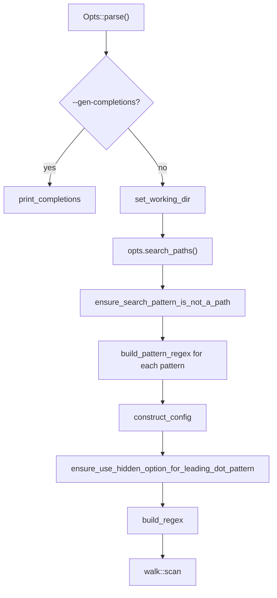

## Overview

`fd` finds entries in the filesystem. It is a fast, user-friendly alternative to `find`: it does not try to cover all of `find`, but its defaults fit most searches. You write `fd PATTERN` instead of `find -iname '*PATTERN*'`.

Sources: [README.md:8-28](repo://README.md#L8-L28)

The crate is published as `fd-find` and builds one binary, `fd`, from `src/main.rs`. Directory traversal comes from the `ignore` crate, pattern matching from `regex` and `globset`, argument parsing from `clap`, and colours from `lscolors`. The default `completions` feature adds shell completion generation through `clap_complete`.

Sources: [Cargo.toml:16-58](repo://Cargo.toml#L16-L58), [Cargo.toml:94-98](repo://Cargo.toml#L94-L98)

To build and run it, see [[Quickstart]]. For how a search runs across threads, see [[Search and Execution Pipeline]].

Sources: [src/main.rs:102-111](repo://src/main.rs#L102-L111)

## Default behaviour

| Behaviour | Default | Turned off by |
| --- | --- | --- |
| Pattern syntax | Regular expression, matched against the file name | `--glob`, `--fixed-strings`, `--exact`, `--full-path` |
| Case | Insensitive unless a pattern holds an uppercase character (smart case) | `--case-sensitive`, `--ignore-case` |
| Hidden files | Skipped | `-H` / `--hidden` |
| Ignore files | `.gitignore`, `.fdignore`, parent and global ignore files are read | `--no-ignore`, `--no-ignore-vcs`, `--no-ignore-parent`, `--no-global-ignore-file` |
| Colours | On when stdout is a terminal and `NO_COLOR` is unset | `--color never` |

Sources: [src/main.rs:248-321](repo://src/main.rs#L248-L321)

## Crate layout

| Module | Role |
| --- | --- |
| `src/main.rs` | Entry point: parses options, builds the regexes and the `Config`, calls `walk::scan` |
| `src/cli.rs` | `Opts`, the `clap` definition of every command-line flag |
| `src/config.rs` | `Config`, the resolved settings shared by every thread |
| `src/walk.rs` | Parallel traversal, filtering, buffering and output |
| `src/exec/` | `--exec` and `--exec-batch` command templates and job runners |
| `src/filter/` | Size, modification time and owner filters |
| `src/fmt/` | Placeholder templates for `--format` and command arguments |
| `src/output.rs` | Printing an entry with colours, hyperlinks and separators |
| `src/exit_codes.rs` | `ExitCode` and how several codes merge into one |

Sources: [src/main.rs:1-36](repo://src/main.rs#L1-L36), [src/config.rs:1-20](repo://src/config.rs#L1-L20)

## From arguments to a search

`main` calls `run` and turns its result into the process exit code; an error is printed and exits with `GeneralError`.

Sources: [src/main.rs:62-73](repo://src/main.rs#L62-L73)

Sources: [src/main.rs:75-112](repo://src/main.rs#L75-L112)

`run` follows these steps:

Sources: [src/main.rs:75-112](repo://src/main.rs#L75-L112)

1. `set_working_dir` changes into `--base-directory` when given, and fails if it is not a directory.
2. `ensure_search_pattern_is_not_a_path` refuses a pattern that holds `/` (or, on Windows, `\` naming an existing directory) unless `--full-path` is set, since such a pattern could never match a file name. It checks the positional pattern and every `--and` pattern.
3. `build_pattern_regex` turns each pattern into regex source: a glob through `GlobBuilder`, `--exact` as an anchored escaped string, `--fixed-strings` as an escaped string, and anything else as written.
4. `construct_config` resolves the options into a `Config`.
5. On Unix, `ensure_use_hidden_option_for_leading_dot_pattern` stops a pattern that only matches dot-files while hidden files are skipped, and suggests `-H`.
6. `build_regex` compiles each pattern as a byte regex, case-insensitive unless `config.case_sensitive`, and adds a hint about `--fixed-strings`, `--exact` and `--glob` to a syntax error.

Sources: [src/main.rs:131-232](repo://src/main.rs#L131-L232), [src/main.rs:521-555](repo://src/main.rs#L521-L555)

All patterns must match an entry for it to be a result: the `--and` expressions are chained with the positional pattern into one list of regexes.

Sources: [src/main.rs:89-111](repo://src/main.rs#L89-L111)

## Configuration resolution

`construct_config` decides each setting once, before any thread starts:

Sources: [src/main.rs:248-256](repo://src/main.rs#L248-L256)

- Smart case: the search is case-sensitive when `--ignore-case` is not set and either `--case-sensitive` is set or any pattern holds an uppercase character.
- Colours: `--color auto` colours output only when ANSI is supported, `NO_COLOR` is empty or unset, and stdout is a terminal. `LS_COLORS` is read from the environment, falling back to the built-in `DEFAULT_LS_COLORS`.
- Hyperlinks follow `--hyperlink`, and in `auto` mode follow the colour decision.
- `--list-details` becomes a batch command running `ls -l -h -d` (GNU `ls`, `gls`, or BSD `ls` depending on the platform).
- `--extension` values become one case-insensitive `RegexSet` of `.\.ext$` patterns, and `--exclude` globs are stored with a leading `!` so the walker treats them as ignore overrides.

Sources: [src/main.rs:248-298](repo://src/main.rs#L248-L298), [src/main.rs:361-393](repo://src/main.rs#L361-L393), [src/main.rs:395-494](repo://src/main.rs#L395-L494)

## Exit codes

| `ExitCode` | Status | When |
| --- | --- | --- |
| `Success` | 0 | The search finished |
| `HasResults(true)` | 0 | `--quiet` and at least one match |
| `HasResults(false)` | 1 | `--quiet` and no match |
| `GeneralError` | 1 | An error, or a failed command |
| `KilledBySigint` | 130 | Interrupted with Ctrl-C |

Sources: [src/exit_codes.rs:6-23](repo://src/exit_codes.rs#L6-L23)

On Unix, `KilledBySigint` restores the default `SIGINT` handler and raises the signal, so the parent shell sees a real interrupt. `merge_exitcodes` combines the codes of several command runs: any non-zero code gives `GeneralError`.

Sources: [src/exit_codes.rs:25-51](repo://src/exit_codes.rs#L25-L51)
