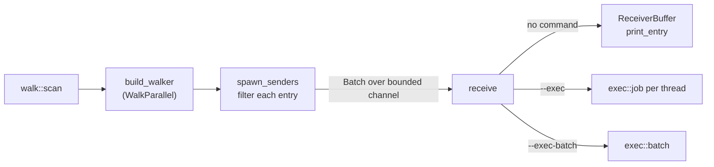
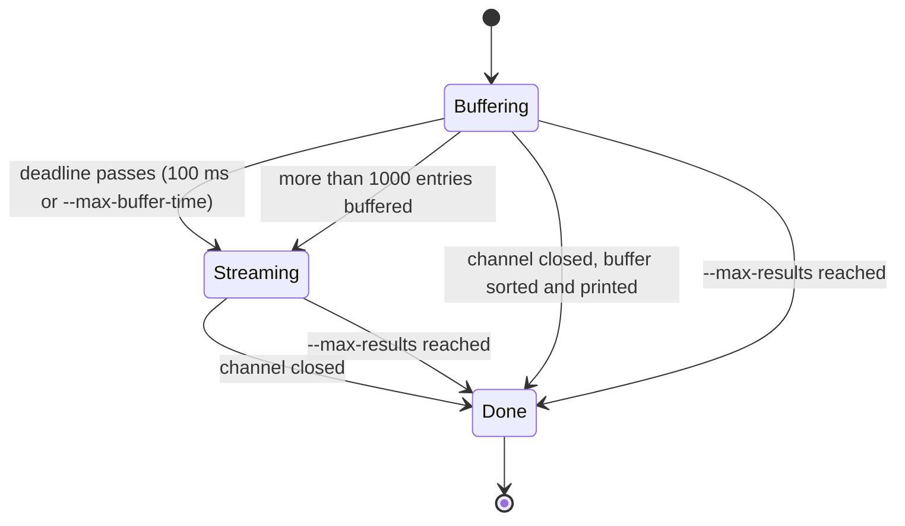

## Overview

`walk::scan` runs every search. It wraps the compiled patterns and the `Config` (see [[Overview]]) in a `WorkerState`, builds a parallel walker from the `ignore` crate, and splits the work between sender threads, which walk and filter the tree, and a receiver, which prints the results or runs commands on them. The two sides meet on a bounded `crossbeam_channel` of `Batch` values.

Sources: [src/walk.rs:305-328](repo://src/walk.rs#L305-L328), [src/walk.rs:680-687](repo://src/walk.rs#L680-L687)

Sources: [src/walk.rs:406-440](repo://src/walk.rs#L406-L440), [src/walk.rs:616-653](repo://src/walk.rs#L616-L653)

## Starting the scan

`WorkerState::scan` builds the walker, installs the Ctrl-C handler, and creates a channel holding at most `2 * config.threads` batches. Inside a `thread::scope` it spawns the receiver on its own thread and then runs the senders on the walker's thread pool; the scan ends when the receiver returns its `ExitCode`.

Sources: [src/walk.rs:616-653](repo://src/walk.rs#L616-L653)

The Ctrl-C handler is installed only when output is coloured and printed, so an interrupt cannot leave the terminal in a coloured state. The first Ctrl-C sets `quit_flag` and `interrupt_flag`, so the walkers stop and the receiver flushes and returns `KilledBySigint`. A second Ctrl-C exits at once.

Sources: [src/walk.rs:621-634](repo://src/walk.rs#L621-L634), [src/walk.rs:260-264](repo://src/walk.rs#L260-L264)

## Building the walker

`build_walker` maps the `Config` ignore settings onto `WalkBuilder`: hidden files, `.ignore` and `.fdignore` files, parent ignore files, `.gitignore` with the global git excludes, symlink following, `--one-file-system` and `--max-depth`. Parent ignore files are read only when some ignore file is read at all.

Sources: [src/walk.rs:347-369](repo://src/walk.rs#L347-L369)

`--exclude` globs become an `Override` rooted at the first search path; each is stored with a leading `!`, which makes it an ignore rule. The global ignore file `fd/ignore` under the user's config directory and each `--ignore-file` are added next, and a malformed pattern in them is reported without stopping the search. Every search path after the first is added to the same walker, which runs with `config.threads` threads.

Sources: [src/walk.rs:330-345](repo://src/walk.rs#L330-L345), [src/walk.rs:371-404](repo://src/walk.rs#L371-L404)

## Filtering entries

`spawn_senders` gives each walker thread a closure that decides, for every entry, what the walk does next. The checks run in order from cheapest to most expensive, so the name is tested before any metadata is read.

Sources: [src/walk.rs:442-462](repo://src/walk.rs#L442-L462)

| Step | Check | When it fails |
| --- | --- | --- |
| 1 | `quit_flag` is set | `WalkState::Quit` |
| 2 | A directory holds an `--ignore-contain` file | `WalkState::Skip` (not entered) |
| 3 | The entry is a search root (depth 0) | skipped, walk continues |
| 4 | Walk error: a missing target of a symlink becomes `DirEntry::broken_symlink`; any other error is sent as `WorkerResult::Error` | sent, walk continues |
| 5 | Depth is below `--min-depth` | skipped |
| 6 | Every pattern matches the file name, or the absolute path with `--full-path` | skipped |
| 7 | The file name matches the `--extension` set | skipped |
| 8 | `--type` allows the entry | skipped |
| 9 | Unix only: `--owner` matches | skipped |
| 10 | It is a file within every `--size` limit | skipped |
| 11 | The modification time satisfies every `--changed-within` / `--changed-before` filter | skipped |

Sources: [src/walk.rs:459-524](repo://src/walk.rs#L459-L524), [src/walk.rs:526-591](repo://src/walk.rs#L526-L591)

`search_str_for_entry` picks the string the patterns see. Without `--full-path` it is the file name; with it, a relative path is joined to the working directory cached in `full_path_base`, after a leading `./` is dropped.

Sources: [src/walk.rs:656-678](repo://src/walk.rs#L656-L678)

An entry that passes every check has its `LS_COLORS` style computed on the walker thread when output is printed, so colouring runs in parallel. It is then sent as `WorkerResult::Entry`. With `--prune` the walk does not descend into a matching directory, and a closed channel turns into `WalkState::Quit`.

Sources: [src/walk.rs:593-612](repo://src/walk.rs#L593-L612)

## Batching results

`BatchSender` cuts channel traffic by sending a shared `Batch` (an `Arc<Mutex<Option<Vec<WorkerResult>>>>`) once, when its first item is pushed. Later items join the same vector until it holds `limit` items or the receiver has taken it, and then a new batch starts. The bounded channel gives backpressure: senders wait when the receiver falls behind.

Sources: [src/walk.rs:47-122](repo://src/walk.rs#L47-L122)

The limit is `0x100` items. With `--exec` on more than one thread it drops to 1, so each result goes to whichever job thread is free and work is spread evenly.

Sources: [src/walk.rs:449-457](repo://src/walk.rs#L449-L457)

## Printing results

Without a command, `receive` hands a buffered, locked stdout to `ReceiverBuffer::process`, which polls until a step returns an `ExitCode`. The receiver starts in `Buffering` mode, so a fast search prints sorted output, and switches to `Streaming` so a slow search shows results as they arrive.

Sources: [src/walk.rs:26-35](repo://src/walk.rs#L26-L35), [src/walk.rs:173-181](repo://src/walk.rs#L173-L181), [src/walk.rs:434-439](repo://src/walk.rs#L434-L439)

Sources: [src/walk.rs:124-127](repo://src/walk.rs#L124-L127), [src/walk.rs:183-293](repo://src/walk.rs#L183-L293)

In `Buffering` mode `recv` waits only until the deadline; a timeout calls `stream`, which prints the buffer unsorted and flushes. In `Streaming` mode each entry is printed at once, and stdout is flushed whenever the channel is empty. `stop` sorts the buffer only when the search ended while still buffering.

Sources: [src/walk.rs:183-302](repo://src/walk.rs#L183-L302)

With `--quiet`, the first entry ends the search with `HasResults(true)` and nothing is printed. Filesystem errors are printed only with `--show-errors`. A broken pipe on write is ignored, any other write error returns `GeneralError`, and a failed flush also returns `GeneralError` so `fd | head` exits quietly.

Sources: [src/walk.rs:198-231](repo://src/walk.rs#L198-L231), [src/walk.rs:251-267](repo://src/walk.rs#L251-L267), [src/walk.rs:295-302](repo://src/walk.rs#L295-L302)

`output::print_entry` writes one entry: an OSC 8 hyperlink around it when `--hyperlink` is on, then the `--format` template, the coloured path or the plain path, and finally a newline or, with `--print0`, a NUL byte.

Sources: [src/output.rs:16-43](repo://src/output.rs#L16-L43)

## Running commands

With `--exec`, `receive` spawns `config.threads` job threads, each reading from a clone of the channel and running `exec::job`. `job` builds and runs the command for each entry's path and merges the exit codes, so one failed command makes the whole run return `GeneralError`. Output of each command is buffered when more than one thread runs, so the output of parallel commands is never mixed.

Sources: [src/walk.rs:411-433](repo://src/walk.rs#L411-L433), [src/exec/job.rs:8-44](repo://src/exec/job.rs#L8-L44)

With `--exec-batch` (and `--list-details`), one `exec::batch` call collects every path and passes them to `CommandSet::execute_batch`. A `CommandBuilder` per command template appends paths, starting a new process when the argument list reaches its limit or `--batch-size`, and the exit codes are merged at the end. A batch template may hold only one placeholder.

Sources: [src/exec/job.rs:46-64](repo://src/exec/job.rs#L46-L64), [src/exec/mod.rs:51-70](repo://src/exec/mod.rs#L51-L70), [src/exec/mod.rs:90-120](repo://src/exec/mod.rs#L90-L120), [src/exec/mod.rs:122-200](repo://src/exec/mod.rs#L122-L200)
