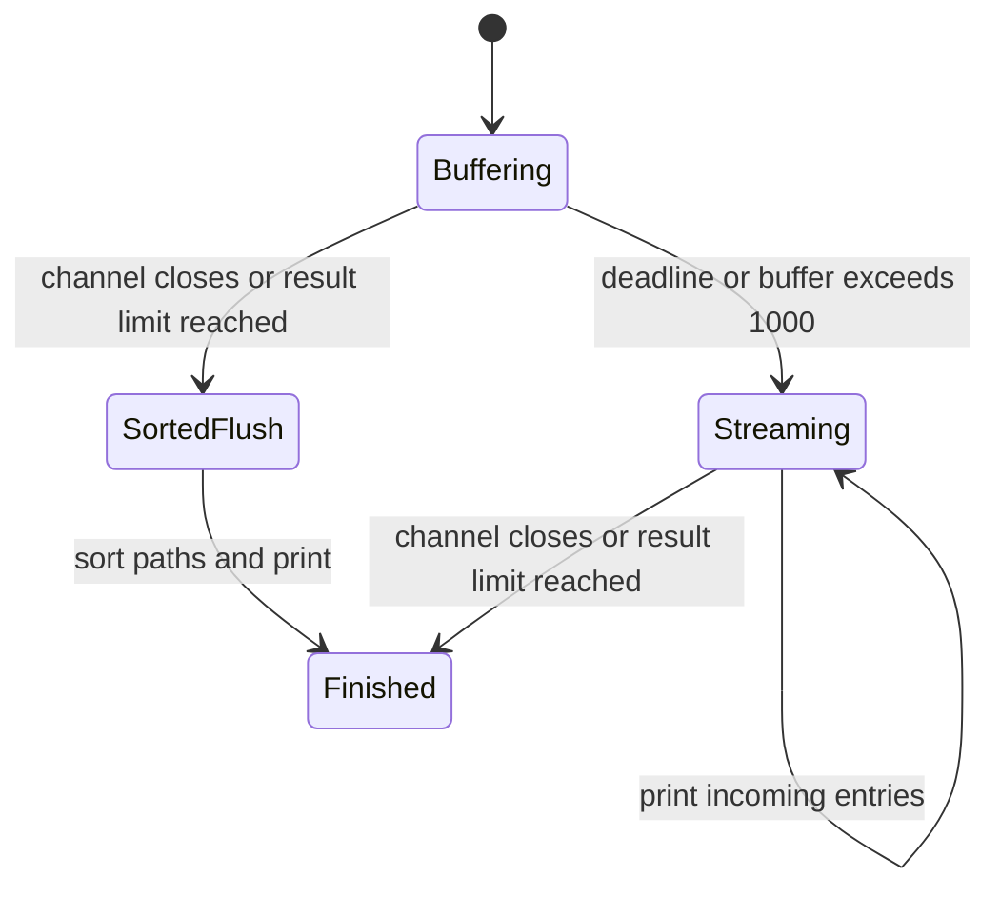

## Overview

When no command is configured, the result consumer locks stdout, wraps it in a buffered writer, and runs `ReceiverBuffer`. This consumer decides when to sort, when to stream, and when to stop; `output::print_entry` renders each accepted entry. The channel and worker lifecycle are covered in [[Traversal and Ignore Rules]]. Commands select a different consumer, so their output grouping and status behavior belong to [[Command Execution]].

Sources: [src/walk.rs:408-439](repo://src/walk.rs#L408-L439), [src/walk.rs:251-267](repo://src/walk.rs#L251-L267)

## Buffering, ordering, and streaming

The receiver starts in buffering mode with a default deadline 100 milliseconds after construction and a buffer capacity of 1,000 entries. `--max-buffer-time` can replace that deadline duration. During buffering, it waits only until the deadline; a timeout switches to streaming. Receiving more than 1,000 buffered entries also switches to streaming, even if the deadline has not arrived.

Sources: [src/walk.rs:124-127](repo://src/walk.rs#L124-L127), [src/walk.rs:151-194](repo://src/walk.rs#L151-L194), [src/walk.rs:208-245](repo://src/walk.rs#L208-L245), [src/cli.rs:559-564](repo://src/cli.rs#L559-L564)

Sources: [src/walk.rs:198-245](repo://src/walk.rs#L198-L245), [src/walk.rs:269-292](repo://src/walk.rs#L269-L292)

Stopping while still buffering sorts entries by their underlying paths, then streams the sorted buffer. Switching because of time or size instead prints the buffer in its existing order. Streaming has no later sorting pass and flushes when no batch is immediately ready. Consequently, a quickly completed search can be sorted, but a larger or slower search has no global ordering guarantee.

Sources: [src/walk.rs:235-245](repo://src/walk.rs#L235-L245), [src/walk.rs:269-301](repo://src/walk.rs#L269-L301), [src/dir_entry.rs:125-136](repo://src/dir_entry.rs#L125-L136)

## Result limits and exit status

`--quiet` returns as soon as an entry arrives, before adding it to the output buffer. Otherwise the receiver counts accepted entries and calls its stop path once `--max-results` is reached. `-1` is the single-result shorthand; a configured maximum of zero is filtered out as no limit. A limited result set is whichever entries arrive first, even if those entries are subsequently sorted during a buffered stop. Execution modes conflict with these result-limiting and quiet options.

Sources: [src/walk.rs:203-225](repo://src/walk.rs#L203-L225), [src/walk.rs:282-292](repo://src/walk.rs#L282-L292), [src/cli.rs:29-30](repo://src/cli.rs#L29-L30), [src/cli.rs:577-601](repo://src/cli.rs#L577-L601), [src/cli.rs:759-763](repo://src/cli.rs#L759-L763)

| Outcome | Status |
| --- | --- |
| Ordinary printing completes, including zero matches | 0 |
| Quiet search finds a match | 0 |
| Quiet search finds no match | 1 |
| General error | 1 |
| Interrupt represented by `KilledBySigint` | 130, with SIGINT re-raised on Unix when possible |

Sources: [src/walk.rs:203-206](repo://src/walk.rs#L203-L206), [src/walk.rs:282-292](repo://src/walk.rs#L282-L292), [src/exit_codes.rs:14-42](repo://src/exit_codes.rs#L14-L42)

An entry-write error other than `BrokenPipe` prints a diagnostic and returns general error. The immediate print path ignores `BrokenPipe`, but a failed buffered flush still returns general error. After printing, an observed interrupt attempts a flush and returns the interrupt status. These distinct branches mean an early-closing downstream consumer is not guaranteed a successful fd exit in every buffering situation.

Sources: [src/walk.rs:251-266](repo://src/walk.rs#L251-L266), [src/walk.rs:295-301](repo://src/walk.rs#L295-L301)

## Rendering and delimiters

`print_entry` optionally opens a terminal hyperlink, then chooses exactly one renderer: a format template takes precedence, otherwise configured colors select colored rendering, otherwise it prints an uncolored path. It closes any hyperlink before writing the terminator. `--print0` selects NUL; ordinary output uses a newline. Both ordinary path renderers append the configured actual separator to directories, while template output prints only the generated template before the terminator.

Sources: [src/output.rs:17-85](repo://src/output.rs#L17-L85), [src/output.rs:124-155](repo://src/output.rs#L124-L155), [src/cli.rs:267-276](repo://src/cli.rs#L267-L276)

Display starts from `DirEntry::stripped_path`. For implicit current-directory searches, automatic stripping is enabled for normal printing and disabled for commands or NUL output. `--strip-cwd-prefix` can select always, never, or auto, but conflicts with explicit roots. Even when stripping is selected, a result that would start with a dash retains its original prefix so downstream tools do not mistake it for an option. Root normalization and absolute matching remain separate concerns in [[Search Patterns and Paths]].

Sources: [src/main.rs:389-390](repo://src/main.rs#L389-L390), [src/cli.rs:674-680](repo://src/cli.rs#L674-L680), [src/cli.rs:765-773](repo://src/cli.rs#L765-L773), [src/dir_entry.rs:56-79](repo://src/dir_entry.rs#L56-L79)

`--path-separator` replaces the native separator for display and placeholder generation. Without an explicit value, Windows uses `/` when `MSYSTEM` is nonempty, otherwise the native separator remains. The Windows configuration check rejects a supplied separator longer than one byte. Ordinary uncolored rendering replaces separators in the displayed string; template generation instead rebuilds path components and leaves fixed template text unchanged.

Sources: [src/main.rs:234-264](repo://src/main.rs#L234-L264), [src/filesystem.rs:123-135](repo://src/filesystem.rs#L123-L135), [src/output.rs:147-155](repo://src/output.rs#L147-L155), [src/fmt/mod.rs:109-150](repo://src/fmt/mod.rs#L109-L150), [src/fmt/mod.rs:153-195](repo://src/fmt/mod.rs#L153-L195)

## Shared format templates

| Placeholder | Expansion |
| --- | --- |
| `{}` | Input path |
| `{/}` | Basename |
| `{//}` | Parent directory |
| `{.}` | Path with its final extension removed |
| `{/.}` | Basename with its final extension removed |
| `{{` and `}}` | Literal opening and closing braces |

Sources: [src/fmt/mod.rs:58-106](repo://src/fmt/mod.rs#L58-L106), [src/fmt/mod.rs:112-140](repo://src/fmt/mod.rs#L112-L140), [src/fmt/input.rs:6-31](repo://src/fmt/input.rs#L6-L31)

`FormatTemplate::parse` uses a cached Aho-Corasick matcher to find placeholders and escaped braces. A template with no substitution tokens becomes fixed text; otherwise it stores tokens interleaved with text segments. `generate` builds an `OsString`, substituting path components while preserving literal segments. The same parser supports `--format` and command arguments, but the command layer adds the default-placeholder and batch restrictions described in [[Command Execution]].

Sources: [src/fmt/mod.rs:51-140](repo://src/fmt/mod.rs#L51-L140), [src/main.rs:374-377](repo://src/main.rs#L374-L377), [src/exec/mod.rs:228-253](repo://src/exec/mod.rs#L228-L253)

The parent helper returns `.` when a simple filename has an empty parent. Removing an extension uses `file_stem`, rejoins the parent and stem, and strips a current-directory prefix. Tests preserve the hidden name `.foo` when removing an extension. Format rendering then converts the generated `OsString` with `to_string_lossy`, so the template renderer does not have the raw-byte guarantee of the plain Unix pipe path.

Sources: [src/fmt/input.rs:11-31](repo://src/fmt/input.rs#L11-L31), [src/fmt/input.rs:56-59](repo://src/fmt/input.rs#L56-L59), [src/output.rs:69-85](repo://src/output.rs#L69-L85)

## Terminal safety and filename bytes

Terminal sanitization escapes control characters and selected invisible or direction-changing Unicode characters, while permitting horizontal tabs. Values through 255 become hexadecimal byte-style escapes; larger codepoints become Unicode-style escapes. Sanitization is applied only when stdout is a terminal, including in formatted and colored renderers, to prevent filenames from injecting terminal control sequences. Safe strings are borrowed without allocating a replacement.

Sources: [src/sanitize.rs:1-54](repo://src/sanitize.rs#L1-L54), [src/output.rs:75-85](repo://src/output.rs#L75-L85), [src/output.rs:110-129](repo://src/output.rs#L110-L129)

On Unix, plain uncolored output to a pipe or file with no custom path separator writes the path's raw bytes. This preserves invalid UTF-8 names for downstream consumers. A terminal or custom separator selects the string-based renderer instead; colored and template renderers also use lossy string conversion. NUL delimiting changes the terminator independently of these renderer choices.

Sources: [src/output.rs:26-42](repo://src/output.rs#L26-L42), [src/output.rs:75-85](repo://src/output.rs#L75-L85), [src/output.rs:95-97](repo://src/output.rs#L95-L97), [src/output.rs:147-181](repo://src/output.rs#L147-L181)

## Colors and hyperlinks

Color defaults to auto. Auto requires an interactive stdout, ANSI support, and no nonempty `NO_COLOR`; always and never override that decision. Enabled colors load `LS_COLORS` or fall back to the repository's palette. The colored renderer styles the parent portion as a directory and the basename using the entry's cached style. A format template bypasses that colored-path branch even if colors are configured.

Sources: [src/cli.rs:520-530](repo://src/cli.rs#L520-L530), [src/main.rs:271-292](repo://src/main.rs#L271-L292), [src/output.rs:26-31](repo://src/output.rs#L26-L31), [src/output.rs:110-136](repo://src/output.rs#L110-L136)

Hyperlinks default to never. A bare `--hyperlink` selects auto, which follows the configured color decision; always forces hyperlink attempts. `PathUrl` converts the original entry path to absolute form and encodes a file URL, percent-encoding unsafe and non-ASCII bytes and converting Windows backslashes. Unix includes a cached hostname when available. If absolute-path conversion fails, the entry still prints without a hyperlink.

Sources: [src/cli.rs:532-548](repo://src/cli.rs#L532-L548), [src/main.rs:293-297](repo://src/main.rs#L293-L297), [src/hyperlink.rs:7-61](repo://src/hyperlink.rs#L7-L61), [src/output.rs:17-35](repo://src/output.rs#L17-L35)
