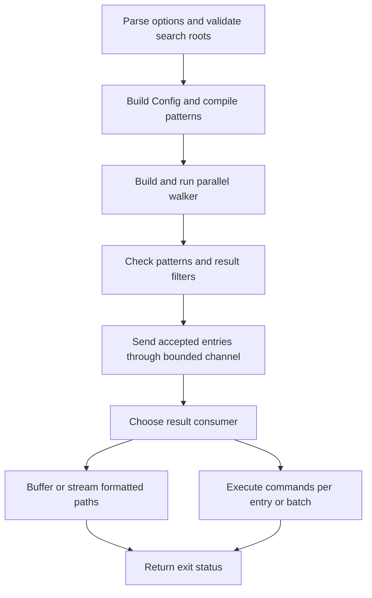

## Overview

`fd` finds filesystem entries using regular expressions or glob patterns. The Cargo package is named `fd-find`, while its executable is `fd`. Its default search skips hidden entries, respects ignore rules, and uses case-insensitive matching unless the query calls for case sensitivity. A search can print matching paths or feed them directly into commands. This documentation follows that complete path through the repository, from command-line parsing to the final output or child-process status.

Sources: [Cargo.toml:1-31](repo://Cargo.toml#L1-L31), [src/cli.rs:21-37](repo://src/cli.rs#L21-L37), [src/main.rs:248-255](repo://src/main.rs#L248-L255), [src/walk.rs:408-439](repo://src/walk.rs#L408-L439)

The implementation is a Rust binary whose entry point builds one search configuration and passes it, together with compiled patterns and validated search roots, to `walk::scan`. There is no separate search-server lifecycle: the invocation constructs its state, traverses the requested directories, consumes results, and returns an exit status. The [[Quickstart]] walks through building this checkout and running that lifecycle locally.

Sources: [Cargo.toml:19-31](repo://Cargo.toml#L19-L31), [src/main.rs:62-112](repo://src/main.rs#L62-L112)

## Parts of the system

| Area | What it does | Page |
| --- | --- | --- |
| Local development | Build, test, install, and generate shell completions | [[Quickstart]] |
| Query preparation | Validate roots, translate patterns, and choose case and path matching | [[Search Patterns and Paths]] |
| Discovery | Configure ignores and parallel directory traversal, then transport entries | [[Traversal and Ignore Rules]] |
| Selection | Apply extension, type, ownership, size, and modification-time predicates | [[Result Filters]] |
| Presentation | Buffer or stream entries and render paths, templates, colors, and hyperlinks | [[Output and Formatting]] |
| Execution | Substitute paths into commands, run jobs or batches, and aggregate failures | [[Command Execution]] |

Sources: [Makefile:8-22](repo://Makefile#L8-L22), [src/main.rs:75-112](repo://src/main.rs#L75-L112), [src/walk.rs:347-403](repo://src/walk.rs#L347-L403), [src/walk.rs:514-591](repo://src/walk.rs#L514-L591), [src/output.rs:17-42](repo://src/output.rs#L17-L42), [src/exec/mod.rs:76-120](repo://src/exec/mod.rs#L76-L120)

## A search from start to finish

Sources: [src/main.rs:75-112](repo://src/main.rs#L75-L112), [src/walk.rs:408-439](repo://src/walk.rs#L408-L439), [src/walk.rs:514-542](repo://src/walk.rs#L514-L542), [src/walk.rs:577-651](repo://src/walk.rs#L577-L651)

1. Parse the invocation and establish its working directory and roots; [[Search Patterns and Paths]] explains why the pattern position is distinct from a directory argument.
2. Translate the primary pattern and additional expressions, create configuration, and compile matchers; [[Search Patterns and Paths]] covers literal, glob, exact, and smart-case behavior.
3. Construct the parallel walker with ignore and depth settings; [[Traversal and Ignore Rules]] explains which entries can reach the callback.
4. Test names before metadata-dependent predicates; [[Result Filters]] describes the ordered selection pipeline.
5. Deliver accepted entries through a bounded channel; [[Traversal and Ignore Rules]] covers worker batches and shutdown.
6. Print results using [[Output and Formatting]], or run the command consumer described in [[Command Execution]], then return the selected consumer's status.

Sources: [src/main.rs:75-112](repo://src/main.rs#L75-L112), [src/walk.rs:347-403](repo://src/walk.rs#L347-L403), [src/walk.rs:514-591](repo://src/walk.rs#L514-L591), [src/walk.rs:408-439](repo://src/walk.rs#L408-L439), [src/walk.rs:636-651](repo://src/walk.rs#L636-L651)

## Design decisions across the flow

The worker checks a name before requesting metadata because name matching does not need filesystem metadata. Accepted entries cache metadata and color style with `OnceCell`, so subsequent consumers can reuse those values. When colored printing is selected, workers compute styles before sending entries, explicitly moving that work into the parallel phase. This makes the placement of a new predicate relevant: a rejection before metadata access avoids work for entries that will never be printed.

Sources: [src/walk.rs:514-542](repo://src/walk.rs#L514-L542), [src/walk.rs:593-600](repo://src/walk.rs#L593-L600), [src/dir_entry.rs:17-22](repo://src/dir_entry.rs#L17-L22), [src/dir_entry.rs:89-108](repo://src/dir_entry.rs#L89-L108)

Parallel discovery is decoupled from consumption by a bounded channel. Workers normally share entries in batches, whose size is limited to provide backpressure; per-entry command execution with multiple receivers switches to single-entry batches to distribute work evenly. The default thread count follows available parallelism but is capped at 64 to limit startup overhead on large machines, with a single-thread fallback if the platform cannot report parallelism.

Sources: [src/walk.rs:74-120](repo://src/walk.rs#L74-L120), [src/walk.rs:443-457](repo://src/walk.rs#L443-L457), [src/walk.rs:636-645](repo://src/walk.rs#L636-L645), [src/cli.rs:788-800](repo://src/cli.rs#L788-L800)

Printing balances sorted results against prompt output. Its receiver initially buffers so a quickly completed search can be sorted; a deadline or buffer-size threshold switches it into streaming. Once streaming starts, there is no final global sorting pass. Command consumers use the result channel directly, so their execution and argument order should not be inferred from the sorted appearance of a small printed search.

Sources: [src/walk.rs:26-35](repo://src/walk.rs#L26-L35), [src/walk.rs:198-245](repo://src/walk.rs#L198-L245), [src/walk.rs:269-292](repo://src/walk.rs#L269-L292), [src/walk.rs:408-438](repo://src/walk.rs#L408-L438), [src/cli.rs:895-899](repo://src/cli.rs#L895-L899), [src/cli.rs:933-934](repo://src/cli.rs#L933-L934)

Paths retain protective syntax when handed to other programs. By default, command execution and NUL-delimited output keep the current-directory prefix to reduce the chance that a filename beginning with a dash becomes an option. Even when prefix stripping is enabled, `DirEntry` retains the original path if stripping would expose a leading dash. Plain piped Unix output also writes raw path bytes, preserving filenames that are not valid UTF-8 for downstream tools.

Sources: [src/cli.rs:674-680](repo://src/cli.rs#L674-L680), [src/main.rs:389-390](repo://src/main.rs#L389-L390), [src/dir_entry.rs:56-79](repo://src/dir_entry.rs#L56-L79), [src/output.rs:167-181](repo://src/output.rs#L167-L181)

## Failure boundaries

Preparation failures propagate to `main`, which prints a contextual error and exits with a general error. Filesystem traversal errors instead travel alongside entries and are displayed only when requested; an unreadable entry therefore follows a different path from an invalid search expression. Command failures are aggregated by their execution consumer. Normal printing returns success even for an empty result set, while quiet mode explicitly converts the existence of a match into its exit status.

Sources: [src/main.rs:62-71](repo://src/main.rs#L62-L71), [src/walk.rs:227-231](repo://src/walk.rs#L227-L231), [src/walk.rs:282-292](repo://src/walk.rs#L282-L292), [src/walk.rs:485-505](repo://src/walk.rs#L485-L505), [src/exec/job.rs:19-43](repo://src/exec/job.rs#L19-L43), [src/exit_codes.rs:14-21](repo://src/exit_codes.rs#L14-L21)
