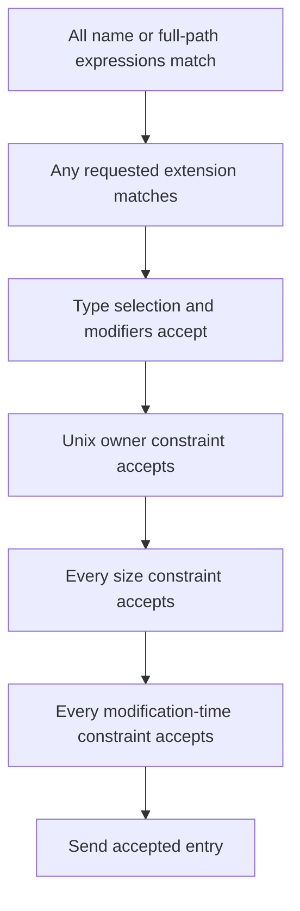

## Overview

Result filters decide whether an entry that survived discovery should be emitted. The worker first checks the patterns described in [[Search Patterns and Paths]], then extensions, file types, Unix ownership, size, and modification time. Every enabled stage must accept the entry. A failed predicate returns `Continue`, leaving directory traversal active; the earlier ignore and marker decisions described in [[Traversal and Ignore Rules]] can instead prevent entries from reaching this pipeline at all.

Sources: [src/walk.rs:464-483](repo://src/walk.rs#L464-L483), [src/walk.rs:514-591](repo://src/walk.rs#L514-L591)

## Predicate order and shared metadata

Sources: [src/walk.rs:514-600](repo://src/walk.rs#L514-L600)

The name check precedes metadata-dependent work because it requires no metadata. `DirEntry::metadata` lazily caches either metadata or its absence in a `OnceCell`, so repeated requests from later predicates reuse the first result. Normal entries obtain metadata through the walker entry; recovered broken symlinks use `symlink_metadata`. An unavailable value is not retried by each successive filter.

Sources: [src/walk.rs:514-524](repo://src/walk.rs#L514-L524), [src/dir_entry.rs:17-22](repo://src/dir_entry.rs#L17-L22), [src/dir_entry.rs:89-96](repo://src/dir_entry.rs#L89-L96)

## Match extensions

Each `--extension` value has leading dots removed, is escaped as a regex literal, and becomes an end-anchored suffix expression containing a literal dot. A case-insensitive `RegexSet` combines the extensions, and the worker tests the filename against that set. Several extension options therefore accept any listed extension. This extension matcher remains case-insensitive even when the main query uses case-sensitive matching.

Sources: [src/main.rs:361-373](repo://src/main.rs#L361-L373), [src/walk.rs:526-535](repo://src/walk.rs#L526-L535)

Extensions do not imply a regular-file restriction. A directory ending in a requested extension can pass, so add a type constraint when the selection should contain only files. The generated expression also requires a character before the suffix's dot; this is visible in the expression construction, rather than an unrestricted string-ends-with check. The CLI recommends a normal regex such as `^[^.]+$` when searching for names without an extension.

Sources: [src/cli.rs:380-393](repo://src/cli.rs#L380-L393), [src/main.rs:365-371](repo://src/main.rs#L365-L371), [src/walk.rs:527-539](repo://src/walk.rs#L527-L539)

## Select types and modifiers

| Type | Selection behavior |
| --- | --- |
| `file` / `f` | Regular files |
| `directory` / `dir` / `d` | Directories |
| `symlink` / `l` | Symbolic links |
| `socket` / `s` | Sockets |
| `pipe` / `p` | Named pipes |
| `block-device` / `b` | Block devices |
| `char-device` / `c` | Character devices |
| `executable` / `x` | Enable files and additionally require executable access |
| `empty` / `e` | Additionally require emptiness; default to files and directories if neither was selected |

Sources: [src/cli.rs:333-378](repo://src/cli.rs#L333-L378), [src/main.rs:333-359](repo://src/main.rs#L333-L359), [src/filetypes.rs:20-40](repo://src/filetypes.rs#L20-L40)

Repeated ordinary types form an inclusion set, but executable and empty are additional predicates over the selected entries. For example, choosing both files and symlinks enables those two kinds; choosing empty and file enables only files and requires them to be empty. `FileTypes::should_ignore` rejects entries without a known type and entries outside all recognized supported types. The platform helpers report sockets, pipes, and device types on Unix/Redox, while their Windows implementations return false.

Sources: [src/main.rs:333-359](repo://src/main.rs#L333-L359), [src/filetypes.rs:20-40](repo://src/filetypes.rs#L20-L40), [src/filesystem.rs:62-100](repo://src/filesystem.rs#L62-L100)

An empty regular file has metadata length zero. An empty directory is one for which `read_dir` succeeds and produces no first entry. The directory test observes actual filesystem entries, not the results remaining after fd's ignore filters; a directory containing only ignored files is still nonempty. Failure to read a directory, unavailable metadata, and unsupported entry types all fail the emptiness predicate.

Sources: [src/filesystem.rs:44-59](repo://src/filesystem.rs#L44-L59)

## Filter ownership on Unix

`--owner` accepts an optional user or UID, optionally followed by a colon and an optional group or GID. Either side may begin with `!` to negate that side's equality test. The parser first tries a numeric identifier, then resolves a supplied name through the system user or group lookup. More than one colon or an unknown name causes an error. Both specified sides must match the entry's metadata.

Sources: [src/cli.rs:460-473](repo://src/cli.rs#L460-L473), [src/filter/owner.rs:24-57](repo://src/filter/owner.rs#L24-L57), [src/filter/owner.rs:69-101](repo://src/filter/owner.rs#L69-L101)

An empty ownership string or a colon with neither side populated is a no-op. `filter_ignore` removes that constraint from configuration, avoiding a metadata lookup for it. An active constraint rejects the entry when metadata is unavailable; ownership is not restricted to regular files, because this stage runs before and independently of the size filter's file check. This option is compiled only on Unix.

Sources: [src/filter/owner.rs:18-21](repo://src/filter/owner.rs#L18-L21), [src/filter/owner.rs:60-66](repo://src/filter/owner.rs#L60-L66), [src/filter/owner.rs:85-101](repo://src/filter/owner.rs#L85-L101), [src/main.rs:268-269](repo://src/main.rs#L268-L269), [src/walk.rs:544-575](repo://src/walk.rs#L544-L575)

## Apply size constraints

Size values consist of an optional sign, an integer quantity, and a required unit. `+` means greater than or equal to the byte threshold, `-` means less than or equal to it, and no sign means exact byte equality. Units are case-insensitive: `b` is bytes; `k`, `m`, `g`, and `t` use powers of 1000; their `ki`, `mi`, `gi`, and `ti` forms use powers of 1024. Prefix units also accept a trailing `b`.

Sources: [src/filter/size.rs:15-73](repo://src/filter/size.rs#L15-L73)

The parser rejects strings outside that grammar with a size-constraint diagnostic. Repeated size options must all hold, so a minimum and maximum create an inclusive interval. Once any size constraint is active, the worker requires `entry_path.is_file()`, then metadata, then checks each threshold against `metadata.len()`. Directories and entries without the required metadata cannot pass this stage.

Sources: [src/filter/size.rs:27-44](repo://src/filter/size.rs#L27-L44), [src/walk.rs:557-575](repo://src/walk.rs#L557-L575)

## Apply modification-time constraints

`--changed-within` constructs an `After` constraint and `--changed-before` constructs a `Before` constraint. Their comparisons are strict: modification time must be greater than or less than the threshold, respectively. Supplying both creates an open time interval. The worker reads modification time from metadata and requires every configured time constraint to accept it; missing metadata or an unreadable modification time rejects the entry.

Sources: [src/main.rs:496-518](repo://src/main.rs#L496-L518), [src/filter/time.rs:49-61](repo://src/filter/time.rs#L49-L61), [src/walk.rs:577-591](repo://src/walk.rs#L577-L591)

Time parsing tries a Jiff span first and subtracts it from the current zoned time, then tries a timestamp, then a civil datetime interpreted in the system timezone. Civil-time conversion selects the later interpretation when resolving ambiguity. Finally, an `@` prefix accepts an unsigned count of seconds since the Unix epoch. An input that none of these branches accepts causes configuration to fail before traversal, with a message directing the user to help.

Sources: [src/filter/time.rs:12-15](repo://src/filter/time.rs#L12-L15), [src/filter/time.rs:28-46](repo://src/filter/time.rs#L28-L46), [src/main.rs:496-518](repo://src/main.rs#L496-L518)

## Deliver an accepted entry

After all predicates pass, colored-printing searches can compute and cache a style on the worker before delivering the entry. The sender then emits `WorkerResult::Entry`; a failed send terminates that worker, and successful delivery is followed by the prune decision. [[Output and Formatting]] owns what happens to accepted entries in the printing consumer, while [[Command Execution]] describes their use as child-process arguments.

Sources: [src/walk.rs:593-611](repo://src/walk.rs#L593-L611), [src/walk.rs:408-438](repo://src/walk.rs#L408-L438), [src/dir_entry.rs:105-108](repo://src/dir_entry.rs#L105-L108)
