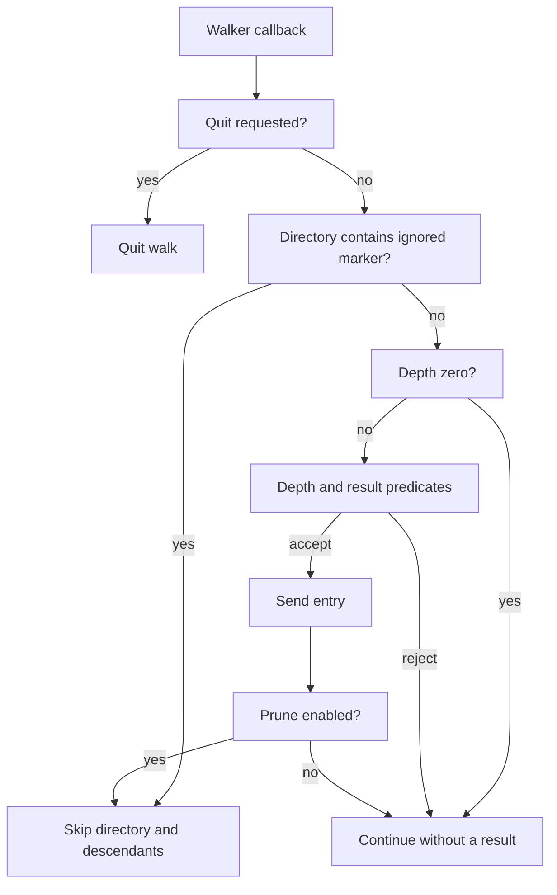

## Overview

Traversal controls which filesystem entries can become candidates and how those candidates reach a consumer. After preparation in [[Search Patterns and Paths]], `walk::scan` creates `WorkerState`, builds an `ignore::WalkParallel`, and connects its callbacks to a receiver through a bounded channel. A candidate rejected by an ignore rule may never reach the application's pattern or metadata checks; a candidate rejected by a result predicate normally allows traversal to continue.

Sources: [src/walk.rs:347-365](repo://src/walk.rs#L347-L365), [src/walk.rs:514-542](repo://src/walk.rs#L514-L542), [src/walk.rs:616-651](repo://src/walk.rs#L616-L651), [src/walk.rs:680-686](repo://src/walk.rs#L680-L686)

## Configure discovery policy

`construct_config` translates CLI flags into separate booleans for hidden entries, ordinary ignore files, Git-related ignores, parent rules, and the global fd ignore file. `build_walker` passes those controls to the walker and adds `.fdignore` as a custom ignore filename when ordinary ignores are enabled. The distinct switches make it possible to include hidden files while still respecting ignore rules, or to disable Git rules while keeping fd-specific ignores.

Sources: [src/main.rs:310-320](repo://src/main.rs#L310-L320), [src/walk.rs:347-369](repo://src/walk.rs#L347-L369)

| Control | Effect |
| --- | --- |
| `--hidden` / `-H` | Disable hidden-entry filtering |
| `--no-ignore` / `-I` | Disable ordinary ignore files, Git-related ignores, and the global fd ignore file |
| `--unrestricted` / `-u` | Include hidden entries and disable those ignore sources |
| `--no-ignore-vcs` | Disable Git ignore, global Git ignore, and Git exclude handling |
| `--no-require-git` | Allow Git-related rules without requiring a Git repository |
| `--no-ignore-parent` | Disable parent-directory ignore rules |
| `--no-global-ignore-file` | Disable the global fd ignore file |

Sources: [src/cli.rs:33-60](repo://src/cli.rs#L33-L60), [src/cli.rs:66-127](repo://src/cli.rs#L66-L127), [src/main.rs:313-320](repo://src/main.rs#L313-L320), [src/walk.rs:354-360](repo://src/walk.rs#L354-L360)

Parent rules are enabled only when parent reading is requested and at least one of ordinary or VCS ignore reading remains enabled. Git ignore, Git global, and Git exclude handling share the VCS switch. By default, Git-related rules require a repository; `--no-require-git` relaxes that requirement. These relationships explain why changing one ignore option does not necessarily expose every missing path.

Sources: [src/main.rs:314-320](repo://src/main.rs#L314-L320), [src/walk.rs:355-360](repo://src/walk.rs#L355-L360), [src/cli.rs:81-97](repo://src/cli.rs#L81-L97)

## Add exclusions and ignore files

`--exclude` values become negated override patterns. `OverrideBuilder` is rooted at the first search path and compiles every supplied exclusion before traversal starts. Malformed exclusions return an error, aborting walker construction. CLI documentation states that these exclusions override other ignore logic, and their construction is independent of the ordinary ignore booleans, so disabling ignore files does not remove explicit exclusions.

Sources: [src/main.rs:380-381](repo://src/main.rs#L380-L381), [src/walk.rs:330-365](repo://src/walk.rs#L330-L365), [src/cli.rs:310-324](repo://src/cli.rs#L310-L324)

When global fd ignores are enabled, the code asks `etcetera` for the platform configuration directory and looks for `fd/ignore` underneath it. It adds the file only if it is a regular file. Every explicit `--ignore-file` is then added independently, including when automatic ignore reading was disabled. These custom files use Git-ignore syntax and are documented as low precedence. Additional roots are added to the same walker after ignore configuration.

Sources: [src/walk.rs:371-403](repo://src/walk.rs#L371-L403), [src/cli.rs:510-518](repo://src/cli.rs#L510-L518)

Global and explicit ignore-file loading treat `ignore::Error::Partial` as nonfatal without printing a message. Other returned loading errors produce a diagnostic but do not return from `build_walker`. Failure to choose a platform configuration directory simply skips the global-file branch. This differs from malformed command-line exclusions, which prevent the walk from being constructed.

Sources: [src/walk.rs:334-344](repo://src/walk.rs#L334-L344), [src/walk.rs:371-403](repo://src/walk.rs#L371-L403)

## Control depth and directory pruning

Maximum depth is applied by `WalkBuilder`; minimum depth is checked inside the callback. `--exact-depth` supplies both limits and conflicts with setting either limit separately. Depth one includes entries directly under a search root. Root entries themselves are skipped when the walker reports depth zero, so ordinary searches list descendants rather than returning their root directory as a match.

Sources: [src/cli.rs:280-308](repo://src/cli.rs#L280-L308), [src/cli.rs:747-752](repo://src/cli.rs#L747-L752), [src/config.rs:49-56](repo://src/config.rs#L49-L56), [src/walk.rs:365-365](repo://src/walk.rs#L365-L365), [src/walk.rs:480-512](repo://src/walk.rs#L480-L512)

`--ignore-contain` checks a directory for each named entry before the root-depth check. If any joined path exists, the callback returns `Skip`, excluding that directory and preventing descent. `--prune` acts later: it returns `Skip` only after a candidate has passed all predicates and been sent as a result. A matching directory is therefore emitted before pruning its children. Predicate details belong to [[Result Filters]], because pruning depends on their combined acceptance decision.

Sources: [src/walk.rs:464-483](repo://src/walk.rs#L464-L483), [src/walk.rs:514-542](repo://src/walk.rs#L514-L542), [src/walk.rs:557-611](repo://src/walk.rs#L557-L611)

Sources: [src/walk.rs:459-483](repo://src/walk.rs#L459-L483), [src/walk.rs:508-542](repo://src/walk.rs#L508-L542), [src/walk.rs:600-611](repo://src/walk.rs#L600-L611)

## Follow links and handle filesystem failures

`--follow` enables descent through symbolic links, and `--one-file-system` asks the walker to remain on the starting filesystem. A special error branch recovers a path-associated not-found error when `symlink_metadata` confirms that the path itself is a symlink. It creates a broken-symlink entry rather than discarding the path. That entry uses symlink metadata and has no known traversal depth, so an active minimum-depth constraint rejects it.

Sources: [src/cli.rs:240-249](repo://src/cli.rs#L240-L249), [src/cli.rs:682-688](repo://src/cli.rs#L682-L688), [src/walk.rs:362-365](repo://src/walk.rs#L362-L365), [src/walk.rs:485-512](repo://src/walk.rs#L485-L512), [src/dir_entry.rs:82-102](repo://src/dir_entry.rs#L82-L102)

Other traversal errors are sent as `WorkerResult::Error`; the callback continues if delivery succeeds and quits if the receiver has gone away. Both printing and command consumers display these errors only with `--show-errors`. Receiving a traversal error does not itself increment the printed-result count or mark an execution job failed. Output failures and child-process failures have their own paths in [[Output and Formatting]] and [[Command Execution]].

Sources: [src/walk.rs:500-505](repo://src/walk.rs#L500-L505), [src/walk.rs:220-231](repo://src/walk.rs#L220-L231), [src/exec/job.rs:19-43](repo://src/exec/job.rs#L19-L43), [src/exec/job.rs:51-63](repo://src/exec/job.rs#L51-L63)

## Transport entries and stop workers

The result channel holds at most twice the configured thread count in batches. A batch is a shared, mutex-protected optional vector: the sender publishes it when the first item arrives, can append until its limit, and creates a replacement after the receiver takes the vector. The usual item limit is 256. Per-entry command execution with multiple threads uses a limit of one to distribute results across job receivers. Thread count defaults to available parallelism capped at 64, with a fallback of one.

Sources: [src/walk.rs:47-120](repo://src/walk.rs#L47-L120), [src/walk.rs:443-457](repo://src/walk.rs#L443-L457), [src/walk.rs:636-645](repo://src/walk.rs#L636-L645), [src/cli.rs:788-800](repo://src/cli.rs#L788-L800)

The printing receiver sets a shared quit flag when processing ends, and callbacks check that flag before handling another entry. Sending to a closed receiver also ends traversal. For colored printing, an installed Ctrl-C handler sets both quit and interrupt flags; a second Ctrl-C exits immediately. After the scoped threads join, the scan returns the interrupt status if that flag was set, otherwise the receiver's status. This coordinated shutdown is separate from the buffer sorting and result limits explained in [[Output and Formatting]].

Sources: [src/walk.rs:173-180](repo://src/walk.rs#L173-L180), [src/walk.rs:459-462](repo://src/walk.rs#L459-L462), [src/walk.rs:600-604](repo://src/walk.rs#L600-L604), [src/walk.rs:616-651](repo://src/walk.rs#L616-L651)
