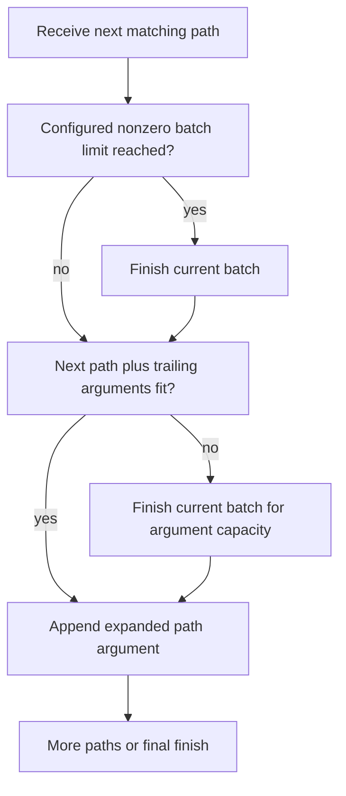

## Overview

`--exec` (`-x`) runs a command for each matching entry; `--exec-batch` (`-X`) accumulates matching paths as arguments to batch commands. Both consume the same filtered results described in [[Traversal and Ignore Rules]]. They replace the ordinary printing consumer, so sorting, colors and `--format` from [[Output and Formatting]] do not transform the child command's output.

Sources: [src/cli.rs:882-948](repo://src/cli.rs#L882-L948), [src/walk.rs:408-440](repo://src/walk.rs#L408-L440), [src/exec/job.rs:33-39](repo://src/exec/job.rs#L33-L39)

## Command arguments and templates

The command is a sequence of arguments. Every argument after `-x` or `-X` belongs to that command until a literal semicolon terminates its template, including arguments beginning with a dash. Put the execution option after the search pattern, roots and fd options. In a shell, `\;` can deliver the terminator without having the shell consume it as a command separator.

Sources: [src/cli.rs:884-899](repo://src/cli.rs#L884-L899), [src/cli.rs:921-930](repo://src/cli.rs#L921-L930)

The CLI provides these examples for a per-entry action and a batch action. The first prints every discovered path under `src`; the second passes Rust-extension matches to `wc -l`. Each example depends on the named executable being available to the process.

Sources: [src/cli.rs:914-915](repo://src/cli.rs#L914-L915), [src/cli.rs:947-948](repo://src/cli.rs#L947-L948), [src/exec/command.rs:101-113](repo://src/exec/command.rs#L101-L113)

```bash
fd . src -x echo
fd -e rs -X wc -l
```

Sources: [src/cli.rs:914-915](repo://src/cli.rs#L914-L915), [src/cli.rs:947-948](repo://src/cli.rs#L947-L948)

`Exec::from_arg_matches` collects occurrences into a `CommandSet`, preserving the argument groups. Each argument is parsed with the shared placeholder language in [[Output and Formatting]]. If no argument contains a placeholder, the template adds a final `{}` argument. An empty command is rejected explicitly because otherwise a match could become the executable accidentally. Template generation constructs `argmax::Command` directly; it does not introduce an implicit shell for aliases or shell syntax.

Sources: [src/cli.rs:861-873](repo://src/cli.rs#L861-L873), [src/exec/mod.rs:219-271](repo://src/exec/mod.rs#L219-L271)

Batch mode requires a fixed executable and at most one argument containing placeholders. The check counts placeholder-bearing arguments, not individual tokens within one argument. Thus a single composite path argument can contain several substitutions, but two separately varying arguments fail validation. Per-entry mode permits placeholders in the executable as well as in its arguments.

Sources: [src/exec/mod.rs:51-69](repo://src/exec/mod.rs#L51-L69), [src/exec/mod.rs:245-271](repo://src/exec/mod.rs#L245-L271)

## Per-entry dispatch

For `-x`, the receiver starts as many job threads as the configured thread count and gives each a clone of the channel receiver. Each job takes an entry, applies the path-prefix policy from [[Output and Formatting]], generates the configured commands and executes them. `--threads=1` makes execution serial; with several workers, command order is not guaranteed. The CLI's default thread choice is shared with searching, so changing it affects both traversal and execution.

Sources: [src/walk.rs:416-432](repo://src/walk.rs#L416-L432), [src/exec/job.rs:11-43](repo://src/exec/job.rs#L11-L43), [src/cli.rs:554-557](repo://src/cli.rs#L554-L557), [src/cli.rs:895-896](repo://src/cli.rs#L895-L896)

When several commands are configured, `CommandSet::execute` generates them in template order for a given entry. `execute_commands` waits for each child before starting the next command in that sequence. A nonzero status or execution error ends that entry's sequence early. The job loop still receives subsequent entries and merges their statuses, so failure of one match does not globally stop every job.

Sources: [src/exec/mod.rs:76-88](repo://src/exec/mod.rs#L76-L88), [src/exec/command.rs:59-98](repo://src/exec/command.rs#L59-L98), [src/exec/job.rs:19-43](repo://src/exec/job.rs#L19-L43)

## Child output and interaction

With multiple execution threads, commands run through `output()` and their stdout and stderr are collected. The entry's `OutputBuffer` locks both parent streams while writing the collected outputs, preventing different worker threads from interleaving those groups. This buffers the command sequence for an entry, rather than streaming every child write as it happens. A failing command flushes already collected output before returning its error status.

Sources: [src/exec/job.rs:16-17](repo://src/exec/job.rs#L16-L17), [src/exec/command.rs:26-56](repo://src/exec/command.rs#L26-L56), [src/exec/command.rs:65-98](repo://src/exec/command.rs#L65-L98)

With one execution thread, the code spawns and waits without enabling output capture, explicitly allowing intermediate output and interaction. If NUL separation is enabled, the output buffer writes a NUL after the entry's command output even when that output was written directly. This is an entry delimiter, not a request to alter every newline printed by the external program.

Sources: [src/exec/job.rs:16-17](repo://src/exec/job.rs#L16-L17), [src/exec/command.rs:30-55](repo://src/exec/command.rs#L30-L55), [src/exec/command.rs:71-78](repo://src/exec/command.rs#L71-L78)

## Batch construction and splitting

The batch consumer converts matching entries to paths and passes them to `CommandSet::execute_batch`. Each template gets a `CommandBuilder` with fixed arguments before the varying path argument and fixed arguments after it. The builder inherits stdin, stdout and stderr. Every incoming path expands the one varying argument, so the resulting process receives separate arguments rather than one string containing all paths.

Sources: [src/exec/job.rs:46-64](repo://src/exec/job.rs#L46-L64), [src/exec/mod.rs:90-120](repo://src/exec/mod.rs#L90-L120), [src/exec/mod.rs:135-188](repo://src/exec/mod.rs#L135-L188)



Sources: [src/exec/mod.rs:102-114](repo://src/exec/mod.rs#L102-L114), [src/exec/mod.rs:173-203](repo://src/exec/mod.rs#L173-L203)

`--batch-size` sets the maximum number of result arguments per invocation; zero leaves that count unlimited. The builder also asks whether the next path plus trailing fixed arguments fits the operating system's argument capacity, and finishes the current batch if necessary. Consequently `-X` may run several processes even with the default count limit. At end of input it executes a remaining nonempty batch; no matches produce no child invocation.

Sources: [src/cli.rs:492-508](repo://src/cli.rs#L492-L508), [src/exec/mod.rs:110-116](repo://src/exec/mod.rs#L110-L116), [src/exec/mod.rs:173-203](repo://src/exec/mod.rs#L173-L203)

Batch argument order follows discovery and is explicitly nondeterministic. A child returning nonzero sets the builder's accumulated status to general error, resets the command and allows later batches to continue. An I/O error while constructing or running a batch instead returns immediately through `handle_cmd_error`. Argument-size checks can split batches, but an individual argument that cannot be added can still fail.

Sources: [src/cli.rs:933-934](repo://src/cli.rs#L933-L934), [src/exec/mod.rs:100-119](repo://src/exec/mod.rs#L100-L119), [src/exec/mod.rs:178-203](repo://src/exec/mod.rs#L178-L203)

## Detailed listings and final status

`--list-details` is implemented by constructing a batch command rather than a separate metadata printer. Most Unix targets use `ls` with long, human-readable and directory-self listing options. macOS and several BSD targets probe for `gls` before choosing their platform `ls` form. Windows requires an available GNU-style `ls` probe or returns an unsupported error. Color selection is translated into arguments for the chosen listing command.

Sources: [src/main.rs:395-429](repo://src/main.rs#L395-L429), [src/main.rs:430-493](repo://src/main.rs#L430-L493)

Missing executables receive a “Command not found” diagnostic; other execution I/O failures receive a general execution diagnostic. Child failures are reduced to fd's general-error status rather than preserving each child's numeric code. Across workers or batch builders, any error makes the merged status fail; an empty set succeeds. Filesystem errors arriving from traversal are optionally printed and skipped by both consumers, independently of child-process status.

Sources: [src/exec/command.rs:80-113](repo://src/exec/command.rs#L80-L113), [src/exit_codes.rs:14-21](repo://src/exit_codes.rs#L14-L21), [src/exit_codes.rs:46-51](repo://src/exit_codes.rs#L46-L51), [src/exec/job.rs:23-30](repo://src/exec/job.rs#L23-L30), [src/exec/job.rs:51-63](repo://src/exec/job.rs#L51-L63)
