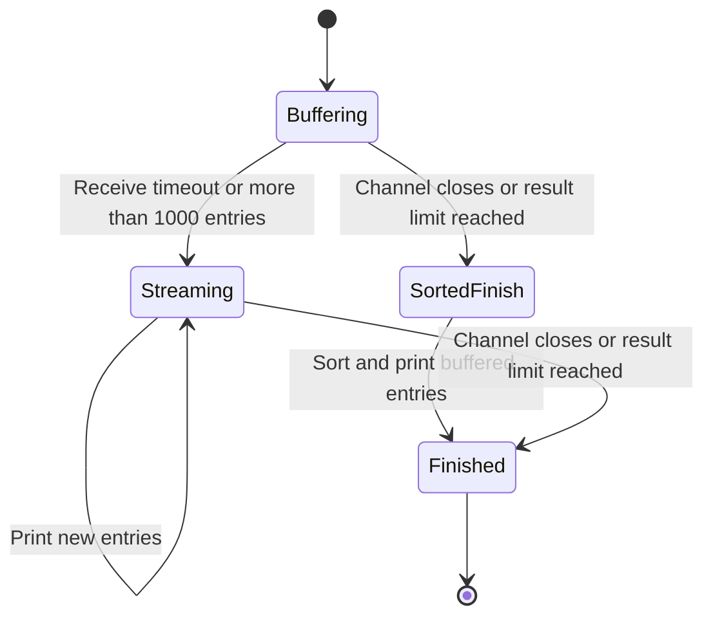

## Overview

Ordinary output consumes the entries delivered by [[Traversal and Ignore Rules]] through `ReceiverBuffer`, then sends each path to `output::print_entry`. Printing chooses a custom format, colored paths or plain paths and appends a newline or NUL delimiter. The same template parser supplies placeholders to [[Command Execution]], but child-process output uses that subsystem's separate buffering rules.

Sources: [src/walk.rs:408-440](repo://src/walk.rs#L408-L440), [src/output.rs:17-43](repo://src/output.rs#L17-L43), [src/exec/mod.rs:219-234](repo://src/exec/mod.rs#L219-L234), [src/exec/command.rs:59-98](repo://src/exec/command.rs#L59-L98)

## Buffering and order

The receiver starts in buffering mode with a deadline 100 milliseconds ahead by default. It buffers up to 1000 entries; receiving the 1001st switches to streaming. A receive timeout also switches to streaming, flushing the entries in their received order. If the channel closes or a result limit ends the search while still buffering, `stop` sorts the buffer before printing it. Sorting uses `DirEntry`'s path ordering.

Sources: [src/walk.rs:124-169](repo://src/walk.rs#L124-L169), [src/walk.rs:198-245](repo://src/walk.rs#L198-L245), [src/walk.rs:269-292](repo://src/walk.rs#L269-L292), [src/dir_entry.rs:132-137](repo://src/dir_entry.rs#L132-L137)

Sources: [src/walk.rs:198-245](repo://src/walk.rs#L198-L245), [src/walk.rs:269-292](repo://src/walk.rs#L269-L292)

This state machine describes ordinary result printing; quiet mode exits before buffering its first match. The hidden `--max-buffer-time` setting accepts milliseconds and changes the initial deadline. Once streaming, the receiver does not restore sorting, and it flushes output before waiting when no next batch is ready. A sorted short search therefore does not establish a stable ordering contract for later, larger searches.

Sources: [src/cli.rs:559-564](repo://src/cli.rs#L559-L564), [src/walk.rs:153-169](repo://src/walk.rs#L153-L169), [src/walk.rs:198-245](repo://src/walk.rs#L198-L245), [src/walk.rs:269-292](repo://src/walk.rs#L269-L292)

## Path spelling and delimiters

For implicit current-directory searches, configuration normally strips `./` from printed paths, but keeps it by default with command execution or NUL output. `--strip-cwd-prefix` accepts `auto`, `always` or `never`; the option conflicts with explicit roots. Even when stripping is enabled, `DirEntry::stripped_path` retains the original prefix if stripping would expose a leading `-`, preserving the protection for downstream option parsers.

Sources: [src/main.rs:378-391](repo://src/main.rs#L378-L391), [src/cli.rs:674-680](repo://src/cli.rs#L674-L680), [src/cli.rs:765-773](repo://src/cli.rs#L765-L773), [src/dir_entry.rs:56-80](repo://src/dir_entry.rs#L56-L80)

Plain and colored renderers append the configured separator to directory entries. `--path-separator` changes displayed separators; absent an explicit value, Windows builds with a nonempty `MSYSTEM` environment variable select `/`. Windows rejects a supplied separator longer than one byte. These output transformations are distinct from the absolute-path match string described in [[Search Patterns]].

Sources: [src/output.rs:45-65](repo://src/output.rs#L45-L65), [src/output.rs:110-136](repo://src/output.rs#L110-L136), [src/output.rs:142-155](repo://src/output.rs#L142-L155), [src/filesystem.rs:123-136](repo://src/filesystem.rs#L123-L136), [src/main.rs:234-264](repo://src/main.rs#L234-L264)

`--print0`, or `-0`, changes the per-entry terminator from newline to NUL. It does not select a different match predicate. On Unix, plain output to a non-terminal with no custom separator writes original path bytes directly, preserving invalid UTF-8 names for downstream tools. Custom formatting and colored output instead pass through lossy string conversion, so NUL separation alone is not a universal byte-preservation guarantee.

Sources: [src/cli.rs:266-276](repo://src/cli.rs#L266-L276), [src/output.rs:38-42](repo://src/output.rs#L38-L42), [src/output.rs:69-97](repo://src/output.rs#L69-L97), [src/output.rs:167-182](repo://src/output.rs#L167-L182)

## Shared format placeholders

`--format` parses a `FormatTemplate` once during configuration. The parser recognizes placeholders and doubled braces, preserving other text as literal text. Templates with no placeholders remain fixed text; printing such a template repeats that text for every result. Command execution adds its own implicit path argument when no placeholder is supplied, as explained in [[Command Execution]].

Sources: [src/main.rs:374-377](repo://src/main.rs#L374-L377), [src/fmt/mod.rs:58-107](repo://src/fmt/mod.rs#L58-L107), [src/fmt/mod.rs:112-140](repo://src/fmt/mod.rs#L112-L140), [src/exec/mod.rs:250-255](repo://src/exec/mod.rs#L250-L255)

| Token | Expansion for an input path |
| --- | --- |
| `{}` | Whole path supplied to the template |
| `{/}` | Basename |
| `{//}` | Parent directory, using `.` for a bare filename |
| `{.}` | Path with its final extension removed |
| `{/.}` | Basename with its final extension removed |
| `{{` and `}}` | Literal opening and closing braces |

Sources: [src/fmt/mod.rs:58-90](repo://src/fmt/mod.rs#L58-L90), [src/fmt/mod.rs:112-140](repo://src/fmt/mod.rs#L112-L140), [src/fmt/input.rs:6-32](repo://src/fmt/input.rs#L6-L32)

Generation produces an `OsString`. Separator replacement applies only to substituted path components, leaving fixed template text untouched. Extension removal uses the path's file stem and strips a leading current-directory component; the tests show that a dotfile such as `.foo` keeps its name. The formatted renderer performs no automatic directory-suffix step, so its visible path decorations are determined by the template.

Sources: [src/fmt/mod.rs:109-140](repo://src/fmt/mod.rs#L109-L140), [src/fmt/input.rs:11-19](repo://src/fmt/input.rs#L11-L19), [src/fmt/input.rs:56-60](repo://src/fmt/input.rs#L56-L60), [src/output.rs:69-86](repo://src/output.rs#L69-L86)

## Color, links and terminal text

Color defaults to `auto`: it requires terminal output, platform ANSI support and no nonempty `NO_COLOR` value. Explicit `always` or `never` bypasses that automatic decision. When enabled, fd loads `LS_COLORS` or falls back to its built-in palette. The renderer colors parent components with the directory style and the basename with the entry style; workers precompute entry styles in parallel for printing.

Sources: [src/cli.rs:520-530](repo://src/cli.rs#L520-L530), [src/main.rs:271-292](repo://src/main.rs#L271-L292), [src/output.rs:110-136](repo://src/output.rs#L110-L136), [src/walk.rs:593-598](repo://src/walk.rs#L593-L598)

Hyperlinks default to disabled. A bare `--hyperlink` selects automatic mode, which follows the color decision; explicit `always` enables it independently. `print_entry` wraps the rendered path in an OSC 8 link when `PathUrl` can construct an absolute path. URL formatting percent-encodes bytes outside its allowlist, including non-ASCII bytes, and converts Windows backslashes to URL slashes. Failure to construct the URL leaves the path unlinked.

Sources: [src/cli.rs:532-548](repo://src/cli.rs#L532-L548), [src/main.rs:293-297](repo://src/main.rs#L293-L297), [src/output.rs:17-36](repo://src/output.rs#L17-L36), [src/hyperlink.rs:7-41](repo://src/hyperlink.rs#L7-L41)

Terminal text is sanitized to prevent escape injection through filenames. Control characters except tab, selected invisible characters, bidirectional overrides and tag characters become visible hexadecimal or Unicode escapes. `maybe_sanitize` applies this only for terminal output. The formatted renderer sanitizes the generated string; colored output sanitizes its parent and basename text before styling.

Sources: [src/sanitize.rs:1-55](repo://src/sanitize.rs#L1-L55), [src/output.rs:75-85](repo://src/output.rs#L75-L85), [src/output.rs:116-129](repo://src/output.rs#L116-L129)

## Limits and exit status

`--max-results` stops the ordinary receiver after the requested number of accepted results; zero disables that limit, and `-1` selects one. Quiet mode returns immediately on its first match without printing result paths. The CLI disallows command execution with result limits or quiet mode, so these controls do not cap the external command consumers.

Sources: [src/cli.rs:29-30](repo://src/cli.rs#L29-L30), [src/cli.rs:566-601](repo://src/cli.rs#L566-L601), [src/cli.rs:759-763](repo://src/cli.rs#L759-L763), [src/walk.rs:203-225](repo://src/walk.rs#L203-L225)

Ordinary completion returns zero even with no matches. Quiet completion returns zero for a match and one otherwise; general errors return one. The interrupt status maps to 130, and Unix exit handling attempts to restore and raise SIGINT. Entry-write errors other than broken pipe produce a diagnostic and general error; flush failures also return general error, so broken-pipe handling should not be interpreted as an unconditional successful exit.

Sources: [src/walk.rs:251-301](repo://src/walk.rs#L251-L301), [src/exit_codes.rs:14-43](repo://src/exit_codes.rs#L14-L43)

For colored printing, `scan` installs a Ctrl-C handler that sets the quit and interrupt flags. A second Ctrl-C exits immediately. The printing path observes the interrupt flag and attempts to flush before returning the interrupt status. This handler is conditional on colored printing, rather than a general wrapper around child-command execution.

Sources: [src/walk.rs:260-263](repo://src/walk.rs#L260-L263), [src/walk.rs:621-633](repo://src/walk.rs#L621-L633), [src/walk.rs:648-652](repo://src/walk.rs#L648-L652)
