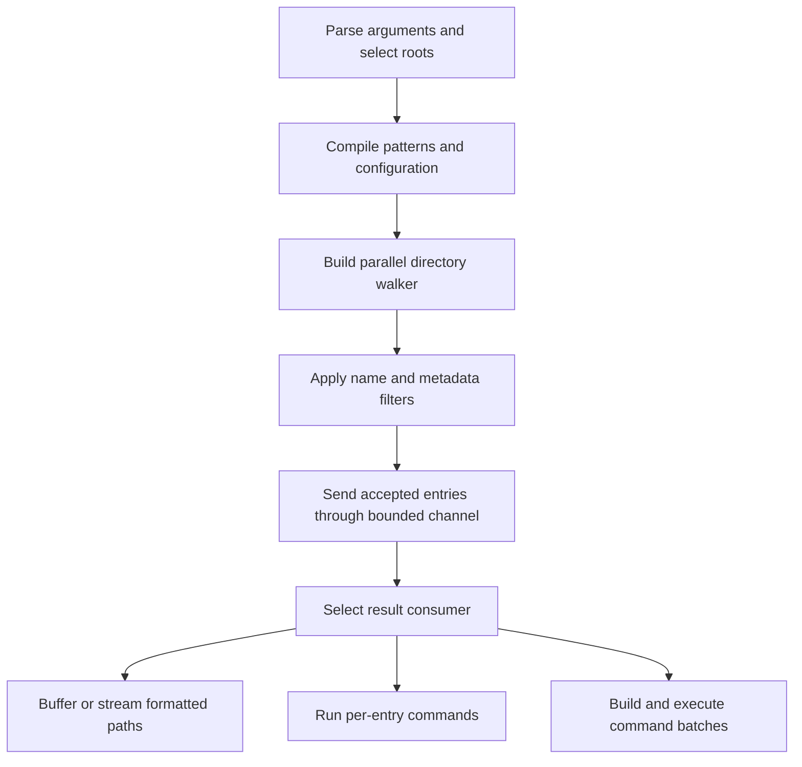

## Overview

`fd` searches filesystem entries by name or path, using regular expressions or glob patterns. Its command-line defaults skip hidden entries and respect ignore rules. The repository builds a Rust executable named `fd` from the `fd-find` package. The program parses one invocation, constructs its search configuration, traverses the requested directories, and either prints matches or passes them to external commands.

Sources: [src/cli.rs:21-60](repo://src/cli.rs#L21-L60), [Cargo.toml:15-32](repo://Cargo.toml#L15-L32), [src/main.rs:75-112](repo://src/main.rs#L75-L112), [src/walk.rs:408-440](repo://src/walk.rs#L408-L440)

The project describes itself as a simple, fast alternative to `find`, with opinionated defaults rather than every feature of that tool. For a first invocation, [[Quickstart]] follows the repository's source-build workflow and basic search interface. This documentation describes the checked-out implementation, including behavior determined by compile-time features and platform-specific branches.

Sources: [README.md:9-12](repo://README.md#L9-L12), [Cargo.toml:19-21](repo://Cargo.toml#L19-L21), [Cargo.toml:94-98](repo://Cargo.toml#L94-L98), [src/main.rs:78-81](repo://src/main.rs#L78-L81)

## Parts of the system

| Area | What it does | Page |
| --- | --- | --- |
| First use | Builds the binary and introduces searches and help | [[Quickstart]] |
| Pattern interpretation | Converts regex, glob, literal and exact patterns into matchers | [[Search Patterns]] |
| Directory discovery | Applies ignore policy and traversal limits, then delivers worker results | [[Traversal and Ignore Rules]] |
| Entry selection | Checks extensions, types and metadata constraints | [[File Filters]] |
| Result presentation | Buffers, orders and renders paths for terminals or pipelines | [[Output and Formatting]] |
| External processes | Expands command templates and runs per-entry or batch jobs | [[Command Execution]] |
| Contributor workflow | Defines build features and test execution | [[Development and Testing]] |

Sources: [src/main.rs:218-232](repo://src/main.rs#L218-L232), [src/walk.rs:347-403](repo://src/walk.rs#L347-L403), [src/walk.rs:514-591](repo://src/walk.rs#L514-L591), [src/output.rs:17-43](repo://src/output.rs#L17-L43), [src/exec/mod.rs:35-120](repo://src/exec/mod.rs#L35-L120), [Cargo.toml:82-107](repo://Cargo.toml#L82-L107)

## From invocation to result

Sources: [src/main.rs:75-112](repo://src/main.rs#L75-L112), [src/walk.rs:408-440](repo://src/walk.rs#L408-L440), [src/walk.rs:514-600](repo://src/walk.rs#L514-L600), [src/walk.rs:616-652](repo://src/walk.rs#L616-L652)

Argument processing happens before traversal: the working directory is selected, roots are checked, patterns are transformed, and configuration is built. [[Search Patterns]] follows this preparation into the final matcher, including errors that prevent a walk from starting. The command consumes directory roots separately from the positional search pattern, so selecting a root and matching a path are distinct operations.

Sources: [src/main.rs:75-112](repo://src/main.rs#L75-L112), [src/cli.rs:695-721](repo://src/cli.rs#L695-L721)

The walker then discovers eligible entries under the configured roots. [[Traversal and Ignore Rules]] explains how visibility and depth determine the candidates. Each candidate passes its name check before the remaining predicates in [[File Filters]]; only accepted entries are sent to the consumer. A rejected name returns immediately, avoiding the later metadata checks.

Sources: [src/walk.rs:347-369](repo://src/walk.rs#L347-L369), [src/walk.rs:508-600](repo://src/walk.rs#L508-L600)

The consumer decides what a match does. [[Output and Formatting]] covers ordinary printing and its short-lived sorting buffer. [[Command Execution]] covers the alternative consumers: one pool for per-entry execution, or a batch consumer that accumulates command arguments. These choices share discovery and filtering, so changing the output action does not create a separate search engine.

Sources: [src/walk.rs:408-440](repo://src/walk.rs#L408-L440), [src/walk.rs:636-646](repo://src/walk.rs#L636-L646)

## Design decisions across the flows

Filtering favors inexpensive checks first. The worker explicitly checks the name before metadata, then extensions, file types, ownership, size and modification time. This ordering means an entry that cannot match its name does not pay for subsequent metadata predicates. The filter catalogue documents the different rules for combining constraints and the cases where missing metadata rejects an entry.

Sources: [src/walk.rs:514-591](repo://src/walk.rs#L514-L591)

Concurrency has bounds. The channel capacity is twice the configured thread count, and sender batches have a size limit to provide backpressure. Per-entry execution with multiple consumers reduces that batch limit to one so work can be distributed evenly. The default thread count follows available parallelism, falls back to one if detection fails, and caps itself at 64 to limit startup overhead on machines with many cores.

Sources: [src/walk.rs:90-120](repo://src/walk.rs#L90-L120), [src/walk.rs:449-457](repo://src/walk.rs#L449-L457), [src/walk.rs:636-646](repo://src/walk.rs#L636-L646), [src/cli.rs:788-800](repo://src/cli.rs#L788-L800)

Presentation balances quick sorted results against streaming. The ordinary receiver starts buffering; if the search ends while still buffered, it sorts the accumulated entries. Crossing its time or size threshold switches it to direct output. This is why result ordering is conditional rather than a global guarantee, and why consumers that require a stable order must account for the behavior described in [[Output and Formatting]].

Sources: [src/walk.rs:124-127](repo://src/walk.rs#L124-L127), [src/walk.rs:198-245](repo://src/walk.rs#L198-L245), [src/walk.rs:269-292](repo://src/walk.rs#L269-L292)

Command and pipeline paths preserve a leading `./` by default when searching the current directory. The CLI documents the reason: reducing the chance that a filename beginning with `-` is interpreted as an option by a downstream command. Configuration selects this policy from whether NUL output or command execution is active; explicit roots and prefix controls are handled separately.

Sources: [src/cli.rs:674-680](repo://src/cli.rs#L674-L680), [src/cli.rs:765-773](repo://src/cli.rs#L765-L773), [src/main.rs:378-391](repo://src/main.rs#L378-L391)

## Failure boundaries

Setup errors propagate to `main`, which prints the error and exits with the general-error status. Traversal errors instead travel alongside entries and are displayed when filesystem-error reporting is enabled. External command failures are aggregated by their consumer. These boundaries matter when interpreting a run: an invalid pattern, an unreadable entry and a failed child command enter different branches rather than one universal error path.

Sources: [src/main.rs:62-72](repo://src/main.rs#L62-L72), [src/walk.rs:227-231](repo://src/walk.rs#L227-L231), [src/walk.rs:485-505](repo://src/walk.rs#L485-L505), [src/exec/job.rs:19-43](repo://src/exec/job.rs#L19-L43)
