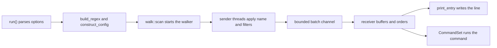

## Overview

fd is a command-line file finder. One run takes a pattern and options, walks the directory tree in parallel, keeps the entries whose names match and every filter the options set, and then prints each one or runs a command on it. `run` in `main.rs` is the entry point: it parses the options, resolves the search paths, builds the regular expressions and the `Config`, and hands the search to `walk::scan`.

Sources: [src/main.rs:75-111](repo://src/main.rs#L75-L111)

The code splits along that path. Each part has its own page:

Sources: [src/main.rs:83-111](repo://src/main.rs#L83-L111)

| Part | What it does | Page |
| --- | --- | --- |
| Startup | parses the options and builds the `Config` the search reads | [[Startup and Configuration]] |
| Patterns | turns each pattern into a regex and matches it against the name | [[Pattern Matching]] |
| Walk | visits the tree in parallel and applies the ignore rules | [[Directory Walk]] |
| Filters | file type, extension, owner, size and time checks on each match | [[Entry Filters]] |
| Results | batches entries to the printer and merges exit codes | [[Result Streaming]] |
| Output | writes one entry, with colour, hyperlinks and terminal sanitising | [[Terminal Output]] |
| Templates | expands `{}`-style placeholders for `--format` and `--exec` | [[Format Templates]] |
| Commands | runs `--exec` and `--exec-batch` on each result or batch | [[Running Commands]] |

Sources: [src/walk.rs:1-26](repo://src/walk.rs#L1-L26), [src/config.rs:1-20](repo://src/config.rs#L1-L20)

## Main flow

Each step below names the page that explains it. The sender threads run the walk and the filters; the receiver thread prints or executes.

Sources: [src/walk.rs:443-460](repo://src/walk.rs#L443-L460), [src/walk.rs:408-441](repo://src/walk.rs#L408-L441)

Sources: [src/main.rs:75-111](repo://src/main.rs#L75-L111), [src/walk.rs:443-460](repo://src/walk.rs#L443-L460), [src/walk.rs:636-649](repo://src/walk.rs#L636-L649)

1. `run` and `construct_config` read the options into a `Config`: see [[Startup and Configuration]].
2. The walker and its ignore rules are built from that `Config`: see [[Directory Walk]].
3. Each sender thread matches the file name against the patterns: see [[Pattern Matching]].
4. A matching entry passes the file type, owner, size and time checks: see [[Entry Filters]].
5. Entries travel to the receiver in batches over a bounded channel, and the receiver buffers them briefly before streaming: see [[Result Streaming]].
6. Each entry is printed by `print_entry`: see [[Terminal Output]]. With `--exec`, a command is built from the placeholders: see [[Format Templates]] and [[Running Commands]].

Sources: [src/walk.rs:408-441](repo://src/walk.rs#L408-L441), [src/output.rs:17-47](repo://src/output.rs#L17-L47), [src/exec/job.rs:11-44](repo://src/exec/job.rs#L11-L44)

## Design decisions

Patterns match the file name, not the path. `search_str_for_entry` returns only the file name unless `--full-path` set a base directory, and `ensure_search_pattern_is_not_a_path` rejects a pattern containing `/` unless `--full-path` is given, because such a pattern could never match a name.

Sources: [src/walk.rs:656-683](repo://src/walk.rs#L656-L683), [src/main.rs:169-182](repo://src/main.rs#L169-L182)

Every pattern must match. The sender skips an entry unless `patterns.iter().all(...)` holds, so a positional pattern and each `--and` pattern narrow the same result set.

Sources: [src/walk.rs:517-523](repo://src/walk.rs#L517-L523)

Matching is smart-case. The search is case-sensitive only when `--case-sensitive` is given or a pattern contains an uppercase literal, and `--ignore-case` overrides both.

Sources: [src/main.rs:251-256](repo://src/main.rs#L251-L256)

The walk is parallel and batched. Senders group up to 256 entries per batch, and when results are sent to an external command with several threads each batch holds one entry so the work spreads across the receivers. The channel holds `2 * threads` batches, which limits how far the walkers run ahead of the printer.

Sources: [src/walk.rs:449-456](repo://src/walk.rs#L449-L456), [src/walk.rs:636](repo://src/walk.rs#L636)

Early results are sorted. The receiver keeps entries in memory for up to 100 ms (the `max_buffer_time` in `Config`, unless set), sorts them if the search finishes in that time, and otherwise streams them unsorted.

Sources: [src/walk.rs:125-127](repo://src/walk.rs#L125-L127), [src/walk.rs:282-291](repo://src/walk.rs#L282-L291)

Exit codes merge. Any worker or command failure makes the whole run return a general error; otherwise the run succeeds, or reports whether it found anything when `--quiet` is set.

Sources: [src/exit_codes.rs:46-51](repo://src/exit_codes.rs#L46-L51)
