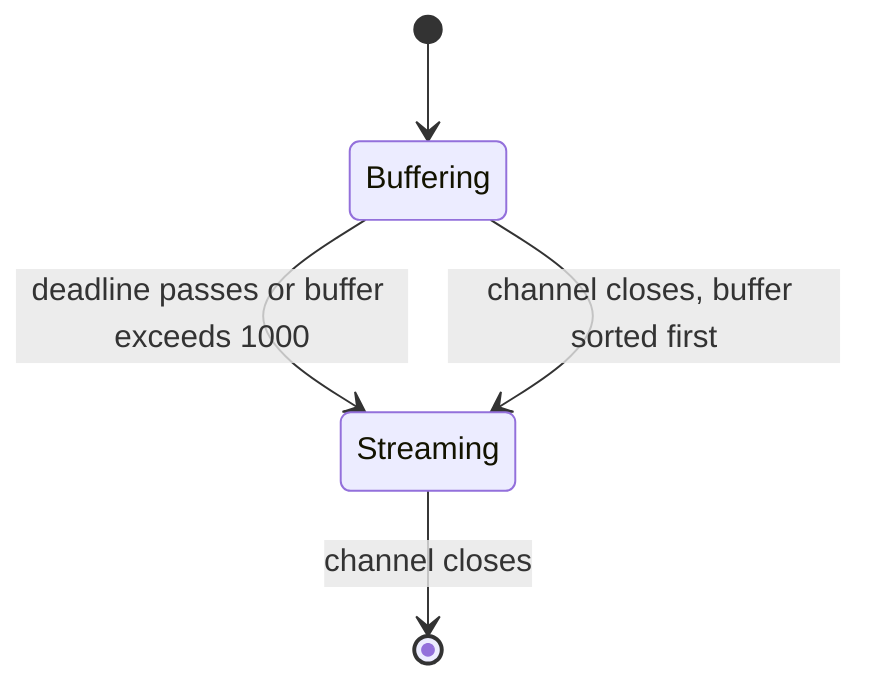

## Overview

The sender threads and the receiver meet at one bounded channel. Senders group matches into batches and send them; a single receiver thread takes the batches, decides whether to hold them for sorting or print them at once, and ends the run with an exit code. The channel holds `2 * threads` batches, so a receiver that falls behind slows the walkers rather than letting results pile up.

Sources: [src/walk.rs:617-650](repo://src/walk.rs#L617-L650)

## Batches

Each sender owns a `BatchSender` with a shared `Batch` and a limit. A batch is sent over the channel as soon as its first item is added, and the sender keeps adding items to it until it holds `limit` entries. The limit is 256 by default, and 1 when a non-batch `--exec` runs on several threads so that work is spread across the job threads.

Sources: [src/walk.rs:75-112](repo://src/walk.rs#L75-L112), [src/walk.rs:449-456](repo://src/walk.rs#L449-L456)

The receiver takes the contents by swapping the `Option` inside the batch to `None`. The sender sees `None` on its next send and starts a fresh batch, so a batch cannot be refilled once it has been consumed. A send error from a closed channel makes the sender quit the walk.

Sources: [src/walk.rs:49-72](repo://src/walk.rs#L49-L72), [src/walk.rs:91-127](repo://src/walk.rs#L91-L127)

## Buffering and streaming

The receiver starts in buffering mode with a deadline `max_buffer_time` ahead, which defaults to 100 ms. Entries go into a vector, and the receiver waits on the channel only until that deadline. Two things switch it to streaming: the deadline passes with no batch, or the buffer grows past 1,000 entries. Each switch prints the buffer and flushes stdout.

Sources: [src/walk.rs:125-127](repo://src/walk.rs#L125-L127), [src/walk.rs:151-172](repo://src/walk.rs#L151-L172), [src/walk.rs:198-250](repo://src/walk.rs#L198-L250), [src/walk.rs:270-280](repo://src/walk.rs#L270-L280)

Sources: [src/walk.rs:198-250](repo://src/walk.rs#L198-L250), [src/walk.rs:282-293](repo://src/walk.rs#L282-L293)

Once streaming, each entry is printed as it arrives. The receiver flushes stdout only when the channel is empty after a batch, so output stays prompt without a flush per line.

Sources: [src/walk.rs:252-268](repo://src/walk.rs#L252-L268), [src/walk.rs:232-238](repo://src/walk.rs#L232-L238)

The sort happens only in the buffering case. A search that ends within the window therefore prints in path order, because `DirEntry` orders by its path, while a longer search prints in the order the walkers produce. `stop` performs that final sort when the walk ends before streaming began.

Sources: [src/walk.rs:282-293](repo://src/walk.rs#L282-L293), [src/dir_entry.rs:125-137](repo://src/dir_entry.rs#L125-L137)

## Early exit

`--quiet` stops at the first entry: the receiver returns `HasResults(true)` at once without printing. `--max-results` and `--max-one-result` count received entries and call `stop` when the count reaches the limit. Either way `process` then sets the quit flag, which tells the senders to stop walking.

Sources: [src/walk.rs:204-206](repo://src/walk.rs#L204-L206), [src/walk.rs:220-225](repo://src/walk.rs#L220-L225), [src/walk.rs:174-182](repo://src/walk.rs#L174-L182)

An interrupt is checked after each printed entry. When the interrupt flag is set, the receiver flushes and returns `KilledBySigint`. The Ctrl-C handler is installed only when results are coloured and printed, so other runs exit through the default signal behaviour.

Sources: [src/walk.rs:252-268](repo://src/walk.rs#L252-L268), [src/walk.rs:621-633](repo://src/walk.rs#L621-L633)

## Errors and exit codes

Walker errors travel the same channel as entries. The receiver prints them only with `--show-errors` and otherwise drops them; in printing mode they do not change the exit code. In exec mode the job threads or batch builders return their codes, and `merge_exitcodes` gives `GeneralError` when any of them failed and `Success` otherwise. `HasResults(true)` maps to 0 and `HasResults(false)` to 1, which is how `--quiet` reports whether anything was found.

Sources: [src/walk.rs:227-232](repo://src/walk.rs#L227-L232), [src/exit_codes.rs:6-23](repo://src/exit_codes.rs#L6-L23), [src/exit_codes.rs:46-51](repo://src/exit_codes.rs#L46-L51)

Printing a single entry is covered in [[Terminal Output]]; running the command for each entry is covered in [[Running Commands]].

Sources: [src/output.rs:17-47](repo://src/output.rs#L17-L47), [src/exec/job.rs:11-44](repo://src/exec/job.rs#L11-L44)
