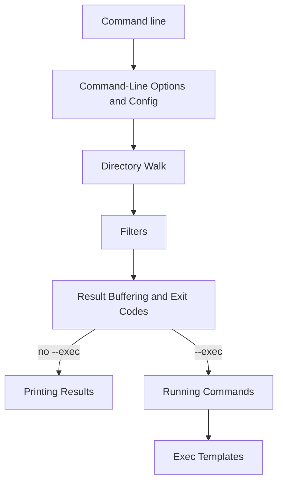

## Overview

*fd* is a command-line file finder. It walks a directory tree in parallel, matches each entry's file name against one or more regular expressions, applies the optional filters, and prints the matches or runs a command for each of them. `run` in `main.rs` is the whole pipeline: it parses the options, builds the patterns and the `Config`, and hands both to the walk.

Sources: [src/main.rs:75-111](repo://src/main.rs#L75-L111)

Only the file name is matched by default. Without `--full-path`, the pattern is tested against the last path component, so a pattern that contains `/` can never match; `--full-path` switches the match to the absolute path instead.

Sources: [src/main.rs:149-153](repo://src/main.rs#L149-L153), [src/walk.rs:656-668](repo://src/walk.rs#L656-L668)

## Parts

| Area | What it does | Page |
| --- | --- | --- |
| Usage | The common invocations, with examples | [[Quickstart]] |
| Options | Parses the flags and maps each one to a `Config` field | [[Command-Line Options and Config]] |
| Patterns | Turns the search pattern into a regex, with glob, exact and smart-case rules | [[Pattern Matching]] |
| Walk | Runs the parallel directory walk and the per-entry checks | [[Directory Walk]] |
| Entries | The `DirEntry` value that carries each match through the pipeline | [[Directory Entries]] |
| Filters | File type, extension, owner, size and modification-time predicates | [[Filters]] |
| Buffering | Orders the matches and streams them to the output; computes the exit code | [[Result Buffering and Exit Codes]] |
| Printing | Writes one entry, with colours, hyperlinks and terminal sanitising | [[Printing Results]] |
| Templates | Parses the `--exec` and `--format` placeholders | [[Exec Templates]] |
| Execution | Runs `--exec` commands one by one or in batches | [[Running Commands]] |

Sources: [src/cli.rs:32-40](repo://src/cli.rs#L32-L40)

## Main flow

Sources: [src/main.rs:75-111](repo://src/main.rs#L75-L111), [src/walk.rs:617-650](repo://src/walk.rs#L617-L650), [src/walk.rs:408-438](repo://src/walk.rs#L408-L438)

The walk threads send each match over a bounded channel to one receiver. The receiver either prints it or hands it to the `--exec` job threads, which build their commands from the templates.

Sources: [src/walk.rs:636-645](repo://src/walk.rs#L636-L645)

## Design decisions

### Matches are sorted when the search is quick

The receiver holds matches in a buffer for the buffer time, 100 ms unless `--max-buffer-time` sets another value, and sorts them if the search ends in that time. Past the deadline, or when the buffer passes 1000 entries, it switches to streaming. The buffer exists so that short searches print in a stable order while long searches show results as they arrive.

Sources: [src/walk.rs:124-127](repo://src/walk.rs#L124-L127), [src/walk.rs:282-290](repo://src/walk.rs#L282-L290)

### Smart case

The search is case-sensitive only when `--case-sensitive` is given, or when a pattern contains an uppercase character and `--ignore-case` is not given. The regex is then built case-insensitive unless the search is case-sensitive.

Sources: [src/main.rs:248-256](repo://src/main.rs#L248-L256), [src/main.rs:541-547](repo://src/main.rs#L541-L547)

### Terminal output is sanitised

Each printed path is passed through `maybe_sanitize`, which escapes control characters and invisible bidi or zero-width characters so that a file name cannot send escape sequences to the user's terminal. The escaping applies only when the output is an interactive terminal, so piped output keeps the raw bytes.

Sources: [src/sanitize.rs:28-52](repo://src/sanitize.rs#L28-L52), [src/output.rs:84](repo://src/output.rs#L84), [src/output.rs:153](repo://src/output.rs#L153)

The README lists the same features as the user sees them: smart case, hidden and ignored entries skipped by default, and parallel traversal.

Sources: [README.md:15-29](repo://README.md#L15-L29)
