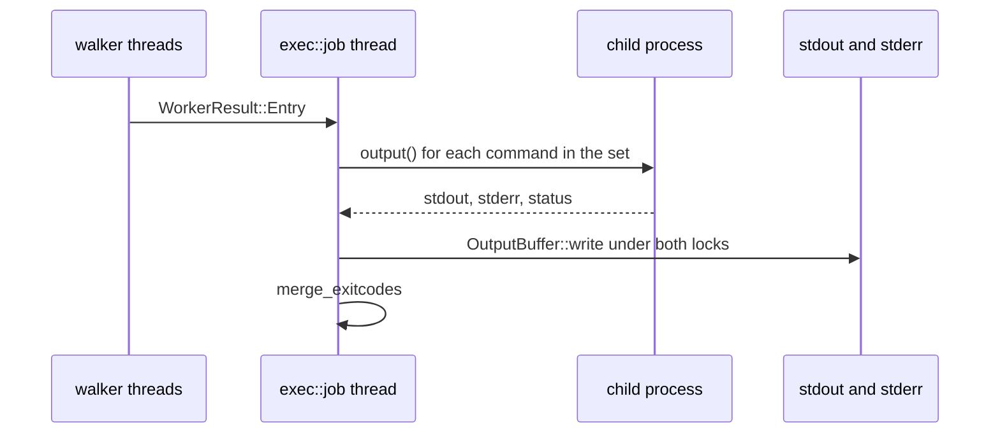

## Overview

Instead of printing results, fd can run a command on them. `-x`/`--exec` runs the command once per result, on several threads at once; `-X`/`--exec-batch` runs it once with all results as arguments, splitting into several runs only when needed. `-l`/`--list-details` is a built-in batch command that runs `ls` (see [[Command-Line Options and Config]]). In every case the parsed command is a `CommandSet` stored in `Config::command`, and its presence switches the scan's receiver from the printer to the code in `src/exec`.

Sources: [src/exec/mod.rs:20-74](repo://src/exec/mod.rs#L20-L74), [src/main.rs:395-410](repo://src/main.rs#L395-L410), [src/walk.rs:406-440](repo://src/walk.rs#L406-L440)

Each command argument is a template; the placeholders `{}`, `{/}`, `{//}`, `{.}` and `{/.}` are explained on [[Placeholder Templates]]. The order in which results reach commands is not defined, because they come from the parallel walk described on [[Parallel Directory Walk]].

Sources: [src/cli.rs:894-908](repo://src/cli.rs#L894-L908), [src/cli.rs:932-943](repo://src/cli.rs#L932-L943)

## Parsing the command line

`--exec` and `--exec-batch` take every following argument, including ones that start with `-`, up to a `;`. That is why the option is usually placed last; `\;` in a shell ends the command so more fd options can follow. Each occurrence of the flag adds one command to the set, so `-x` can be given several times. `--exec-batch` conflicts with `--exec`, and both conflict with `--list-details`, `--max-results`, `-1` and `--quiet`.

Sources: [src/cli.rs:882-952](repo://src/cli.rs#L882-L952), [src/cli.rs:29-30](repo://src/cli.rs#L29-L30)

`Exec::from_arg_matches` passes the occurrences to `CommandSet::new` for `--exec` or `CommandSet::new_batch` for `--exec-batch`, and turns a validation error into a clap `InvalidValue` error.

Sources: [src/cli.rs:861-874](repo://src/cli.rs#L861-L874)

## Validating command templates

`CommandTemplate::new` parses each argument with `FormatTemplate::parse` and then checks the command:

Sources: [src/exec/mod.rs:219-256](repo://src/exec/mod.rs#L219-L256)

1. It must have at least one argument. Clap cannot enforce this, and without the check fd "will try to execute each file and directory it finds".
2. In batch mode the first argument must be a fixed program, not a placeholder. In one-by-one mode a placeholder executable such as `fd -x {}` is allowed and runs each result.
3. If no argument contains a placeholder, a lone `{}` is appended as a last argument, so `fd -e zip -x unzip` runs `unzip <path>`.

Sources: [src/exec/mod.rs:236-255](repo://src/exec/mod.rs#L236-L255), [src/exec/mod.rs:438-443](repo://src/exec/mod.rs#L438-L443)

`new_batch` also refuses a template with more than one placeholder argument ("Only one placeholder allowed for batch commands"), because in batch mode that single argument is repeated once per path.

Sources: [src/exec/mod.rs:51-70](repo://src/exec/mod.rs#L51-L70), [src/exec/mod.rs:421-424](repo://src/exec/mod.rs#L421-L424)

## One command per result

For `--exec`, `WorkerState::receive` starts `config.threads` scoped threads, each running `exec::job` over its own clone of the channel's receiver. The walker threads use a batch limit of 1 in this mode, so the job threads share the work evenly. When every job has finished, their exit codes are merged.

Sources: [src/walk.rs:412-433](repo://src/walk.rs#L412-L433), [src/walk.rs:449-456](repo://src/walk.rs#L449-L456)

`job` handles each `WorkerResult`. Errors are printed under `--show-errors` and skipped. For an entry it calls `CommandSet::execute` with the stripped path, the path separator, the null-separator flag, and `buffer_output = threads > 1`. It keeps going after a failure, folding each command's code into its own with `merge_exitcodes`.

Sources: [src/exec/job.rs:8-44](repo://src/exec/job.rs#L8-L44)

`execute` expands every command in the set for the path and hands them to `execute_commands`, which runs them in order:

Sources: [src/exec/mod.rs:76-88](repo://src/exec/mod.rs#L76-L88), [src/exec/mod.rs:262-272](repo://src/exec/mod.rs#L262-L272)

- **With buffering** (several threads), each command runs with `output()`, which captures its stdout and stderr into an `OutputBuffer`. When the entry's commands are done, `OutputBuffer::write` locks both stdout and stderr and writes all of the captured output at once, so output from parallel commands never interleaves.
- **Without buffering** (`--threads=1`), each command is spawned with inherited streams and waited for, so its output is shown live and interactive programs work.
- **On failure**, a non-zero or missing exit status writes what was buffered and returns `GeneralError`; the set's remaining commands are not run for that entry.
- **With `--print0`**, `write` adds a `\0` after each entry's output even when nothing was captured, so the results stay separated.

Sources: [src/exec/command.rs:9-57](repo://src/exec/command.rs#L9-L57), [src/exec/command.rs:59-99](repo://src/exec/command.rs#L59-L99)



Sources: [src/exec/job.rs:20-41](repo://src/exec/job.rs#L20-L41), [src/exec/command.rs:30-56](repo://src/exec/command.rs#L30-L56)

## All results in one command

For `--exec-batch` and `--list-details`, the receiver thread itself runs `exec::batch`. It turns the incoming results into owned stripped paths, prints errors under `--show-errors`, and passes the stream to `CommandSet::execute_batch` with `--batch-size` as the limit (0, the default, means no limit). The stream is lazy, so a batch can start while the walk is still running.

Sources: [src/walk.rs:412-414](repo://src/walk.rs#L412-L414), [src/exec/job.rs:46-64](repo://src/exec/job.rs#L46-L64), [src/cli.rs:492-508](repo://src/cli.rs#L492-L508)

`execute_batch` makes one `CommandBuilder` per command in the set and pushes every path to each of them in turn. A builder splits its template around the placeholder argument into `pre_args`, the `path_arg` template and `post_args`, and builds an `argmax::Command` from the program and `pre_args`, with stdin, stdout and stderr inherited.

Sources: [src/exec/mod.rs:90-120](repo://src/exec/mod.rs#L90-L120), [src/exec/mod.rs:123-171](repo://src/exec/mod.rs#L123-L171)

```rust
fn push(&mut self, path: &Path, separator: Option<&str>) -> io::Result<()> {
    if self.limit > 0 && self.count >= self.limit {
        self.finish()?;
    }

    let arg = self.path_arg.generate(path, separator);
    if !self
        .cmd
        .args_would_fit(iter::once(&arg).chain(&self.post_args))
    {
        self.finish()?;
    }

    self.cmd.try_arg(arg)?;
    self.count += 1;
    Ok(())
}
```

Sources: [src/exec/mod.rs:173-189](repo://src/exec/mod.rs#L173-L189)

`push` runs the pending command first when it already holds `limit` paths, or when the new argument plus the trailing `post_args` would not fit within the operating system's command-line limit. `argmax` does that size check. `finish` appends `post_args`, runs the command, records `GeneralError` if it fails, and starts a fresh command with the same `pre_args`; it does nothing when no path has been added. After the last path every builder is finished, and the builders' exit codes are merged.

Sources: [src/exec/mod.rs:191-207](repo://src/exec/mod.rs#L191-L207), [src/exec/mod.rs:110-116](repo://src/exec/mod.rs#L110-L116)

The result is that `fd -e rs -X wc -l` runs `wc -l` once with every Rust file, or several times when there are too many files for one command line, with each run getting a contiguous slice of the results.

Sources: [src/cli.rs:944-948](repo://src/cli.rs#L944-L948)

## Errors and exit codes

`handle_cmd_error` turns a failure to start a command into a message. A `NotFound` error with a known command prints "Command not found: <program>"; anything else prints "Problem while executing command: <error>". Both return `GeneralError`. In batch mode a start failure returns at once; in one-by-one mode it fails only that entry.

Sources: [src/exec/command.rs:101-115](repo://src/exec/command.rs#L101-L115), [src/exec/mod.rs:100-119](repo://src/exec/mod.rs#L100-L119)

The final exit status is 1 when any command failed or could not be started, and 0 otherwise; `merge_exitcodes` folds every code into one (see [[Exit Codes, Errors and Interrupts]]).

Sources: [src/exit_codes.rs:46-51](repo://src/exit_codes.rs#L46-L51), [src/walk.rs:430-431](repo://src/walk.rs#L430-L431)

## Paths passed to commands

Commands receive `stripped_path`, but `strip_cwd_prefix` defaults to off when a command is given, so a result in the current directory is passed as `./name`. A file called `-rf` therefore reaches the command as `./-rf`, not as an option. `--strip-cwd-prefix` turns the stripping back on, and the dash check still keeps `./` in front of a name starting with `-`.

Sources: [src/main.rs:390](repo://src/main.rs#L390), [src/cli.rs:674-680](repo://src/cli.rs#L674-L680), [src/dir_entry.rs:56-71](repo://src/dir_entry.rs#L56-L71)
