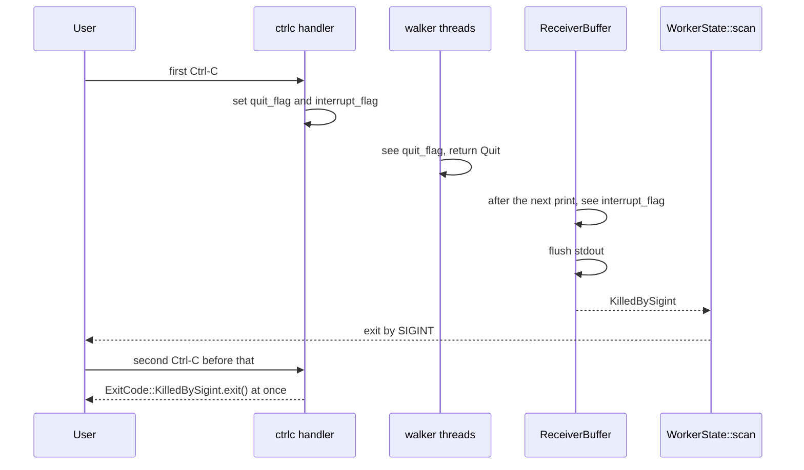

## Overview

Every path through fd ends in `main`, which calls `run` and turns its result into a process exit. A successful `run` returns an `ExitCode` chosen by the receiver of the scan; an `Err` from anywhere before or around the scan is printed with `print_error` and exits as `GeneralError`. Errors found during the walk do not end the search: they travel to the receiver as `WorkerResult::Error` values and are printed only on request.

Sources: [src/main.rs:62-73](repo://src/main.rs#L62-L73), [src/walk.rs:37-45](repo://src/walk.rs#L37-L45)

This page lists the codes and the error paths. Which flow returns which code is shown on [[Output and Buffering]] for printing and [[Command Execution]] for commands.

Sources: [src/walk.rs:281-293](repo://src/walk.rs#L281-L293), [src/exec/job.rs:40-43](repo://src/exec/job.rs#L40-L43)

## Exit codes

| `ExitCode` | Status | Returned when |
| --- | --- | --- |
| `Success` | 0 | the search ended normally, or every command succeeded |
| `HasResults(true)` | 0 | `--quiet` found at least one entry |
| `HasResults(false)` | 1 | `--quiet` found nothing |
| `GeneralError` | 1 | an error stopped fd, a write failed, or a command failed |
| `KilledBySigint` | 130 | Ctrl-C interrupted the search |

Sources: [src/exit_codes.rs:6-23](repo://src/exit_codes.rs#L6-L23)

Without `--quiet`, a search that finds nothing still exits 0; only `--quiet` reports "no results" through the status.

Sources: [src/walk.rs:281-293](repo://src/walk.rs#L281-L293), [src/cli.rs:588-601](repo://src/cli.rs#L588-L601)

`merge_exitcodes` combines several codes, as the parallel `--exec` jobs and the batch builders do: if any code is non-zero, the result is `GeneralError`, and otherwise `Success`. An interrupted job therefore becomes `GeneralError` in the merged result, as the unit tests check; the interrupt is still reported, because `scan` checks the interrupt flag itself after the receiver returns.

Sources: [src/exit_codes.rs:26-51](repo://src/exit_codes.rs#L26-L51), [src/exit_codes.rs:53-93](repo://src/exit_codes.rs#L53-L93), [src/walk.rs:648-652](repo://src/walk.rs#L648-L652)

`ExitCode::exit` normally calls `process::exit` with the status. For `KilledBySigint` on Unix it first restores the default SIGINT handler and raises SIGINT against itself, so the parent shell sees a process killed by the signal rather than one that exited with 130. Status 130 is the fallback if raising the signal fails to end the process.

Sources: [src/exit_codes.rs:25-44](repo://src/exit_codes.rs#L25-L44)

## Error messages

`print_error` writes `[fd error]: ` and the message to stderr. When stderr is a terminal the message is passed through `maybe_sanitize` first, because messages often contain file names (see [[Output and Buffering]]). `main` formats a top-level `anyhow` error with `{err:#}`, which includes its chain of causes on one line.

Sources: [src/error.rs:1-9](repo://src/error.rs#L1-L9), [src/main.rs:68-71](repo://src/main.rs#L68-L71)

Argument errors are reported by clap inside `Opts::parse` before `run` does anything else. Everything `run` rejects afterwards is an `anyhow` error that ends fd with status 1.

Sources: [src/main.rs:75-112](repo://src/main.rs#L75-L112)

| Message starts with | Raised by | Page |
| --- | --- | --- |
| "The '--base-directory' path … is not a directory" | `set_working_dir` | [[Command-Line Options and Config]] |
| "No valid search paths given." | `run` | [[Command-Line Options and Config]] |
| "The search pattern … contains a path-separation character" | `ensure_single_search_pattern_is_not_a_path` | [[Pattern Matching]] |
| "The pattern(s) seems to only match files with a leading dot" | `ensure_use_hidden_option_for_leading_dot_pattern` | [[Pattern Matching]] |
| a regex syntax error, with a note on `--fixed-strings` | `build_regex` | [[Pattern Matching]] |
| "… is not a valid date or duration" | `extract_time_constraints` | [[Entry Filters]] |
| "A path separator must be exactly one byte" (Windows) | `check_path_separator_length` | [[Command-Line Options and Config]] |
| "Malformed exclude pattern" | `build_overrides` | [[Hidden Files, Ignore Rules and Exclusions]] |
| "'fd --list-details' is not supported …" | `determine_ls_command` | [[Command-Line Options and Config]] |

Sources: [src/main.rs:131-147](repo://src/main.rs#L131-L147), [src/main.rs:84-87](repo://src/main.rs#L84-L87), [src/main.rs:203-212](repo://src/main.rs#L203-L212), [src/main.rs:521-555](repo://src/main.rs#L521-L555), [src/main.rs:496-519](repo://src/main.rs#L496-L519), [src/main.rs:234-246](repo://src/main.rs#L234-L246), [src/walk.rs:330-345](repo://src/walk.rs#L330-L345), [src/main.rs:481-492](repo://src/main.rs#L481-L492)

## Errors that do not stop fd

Some problems are reported and the search goes on:

Sources: [src/cli.rs:709-720](repo://src/cli.rs#L709-L720)

- **A search path that is not a directory** is reported as "Search path '…' is not a directory." and dropped; fd stops only if no path is left.
- **A malformed line in the global or a custom ignore file** prints "Malformed pattern in … ignore file", unless the error is only partial, and the walk continues.
- **A walk error** (permission denied, a loop, an unreadable directory) is sent as `WorkerResult::Error`. The printer and both command runners print it only with `--show-errors`, and drop it otherwise, without changing the exit code.
- **A broken symlink** is not an error at all: the walker turns it into a result (see [[Parallel Directory Walk]]).

Sources: [src/cli.rs:709-720](repo://src/cli.rs#L709-L720), [src/walk.rs:376-395](repo://src/walk.rs#L376-L395), [src/walk.rs:485-505](repo://src/walk.rs#L485-L505), [src/walk.rs:227-232](repo://src/walk.rs#L227-L232), [src/exec/job.rs:25-30](repo://src/exec/job.rs#L25-L30), [src/exec/job.rs:55-60](repo://src/exec/job.rs#L55-L60), [src/cli.rs:603-611](repo://src/cli.rs#L603-L611)

## Broken pipes

When fd's output goes into a program that exits early, such as `fd | head`, writes start failing. `ReceiverBuffer::print` ignores `BrokenPipe` write errors, and the next flush fails; `flush` treats any flush error as "probably a broken pipe" and stops the receiver with `GeneralError` without printing a message. The receiver then sets the quit flag, so the walker threads stop too. Any other write error prints "Could not write to output: …".

Sources: [src/walk.rs:251-258](repo://src/walk.rs#L251-L258), [src/walk.rs:295-302](repo://src/walk.rs#L295-L302), [src/walk.rs:173-181](repo://src/walk.rs#L173-L181)

## Ctrl-C

`WorkerState::scan` installs a `ctrlc` handler only when results are printed in colour, that is when `ls_colors` is set and no command is given. In every other mode SIGINT keeps its default behaviour and ends fd at once.

Sources: [src/walk.rs:621-634](repo://src/walk.rs#L621-L634)

```rust
ctrlc::set_handler(move || {
    quit_flag.store(true, Ordering::Relaxed);

    if interrupt_flag.fetch_or(true, Ordering::Relaxed) {
        // Ctrl-C has been pressed twice, exit NOW
        ExitCode::KilledBySigint.exit();
    }
})
.unwrap();
```

Sources: [src/walk.rs:625-633](repo://src/walk.rs#L625-L633)



Sources: [src/walk.rs:259-264](repo://src/walk.rs#L259-L264), [src/walk.rs:459-462](repo://src/walk.rs#L459-L462), [src/walk.rs:648-652](repo://src/walk.rs#L648-L652)

The first press sets both flags. The walker threads stop at their next entry, and the receiver flushes and returns `KilledBySigint` after the entry it is printing, so the output ends on a complete line. If the receiver was still buffering, the walk ending makes it print the sorted buffer, and it stops after the first printed entry. `scan` returns `KilledBySigint` whenever the interrupt flag is set, whatever code the receiver gave. A second press, before fd has exited, makes the handler exit immediately.

Sources: [src/walk.rs:259-264](repo://src/walk.rs#L259-L264), [src/walk.rs:281-286](repo://src/walk.rs#L281-L286), [src/walk.rs:648-652](repo://src/walk.rs#L648-L652), [src/walk.rs:628-631](repo://src/walk.rs#L628-L631)
