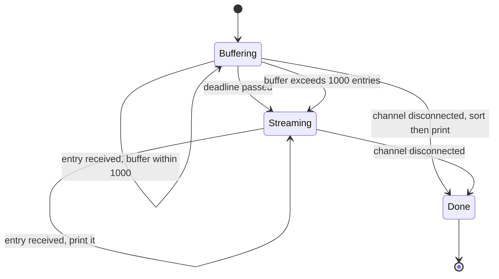

## Overview

When no command is given, the receiver thread of a scan owns standard output. `WorkerState::receive` locks stdout once, wraps it in a `BufWriter`, and hands it to a `ReceiverBuffer`, which decides when to print (buffer and sort, or stream) and when to stop (end of walk, `--max-results`, `--quiet`, Ctrl-C). Each entry is written by `output::print_entry`, which decides how a path looks: colours, hyperlink, `--format`, separators, and escaping of unsafe characters.

Sources: [src/walk.rs:406-440](repo://src/walk.rs#L406-L440), [src/walk.rs:129-171](repo://src/walk.rs#L129-L171), [src/output.rs:16-43](repo://src/output.rs#L16-L43)

The results arrive in batches from the walker threads described on [[Parallel Directory Walk]]. With `--exec` or `--exec-batch` the receiver runs commands instead, as described on [[Command Execution]].

Sources: [src/walk.rs:411-433](repo://src/walk.rs#L411-L433)

## Buffering, then streaming

The receiver starts in `Buffering` mode with a deadline of `max_buffer_time` (the hidden `--max-buffer-time` flag, in milliseconds) or 100 ms. While buffering it waits on the channel only until the deadline and collects entries in a vector. When the walk ends first, the buffer is sorted and printed, so a search that finishes quickly gives sorted, repeatable output.

Sources: [src/walk.rs:124-127](repo://src/walk.rs#L124-L127), [src/walk.rs:151-171](repo://src/walk.rs#L151-L171), [src/walk.rs:183-195](repo://src/walk.rs#L183-L195), [src/cli.rs:559-564](repo://src/cli.rs#L559-L564)

Sources: [src/walk.rs:197-249](repo://src/walk.rs#L197-L249), [src/walk.rs:269-293](repo://src/walk.rs#L269-L293)

Switching to streaming (`stream`) prints the buffered entries in the order they arrived, unsorted, flushes, and from then on prints each entry as it comes, waiting on the channel for as long as it takes. In streaming mode the receiver flushes stdout whenever the channel is momentarily empty, so output appears promptly without a flush per line.

Sources: [src/walk.rs:269-279](repo://src/walk.rs#L269-L279), [src/walk.rs:208-218](repo://src/walk.rs#L208-L218), [src/walk.rs:235-238](repo://src/walk.rs#L235-L238)

## Stopping early

`process` loops on `poll` until it returns an `ExitCode` and then sets the shared `quit_flag`, which makes every walker thread return `WalkState::Quit` at its next entry.

Sources: [src/walk.rs:173-181](repo://src/walk.rs#L173-L181), [src/walk.rs:459-462](repo://src/walk.rs#L459-L462)

- **`--quiet`** (`-q`, `--has-results`): the first entry returns `HasResults(true)` at once, before anything is printed. If the walk ends with no entries, `stop` returns `HasResults(false)`, which maps to exit status 1.
- **`--max-results N`** and **`-1`**: after the N-th entry is counted, `stop` runs. If the receiver is still buffering, the N entries found so far are sorted before printing.
- **End of walk**: a disconnected channel also calls `stop`.

Sources: [src/walk.rs:203-226](repo://src/walk.rs#L203-L226), [src/walk.rs:281-293](repo://src/walk.rs#L281-L293), [src/exit_codes.rs:14-23](repo://src/exit_codes.rs#L14-L23)

Filesystem errors sent by the walker are printed with `print_error` only under `--show-errors`, and otherwise dropped. A write error other than a broken pipe prints "Could not write to output" and stops with `GeneralError`; a failed flush, "probably a broken pipe", stops with `GeneralError` without a message. After each printed entry the receiver checks the interrupt flag and, if Ctrl-C was pressed, flushes and stops with `KilledBySigint` (see [[Exit Codes, Errors and Interrupts]]).

Sources: [src/walk.rs:227-232](repo://src/walk.rs#L227-L232), [src/walk.rs:251-267](repo://src/walk.rs#L251-L267), [src/walk.rs:295-302](repo://src/walk.rs#L295-L302)

## Printing one entry

### Choosing a style

`print_entry` writes, in order: an optional hyperlink opener, the path in one of three styles, the hyperlink closer, and the terminator, which is `\0` with `-0`/`--print0` and a newline otherwise.

Sources: [src/output.rs:16-43](repo://src/output.rs#L16-L43)

| Style | Used when | Writer |
| --- | --- | --- |
| Template | `--format` is given | `print_entry_format` |
| Coloured | `ls_colors` is set (colour on, see [[Command-Line Options and Config]]) | `print_entry_colorized` |
| Plain | otherwise | `print_entry_uncolorized` |

Sources: [src/output.rs:26-32](repo://src/output.rs#L26-L32)

All three start from `entry.stripped_path(config)`: the leading `./` is removed when `strip_cwd_prefix` is on, unless the rest would begin with `-` (see [[Parallel Directory Walk]]).

Sources: [src/output.rs:68-86](repo://src/output.rs#L68-L86), [src/output.rs:88-96](repo://src/output.rs#L88-L96), [src/output.rs:141-147](repo://src/output.rs#L141-L147)

### Coloured paths

`print_entry_colorized` splits the path into the parent part, including any separators that follow it, and the final component. The parent is painted with the `LS_COLORS` directory style, after replacing separators when `--path-separator` is set. The final component is painted with the entry's own style, which the walker thread usually computed already and cached in the `DirEntry`.

Sources: [src/output.rs:88-129](repo://src/output.rs#L88-L129)

### Trailing separator on directories

Coloured and plain output append `actual_path_separator` after every directory, which is why directories print as `one/two/`. In colour it is painted with the directory style. Template output does not add it.

Sources: [src/output.rs:45-66](repo://src/output.rs#L45-L66), [src/output.rs:131-139](repo://src/output.rs#L131-L139), [src/output.rs:155](repo://src/output.rs#L155)

### Plain paths and raw bytes

On Unix, when stdout is not a terminal and no `--path-separator` is set, `print_entry_uncolorized` writes the path's raw bytes with `write_all`, "so invalid UTF-8 filenames reach downstream tools intact". Otherwise, and always on other platforms, the path is converted lossily to a string, separators are replaced if requested, and the result is sanitized.

Sources: [src/output.rs:141-182](repo://src/output.rs#L141-L182)

### Templates

With `--format`, the parsed `FormatTemplate` is expanded against the stripped path with the configured separator, converted lossily to a string, and sanitized. The placeholder syntax is on [[Placeholder Templates]].

Sources: [src/output.rs:68-86](repo://src/output.rs#L68-L86), [src/main.rs:374-377](repo://src/main.rs#L374-L377)

## Hyperlinks

With `--hyperlink`, each path is wrapped in an OSC 8 escape sequence (`ESC ] 8 ; ; url ESC \` … `ESC ] 8 ; ; ESC \`), which terminals that support it render as a clickable link. The URL comes from `PathUrl::new`, which makes the path absolute; if that fails, the path is printed without a link.

Sources: [src/output.rs:17-24](repo://src/output.rs#L17-L24), [src/output.rs:34-36](repo://src/output.rs#L34-L36), [src/hyperlink.rs:5-11](repo://src/hyperlink.rs#L5-L11)

`PathUrl` formats as `file://`, then the host, then the absolute path percent-encoded byte by byte. Only ASCII letters, digits and `/ : - . _ ~` are written as they are; every other byte, including all non-ASCII bytes, becomes `%XX`, because on some systems the path bytes may not be valid UTF-8. On Unix the host is the machine's hostname, looked up once; elsewhere it is `/`, and Windows backslashes become `/`.

Sources: [src/hyperlink.rs:13-62](repo://src/hyperlink.rs#L13-L62), [src/hyperlink.rs:80-86](repo://src/hyperlink.rs#L80-L86)

## Terminal sanitization

A file name can contain escape sequences that a terminal would run: changing the clipboard (OSC 52), forging a hyperlink, or overwriting earlier output with a carriage return. `sanitize.rs` exists "to prevent terminal escape injection via filenames". `maybe_sanitize` escapes only when its `is_terminal` argument is true, and the printer passes `config.interactive_terminal`, so pipes and files get the bytes unchanged.

Sources: [src/sanitize.rs:1-2](repo://src/sanitize.rs#L1-L2), [src/sanitize.rs:48-55](repo://src/sanitize.rs#L48-L55), [src/sanitize.rs:79-96](repo://src/sanitize.rs#L79-L96)

`needs_escape` flags every control character except tab, plus the soft hyphen, zero-width characters, bidi embedding and override marks, word joiners and other invisible format characters, the byte-order mark, interlinear annotation characters and language tags. `sanitize_for_terminal` returns the input borrowed when nothing needs escaping; otherwise it writes `\xNN` for code points up to `0xFF` and `\u{NNNN}` above, so the escaped form still shows which character was there.

Sources: [src/sanitize.rs:6-46](repo://src/sanitize.rs#L6-L46), [src/sanitize.rs:98-117](repo://src/sanitize.rs#L98-L117)

Sanitization covers the plain path, both coloured parts and template output. Error messages go through the same function, checked against stderr instead of stdout (see [[Exit Codes, Errors and Interrupts]]).

Sources: [src/output.rs:80-85](repo://src/output.rs#L80-L85), [src/output.rs:120-129](repo://src/output.rs#L120-L129), [src/output.rs:153-154](repo://src/output.rs#L153-L154), [src/error.rs:5-9](repo://src/error.rs#L5-L9)
