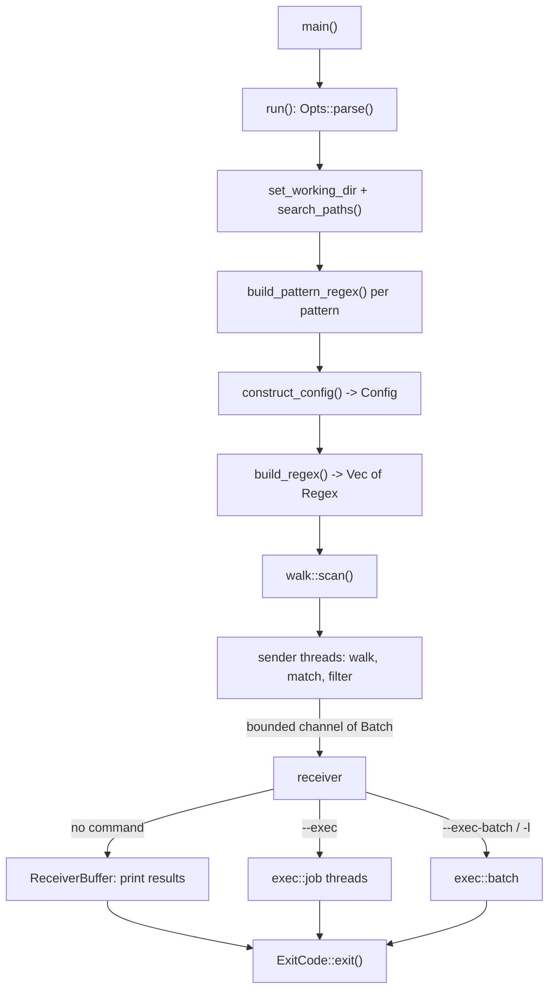

## Overview

fd is a command-line program that finds entries in a filesystem. It is a simpler, faster alternative to `find`: one positional pattern (a regular expression by default) is matched against file names, hidden files and `.gitignore`d paths are skipped, and the search is case-insensitive unless the pattern holds an uppercase letter. The crate is published as `fd-find` and builds a single binary named `fd` from `src/main.rs`.

Sources: [Cargo.toml:1-31](repo://Cargo.toml#L1-L31), [src/cli.rs:21-31](repo://src/cli.rs#L21-L31)

Every invocation runs the same pipeline. `run` parses the arguments, compiles the patterns, freezes every option into one `Config`, and hands the search paths, regexes and config to `walk::scan`. From there a pool of walker threads finds and filters entries, and one receiver either prints them or runs a command for each one. `main` turns the returned `ExitCode` (or an error) into the process exit status.

Sources: [src/main.rs:62-112](repo://src/main.rs#L62-L112), [src/walk.rs:680-687](repo://src/walk.rs#L680-L687)

## Parts of fd

| Area | What it does | Page |
| --- | --- | --- |
| Building and first searches | Build with Cargo or `make`, install completions and the man page | [[Quickstart]] |
| Arguments and configuration | The clap `Opts` struct, search paths, colour and hyperlink decisions, the `Config` struct | [[Command-Line Options and Config]] |
| Patterns | Glob, exact, literal and regex patterns; smart case; `--and`; `--full-path`; extensions | [[Pattern Matching]] |
| Ignore rules | Hidden files, `.gitignore`, `.fdignore`, the global ignore file, `--exclude`, `--ignore-contain` | [[Hidden Files, Ignore Rules and Exclusions]] |
| Directory walk | The parallel walker, the per-entry check chain, batching over a channel, `DirEntry` | [[Parallel Directory Walk]] |
| Metadata filters | `--type`, `--size`, `--changed-within`/`--changed-before`, `--owner` | [[Entry Filters]] |
| Printing | Buffered then streamed output, sorting, colours, hyperlinks, sanitization | [[Output and Buffering]] |
| Templates | The `{}`, `{/}`, `{//}`, `{.}`, `{/.}` placeholders for `--format` and `--exec` | [[Placeholder Templates]] |
| Commands | `--exec`, `--exec-batch` and `--list-details` | [[Command Execution]] |
| Exit status | Exit codes, error messages, Ctrl-C | [[Exit Codes, Errors and Interrupts]] |
| Development | The integration test harness and the CI workflow | [[Testing and CI]] |

Sources: [src/main.rs:1-15](repo://src/main.rs#L1-L15)

## Main flow

Sources: [src/main.rs:62-112](repo://src/main.rs#L62-L112), [src/walk.rs:406-440](repo://src/walk.rs#L406-L440), [src/walk.rs:616-653](repo://src/walk.rs#L616-L653)

1. `Opts::parse()` reads the command line; `set_working_dir` applies `--base-directory` and `search_paths` checks the roots ([[Command-Line Options and Config]]).
2. `build_pattern_regex` turns each pattern into regex source, and the path-separator check rejects patterns that can never match a file name ([[Pattern Matching]]).
3. `construct_config` derives smart case, colours, hyperlinks, filters and the command into an immutable `Config` ([[Command-Line Options and Config]]).
4. `build_regex` compiles the patterns into byte regexes with the chosen case sensitivity ([[Pattern Matching]]).
5. `walk::scan` builds an `ignore` walker that applies the ignore rules ([[Hidden Files, Ignore Rules and Exclusions]]) and starts the sender threads ([[Parallel Directory Walk]]).
6. Each sender matches the patterns, then the metadata filters ([[Entry Filters]]), and sends survivors in batches to the receiver.
7. Without a command, `ReceiverBuffer` prints the results ([[Output and Buffering]]); with `--exec` or `--exec-batch` the results feed commands ([[Command Execution]], [[Placeholder Templates]]).
8. The receiver's `ExitCode` becomes the process status ([[Exit Codes, Errors and Interrupts]]).

Sources: [src/main.rs:75-112](repo://src/main.rs#L75-L112), [src/walk.rs:508-604](repo://src/walk.rs#L508-L604)

## Design decisions

### Traversal is delegated to the ignore crate

fd does not walk directories itself. `build_walker` configures `ignore::WalkBuilder` with the hidden, ignore-file, symlink, filesystem and depth options and calls `build_parallel`, so gitignore semantics and multi-threaded traversal come from the same crate ripgrep uses. The thread count defaults to the available parallelism, capped at 64 "to limit startup overhead on massively parallel machines".

Sources: [src/walk.rs:347-404](repo://src/walk.rs#L347-L404), [src/cli.rs:788-800](repo://src/cli.rs#L788-L800)

### Senders and one receiver share a bounded channel

The walker threads do all the per-entry work (matching, metadata filters, even computing the colour style "in parallel") and send results over a `crossbeam_channel::bounded(2 * threads)` channel. A single receiver owns standard output, so lines never interleave; the bounded channel and the batch size limit give backpressure when output is slower than the walk.

Sources: [src/walk.rs:593-604](repo://src/walk.rs#L593-L604), [src/walk.rs:636-646](repo://src/walk.rs#L636-L646), [src/walk.rs:90-98](repo://src/walk.rs#L90-L98)

### Short searches print sorted output

Parallel traversal returns entries in no fixed order. The receiver first buffers results; if the search ends within the buffer time (100 ms by default) and under 1,000 results, it sorts the buffer before printing, so small searches are deterministic. Longer searches switch to streaming so the first results appear quickly.

Sources: [src/walk.rs:26-35](repo://src/walk.rs#L26-L35), [src/walk.rs:124-127](repo://src/walk.rs#L124-L127), [src/walk.rs:281-293](repo://src/walk.rs#L281-L293)

### Byte regexes over raw file names

Patterns compile to `regex::bytes::Regex`, and each name is turned into bytes with `osstr_to_bytes`, which borrows the raw bytes on Unix. File names that are not valid UTF-8 can therefore still match, and piped output writes those raw bytes unchanged.

Sources: [src/main.rs:541-555](repo://src/main.rs#L541-L555), [src/filesystem.rs:102-116](repo://src/filesystem.rs#L102-L116), [src/output.rs:167-182](repo://src/output.rs#L167-L182)

### Terminal output is sanitized

File names are untrusted input. When writing to a terminal, every path and error message passes through `maybe_sanitize`, which escapes control characters, bidi overrides and invisible format characters "to prevent terminal escape injection via filenames". Pipes and files receive the bytes as they are.

Sources: [src/sanitize.rs:1-55](repo://src/sanitize.rs#L1-L55), [src/error.rs:1-9](repo://src/error.rs#L1-L9)

### jemalloc is optional and platform-gated

`main.rs` sets `tikv_jemallocator` as the global allocator "for performance reasons" when the `use-jemalloc` feature is on and the target is not Windows, Android, macOS, FreeBSD, OpenBSD, illumos, 32-bit musl or riscv64. The feature is part of the `base` feature set, not the default one, and the platform list must be kept in sync with the matching section of `Cargo.toml`; macOS is excluded because of a jemalloc bug with macOS Catalina.

Sources: [src/main.rs:38-54](repo://src/main.rs#L38-L54), [Cargo.toml:65-71](repo://Cargo.toml#L65-L71), [Cargo.toml:94-98](repo://Cargo.toml#L94-L98)
