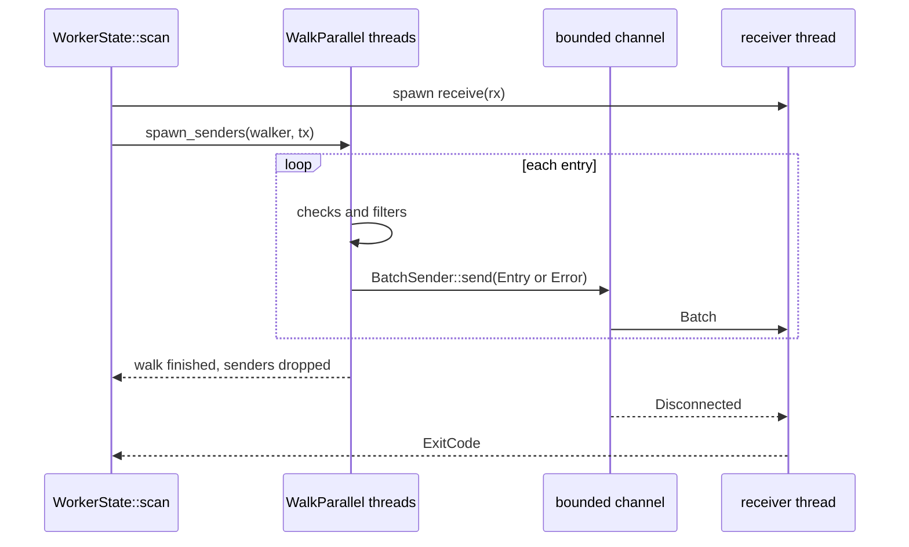
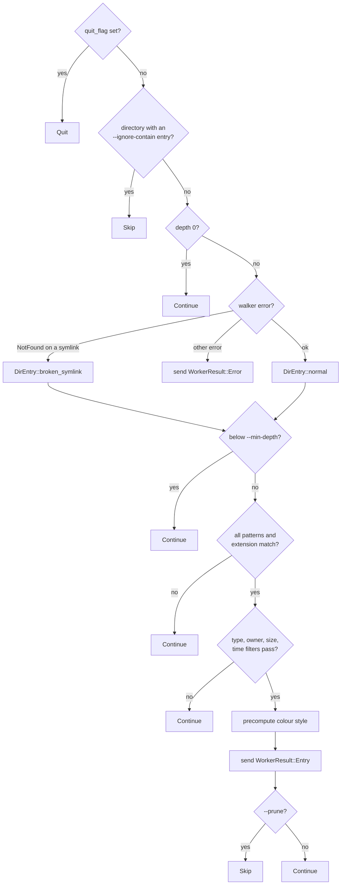

## Overview

`walk::scan` is where fd spends nearly all its time. It wraps the compiled patterns and the `Config` in a `WorkerState`, builds a multi-threaded walker from the `ignore` crate, and runs two kinds of threads inside one `thread::scope`: the walker's sender threads, which read directories and decide for each entry whether it is a result, and a receiver, which turns results into output or commands. They talk only through a bounded `crossbeam_channel` of batches and two atomic flags.

Sources: [src/walk.rs:305-328](repo://src/walk.rs#L305-L328), [src/walk.rs:616-653](repo://src/walk.rs#L616-L653), [src/walk.rs:680-687](repo://src/walk.rs#L680-L687)

This page follows the sender side. Which entries the walker never yields is on [[Hidden Files, Ignore Rules and Exclusions]]; the receiver is on [[Output and Buffering]] for printing and [[Command Execution]] for `--exec`.

Sources: [src/walk.rs:406-440](repo://src/walk.rs#L406-L440)

## Running a scan

`WorkerState::scan` builds the walker, optionally installs the Ctrl-C handler, creates the channel, and then:

Sources: [src/walk.rs:617-636](repo://src/walk.rs#L617-L636)

1. spawns the receiver with `self.receive(rx)` on a scoped thread;
2. calls `spawn_senders(walker, tx)`, which runs the parallel walk on the calling thread and returns when every walker thread has finished;
3. joins the receiver and returns its `ExitCode`, replaced by `KilledBySigint` if the interrupt flag was set.

Sources: [src/walk.rs:616-653](repo://src/walk.rs#L616-L653)



Sources: [src/walk.rs:442-457](repo://src/walk.rs#L442-L457), [src/walk.rs:636-646](repo://src/walk.rs#L636-L646), [src/walk.rs:243-245](repo://src/walk.rs#L243-L245)

The channel holds at most `2 * config.threads` batches. `spawn_senders` takes the sender by value and every walker thread clones it, so once the walk ends and the clones and the original are dropped, the receiver's next `recv` reports `Disconnected`, which is how it learns the search is complete. The walker uses `config.threads` threads: `--threads`, or the available parallelism capped at 64 (see [[Command-Line Options and Config]]).

Sources: [src/walk.rs:443-457](repo://src/walk.rs#L443-L457), [src/walk.rs:636](repo://src/walk.rs#L636), [src/walk.rs:402](repo://src/walk.rs#L402)

## The per-entry checks

`spawn_senders` passes a factory to `WalkParallel::run`; each walker thread gets its own boxed closure, called once per entry. The closure returns `WalkState::Continue` to keep going, `Skip` to not descend into a directory, or `Quit` to stop the whole walk. Its checks run in a fixed order, cheapest first: "Check the name first, since it doesn't require metadata".

Sources: [src/walk.rs:443-460](repo://src/walk.rs#L443-L460), [src/walk.rs:514-517](repo://src/walk.rs#L514-L517)



Sources: [src/walk.rs:459-542](repo://src/walk.rs#L459-L542), [src/walk.rs:543-612](repo://src/walk.rs#L543-L612)

- **Quit flag.** Checked first, so a receiver that has seen enough (`--max-results`, `--quiet`) or a Ctrl-C stops every walker thread at its next entry.
- **`--ignore-contain`.** Skips marked directories, before any other check (see [[Hidden Files, Ignore Rules and Exclusions]]).
- **The root.** Each search root arrives as an entry of depth 0 and is never reported itself.
- **Walker errors.** A `NotFound` error whose path is itself a symlink means the link's target is missing; it becomes a broken-symlink `DirEntry` and continues as a normal candidate. Any other error is sent to the receiver as `WorkerResult::Error`, which prints it only under `--show-errors`.
- **Depth.** `--max-depth` is enforced by the walker itself, so deeper directories are never read. `--min-depth` can only be checked here, after the entry has been read; broken symlinks have no depth and are dropped whenever a minimum depth is set.
- **Name checks.** The patterns and then the extension set, described on [[Pattern Matching]].
- **Metadata filters.** `--type`, `--owner` (Unix), `--size` and `--changed-*`, in that order, described on [[Entry Filters]].

Sources: [src/walk.rs:459-512](repo://src/walk.rs#L459-L512), [src/walk.rs:514-591](repo://src/walk.rs#L514-L591), [src/walk.rs:365](repo://src/walk.rs#L365)

When output is printed in colour, the closure calls `entry.style(ls_colors)` before sending: the style lookup is cached on the entry, so it is computed "in parallel" on the walker threads instead of on the single printing thread. Finally the entry is sent; a failed send means the receiver has gone, and the walk quits. With `--prune`, a matching directory is reported but not descended into.

Sources: [src/walk.rs:593-611](repo://src/walk.rs#L593-L611)

## Batching results

Sending every entry as its own channel message would make the channel the bottleneck, so each walker thread wraps its sender in a `BatchSender`. A `Batch` is a shared `Arc<Mutex<Option<Vec<WorkerResult>>>>`: the sender puts it on the channel when its first item is added and keeps appending to the same vector until the receiver takes it.

Sources: [src/walk.rs:47-72](repo://src/walk.rs#L47-L72)

```rust
fn send(&mut self, item: WorkerResult) -> Result<(), SendError<()>> {
    let mut batch = self.batch.lock();

    if self.needs_flush(batch.as_ref()) {
        drop(batch);
        self.batch = Batch::new();
        batch = self.batch.lock();
    }

    let items = batch.as_mut().unwrap();
    items.push(item);

    if items.len() == 1 {
        // New batch, send it over the channel
        self.tx
            .send(self.batch.clone())
            .map_err(|_| SendError(()))?;
    }

    Ok(())
}
```

Sources: [src/walk.rs:100-121](repo://src/walk.rs#L100-L121)

The receiver empties a batch by iterating it, which `take`s the vector and leaves `None`. `needs_flush` starts a new batch when the old one has been taken, or when it has reached `limit` items, which "provide[s] some backpressure": a thread that outruns the receiver fills batches, then blocks on the bounded channel. The limit is `0x100` entries, except with `--exec` (not batch mode) on more than one thread, where it is 1 to "evenly distribute work between multiple receivers".

Sources: [src/walk.rs:65-72](repo://src/walk.rs#L65-L72), [src/walk.rs:90-98](repo://src/walk.rs#L90-L98), [src/walk.rs:449-457](repo://src/walk.rs#L449-L457)

## DirEntry

`DirEntry` wraps either an `ignore::DirEntry` or the path of a broken symlink, plus two `OnceCell` caches: `metadata` and `style`. Metadata is fetched at most once and only when a filter or the printer asks for it, so a search with no metadata filters never calls `stat` beyond what the walker does. For a broken symlink the metadata is the link's own (`symlink_metadata`), its file type comes from that, and it has no depth.

Sources: [src/dir_entry.rs:12-110](repo://src/dir_entry.rs#L12-L110)

Entries compare and sort by path, which the receiver uses to sort buffered output. `DirEntry` also implements `lscolors::Colorable`, so `LsColors::style_for` can read its name, type and metadata from the cached values.

Sources: [src/dir_entry.rs:116-168](repo://src/dir_entry.rs#L116-L168)

`stripped_path` returns the path as shown to the user: with `strip_cwd_prefix` the leading `./` is removed, unless what remains would start with `-`, in which case the `./` is kept "so downstream tools don't interpret it as an option". `into_stripped_path` is the owning variant used for batch commands.

Sources: [src/dir_entry.rs:56-81](repo://src/dir_entry.rs#L56-L81), [src/dir_entry.rs:112-114](repo://src/dir_entry.rs#L112-L114), [src/filesystem.rs:118-121](repo://src/filesystem.rs#L118-L121)

## Stopping the walk

Two `Arc<AtomicBool>` flags live in `WorkerState`. `quit_flag` is set by the receiver when it stops early and by the Ctrl-C handler; walker threads read it at the start of every entry. `interrupt_flag` records that Ctrl-C was pressed, so the receiver can stop printing and `scan` can report `KilledBySigint`. The handler is only installed when output is printed in colour; the rest of the interrupt handling is on [[Exit Codes, Errors and Interrupts]].

Sources: [src/walk.rs:305-328](repo://src/walk.rs#L305-L328), [src/walk.rs:174-181](repo://src/walk.rs#L174-L181), [src/walk.rs:621-652](repo://src/walk.rs#L621-L652)
