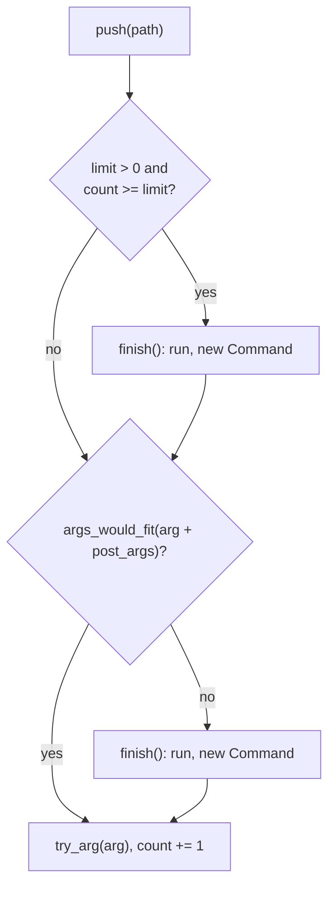

## Overview

Instead of printing results, fd can run a command for them. `--exec`/`-x` runs a command once per result, in parallel; `--exec-batch`/`-X` runs a command once with many results as arguments; and `--list-details`/`-l` is a built-in `--exec-batch` that runs `ls -l`. All three end up as a `CommandSet` in `Config.command`, and the receiver hands the results to `exec::job` or `exec::batch` instead of the printer ([[Result Receiver]]).

Sources: [src/exec/mod.rs:20-74](repo://src/exec/mod.rs#L20-L74), [src/walk.rs:406-434](repo://src/walk.rs#L406-L434), [src/main.rs:395-410](repo://src/main.rs#L395-L410)

Each command argument is a template with placeholders such as `{}` and `{/.}`; parsing and expansion are on [[Placeholder Templates]]. This page covers how commands are validated, scheduled and run, and how their failures become fd's exit code.

Sources: [src/exec/mod.rs:210-273](repo://src/exec/mod.rs#L210-L273)

## Building a CommandSet

### From the command line

clap collects each `-x` or `-X` occurrence as one command: all values up to a `;` terminator, with values starting with `-` allowed. `-x` and `-X` conflict with each other and with `--list-details`, and the exec group conflicts with `--max-results`, `-1` and `--quiet`. Because all following arguments belong to the command, the help recommends placing `-x` last or ending it with `\;`.

Sources: [src/cli.rs:882-952](repo://src/cli.rs#L882-L952), [src/cli.rs:29-30](repo://src/cli.rs#L29-L30)

`Exec::from_arg_matches` builds `CommandSet::new` (mode `OneByOne`) from the `exec` occurrences or `CommandSet::new_batch` (mode `Batch`) from the `exec_batch` occurrences, and a validation error becomes a clap usage error.

Sources: [src/cli.rs:861-874](repo://src/cli.rs#L861-L874), [src/exec/mod.rs:35-70](repo://src/exec/mod.rs#L35-L70)

### Validation

`CommandTemplate::new` parses every argument into a `FormatTemplate` and enforces three rules:

Sources: [src/exec/mod.rs:219-256](repo://src/exec/mod.rs#L219-L256)

1. A command with no arguments fails with `No executable provided for --exec or --exec-batch`; otherwise fd would try to execute each result.
2. In batch mode, the first argument must be a fixed executable, not a placeholder. With `-x` a placeholder is allowed there, so `fd -x {}` runs each result.
3. A command with no placeholder gets an implicit `{}` appended as its last argument, so `fd -e zip -x unzip` runs `unzip <path>`.

Sources: [src/exec/mod.rs:236-253](repo://src/exec/mod.rs#L236-L253), [src/exec/mod.rs:438-443](repo://src/exec/mod.rs#L438-L443)

`new_batch` adds a fourth rule: only one argument may contain placeholders, because that argument is repeated once per result.

Sources: [src/exec/mod.rs:51-70](repo://src/exec/mod.rs#L51-L70), [src/exec/mod.rs:421-424](repo://src/exec/mod.rs#L421-L424)

### List details

`--list-details` has no user command. `extract_command` builds one with `CommandSet::new_batch` from `determine_ls_command`, which picks an `ls` for the platform:

Sources: [src/main.rs:395-410](repo://src/main.rs#L395-L410)

| Platform | Command |
| --- | --- |
| Unix other than macOS and the BSDs | `ls -l -h -d --color=always` or `--color=never` |
| macOS, DragonFly, FreeBSD, NetBSD, OpenBSD with GNU `gls` installed | `gls -l -h -d --color=…` |
| the same without `gls` | `ls -l -h -d`, plus `-G` when colored except on NetBSD and OpenBSD |
| Windows with GNU `ls` on the `PATH` | `ls -l -h -d --color=…` |
| Windows without it, and other platforms | error: `--list-details` is not supported |

Sources: [src/main.rs:412-494](repo://src/main.rs#L412-L494)

Short options are used so that BusyBox `ls` also works, and `-d` lists directories themselves instead of their contents. The implicit `{}` passes the results to `ls`, which sorts them, giving the deterministic order that the option's help mentions.

Sources: [src/main.rs:412-429](repo://src/main.rs#L412-L429), [src/cli.rs:227-238](repo://src/cli.rs#L227-L238)

## One command per result

### Job threads

For `-x`, `WorkerState::receive` starts `threads` scoped threads, each running `exec::job` over a clone of the channel, and merges their exit codes with `merge_exitcodes`. The walker's batch limit drops to 1 in this mode, so results spread evenly across the job threads instead of one thread taking a batch of 256 ([[Parallel Directory Walk]]).

Sources: [src/walk.rs:412-433](repo://src/walk.rs#L412-L433), [src/walk.rs:449-457](repo://src/walk.rs#L449-L457)

`job` loops over the results, skipping errors (printed with `--show-errors`), and calls `CommandSet::execute` with the entry's displayed path. It keeps going after a failed command and merges every exit code, so fd exits with status 1 if any command failed. Commands run in no guaranteed order.

Sources: [src/exec/job.rs:8-44](repo://src/exec/job.rs#L8-L44), [src/cli.rs:894-899](repo://src/cli.rs#L894-L899)

### Running the commands

`execute` expands every command of the set for the path and hands them to `execute_commands`, which runs them one after the other. Several `-x` options therefore run in sequence for each result. The first command that exits non-zero, or cannot be started, stops the sequence for that result.

Sources: [src/exec/mod.rs:76-88](repo://src/exec/mod.rs#L76-L88), [src/exec/command.rs:58-99](repo://src/exec/command.rs#L58-L99)

### Output buffering

With more than one thread, output is buffered: each command runs with `output()`, its stdout and stderr are kept in an `OutputBuffer`, and the buffer is written while holding both the stdout and stderr locks. One result's output therefore never interleaves with another's. With `--threads=1` the command is spawned with inherited stdio and its output appears live, which allows interactive commands.

Sources: [src/exec/job.rs:16-17](repo://src/exec/job.rs#L16-L17), [src/exec/command.rs:9-56](repo://src/exec/command.rs#L9-L56), [src/exec/command.rs:69-78](repo://src/exec/command.rs#L69-L78)

With `--print0`, `OutputBuffer::write` adds a NUL byte after each result's output, even when the output was not buffered, so the outputs of consecutive results can be split downstream.

Sources: [src/exec/command.rs:30-56](repo://src/exec/command.rs#L30-L56)

## Batch execution

### Argument layout

For `-X` and `-l`, `exec::batch` turns the results into their displayed paths and calls `execute_batch` with `--batch-size`. Each command gets a `CommandBuilder`, which splits the template into the arguments before the placeholder argument (`pre_args`), the placeholder argument itself (`path_arg`), and the arguments after it (`post_args`). Every path is pushed to every builder; then each builder is finished.

Sources: [src/exec/job.rs:46-64](repo://src/exec/job.rs#L46-L64), [src/exec/mod.rs:90-162](repo://src/exec/mod.rs#L90-L162)

### Splitting into several runs

`CommandBuilder` uses `argmax::Command`, which knows the operating system's limit on command-line length. `push` runs the command and starts a new one before adding a path when the batch already holds `--batch-size` paths (0 means no limit), or when the new argument plus `post_args` would no longer fit. `finish` appends `post_args`, runs the command with inherited stdio, and records `GeneralError` if it exits unsuccessfully. A command with no paths is never run, so `-X` with no results runs nothing.

Sources: [src/exec/mod.rs:164-207](repo://src/exec/mod.rs#L164-L207), [src/cli.rs:492-508](repo://src/cli.rs#L492-L508)

Sources: [src/exec/mod.rs:173-203](repo://src/exec/mod.rs#L173-L203)

`execute_batch` merges the builders' exit codes. An I/O error while building or running a command returns at once through `handle_cmd_error`.

Sources: [src/exec/mod.rs:100-120](repo://src/exec/mod.rs#L100-L120)

## Paths passed to commands

Commands receive `DirEntry::stripped_path` or `into_stripped_path`, with the custom separator applied when `--path-separator` is set. In the default `auto` mode of `--strip-cwd-prefix`, a command keeps the `./` prefix, so a file named `-rf` reaches the command as `./-rf` and is not read as an option ([[Printing Results]]).

Sources: [src/exec/job.rs:33-39](repo://src/exec/job.rs#L33-L39), [src/exec/job.rs:51-54](repo://src/exec/job.rs#L51-L54), [src/main.rs:390-390](repo://src/main.rs#L390-L390), [src/cli.rs:674-680](repo://src/cli.rs#L674-L680)

## Errors

`handle_cmd_error` prints `Command not found: <program>` when starting the program fails with `NotFound`, and `Problem while executing command: <error>` for any other I/O error, both returning `GeneralError`. A command that runs but exits non-zero is not reported by fd; only the exit code records it.

Sources: [src/exec/command.rs:101-115](repo://src/exec/command.rs#L101-L115), [src/exec/command.rs:80-95](repo://src/exec/command.rs#L80-L95)
