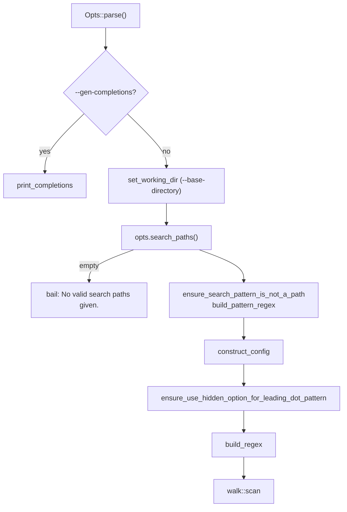

## Overview

Every fd run starts by turning the command line into two values: `Opts`, the clap-derived struct that mirrors the arguments, and `Config`, the settings the walker, the filters, the receiver and the printer read. `Opts` is only used inside `run` and `construct_config`; from `walk::scan` onward the program sees `Config` alone, so a setting that combines several flags (such as whether to read `.gitignore` files) is resolved once, here.

Sources: [src/main.rs:75-112](repo://src/main.rs#L75-L112), [src/config.rs:13-75](repo://src/config.rs#L13-L75), [src/config.rs:76-143](repo://src/config.rs#L76-L143)

This page follows `run` up to the call to `construct_config` and through it. How the patterns become regexes is on [[Pattern Matching]], and how the walker applies the ignore settings is on [[Parallel Directory Walk]].

Sources: [src/main.rs:89-111](repo://src/main.rs#L89-L111)

## Startup sequence

Sources: [src/main.rs:75-112](repo://src/main.rs#L75-L112)

`set_working_dir` runs before the search paths are resolved because `--base-directory` changes the process's current directory with `env::set_current_dir`; relative search paths given afterwards are therefore resolved against it. A base directory that is not an existing directory is an error.

Sources: [src/main.rs:131-147](repo://src/main.rs#L131-L147), [src/cli.rs:613-626](repo://src/cli.rs#L613-L626)

## The Opts struct

### Derive attributes

`Opts` derives `clap::Parser`. The `command` attribute sets `args_override_self = true`, so repeating a flag keeps the last value instead of failing, and puts `--exec`, `--exec-batch` and `--list-details` in one group that conflicts with `--max-results`, `--quiet` and `-1`.

Sources: [src/cli.rs:21-32](repo://src/cli.rs#L21-L32)

### Negating flags

Most boolean flags have a hidden opposite declared as a unit field with `overrides_with`: `--no-hidden` cancels `--hidden`, `--ignore` cancels `--no-ignore`, `--no-follow` cancels `--follow`, `--relative-path` cancels `--absolute-path`, and so on. Whichever of the pair comes last on the command line wins, which lets an alias or a wrapper script set a default that the user can still undo.

Sources: [src/cli.rs:33-64](repo://src/cli.rs#L33-L64), [src/cli.rs:213-253](repo://src/cli.rs#L213-L253)

`-u`/`--unrestricted` is stored as a counter in `rg_alias_hidden_ignore` and read through `rg_alias_ignore()`, which is true when it was given at least once; `construct_config` treats it as `--no-ignore --hidden`.

Sources: [src/cli.rs:122-128](repo://src/cli.rs#L122-L128), [src/cli.rs:742-745](repo://src/cli.rs#L742-L745)

### Hand-rolled exec parsing

clap's derive API cannot collect grouped values, so `Exec` implements `FromArgMatches` and `Args` by hand. `--exec`/`-x` and `--exec-batch`/`-X` take one or more values, allow values starting with a hyphen, and end at a `;` terminator; each occurrence is one command, so `-x a ; -x b` gives two. `from_arg_matches` builds a `CommandSet` with `CommandSet::new` or `CommandSet::new_batch` and turns a validation error into a clap `InvalidValue` error, so a bad template is reported as a usage error. The `CommandSet` itself is described on [[Command Execution]].

Sources: [src/cli.rs:855-957](repo://src/cli.rs#L855-L957)

### Accessor methods

Some fields are private and read through methods that merge related flags:

Sources: [src/cli.rs:747-763](repo://src/cli.rs#L747-L763)

| Method | Returns |
| --- | --- |
| `max_depth()` | `--max-depth`, or `--exact-depth` |
| `min_depth()` | `--min-depth`, or `--exact-depth` |
| `threads()` | `--threads`, or `default_num_threads()`: available parallelism capped at 64, falling back to 1 |
| `max_results()` | `--max-results` when above zero, else 1 for `-1` |
| `strip_cwd_prefix(auto)` | whether to drop `./`, only when no search path was given |

Sources: [src/cli.rs:747-773](repo://src/cli.rs#L747-L773), [src/cli.rs:788-800](repo://src/cli.rs#L788-L800)

## Search paths

`search_paths` takes the positional `path` arguments, or the `--search-path` values (the two conflict), or the current directory when neither is given. Each given path that is not an existing directory is reported with `Search path '…' is not a directory.` and dropped; `run` fails only when no path is left. When no path is given and the current directory has been deleted, the error is `Could not retrieve current directory (has it been deleted?).`

Sources: [src/cli.rs:652-672](repo://src/cli.rs#L652-L672), [src/cli.rs:696-721](repo://src/cli.rs#L696-L721), [src/cli.rs:963-971](repo://src/cli.rs#L963-L971), [src/main.rs:84-87](repo://src/main.rs#L84-L87)

`is_existing_directory` deliberately avoids `exists()`, because `.` always exists even when the working directory has been removed; it requires `is_dir()` and either a file name or a path that normalizes.

Sources: [src/filesystem.rs:38-42](repo://src/filesystem.rs#L38-L42)

`normalize_path` rewrites each path before it reaches the walker. With `--absolute-path` the path is normalized and made absolute. Otherwise `.` becomes `./`, a workaround for a ripgrep change, and a path named `-` becomes `./-` so the walker treats it as a path.

Sources: [src/cli.rs:723-736](repo://src/cli.rs#L723-L736), [src/filesystem.rs:14-36](repo://src/filesystem.rs#L14-L36)

## Building Config

### Case sensitivity

`construct_config` consumes `Opts` and the regex source strings of the patterns. It decides case sensitivity first: the search is case-sensitive when `--ignore-case` is absent and either `--case-sensitive` is given or some pattern has an uppercase character (smart case, see [[Pattern Matching]]).

Sources: [src/main.rs:248-255](repo://src/main.rs#L248-L255)

### Ignore settings

The ignore fields combine the flags so that broader flags imply narrower ones:

Sources: [src/main.rs:313-320](repo://src/main.rs#L313-L320)

| Config field | False when |
| --- | --- |
| `ignore_hidden` | `--hidden` or `-u` |
| `read_fdignore` | `--no-ignore` or `-u` |
| `read_vcsignore` | `--no-ignore`, `-u` or `--no-ignore-vcs` |
| `require_git_to_read_vcsignore` | `--no-require-git` |
| `read_parent_ignore` | `--no-ignore-parent` |
| `read_global_ignore` | `--no-ignore`, `-u` or `--no-global-ignore-file` |

Sources: [src/main.rs:310-320](repo://src/main.rs#L310-L320)

`--exclude` globs are stored with a `!` prefix in `exclude_patterns`, the form the `ignore` crate's override builder treats as an exclusion, and `--ignore-file` paths are moved into `ignore_files`. Both are applied in `build_walker`.

Sources: [src/main.rs:380-381](repo://src/main.rs#L380-L381), [src/walk.rs:330-345](repo://src/walk.rs#L330-L345)

### Colors and hyperlinks

With `--color=auto`, output is colored only when the terminal supports ANSI, `NO_COLOR` is unset or empty, and stdout is a terminal. On Windows ANSI support is enabled through `nu_ansi_term::enable_ansi_support`, or assumed when `TERM` is set. Colored output loads `LsColors` from the `LS_COLORS` environment variable, or from the built-in `DEFAULT_LS_COLORS` table; uncolored output stores `None`. `--hyperlink=auto` follows the color decision.

Sources: [src/main.rs:271-297](repo://src/main.rs#L271-L297), [src/main.rs:56-60](repo://src/main.rs#L56-L60)

### Path separator

`--path-separator`, or `/` when the `MSYSTEM` variable is set on Windows (MSYS2), becomes `path_separator`; `actual_path_separator` falls back to the platform separator and is what the printer writes after directories. On Windows a separator longer than one byte is rejected, with a hint that some shells expand `/`.

Sources: [src/main.rs:234-264](repo://src/main.rs#L234-L264), [src/filesystem.rs:123-136](repo://src/filesystem.rs#L123-L136)

### Commands, file types and the rest

`extract_command` takes the parsed `--exec`/`--exec-batch` command, or, for `--list-details`, builds a batch command running `ls` (see [[Command Execution]]). Whether a command exists matters for `strip_cwd_prefix`: in auto mode the `./` prefix is dropped only when neither `--print0` nor a command is used, to keep paths that start with `-` from being read as options.

Sources: [src/main.rs:298-299](repo://src/main.rs#L298-L299), [src/main.rs:390-390](repo://src/main.rs#L390-L390), [src/main.rs:395-410](repo://src/main.rs#L395-L410), [src/cli.rs:674-680](repo://src/cli.rs#L674-L680)

`--type` values set flags on a `FileTypes`. `executable` also turns on `files`, and `empty` alone turns on both `files` and `directories`, so `-t e` finds empty files and empty directories. `--extension` values lose a leading dot, are escaped, and become one case-insensitive `RegexSet` of `.\.ext$` patterns. The filters these feed are described on [[Entry Filters]].

Sources: [src/main.rs:333-373](repo://src/main.rs#L333-L373)

`--changed-within` and `--changed-before` are parsed by `extract_time_constraints`, which fails with `is not a valid date or duration` on bad input; size and owner constraints were already parsed by clap's value parsers. `--full-path` caches the current directory in `full_path_base`, failing if it cannot be read, and `--format` is parsed into a `FormatTemplate` ([[Placeholder Templates]]).

Sources: [src/main.rs:266-269](repo://src/main.rs#L266-L269), [src/main.rs:301-308](repo://src/main.rs#L301-L308), [src/main.rs:374-377](repo://src/main.rs#L374-L377), [src/main.rs:496-519](repo://src/main.rs#L496-L519)

## Config reference

`Config` holds only resolved values. `is_printing()` is true when no command is set, and decides whether results go to the printer or to the command runner.

Sources: [src/config.rs:138-143](repo://src/config.rs#L138-L143)

| Field | Meaning |
| --- | --- |
| `case_sensitive` | regexes are built case-sensitive |
| `full_path_base` | cached cwd for `--full-path`; `None` matches file names |
| `follow_links`, `one_file_system` | traversal options passed to the walker |
| `max_depth`, `min_depth`, `prune` | depth limits and `--prune` |
| `threads` | walker threads and `--exec` job threads |
| `quiet`, `max_results` | stop conditions for the receiver |
| `max_buffer_time` | hidden `--max-buffer-time` in milliseconds |
| `ls_colors`, `hyperlink`, `interactive_terminal` | printer settings |
| `file_types`, `extensions`, `size_constraints`, `time_constraints`, `owner_constraint` | entry filters |
| `format`, `command`, `batch_size` | output template and command execution |
| `show_filesystem_errors` | print walker errors (`--show-errors`) |
| `null_separator`, `path_separator`, `actual_path_separator`, `strip_cwd_prefix` | path rendering |
| `ignore_contain` | names whose presence stops descent into a directory |

Sources: [src/config.rs:14-75](repo://src/config.rs#L14-L75), [src/config.rs:76-136](repo://src/config.rs#L76-L136)
