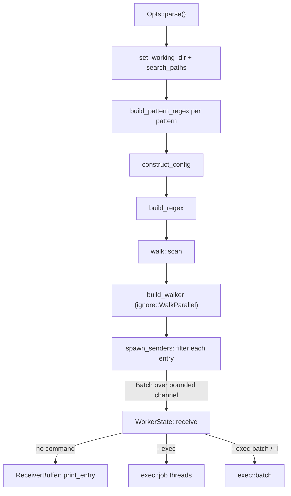

## Overview

`fd` finds entries in the filesystem. It is a command-line alternative to `find` that trades some of `find`'s range for sensible defaults: the pattern is a regular expression matched against file names, the search is case-insensitive unless the pattern holds an uppercase character, and hidden files and paths listed in `.gitignore` are skipped. The crate is published as `fd-find` and builds a single binary named `fd` from `src/main.rs`.

Sources: [Cargo.toml:1-33](repo://Cargo.toml#L1-L33), [README.md:8-29](repo://README.md#L8-L29)

The whole program is one pass through a pipeline. `run` parses the command line into `Opts`, turns every pattern into a regex source string, folds the options into a `Config`, compiles the regexes and hands everything to `walk::scan`. The exit code `scan` returns becomes the process exit code, and any error that bubbles out of `run` is printed with the `[fd error]:` prefix and exits with the general error code.

Sources: [src/main.rs:62-112](repo://src/main.rs#L62-L112), [src/error.rs:1-9](repo://src/error.rs#L1-L9)

## Parts of fd

Each part of the pipeline has one page. The modules live directly under `src/`, with the execution, filter and template code in the `exec`, `filter` and `fmt` subfolders.

Sources: [src/main.rs:1-15](repo://src/main.rs#L1-L15), [src/filter/mod.rs:1-11](repo://src/filter/mod.rs#L1-L11)

| Area | What it does | Page |
| --- | --- | --- |
| `cli.rs`, `config.rs`, `main.rs` | Parses arguments with clap and derives the `Config` every other part reads | [[Command-Line Parsing and Configuration]] |
| `main.rs`, `regex_helper.rs` | Turns regex, glob, fixed-string and exact patterns into compiled regexes; applies smart case | [[Pattern Matching]] |
| `walk.rs`, `dir_entry.rs` | Traverses the search paths in parallel with the `ignore` crate and filters each entry | [[Parallel Directory Walk]] |
| `filetypes.rs`, `filter/` | File type, size, modification time and owner filters | [[Entry Filters]] |
| `walk.rs`, `exit_codes.rs` | Receives entries, buffers and sorts or streams them, and decides the exit code | [[Result Receiver]] |
| `output.rs`, `hyperlink.rs`, `sanitize.rs` | Writes one result line with colors, hyperlinks and safe escaping | [[Printing Results]] |
| `fmt/` | Parses and expands `{}`, `{/}`, `{//}`, `{.}` and `{/.}` placeholders | [[Placeholder Templates]] |
| `exec/` | Runs `--exec`, `--exec-batch` and `--list-details` commands | [[Command Execution]] |
| `tests/` | Integration test harness and CI | [[Testing and CI]] |

Sources: [src/main.rs:1-36](repo://src/main.rs#L1-L36)

## Main flow

Sources: [src/main.rs:75-112](repo://src/main.rs#L75-L112), [src/walk.rs:408-440](repo://src/walk.rs#L408-L440), [src/walk.rs:617-653](repo://src/walk.rs#L617-L653)

1. `Opts::parse` reads the arguments, then `set_working_dir` applies `--base-directory` and `search_paths` validates the roots: [[Command-Line Parsing and Configuration]].
2. Each positional and `--and` pattern becomes a regex source string, and smart case is decided from those strings: [[Pattern Matching]].
3. `construct_config` derives every setting the walk and output need into one `Config`: [[Command-Line Parsing and Configuration]].
4. `walk::scan` builds a parallel walker and runs one callback per entry on the walker's threads, which applies the pattern and the filters: [[Parallel Directory Walk]] and [[Entry Filters]].
5. Matching entries travel in batches to a receiver thread, which prints them or runs commands: [[Result Receiver]], [[Printing Results]] and [[Command Execution]].

Sources: [src/main.rs:83-111](repo://src/main.rs#L83-L111), [src/walk.rs:443-460](repo://src/walk.rs#L443-L460), [src/walk.rs:600-604](repo://src/walk.rs#L600-L604)

## Design decisions

### Parallel traversal with the ignore crate

fd does not walk directories itself. `build_walker` configures an `ignore::WalkBuilder`, which brings gitignore, `.ignore` and global-ignore handling, and calls `build_parallel` with the configured thread count. The default thread count is the machine's available parallelism, capped at 64 "to limit startup overhead on massively parallel machines".

Sources: [src/walk.rs:347-404](repo://src/walk.rs#L347-L404), [src/cli.rs:788-800](repo://src/cli.rs#L788-L800)

### Filtering on the walker threads

All matching and filtering runs inside the walker callback, so it is spread over the walker's threads; only matches cross to the receiver. The callback checks the name first "since it doesn't require metadata", and when output is colored it computes each entry's color style there too ("Compute colors in parallel").

Sources: [src/walk.rs:514-598](repo://src/walk.rs#L514-L598)

### Batches over a bounded channel

Senders do not send entries one by one. `BatchSender` appends to a shared `Batch` and sends it on the channel only when the batch is new; the batch size is limited "to provide some backpressure", and the channel is `bounded(2 * threads)`. With parallel `--exec` the limit drops to one entry "to evenly distribute work between multiple receivers".

Sources: [src/walk.rs:74-122](repo://src/walk.rs#L74-L122), [src/walk.rs:449-457](repo://src/walk.rs#L449-L457), [src/walk.rs:636-636](repo://src/walk.rs#L636-L636)

### Sorted output when the search is fast

A parallel walk finds entries in no fixed order. The receiver starts in buffering mode and keeps results in memory; if the search ends within the deadline (100 ms by default) and with at most 1,000 results, it sorts the buffer and prints it, so short searches give sorted output. Otherwise it switches to streaming and prints as results arrive.

Sources: [src/walk.rs:124-127](repo://src/walk.rs#L124-L127), [src/walk.rs:198-293](repo://src/walk.rs#L198-L293)

### jemalloc as the allocator

On most non-Windows targets, and only with the `use-jemalloc` feature, fd sets `tikv_jemallocator::Jemalloc` as the global allocator "for performance reasons". The target list in `main.rs` must be kept in sync with the dependency's target section in `Cargo.toml`; macOS is excluded because of a jemalloc bug on Catalina.

Sources: [src/main.rs:38-54](repo://src/main.rs#L38-L54), [Cargo.toml:64-71](repo://Cargo.toml#L64-L71), [Cargo.toml:102-106](repo://Cargo.toml#L102-L106)

### Safe output to terminals

File names can hold control characters. When writing to a terminal, fd escapes control, bidi-override, zero-width and tag characters in paths and in error messages, "to prevent terminal escape injection via filenames"; when stdout is a pipe the bytes pass through unchanged.

Sources: [src/sanitize.rs:1-55](repo://src/sanitize.rs#L1-L55), [src/error.rs:5-9](repo://src/error.rs#L5-L9)
