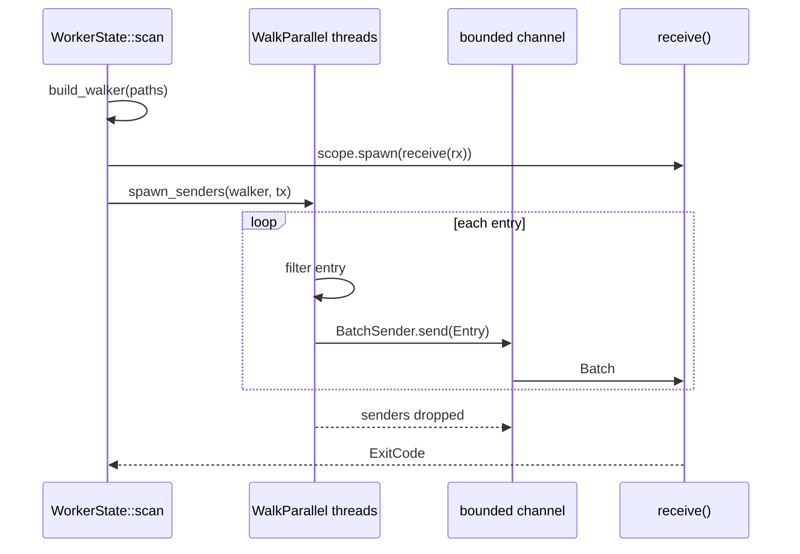
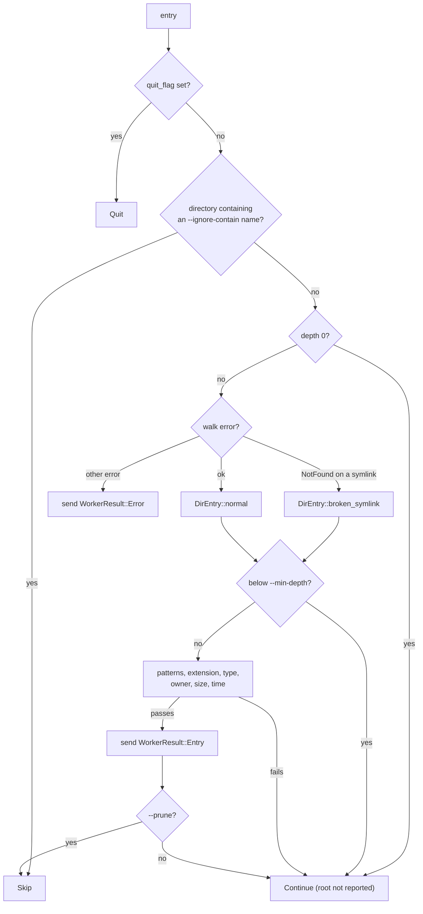

## Overview

`walk::scan` is where the search happens. It wraps the compiled patterns and the `Config` in a `WorkerState`, builds a parallel walker from the `ignore` crate, and runs two sides at once: sender threads, owned by the walker, that test each entry and push matches into a channel, and a receiver that prints them or runs commands. This page covers the walker and the sender side; the receiver is on [[Result Receiver]].

Sources: [src/walk.rs:305-328](repo://src/walk.rs#L305-L328), [src/walk.rs:680-687](repo://src/walk.rs#L680-L687)

fd uses the `ignore` crate, the walker ripgrep is built on, so `.gitignore`, `.ignore` and global git excludes are handled by it; fd adds `.fdignore`, a global fd ignore file, custom ignore files and `--exclude` globs on top.

Sources: [src/walk.rs:347-404](repo://src/walk.rs#L347-L404)

## Scan lifecycle

`WorkerState::scan` builds the walker, installs the Ctrl-C handler when needed, creates a channel bounded to twice the thread count, and starts both sides inside `thread::scope`. The receiver runs on its own scoped thread; `spawn_senders` blocks the calling thread until the walk is over, and dropping the walker's senders closes the channel, which tells the receiver to finish.

Sources: [src/walk.rs:617-653](repo://src/walk.rs#L617-L653)

Sources: [src/walk.rs:617-653](repo://src/walk.rs#L617-L653), [src/walk.rs:443-463](repo://src/walk.rs#L443-L463), [src/walk.rs:600-604](repo://src/walk.rs#L600-L604)

## Building the walker

### WalkBuilder settings

`build_walker` starts a `WalkBuilder` at the first search path and adds every other path with `builder.add`, so all roots share one walker and one thread pool. Each `Config` field maps onto one builder setting:

Sources: [src/walk.rs:347-365](repo://src/walk.rs#L347-L365), [src/walk.rs:398-404](repo://src/walk.rs#L398-L404)

| Builder call | Config value |
| --- | --- |
| `hidden` | `ignore_hidden` |
| `ignore` (`.ignore` files) | `read_fdignore` |
| `parents` | `read_parent_ignore`, and only if `.fdignore` or VCS ignores are read |
| `git_ignore`, `git_global`, `git_exclude` | `read_vcsignore` |
| `require_git` | `require_git_to_read_vcsignore` |
| `overrides` | `--exclude` globs |
| `follow_links` | `follow_links` |
| `same_file_system` | `one_file_system` |
| `max_depth` | `max_depth` |
| `threads` | `threads` |

Sources: [src/walk.rs:352-365](repo://src/walk.rs#L352-L365), [src/walk.rs:402-402](repo://src/walk.rs#L402-L402)

### Extra ignore files

When `.fdignore` files are read, `.fdignore` is registered as a custom ignore file name. When the global ignore file is read, fd looks for `fd/ignore` under the platform's config directory from `etcetera::choose_base_strategy` and adds it if it is a file. Each `--ignore-file` path is added after it. A malformed pattern in either is printed as an error but does not stop the search, and partial errors are silently accepted.

Sources: [src/walk.rs:367-396](repo://src/walk.rs#L367-L396)

### Exclude overrides

`build_overrides` feeds every `--exclude` glob, already prefixed with `!` by `construct_config`, to an `OverrideBuilder` rooted at the first search path. A bad glob fails the run with `Malformed exclude pattern`. As overrides, these exclusions take precedence over the other ignore rules.

Sources: [src/walk.rs:330-345](repo://src/walk.rs#L330-L345), [src/main.rs:380-380](repo://src/main.rs#L380-L380), [src/cli.rs:310-324](repo://src/cli.rs#L310-L324)

## The per-entry callback

### Callback order

`spawn_senders` calls `walker.run` with a factory that each walker thread calls once. The factory gives the thread its own `BatchSender` and returns a closure the walker calls for every entry. The closure's return value steers the walk: `Continue` descends normally, `Skip` does not descend into a directory, and `Quit` stops the thread.

Sources: [src/walk.rs:443-463](repo://src/walk.rs#L443-L463)

Sources: [src/walk.rs:459-524](repo://src/walk.rs#L459-L524), [src/walk.rs:526-612](repo://src/walk.rs#L526-L612)

### Early checks

The quit flag is checked first, so threads stop soon after the receiver has enough results or the user pressed Ctrl-C. For a directory, `--ignore-contain` names are tested with `entry_path.join(name).exists()`; the file type is checked first to avoid the syscall for files. A match returns `Skip`, so the directory and everything below it disappear from the results. The root of each search path (depth 0) is never reported.

Sources: [src/walk.rs:460-484](repo://src/walk.rs#L460-L484), [src/cli.rs:550-552](repo://src/cli.rs#L550-L552)

### Broken symlinks and errors

The walker reports an error when it cannot stat an entry. If the error is `NotFound` and the path's own metadata says it is a symlink, the entry is a broken symlink: fd keeps it as `DirEntry::broken_symlink` so it can still be listed and matched. Any other error is sent to the receiver as `WorkerResult::Error`, which prints it only with `--show-errors`.

Sources: [src/walk.rs:485-506](repo://src/walk.rs#L485-L506), [src/walk.rs:227-231](repo://src/walk.rs#L227-L231)

### Depth, matching and filters

`--min-depth` is applied in the callback, since the walker only knows a maximum; a broken symlink has no depth and is dropped when a minimum is set. Then come the pattern and extension checks ([[Pattern Matching]]), followed by the file type, owner, size and time filters ([[Entry Filters]]). Every failed check returns `Continue`, so the entry is not reported but a directory is still descended into.

Sources: [src/walk.rs:508-591](repo://src/walk.rs#L508-L591)

### Sending and pruning

When results will be printed in color, the closure computes the entry's `LsColors` style before sending it, so this lookup also runs in parallel. A failed send means the receiver is gone, and the thread quits. With `--prune`, a matching directory is reported but not descended into.

Sources: [src/walk.rs:593-611](repo://src/walk.rs#L593-L611), [src/cli.rs:326-331](repo://src/cli.rs#L326-L331)

## DirEntry

`DirEntry` wraps either an `ignore::DirEntry` or the path of a broken symlink, plus two `OnceCell` caches: one for `Metadata` and one for the color `Style`. `metadata()` calls `metadata()` on a normal entry or `symlink_metadata()` on a broken symlink the first time and caches the result, success or not, so the size, time, owner and empty filters share one stat call. `file_type()` comes from the walker for normal entries and from the cached metadata for broken symlinks; `depth()` is `None` for broken symlinks.

Sources: [src/dir_entry.rs:1-111](repo://src/dir_entry.rs#L1-L111)

Entries compare and sort by path, which is what the receiver uses to sort buffered results. `DirEntry` also implements `lscolors::Colorable`, so `LsColors::style_for` can use the cached file type and metadata. `stripped_path` and `into_stripped_path` give the path as shown to the user and are described on [[Printing Results]].

Sources: [src/dir_entry.rs:116-168](repo://src/dir_entry.rs#L116-L168)

## Batching

### BatchSender

Each walker thread sends through a `BatchSender`. A `Batch` is an `Arc<Mutex<Option<Vec<WorkerResult>>>>` shared between the sender and the receiver. `send` locks the current batch and appends the item; only when the item is the first in the batch is the batch itself sent over the channel. Later items join a batch the receiver may already hold, so a busy thread sends far fewer channel messages than entries.

Sources: [src/walk.rs:47-122](repo://src/walk.rs#L47-L122)

A new batch is started when the receiver has taken the current one (the `Option` is `None` after `into_iter`) or when it has reached the thread's limit, which provides backpressure together with the bounded channel. The limit is 256 entries, except with a parallel `--exec` on more than one thread, where it is 1 so that work spreads evenly across the job threads ([[Command Execution]]).

Sources: [src/walk.rs:65-98](repo://src/walk.rs#L65-L98), [src/walk.rs:449-457](repo://src/walk.rs#L449-L457)

## Stopping and Ctrl-C

`quit_flag` and `interrupt_flag` are shared `AtomicBool`s. The receiver sets `quit_flag` when it stops early, and the senders see it on their next entry.

Sources: [src/walk.rs:305-328](repo://src/walk.rs#L305-L328), [src/walk.rs:174-181](repo://src/walk.rs#L174-L181)

A Ctrl-C handler is installed only when the output is colored and printed, not passed to a command. The first Ctrl-C sets both flags, so the walk stops and the receiver flushes and returns `KilledBySigint` after the line it is printing; a second Ctrl-C exits at once. After the scope ends, `scan` returns `KilledBySigint` whenever the interrupt flag is set, whatever the receiver returned; [[Result Receiver]] covers how that exit code re-raises the signal.

Sources: [src/walk.rs:621-652](repo://src/walk.rs#L621-L652), [src/walk.rs:260-264](repo://src/walk.rs#L260-L264)
