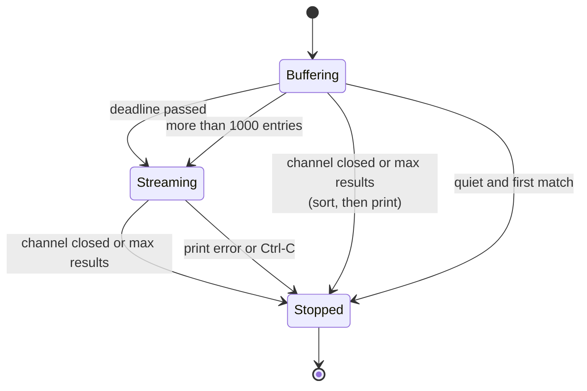

## Overview

The walker threads send `WorkerResult` values in batches over a bounded channel ([[Parallel Directory Walk]]). On the other end, `WorkerState::receive` decides what happens to them: without a command they go to a `ReceiverBuffer`, which prints them; with `--exec` or `--exec-batch` (or `--list-details`) they go to the command runner. Whatever the receiver returns becomes fd's `ExitCode`.

Sources: [src/walk.rs:37-45](repo://src/walk.rs#L37-L45), [src/walk.rs:406-440](repo://src/walk.rs#L406-L440)

The receiver exists as a separate stage so that output stays single-threaded: only one thread writes to stdout, and it can sort, count and stop the search without coordinating the walker threads beyond one shared flag.

Sources: [src/walk.rs:129-149](repo://src/walk.rs#L129-L149), [src/walk.rs:173-181](repo://src/walk.rs#L173-L181)

## Choosing the receiver

`receive` turns the channel into an iterator of results with `rx.into_iter().flatten()`: the `Receiver<Batch>` yields batches, and each `Batch` yields the results the sender put in it.

Sources: [src/walk.rs:408-440](repo://src/walk.rs#L408-L440), [src/walk.rs:65-72](repo://src/walk.rs#L65-L72)

| Configuration | Receiver | Page |
| --- | --- | --- |
| no command | `ReceiverBuffer::new(self, rx, stdout).process()` on a `BufWriter` over locked stdout | this page, then [[Printing Results]] |
| `--exec-batch` or `--list-details` | `exec::batch` on the current receiver thread | [[Command Execution]] |
| `--exec` | `threads` scoped threads, each running `exec::job` on a clone of the channel; their exit codes are merged | [[Command Execution]] |

Sources: [src/walk.rs:408-440](repo://src/walk.rs#L408-L440)

## Buffering, then streaming

### Two modes

The walker finds entries in no fixed order. To give sorted output for short searches without delaying long ones, `ReceiverBuffer` starts in `Buffering` mode with a deadline of now plus `max_buffer_time`, which defaults to 100 ms and can be set with the hidden `--max-buffer-time` option in milliseconds. In this mode entries are kept in a `Vec<DirEntry>` with room for `MAX_BUFFER_LENGTH` (1,000) entries. In `Streaming` mode every entry is printed as it arrives.

Sources: [src/walk.rs:26-35](repo://src/walk.rs#L26-L35), [src/walk.rs:124-171](repo://src/walk.rs#L124-L171), [src/cli.rs:559-564](repo://src/cli.rs#L559-L564)

### Switching modes

`recv` waits with `recv_deadline` while buffering and blocks with `recv` while streaming. The receiver switches to streaming in two cases: the deadline passes (`RecvTimeoutError::Timeout`), or the buffer grows past 1,000 entries. Switching (`stream`) prints the buffered entries in the order they arrived, unsorted, and flushes.

Sources: [src/walk.rs:183-195](repo://src/walk.rs#L183-L195), [src/walk.rs:208-218](repo://src/walk.rs#L208-L218), [src/walk.rs:240-242](repo://src/walk.rs#L240-L242), [src/walk.rs:269-279](repo://src/walk.rs#L269-L279)

Sources: [src/walk.rs:198-293](repo://src/walk.rs#L198-L293)

### Sorting at the end

When the channel disconnects, because every walker thread has finished, `stop` runs. If the receiver is still buffering, the search finished within the deadline and with at most 1,000 entries; `stop` sorts the buffer, which orders `DirEntry` values by path, and prints it. Output is therefore sorted only when the search is that fast; otherwise its order depends on thread timing.

Sources: [src/walk.rs:243-245](repo://src/walk.rs#L243-L245), [src/walk.rs:281-293](repo://src/walk.rs#L281-L293), [src/dir_entry.rs:132-137](repo://src/dir_entry.rs#L132-L137)

### Flushing

While streaming, stdout is flushed after a batch when no other batch is waiting in the channel, so output appears promptly when the walker is slow without a flush per line when it is fast.

Sources: [src/walk.rs:235-238](repo://src/walk.rs#L235-L238)

## Stop conditions

`process` loops on `poll` until it returns an `Err` carrying an exit code. Whatever the reason, it then sets `quit_flag`, so walker threads that are still running return `WalkState::Quit` on their next entry.

Sources: [src/walk.rs:173-181](repo://src/walk.rs#L173-L181), [src/walk.rs:460-462](repo://src/walk.rs#L460-L462)

| Condition | What happens | Exit code |
| --- | --- | --- |
| `--quiet` and the first entry arrives | nothing is printed | `HasResults(true)`: 0 |
| `--quiet` and the channel closes with no entry | | `HasResults(false)`: 1 |
| `num_results` reaches `--max-results` (or `-1`) | `stop`: buffered entries are sorted and printed | `Success`: 0 |
| channel closes | `stop` | `Success`: 0 |
| writing a line fails, other than a broken pipe | error printed | `GeneralError`: 1 |
| flushing stdout fails | | `GeneralError`: 1 |
| `interrupt_flag` set after a line is printed | flush, ignoring errors | `KilledBySigint`: 130 |

Sources: [src/walk.rs:198-302](repo://src/walk.rs#L198-L302)

`--quiet` and `--max-results` conflict, and both conflict with the exec options, so only the printing receiver has to handle them. A broken pipe while writing a line is ignored; the next flush fails, and the receiver exits with `GeneralError`, the comment's "Probably a broken pipe. Exit gracefully."

Sources: [src/cli.rs:29-30](repo://src/cli.rs#L29-L30), [src/cli.rs:588-601](repo://src/cli.rs#L588-L601), [src/walk.rs:251-258](repo://src/walk.rs#L251-L258), [src/walk.rs:295-302](repo://src/walk.rs#L295-L302)

## Filesystem errors

Errors from the walker arrive as `WorkerResult::Error`. The printing receiver, `exec::job` and `exec::batch` all print them only when `--show-errors` is set, and all of them skip the result and go on; a filesystem error never changes the exit code.

Sources: [src/walk.rs:227-231](repo://src/walk.rs#L227-L231), [src/exec/job.rs:20-31](repo://src/exec/job.rs#L20-L31), [src/exec/job.rs:51-61](repo://src/exec/job.rs#L51-L61), [src/cli.rs:603-611](repo://src/cli.rs#L603-L611)

`print_error` writes every error message to stderr with the `[fd error]: ` prefix. When stderr is a terminal, the message is passed through `maybe_sanitize` first, because error messages can contain file names ([[Printing Results]]).

Sources: [src/error.rs:1-9](repo://src/error.rs#L1-L9)

## Exit codes

`ExitCode` has four variants, converted to the process status by `From<ExitCode> for i32`:

Sources: [src/exit_codes.rs:6-23](repo://src/exit_codes.rs#L6-L23)

| Variant | Status |
| --- | --- |
| `Success` | 0 |
| `HasResults(true)` | 0 |
| `HasResults(false)` | 1 |
| `GeneralError` | 1 |
| `KilledBySigint` | 130 |

Sources: [src/exit_codes.rs:14-23](repo://src/exit_codes.rs#L14-L23)

`merge_exitcodes` combines the codes of several commands or job threads: any non-zero code, including `KilledBySigint`, gives `GeneralError`, and otherwise (also for an empty list) `Success`.

Sources: [src/exit_codes.rs:46-51](repo://src/exit_codes.rs#L46-L51), [src/exit_codes.rs:57-84](repo://src/exit_codes.rs#L57-L84)

`ExitCode::exit` ends the process. For `KilledBySigint` on Unix, it first restores the default `SIGINT` handler and raises `SIGINT` against itself, so a parent shell sees that fd was killed by the signal; status 130 is the fallback if the process survives that. `main` calls `exit` with the code `run` returned, or with `GeneralError` after printing an error that `run` returned.

Sources: [src/exit_codes.rs:25-44](repo://src/exit_codes.rs#L25-L44), [src/main.rs:62-73](repo://src/main.rs#L62-L73)

`WorkerState::scan` checks the interrupt flag once more after the receiver returns, and reports `KilledBySigint` whenever it is set, so a Ctrl-C during a search ends with the signal even when the receiver itself finished normally.

Sources: [src/walk.rs:648-652](repo://src/walk.rs#L648-L652)
