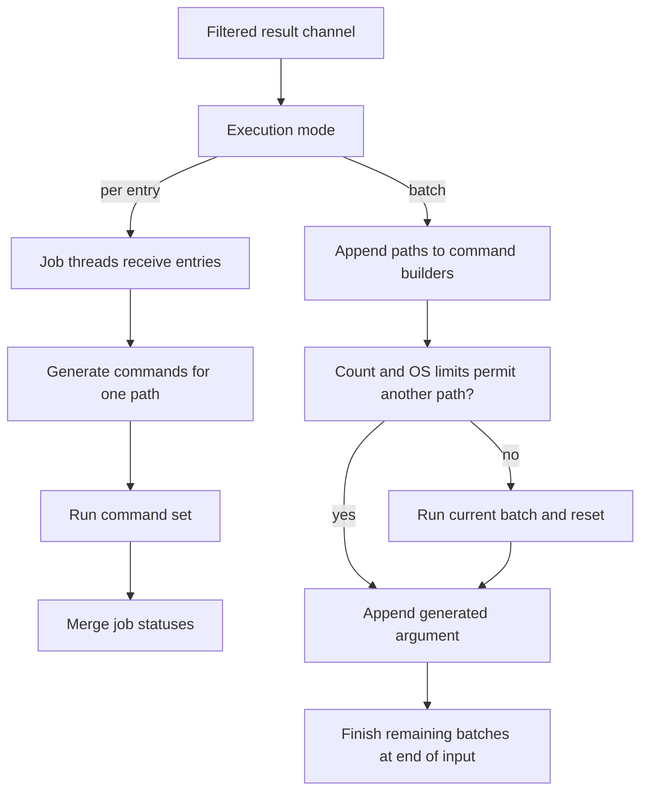

## Overview

Execution replaces path printing with external commands. `-x` or `--exec` creates a command invocation for each result, while `-X` or `--exec-batch` expands results into a batch invocation. Both consume the same filtered worker entries. The receiver chooses the execution mode from `Config.command`; shared path presentation and placeholder syntax are documented in [[Output and Pipelines]].

Sources: [src/cli.rs:883-949](repo://src/cli.rs#L883-L949), [src/walk.rs:408-439](repo://src/walk.rs#L408-L439), [src/exec/job.rs:33-40](repo://src/exec/job.rs#L33-L40), [src/exec/job.rs:46-63](repo://src/exec/job.rs#L46-L63)

## Place the command boundary

Each execution option takes one or more arguments, accepts hyphen-prefixed values, and consumes values until a semicolon terminator. Put the pattern, roots and fd options before the execution option, as in the examples below. If fd arguments must follow a template, escape the terminator for the invoking shell as `\;`. Repeated execution options append templates to a `CommandSet`, but batch and per-entry modes conflict with each other.

Sources: [src/cli.rs:861-873](repo://src/cli.rs#L861-L873), [src/cli.rs:883-949](repo://src/cli.rs#L883-L949)

```bash
fd . src -x echo
fd -e rs -X wc -l
```

Sources: [src/cli.rs:914-915](repo://src/cli.rs#L914-L915), [src/cli.rs:947-948](repo://src/cli.rs#L947-L948)

Templates are argument sequences. `CommandTemplate::generate` constructs a command from the generated first argument and adds each remaining argument separately; it does not assemble an implicit shell command string. If no placeholder occurs, template construction appends the result-path placeholder automatically. The [[Quickstart]] examples therefore need no explicit placeholder when the result path belongs at the end.

Sources: [src/exec/mod.rs:220-255](repo://src/exec/mod.rs#L220-L255), [src/exec/mod.rs:266-271](repo://src/exec/mod.rs#L266-L271)

## Validate templates before searching

Every supplied argument is parsed using the shared `FormatTemplate` parser. An empty template is refused because otherwise the program could accidentally execute discovered files and directories. Per-entry mode permits a placeholder as the executable. Batch mode requires a fixed executable as its first argument and refuses more than one placeholder-bearing argument. The latter check counts arguments containing tokens, rather than counting every token inside one argument.

Sources: [src/exec/mod.rs:51-69](repo://src/exec/mod.rs#L51-L69), [src/exec/mod.rs:220-259](repo://src/exec/mod.rs#L220-L259), [src/exec/mod.rs:438-442](repo://src/exec/mod.rs#L438-L442)

The conversion runs while Clap constructs `Exec` from matches, and errors become `InvalidValue` CLI errors. A single command can combine a path placeholder with literal suffix text, such as the conversion example below. [[Output and Pipelines]] explains the basename, parent and extension-removal substitutions, including brace escaping; execution applies the same substitutions before adding arguments to the external process.

Sources: [src/cli.rs:861-873](repo://src/cli.rs#L861-L873), [src/cli.rs:900-917](repo://src/cli.rs#L900-L917), [src/exec/mod.rs:266-271](repo://src/exec/mod.rs#L266-L271)

```bash
fd -e jpg -x convert {} {.}.png
```

Sources: [src/cli.rs:916-917](repo://src/cli.rs#L916-L917)

## Dispatch per-entry jobs

For per-entry mode, the receiver starts `config.threads` scoped job threads, each reading from a clone of the result channel. Each job obtains an entry, chooses its presented path, generates the command set and executes it. `--threads=1` makes command execution sequential. Execution order remains unspecified, including the order in which matching entries arrive; reducing the thread count does not introduce an explicit sort.

Sources: [src/walk.rs:411-431](repo://src/walk.rs#L411-L431), [src/exec/job.rs:11-43](repo://src/exec/job.rs#L11-L43), [src/cli.rs:895-899](repo://src/cli.rs#L895-L899)



Sources: [src/walk.rs:408-431](repo://src/walk.rs#L408-L431), [src/exec/job.rs:33-63](repo://src/exec/job.rs#L33-L63), [src/exec/mod.rs:90-119](repo://src/exec/mod.rs#L90-L119), [src/exec/mod.rs:173-202](repo://src/exec/mod.rs#L173-L202)

When more than one execution thread is configured, each result's command output is captured. `OutputBuffer::write` locks stdout and stderr while writing that result's collected outputs, preventing other job threads from interleaving their writes. With one thread, execution uses spawning without that output capture so intermediate output can be viewed and interacted with. `-0` appends a NUL to stdout after the command output for each result.

Sources: [src/exec/job.rs:16-17](repo://src/exec/job.rs#L16-L17), [src/exec/command.rs:30-55](repo://src/exec/command.rs#L30-L55), [src/exec/command.rs:71-98](repo://src/exec/command.rs#L71-L98)

## Bound batches by count and argument space

Batch execution builds one `CommandBuilder` per template. The builder separates fixed arguments before the placeholder-bearing argument from fixed arguments after it. Each result generates one argument using that path template. The builder first checks a positive `--batch-size` limit, then asks `argmax::Command` whether the next argument and all fixed trailing arguments will fit. If either limit is reached, it executes the accumulated batch before appending the next result.

Sources: [src/exec/mod.rs:90-116](repo://src/exec/mod.rs#L90-L116), [src/exec/mod.rs:135-188](repo://src/exec/mod.rs#L135-L188)

A batch size of zero removes the count limit, while operating-system argument limits can still split the command. Batch processes inherit stdin, stdout and stderr. Finishing a nonempty batch appends its trailing arguments, waits for the process, records a failed status, and resets the builder. Finishing an empty builder does nothing, so no matches means no external invocation. Batch argument order is explicitly unspecified by the CLI.

Sources: [src/cli.rs:492-508](repo://src/cli.rs#L492-L508), [src/cli.rs:932-934](repo://src/cli.rs#L932-L934), [src/exec/mod.rs:164-202](repo://src/exec/mod.rs#L164-L202)

## Request a detailed listing

`-l` or `--list-details` selects a batch `ls` command through `extract_command`. On most Unix targets the command is `ls -l -h -d` with an explicit color choice. On macOS and the listed BSD targets it first tries GNU `gls`, then falls back to BSD `ls`, adding `-G` only on supported targets when color is enabled. On Windows it requires GNU `ls` and otherwise reports that the listing mode is unsupported.

Sources: [src/main.rs:395-428](repo://src/main.rs#L395-L428), [src/main.rs:430-493](repo://src/main.rs#L430-L493)

The CLI makes detailed listing conflict with explicit execution options, absolute-path mode, NUL output and custom printing formats. Quiet mode and maximum-result limits also conflict with execution modes. These choices are checked before dispatch, rather than producing a mixture of path records and command output at runtime.

Sources: [src/cli.rs:29-30](repo://src/cli.rs#L29-L30), [src/cli.rs:227-238](repo://src/cli.rs#L227-L238), [src/cli.rs:266-276](repo://src/cli.rs#L266-L276), [src/cli.rs:475-487](repo://src/cli.rs#L475-L487), [src/cli.rs:883-930](repo://src/cli.rs#L883-L930)

## Propagate failures

Within one per-entry command set, a nonzero child status stops the remaining commands for that entry and returns `GeneralError`. The job loop continues consuming subsequent entries and merges their outcomes. Missing executables receive a command-not-found diagnostic; other launch errors receive an execution-problem diagnostic. fd aggregates these failures into status one rather than forwarding an arbitrary child exit code.

Sources: [src/exec/command.rs:60-114](repo://src/exec/command.rs#L60-L114), [src/exec/job.rs:19-43](repo://src/exec/job.rs#L19-L43), [src/exit_codes.rs:14-21](repo://src/exit_codes.rs#L14-L21), [src/exit_codes.rs:46-50](repo://src/exit_codes.rs#L46-L50)

In batch mode, a completed child with unsuccessful status marks its builder as failed, but the builder can continue processing later batches. Errors while constructing, extending or finishing a builder return immediately through `handle_cmd_error`. Filesystem errors from traversal are separate records: both execution consumers display them only when requested and skip them instead of converting them into command arguments.

Sources: [src/exec/mod.rs:90-119](repo://src/exec/mod.rs#L90-L119), [src/exec/mod.rs:191-206](repo://src/exec/mod.rs#L191-L206), [src/exec/job.rs:23-30](repo://src/exec/job.rs#L23-L30), [src/exec/job.rs:51-63](repo://src/exec/job.rs#L51-L63)
