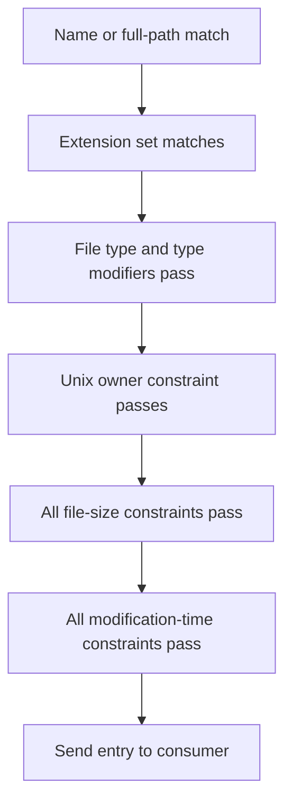

## Overview

After the name or full-path match succeeds, fd applies extension, file-type, ownership, size and modification-time predicates in that order. These constraints refine entries supplied by [[Traversal and Ignore Rules]]; they do not make ignored directories eligible for descent. [[Search Patterns]] owns the preceding regex stage. Every enabled constraint must pass before the worker sends an entry to its result consumer.

Sources: [src/walk.rs:514-591](repo://src/walk.rs#L514-L591), [src/walk.rs:600-611](repo://src/walk.rs#L600-L611)

## Follow the predicate order

Sources: [src/walk.rs:514-611](repo://src/walk.rs#L514-L611)

The callback returns `WalkState::Continue` as soon as a predicate rejects an entry. Name matching comes first because it needs no metadata; the later predicates only obtain metadata when their options are present. This ordering also affects pruning: the worker reaches the prune branch only after sending an accepted entry. A directory rejected by a type or time filter does not reach that branch and can still be traversed.

Sources: [src/walk.rs:514-591](repo://src/walk.rs#L514-L591), [src/walk.rs:600-611](repo://src/walk.rs#L600-L611)

## Select extensions

`-e` or `--extension` may be repeated. Configuration removes leading dots from each supplied extension, regex-escapes its literal text, and builds a case-insensitive `RegexSet` with an end anchor. The worker tests that set against the entry's filename, independently of whether the main pattern searches a full path. Repeated extensions provide alternatives within this set, while the main pattern and other filter families still have to pass.

Sources: [src/cli.rs:380-393](repo://src/cli.rs#L380-L393), [src/main.rs:361-373](repo://src/main.rs#L361-L373), [src/walk.rs:526-535](repo://src/walk.rs#L526-L535)

An extension is a name constraint, so it can also match directories whose names end with the extension. Add a file-type constraint when you only want regular files. The generated regex requires a character before the extension dot, which follows directly from the configuration pattern. If the worker cannot obtain a filename component, it rejects the entry rather than treating the extension filter as satisfied.

Sources: [src/cli.rs:380-385](repo://src/cli.rs#L380-L385), [src/main.rs:365-371](repo://src/main.rs#L365-L371), [src/walk.rs:526-535](repo://src/walk.rs#L526-L535)

## Select kinds and modifiers

| Selection | CLI value | Behavior |
| --- | --- | --- |
| Regular file | `f`, `file` | Includes regular files |
| Directory | `d`, `dir`, `directory` | Includes directories |
| Symbolic link | `l`, `symlink` | Includes symbolic links |
| Socket or FIFO | `s`, `socket`; `p`, `pipe` | Includes the corresponding special type |
| Device | `b`, `block-device`; `c`, `char-device` | Includes block or character devices |
| Executable modifier | `x`, `executable` | Enables regular files and requires executable access |
| Empty modifier | `e`, `empty` | Requires emptiness; defaults to files and directories if neither was selected |

Sources: [src/cli.rs:333-378](repo://src/cli.rs#L333-L378), [src/main.rs:333-360](repo://src/main.rs#L333-L360), [src/filetypes.rs:20-41](repo://src/filetypes.rs#L20-L41)

Repeated ordinary types expand the selected kinds, such as files plus symlinks. Executable and empty are additional restrictions, rather than ordinary independent kinds. The implementation calls `faccess` executable checking for the executable modifier. For emptiness, it reads a directory and requires no first entry, or checks that a regular file's metadata length is zero. Other kinds, unavailable metadata, and unreadable directories fail the emptiness predicate.

Sources: [src/main.rs:333-357](repo://src/main.rs#L333-L357), [src/filetypes.rs:20-41](repo://src/filetypes.rs#L20-L41), [src/filesystem.rs:44-59](repo://src/filesystem.rs#L44-L59)

When a type filter is active, unavailable file-type information rejects the entry. Special-type helpers use the platform's filesystem type extensions on Unix and Redox; their Windows implementations return false for block devices, character devices, sockets and pipes. This platform handling lives in the helper layer used by the common type predicate.

Sources: [src/filetypes.rs:20-41](repo://src/filetypes.rs#L20-L41), [src/filesystem.rs:62-100](repo://src/filesystem.rs#L62-L100)

## Bound file sizes

`--size` or `-S` accepts an unsigned integer quantity with a unit and an optional sign. A leading `+` means at least the specified bytes, a leading `-` means at most, and no sign means exact equality. The parser accepts case-insensitive byte, decimal and binary units, including optional trailing `b` for prefixed units. Multiple size options all have to pass, so lower and upper bounds can define an inclusive interval.

Sources: [src/cli.rs:395-417](repo://src/cli.rs#L395-L417), [src/filter/size.rs:15-73](repo://src/filter/size.rs#L15-L73), [src/walk.rs:557-574](repo://src/walk.rs#L557-L574)

Decimal units `k`, `m`, `g` and `t` scale by powers of 1,000; `ki`, `mi`, `gi` and `ti` scale by powers of 1,024. The worker first requires `entry_path.is_file()`, then obtains metadata and compares `metadata.len()` against every bound. Directories are excluded whenever size constraints are present. Invalid size syntax is reported by the CLI value parser before a scan begins.

Sources: [src/filter/size.rs:15-73](repo://src/filter/size.rs#L15-L73), [src/cli.rs:412-417](repo://src/cli.rs#L412-L417), [src/walk.rs:557-574](repo://src/walk.rs#L557-L574)

## Bound modification times

`--changed-within` selects modification times after a boundary, and `--changed-before` selects times before one. Startup parses each supplied boundary into a `TimeFilter`, rejecting invalid dates or durations with a help-directed error. The parser tries a Jiff span relative to the current zoned time, a timestamp, a civil datetime resolved in the system timezone, and finally an `@`-prefixed integer Unix timestamp. Ambiguous civil times choose the later interpretation.

Sources: [src/cli.rs:419-458](repo://src/cli.rs#L419-L458), [src/main.rs:496-518](repo://src/main.rs#L496-L518), [src/filter/time.rs:12-15](repo://src/filter/time.rs#L12-L15), [src/filter/time.rs:28-54](repo://src/filter/time.rs#L28-L54)

The comparisons are strict: `Before` uses less-than and `After` uses greater-than. Supplying both boundaries requires the modification time to lie strictly between them. The worker applies these predicates to any entry that reaches this stage, without a regular-file gate. Missing metadata or an unavailable modification timestamp rejects the entry whenever a time constraint is enabled.

Sources: [src/filter/time.rs:57-61](repo://src/filter/time.rs#L57-L61), [src/walk.rs:577-591](repo://src/walk.rs#L577-L591)

## Restrict Unix ownership

On Unix, `--owner` or `-o` accepts an optional user or UID, an optional group or GID after a colon, and a leading `!` on either component to negate it. Numeric values are parsed directly; names resolve through `nix::unistd::User` or `Group`. Extra colons and unknown names are errors. Empty components are ignored, so an empty string or a bare colon produces a no-op filter that configuration removes.

Sources: [src/cli.rs:460-473](repo://src/cli.rs#L460-L473), [src/filter/owner.rs:18-66](repo://src/filter/owner.rs#L18-L66), [src/filter/owner.rs:85-102](repo://src/filter/owner.rs#L85-L102), [src/main.rs:268-269](repo://src/main.rs#L268-L269)

When active, both user and group checks must pass against the same metadata. A component can require equality, inequality, or nothing. The worker rejects the entry if ownership metadata is unavailable. `DirEntry::metadata` stores either the successful metadata or its absence in a `OnceCell`, so ownership, size and time checks on that entry share the cached lookup result.

Sources: [src/filter/owner.rs:69-82](repo://src/filter/owner.rs#L69-L82), [src/walk.rs:544-554](repo://src/walk.rs#L544-L554), [src/dir_entry.rs:89-96](repo://src/dir_entry.rs#L89-L96)
