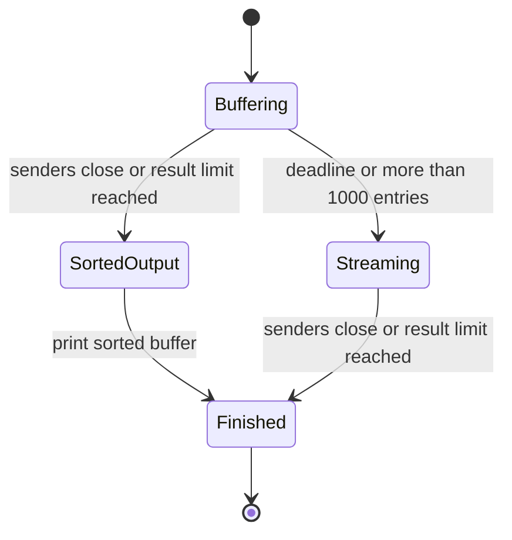

## Overview

When no command is configured, the receiver locks stdout, wraps it in a buffered writer, and feeds worker results into `ReceiverBuffer`. This consumer decides when to sort, when to stream, how many results to accept, and how to render each entry. [[Traversal and Ignore Rules]] covers the producers. A configured command selects the separate consumer described in [[Command Execution]], which shares path and template machinery with printing.

Sources: [src/walk.rs:408-439](repo://src/walk.rs#L408-L439), [src/walk.rs:151-179](repo://src/walk.rs#L151-L179)

## Buffer briefly, then stream

The receiver starts in `Buffering` mode with a deadline 100 milliseconds in the future unless `--max-buffer-time` supplies another duration. Entries accumulate in a vector. If all senders disconnect before the deadline and capacity threshold, `stop` sorts that vector by entry path and prints it. If the buffer exceeds 1,000 entries or the deadline expires first, `stream` prints the current buffer in arrival order and permanently switches to direct streaming.

Sources: [src/walk.rs:124-169](repo://src/walk.rs#L124-L169), [src/walk.rs:198-244](repo://src/walk.rs#L198-L244), [src/walk.rs:269-291](repo://src/walk.rs#L269-L291), [src/dir_entry.rs:132-136](repo://src/dir_entry.rs#L132-L136)



Sources: [src/walk.rs:198-244](repo://src/walk.rs#L198-L244), [src/walk.rs:269-291](repo://src/walk.rs#L269-L291)

Streaming flushes stdout when no next batch is ready, so it does not wait indefinitely with already printed data buffered. Because streaming never sorts, ordinary output is not guaranteed to be globally ordered. A search limited by `--max-results` stops after the accepted count is reached; if it is still buffering, the selected results are sorted before printing, but selection itself follows arrival order.

Sources: [src/walk.rs:208-244](repo://src/walk.rs#L208-L244), [src/walk.rs:269-291](repo://src/walk.rs#L269-L291)

## Choose result counts and status

`--max-results` sets a positive result limit; zero is filtered out and leaves the search unlimited. `-1` selects a single result. `--quiet`, also available as `-q` or `--has-results`, returns on the first matching entry without printing paths. If no match arrives, it returns the negative result status when the senders close. Execution options conflict with result limits and quiet mode in the CLI argument group.

Sources: [src/cli.rs:29-30](repo://src/cli.rs#L29-L30), [src/cli.rs:566-601](repo://src/cli.rs#L566-L601), [src/cli.rs:759-763](repo://src/cli.rs#L759-L763), [src/walk.rs:203-225](repo://src/walk.rs#L203-L225), [src/walk.rs:281-291](repo://src/walk.rs#L281-L291)

| Outcome | Process status |
| --- | --- |
| Ordinary successful printing, including no matches | 0 |
| Quiet mode with a match | 0 |
| Quiet mode without a match | 1 |
| General application error | 1 |
| Interrupted status | 130, with Unix SIGINT re-raising attempted |

Sources: [src/walk.rs:281-291](repo://src/walk.rs#L281-L291), [src/exit_codes.rs:14-42](repo://src/exit_codes.rs#L14-L42)

## Preserve path meaning

`DirEntry::stripped_path` controls presentation of a leading `./`. Automatic configuration strips it for ordinary printing but keeps it for NUL output and command execution. Stripping is only enabled when no explicit search roots were supplied. Even if stripping is requested, an entry retains its original prefix when the stripped path would start with a dash, preventing downstream consumers from interpreting that path as an option. Full-path pattern matching remains independent, as explained in [[Search Patterns]].

Sources: [src/main.rs:389-390](repo://src/main.rs#L389-L390), [src/cli.rs:765-773](repo://src/cli.rs#L765-L773), [src/dir_entry.rs:56-79](repo://src/dir_entry.rs#L56-L79), [src/walk.rs:656-677](repo://src/walk.rs#L656-L677)

`print_entry` renders a custom format first, then colored output, then uncolored output. Normal path rendering appends a separator for directories; a custom format emits its generated text instead. After rendering, the function writes either a newline or a NUL byte. `--path-separator` overrides displayed separators; on Windows a nonempty `MSYSTEM` supplies `/` as the default override, and startup rejects override strings longer than one byte on Windows.

Sources: [src/output.rs:17-85](repo://src/output.rs#L17-L85), [src/output.rs:131-155](repo://src/output.rs#L131-L155), [src/main.rs:234-264](repo://src/main.rs#L234-L264), [src/filesystem.rs:123-135](repo://src/filesystem.rs#L123-L135)

## Use shared format templates

`--format` parses its text through `FormatTemplate`, also used by external-command arguments. The parser stores either fixed text or text interspersed with placeholder tokens. Doubled braces produce literal braces. Formatting generates an `OsString`, and a separator override affects substituted path components while leaving fixed text untouched. Unlike command templates, a printing format without placeholders stays fixed text and is emitted for every selected entry.

Sources: [src/main.rs:374-377](repo://src/main.rs#L374-L377), [src/fmt/mod.rs:58-139](repo://src/fmt/mod.rs#L58-L139), [src/output.rs:69-85](repo://src/output.rs#L69-L85)

| Placeholder | Generated value |
| --- | --- |
| `{}` | Result path |
| `{/}` | Basename |
| `{//}` | Parent directory; `.` for a basename with an empty parent |
| `{.}` | Path with its final extension removed |
| `{/.}` | Basename with its final extension removed |
| `{{` and `}}` | Literal opening and closing braces |

Sources: [src/fmt/mod.rs:58-90](repo://src/fmt/mod.rs#L58-L90), [src/fmt/mod.rs:112-139](repo://src/fmt/mod.rs#L112-L139), [src/fmt/input.rs:6-31](repo://src/fmt/input.rs#L6-L31)

## Distinguish terminal text from pipe bytes

On Unix, uncolored output to a pipe or file writes raw filename bytes when no custom separator is configured. This branch preserves invalid UTF-8 for downstream tools. Terminal output, colored output, custom formats and separator replacement instead pass through string rendering; the format branch explicitly uses a lossy conversion. Use the ordinary uncolored byte path when preserving a filename's original bytes matters.

Sources: [src/output.rs:69-85](repo://src/output.rs#L69-L85), [src/output.rs:95-98](repo://src/output.rs#L95-L98), [src/output.rs:142-181](repo://src/output.rs#L142-L181)

Terminal sanitation escapes control characters except tab, as well as the explicitly listed invisible and directional formatting characters. It emits byte-sized escapes or Unicode escapes and borrows unchanged strings when no escaping is necessary. `maybe_sanitize` applies this transformation only for terminal output. For pipelines, `-0` supplies unambiguous record boundaries, as in the repository's example below.

Sources: [src/sanitize.rs:1-55](repo://src/sanitize.rs#L1-L55), [README.md:527-536](repo://README.md#L527-L536)

```bash
fd -0 -e rs | xargs -0 wc -l
```

Sources: [README.md:527-536](repo://README.md#L527-L536)

## Configure color and hyperlinks

Color defaults to auto: stdout must be a terminal, ANSI support must be available, and `NO_COLOR` must be absent or empty. Explicit always and never modes bypass that auto decision. When enabled, `LS_COLORS` is loaded with a built-in fallback. The colored renderer styles parent directories separately from basenames, using the entry's cached style for the latter.

Sources: [src/cli.rs:520-530](repo://src/cli.rs#L520-L530), [src/main.rs:271-292](repo://src/main.rs#L271-L292), [src/output.rs:95-136](repo://src/output.rs#L95-L136), [src/dir_entry.rs:105-109](repo://src/dir_entry.rs#L105-L109)

Hyperlinks default to never. Supplying `--hyperlink` without a value chooses auto, which follows whether colored output is enabled; explicit always or never controls it directly. `PathUrl` converts the entry to an absolute path and percent-encodes bytes outside its allowed URL set. `print_entry` wraps the rendered text in terminal hyperlink sequences and closes the hyperlink before writing the record separator.

Sources: [src/cli.rs:532-548](repo://src/cli.rs#L532-L548), [src/main.rs:293-297](repo://src/main.rs#L293-L297), [src/hyperlink.rs:7-40](repo://src/hyperlink.rs#L7-L40), [src/output.rs:17-42](repo://src/output.rs#L17-L42)

## Handle output failure and interruption

An entry write error other than `BrokenPipe` prints a diagnostic and returns a general error. A flush failure also returns a general error. The receiver sets the shared quit flag whenever its processing loop ends. For colored ordinary printing, scan installs a Ctrl-C handler: the first interrupt asks producers to quit, and a second exits immediately. The scan returns an interrupted status if the interrupt flag was set.

Sources: [src/walk.rs:173-179](repo://src/walk.rs#L173-L179), [src/walk.rs:251-264](repo://src/walk.rs#L251-L264), [src/walk.rs:295-301](repo://src/walk.rs#L295-L301), [src/walk.rs:621-652](repo://src/walk.rs#L621-L652)
