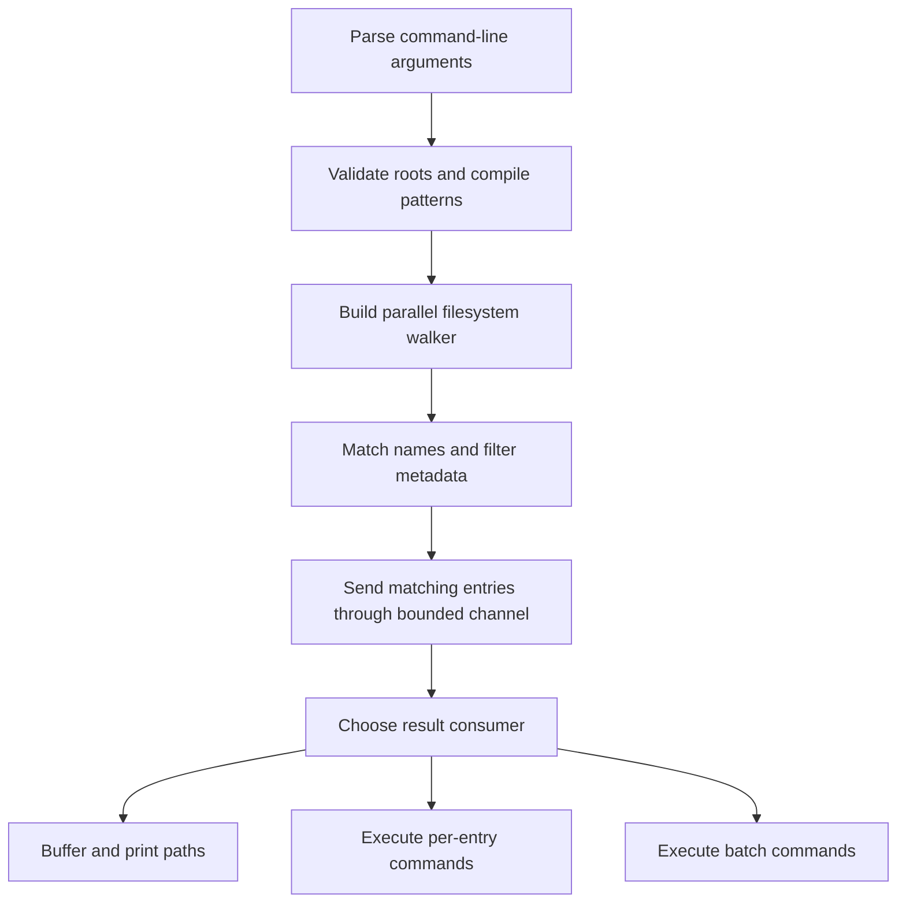

## Overview

`fd` finds entries in a filesystem using regular expressions or glob patterns. It is a Rust command-line application whose Cargo package is named `fd-find` and whose executable is named `fd`. A search starts with a pattern and optional root directories, then either prints matching paths or turns them into arguments for external commands. [[Quickstart]] introduces the build and the first searches using this interface.

Sources: [Cargo.toml:1-31](repo://Cargo.toml#L1-L31), [src/cli.rs:21-31](repo://src/cli.rs#L21-L31), [src/cli.rs:628-672](repo://src/cli.rs#L628-L672), [src/walk.rs:408-439](repo://src/walk.rs#L408-L439)

The default search is recursive, matches entry names, skips hidden entries, and respects ignore rules. Case handling is smart: an uppercase character in any compiled pattern makes the search case-sensitive unless case-insensitive matching was explicitly requested. These choices become fields in one `Config`, which is passed with the compiled patterns into the search engine.

Sources: [src/main.rs:94-111](repo://src/main.rs#L94-L111), [src/main.rs:248-255](repo://src/main.rs#L248-L255), [src/main.rs:301-328](repo://src/main.rs#L301-L328), [src/cli.rs:278-288](repo://src/cli.rs#L278-L288)

## Find the relevant system

| Area | What it does | Documentation |
| --- | --- | --- |
| First use | Builds the executable and introduces searches | [[Quickstart]] |
| Pattern matching | Validates and compiles regex, glob, literal and full-path searches | [[Search Patterns]] |
| Filesystem traversal | Chooses roots, applies ignore rules and controls descent | [[Traversal and Ignore Rules]] |
| Entry selection | Applies extension, type, size, time and ownership constraints | [[Metadata Filters]] |
| Result presentation | Buffers, formats and prints paths or answers existence queries | [[Output and Pipelines]] |
| Result actions | Runs commands for individual entries or batches | [[Command Execution]] |
| Contributor workflow | Defines builds, integration fixtures and completion installation | [[Development and Testing]] |

Sources: [src/main.rs:75-111](repo://src/main.rs#L75-L111), [src/walk.rs:347-403](repo://src/walk.rs#L347-L403), [src/walk.rs:514-600](repo://src/walk.rs#L514-L600), [src/walk.rs:408-439](repo://src/walk.rs#L408-L439), [Makefile:8-52](repo://Makefile#L8-L52), [tests/testenv/mod.rs:28-78](repo://tests/testenv/mod.rs#L28-L78)

## Follow a search

Sources: [src/main.rs:75-111](repo://src/main.rs#L75-L111), [src/walk.rs:347-365](repo://src/walk.rs#L347-L365), [src/walk.rs:514-611](repo://src/walk.rs#L514-L611), [src/walk.rs:408-439](repo://src/walk.rs#L408-L439), [src/walk.rs:616-652](repo://src/walk.rs#L616-L652)

1. Argument parsing supplies the public interface introduced in [[Quickstart]]; an optional base directory is applied before resolving search roots.
2. Validation and compilation turn user patterns into byte regexes, including additional required expressions, as explained in [[Search Patterns]].
3. The walker receives ignore, symlink, filesystem and depth settings; [[Traversal and Ignore Rules]] follows these decisions through directory descent.
4. Each worker first matches the name or absolute path, then applies the predicates covered by [[Metadata Filters]].
5. Accepted entries reach a receiver through a bounded channel; [[Output and Pipelines]] explains the printing consumer and its buffering behavior.
6. When a command is configured, the receiver instead dispatches individual jobs or batches, as described in [[Command Execution]].

Sources: [src/main.rs:75-111](repo://src/main.rs#L75-L111), [src/walk.rs:347-365](repo://src/walk.rs#L347-L365), [src/walk.rs:514-600](repo://src/walk.rs#L514-L600), [src/walk.rs:408-439](repo://src/walk.rs#L408-L439), [src/walk.rs:636-645](repo://src/walk.rs#L636-L645)

## Design decisions across the flow

Name matching precedes metadata-dependent filtering because it does not require metadata. This gives workers a cheap rejection step before ownership, size or modification-time checks. `DirEntry` then caches metadata and styling in `OnceCell` values, so consumers of the same entry reuse the stored result. Color styling is computed in the workers when ordinary path printing needs it, distributing that work across the search threads.

Sources: [src/walk.rs:514-554](repo://src/walk.rs#L514-L554), [src/walk.rs:557-598](repo://src/walk.rs#L557-L598), [src/dir_entry.rs:17-31](repo://src/dir_entry.rs#L17-L31), [src/dir_entry.rs:89-109](repo://src/dir_entry.rs#L89-L109)

The parallel producer and receiver are connected by a channel sized to twice the configured thread count. Producers send shared batches, with a batch-size limit that the code identifies as backpressure. For parallel per-entry execution, producers reduce that limit to one to distribute work evenly among receivers. The default thread calculation also caps available parallelism at 64, explicitly to limit startup overhead on machines with many cores.

Sources: [src/walk.rs:90-120](repo://src/walk.rs#L90-L120), [src/walk.rs:442-457](repo://src/walk.rs#L442-L457), [src/walk.rs:636-645](repo://src/walk.rs#L636-L645), [src/cli.rs:788-799](repo://src/cli.rs#L788-L799)

Printing begins with a short buffering phase so a quickly completed search can sort its results. A deadline or a buffer exceeding 1,000 entries changes the receiver to streaming, after which it prints arrivals directly. Consequently, ordering depends on whether the search finished within the buffering phase; the code does not impose a global sort on streamed results. This behavior is part of the receiver, separate from the entry-selection predicates.

Sources: [src/config.rs:68-71](repo://src/config.rs#L68-L71), [src/walk.rs:124-127](repo://src/walk.rs#L124-L127), [src/walk.rs:198-244](repo://src/walk.rs#L198-L244), [src/walk.rs:269-291](repo://src/walk.rs#L269-L291)

Path presentation preserves a leading `./` whenever stripping it would expose a leading dash, because downstream commands might otherwise interpret the path as an option. On Unix, ordinary uncolored piped output writes raw filename bytes when no separator override is present; the code states that this preserves invalid UTF-8 names for downstream tools. Terminal rendering uses a different path that can sanitize displayed text.

Sources: [src/dir_entry.rs:56-79](repo://src/dir_entry.rs#L56-L79), [src/output.rs:142-181](repo://src/output.rs#L142-L181)

## Completion and failure boundaries

Startup errors propagate through `run` to the top-level error printer and a general error exit. Traversal errors travel alongside entries and are displayed when filesystem error reporting is enabled. A quiet search returns a result-dependent status, while ordinary printing can complete successfully with no matches. Command consumers aggregate command failures into the application's own exit status; callers should use that status rather than expect an external command's numeric status to be forwarded unchanged.

Sources: [src/main.rs:62-111](repo://src/main.rs#L62-L111), [src/walk.rs:203-230](repo://src/walk.rs#L203-L230), [src/walk.rs:281-291](repo://src/walk.rs#L281-L291), [src/exec/job.rs:19-43](repo://src/exec/job.rs#L19-L43), [src/exit_codes.rs:14-21](repo://src/exit_codes.rs#L14-L21), [src/exit_codes.rs:46-50](repo://src/exit_codes.rs#L46-L50)
