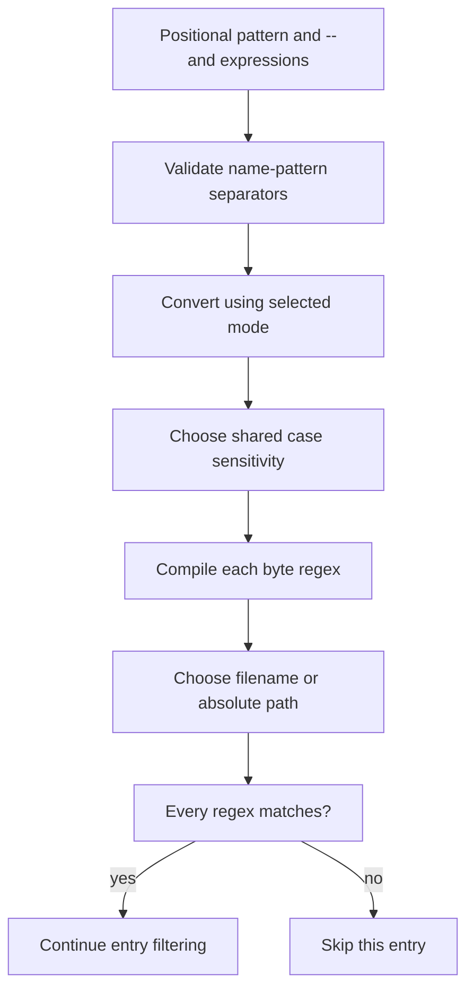

## Overview

Pattern processing decides whether an eligible filesystem entry has the requested name. The startup path collects the positional pattern and any `--and` expressions, transforms them according to the selected mode, constructs configuration, and compiles byte regexes. The worker then requires every regex to match the same search string. The commands in [[Quickstart]] enter through this pipeline; directory visitation is controlled separately by [[Traversal and Ignore Rules]].

Sources: [src/main.rs:89-111](repo://src/main.rs#L89-L111), [src/walk.rs:514-524](repo://src/walk.rs#L514-L524)

## Choose a pattern mode

| Mode | Public option | Conversion before regex compilation |
| --- | --- | --- |
| Regular expression | Default, or `--regex` to override glob | Uses the supplied pattern unchanged |
| Glob | `-g`, `--glob` | Converts a nonempty glob through `GlobBuilder` with literal separators |
| Literal substring | `-F`, `--fixed-strings`, `--literal` | Escapes regex punctuation without adding anchors |
| Exact literal | `--exact` | Escapes regex punctuation and adds start and end anchors |

Sources: [src/cli.rs:153-198](repo://src/cli.rs#L153-L198), [src/main.rs:218-231](repo://src/main.rs#L218-L231)

A regular expression can match a substring; add anchors when the entire search string should satisfy a regex. Glob matching is useful for complete name patterns such as the README's `libc.so` example. `--fixed-strings` retains substring behavior while making punctuation literal, whereas `--exact` explicitly requires the entire name or path. Clap rejects combining `--exact` with glob or fixed-string mode, and glob declares a conflict with fixed strings.

Sources: [README.md:40-63](repo://README.md#L40-L63), [README.md:115-122](repo://README.md#L115-L122), [src/cli.rs:153-198](repo://src/cli.rs#L153-L198), [src/main.rs:218-231](repo://src/main.rs#L218-L231)

The positional pattern defaults to an empty string, allowing a search without a name restriction. The conversion deliberately skips glob construction for an empty glob pattern, leaving that empty expression available to the regex builder. An exact empty pattern instead receives the exact-mode anchors. A pattern beginning with a dash must follow `--` so it is parsed as a pattern rather than an option.

Sources: [src/cli.rs:628-639](repo://src/cli.rs#L628-L639), [src/main.rs:218-231](repo://src/main.rs#L218-L231)

## Match names or absolute paths

By default, `search_str_for_entry` takes `file_name()` from the visited path. Parent directories do not participate in this match. With `--full-path` or `-p`, startup caches the current directory in `Config.full_path_base`. The worker borrows an already absolute path, or strips a leading current-directory component and joins the relative entry to the cached base. Full-path matching therefore uses an absolute path even when the displayed result is relative.

Sources: [src/cli.rs:255-264](repo://src/cli.rs#L255-L264), [src/main.rs:301-308](repo://src/main.rs#L301-L308), [src/walk.rs:656-677](repo://src/walk.rs#L656-L677)

Output path selection is independent: `--absolute-path` normalizes search roots for absolute results, while `--full-path` controls the string tested by regexes. A base-directory change happens before either root resolution or full-path configuration. This separation matters when a pattern includes directories but the consumer still wants relative results; [[Output and Pipelines]] describes the final path representation and separator handling.

Sources: [src/main.rs:83-102](repo://src/main.rs#L83-L102), [src/main.rs:131-146](repo://src/main.rs#L131-L146), [src/main.rs:301-308](repo://src/main.rs#L301-L308), [src/cli.rs:723-735](repo://src/cli.rs#L723-L735), [src/dir_entry.rs:56-79](repo://src/dir_entry.rs#L56-L79)

## Combine required expressions

`--and` supplies additional required patterns and may be repeated. Startup chains these expressions with the positional pattern and runs every expression through the same mode conversion. During traversal, `patterns.iter().all(...)` rejects an entry on the first nonmatching expression. This is conjunction across patterns: matching one expression does not compensate for failing another, and all expressions inspect the same filename or absolute-path bytes.

Sources: [src/cli.rs:200-211](repo://src/cli.rs#L200-L211), [src/main.rs:90-109](repo://src/main.rs#L90-L109), [src/walk.rs:514-524](repo://src/walk.rs#L514-L524)

Sources: [src/main.rs:89-111](repo://src/main.rs#L89-L111), [src/main.rs:169-179](repo://src/main.rs#L169-L179), [src/main.rs:218-255](repo://src/main.rs#L218-L255), [src/walk.rs:514-524](repo://src/walk.rs#L514-L524), [src/walk.rs:656-677](repo://src/walk.rs#L656-L677)

## Understand smart case and byte matching

One shared case-sensitivity setting applies to every compiled regex. Explicit `--ignore-case` suppresses both explicit case-sensitive mode and smart-case detection in configuration. Otherwise, `--case-sensitive` or uppercase content detected in any transformed pattern enables sensitivity. The detector parses regex syntax and walks literals, character classes, captures, repetitions, concatenations and alternations; it does not merely scan the raw option text for capital letters.

Sources: [src/main.rs:248-255](repo://src/main.rs#L248-L255), [src/regex_helper.rs:4-37](repo://src/regex_helper.rs#L4-L37)

The syntax-aware distinction is visible in the helper tests: the regex start anchor written as `\A` does not trigger smart case, while a class containing uppercase characters does. The final `RegexBuilder` applies the shared case setting and enables dot matching across newlines. Workers match filename bytes directly on Unix; Windows obtains bytes from a lossy string conversion of the operating-system string.

Sources: [src/regex_helper.rs:81-96](repo://src/regex_helper.rs#L81-L96), [src/main.rs:541-554](repo://src/main.rs#L541-L554), [src/walk.rs:519-524](repo://src/walk.rs#L519-L524), [src/filesystem.rs:102-115](repo://src/filesystem.rs#L102-L115)

## Resolve pattern diagnostics

Without full-path matching, startup checks both the positional and additional patterns for accidental directory paths. A forward slash always triggers the diagnostic. On Windows, a backslash triggers it only when the pattern names an existing directory, because a backslash is also a valid regex escape. The diagnostic suggests a match-all pattern with a separate root for a scoped search, or `--full-path` when directory components belong in the match.

Sources: [src/main.rs:149-215](repo://src/main.rs#L149-L215)

On Unix, startup also detects some patterns that can only match names beginning with a dot while hidden entries remain disabled. The helper recognizes a start anchor followed by a literal leading dot, but its comment explicitly notes that more complex equivalent expressions are not all detected. This is a friendly diagnostic rather than an exhaustive analysis of hidden-file patterns; the actual hidden-file policy remains the walker's responsibility.

Sources: [src/main.rs:521-538](repo://src/main.rs#L521-L538), [src/regex_helper.rs:39-78](repo://src/regex_helper.rs#L39-L78), [src/walk.rs:352-365](repo://src/walk.rs#L352-L365)

An invalid final regex becomes a startup error with suggestions to use literal substring, exact literal, or glob matching. Invalid nonempty globs can fail earlier during mode conversion. Once compilation succeeds, a name match only advances the entry to extension and metadata checks; [[Metadata Filters]] describes why a correctly matching name can still be excluded from the results.

Sources: [src/main.rs:218-231](repo://src/main.rs#L218-L231), [src/main.rs:541-554](repo://src/main.rs#L541-L554), [src/walk.rs:519-542](repo://src/walk.rs#L519-L542)
