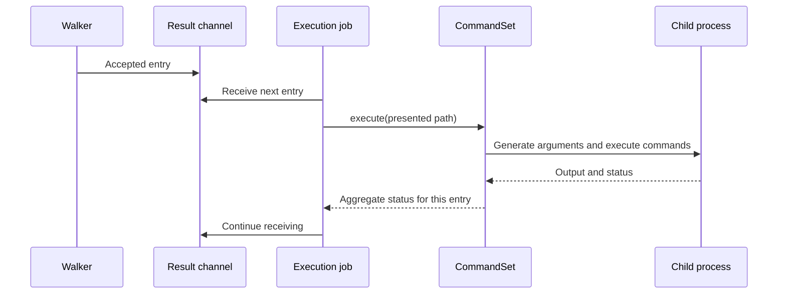

## Overview

Execution replaces the printed-path consumer with either per-entry command jobs (`--exec`, `-x`) or a batch consumer (`--exec-batch`, `-X`). Both receive the entries accepted by [[Search Patterns]], [[Traversal and Ignore Rules]] and [[Entry Filters]]. Commands use the shared placeholder and path-presentation rules in [[Result Output]], but their stdout and stderr follow execution-specific buffering behavior.

Sources: [src/walk.rs:408-439](repo://src/walk.rs#L408-L439), [src/exec/job.rs:11-64](repo://src/exec/job.rs#L11-L64), [src/exec/mod.rs:76-119](repo://src/exec/mod.rs#L76-L119)

## Capture and validate command arguments

`Exec::from_arg_matches` collects each occurrence of `--exec` or `--exec-batch` as a separate command template. Both options append occurrences, accept hyphen-prefixed command arguments and use `;` as a terminator. Arguments after the execution option belong to the external command, so put the execution option last or escape the terminator for your shell when more fd arguments must follow. Batch execution conflicts with per-entry execution; both conflict with detailed-listing mode.

Sources: [src/cli.rs:861-873](repo://src/cli.rs#L861-L873), [src/cli.rs:882-899](repo://src/cli.rs#L882-L899), [src/cli.rs:922-930](repo://src/cli.rs#L922-L930)

Every argument is parsed as a `FormatTemplate`. If no placeholder appears anywhere, `CommandTemplate::new` appends an implicit whole-path placeholder as the final argument. An empty command is rejected: the code comments explain that accepting it would otherwise execute every discovered file and directory. Per-entry mode can deliberately use a placeholder as its executable; batch mode requires its first argument to be fixed.

Sources: [src/exec/mod.rs:219-255](repo://src/exec/mod.rs#L219-L255)

Batch validation rejects templates with more than one argument containing placeholder tokens. The check counts token-bearing arguments, not individual token occurrences inside one argument. `CommandBuilder` divides the template into fixed arguments before the path argument, that path template, and fixed arguments after it. This is the shape it can expand repeatedly as paths arrive.

Sources: [src/exec/mod.rs:51-69](repo://src/exec/mod.rs#L51-L69), [src/exec/mod.rs:258-260](repo://src/exec/mod.rs#L258-L260), [src/exec/mod.rs:135-161](repo://src/exec/mod.rs#L135-L161)

## Direct execution and templates

`CommandTemplate::generate` constructs `argmax::Command` from the generated first argument and adds each remaining generated argument separately. It does not assemble a shell command string. Shell aliases and functions therefore need the explicit shell or script approach described in the repository README. The README also advises quoting placeholders when a shell would otherwise interpret them before fd receives them.

Sources: [src/exec/mod.rs:262-271](repo://src/exec/mod.rs#L262-L271), [README.md:439-450](repo://README.md#L439-L450)

The placeholder catalogue belongs to [[Result Output]]. During execution, `job` supplies `DirEntry::stripped_path`, the configured path separator and the NUL-output setting to `CommandSet::execute`. There is no terminal-color or hyperlink wrapping of path arguments. Directory changes happen during startup through `--base-directory`, rather than implicitly changing to each match's parent.

Sources: [src/exec/job.rs:33-39](repo://src/exec/job.rs#L33-L39), [src/exec/mod.rs:76-87](repo://src/exec/mod.rs#L76-L87), [src/exec/mod.rs:266-271](repo://src/exec/mod.rs#L266-L271), [src/main.rs:83-84](repo://src/main.rs#L83-L84), [src/main.rs:131-147](repo://src/main.rs#L131-L147)

## Per-entry jobs and output grouping

For `-x`, `WorkerState::receive` creates `config.threads` job threads, each consuming from a cloned receiver. Each job loops until its input closes, generates the command set for a path, executes it, and merges its status into the accumulated result. CLI help promises no command ordering. `--threads=1` makes execution sequential, while the order of discovered paths remains the traversal order.

Sources: [src/walk.rs:411-432](repo://src/walk.rs#L411-L432), [src/exec/job.rs:11-43](repo://src/exec/job.rs#L11-L43), [src/cli.rs:895-899](repo://src/cli.rs#L895-L899)

Sources: [src/walk.rs:411-432](repo://src/walk.rs#L411-L432), [src/walk.rs:600-604](repo://src/walk.rs#L600-L604), [src/exec/job.rs:19-43](repo://src/exec/job.rs#L19-L43), [src/exec/mod.rs:76-87](repo://src/exec/mod.rs#L76-L87), [src/exec/command.rs:60-98](repo://src/exec/command.rs#L60-L98)

With multiple execution threads, a job captures child output. `OutputBuffer` holds stdout and stderr for the command set, then locks both streams while writing the collected output for that entry. This groups output from concurrent jobs. With one thread, execution uses `spawn` and waits without capture, allowing intermediate output and interaction. The implementation selects buffering with `config.threads > 1`.

Sources: [src/exec/job.rs:16-17](repo://src/exec/job.rs#L16-L17), [src/exec/command.rs:9-55](repo://src/exec/command.rs#L9-L55), [src/exec/command.rs:71-98](repo://src/exec/command.rs#L71-L98)

When `--print0` accompanies per-entry execution, `OutputBuffer` appends one NUL to stdout after that entry's command-set output, including when output was written directly. It does not replace newline characters produced by child processes. In a multi-command set, a command failure writes output collected so far and skips the remaining commands for that entry; the job loop can still process subsequent entries.

Sources: [src/exec/command.rs:30-55](repo://src/exec/command.rs#L30-L55), [src/exec/command.rs:60-98](repo://src/exec/command.rs#L60-L98), [src/exec/job.rs:19-43](repo://src/exec/job.rs#L19-L43)

## Batch execution and argument limits

For `-X`, the receiver uses a single batch consumer. It discards error items after optionally displaying them, converts entries to presented paths and calls `execute_batch`. Each command template gets its own `CommandBuilder`, and every arriving path is pushed into every builder. Commands inherit stdin, stdout and stderr, so their output is not grouped by the per-entry output buffer.

Sources: [src/walk.rs:411-415](repo://src/walk.rs#L411-L415), [src/exec/job.rs:46-64](repo://src/exec/job.rs#L46-L64), [src/exec/mod.rs:90-119](repo://src/exec/mod.rs#L90-L119), [src/exec/mod.rs:164-170](repo://src/exec/mod.rs#L164-L170)

`--batch-size` sets a maximum path count per invocation; zero means no explicit count limit. Before adding a path, a builder flushes if its count has reached that limit or if the generated path plus fixed trailing arguments would exceed the command-line capacity. It then appends the new argument. At the end, `finish` executes only nonempty batches, adds trailing arguments, records nonzero status as a general error and resets the builder.

Sources: [src/cli.rs:492-508](repo://src/cli.rs#L492-L508), [src/exec/mod.rs:173-207](repo://src/exec/mod.rs#L173-L207), [src/exec/mod.rs:110-116](repo://src/exec/mod.rs#L110-L116)

Thus the documented “all results at once” interface can produce several child invocations because of count or OS argument limits. An empty result set executes no batch command. Arguments are not sorted, and CLI help explicitly disclaims their order. A nonzero child exit status remains recorded while later batches may run; an I/O error during builder setup, push or finalization returns immediately through the command-error handler.

Sources: [src/cli.rs:492-497](repo://src/cli.rs#L492-L497), [src/cli.rs:933-934](repo://src/cli.rs#L933-L934), [src/exec/mod.rs:94-119](repo://src/exec/mod.rs#L94-L119), [src/exec/mod.rs:191-207](repo://src/exec/mod.rs#L191-L207)

## Detailed listings

`--list-details`, or `-l`, is implemented by constructing a batch command when no explicit command was supplied. On GNU-style Unix systems it uses `ls -l -h -d` with an explicit color setting. On macOS and the listed BSD systems it probes `gls`, falling back to BSD `ls` and adding `-G` where supported and color is enabled. Windows requires an available GNU `ls`; otherwise startup reports that the mode is unsupported.

Sources: [src/main.rs:395-409](repo://src/main.rs#L395-L409), [src/main.rs:412-493](repo://src/main.rs#L412-L493)

## Failure status

`handle_cmd_error` distinguishes a missing executable from other execution problems and returns `GeneralError` for both. A per-entry child exit code other than zero, including a missing numeric code, also becomes a general error. `merge_exitcodes` maps any unsuccessful member to a general error and an empty or wholly successful sequence to success. The final fd status therefore reports aggregate success or failure rather than preserving arbitrary child exit codes.

Sources: [src/exec/command.rs:80-114](repo://src/exec/command.rs#L80-L114), [src/exit_codes.rs:14-21](repo://src/exit_codes.rs#L14-L21), [src/exit_codes.rs:46-50](repo://src/exit_codes.rs#L46-L50), [src/exec/mod.rs:191-207](repo://src/exec/mod.rs#L191-L207)
