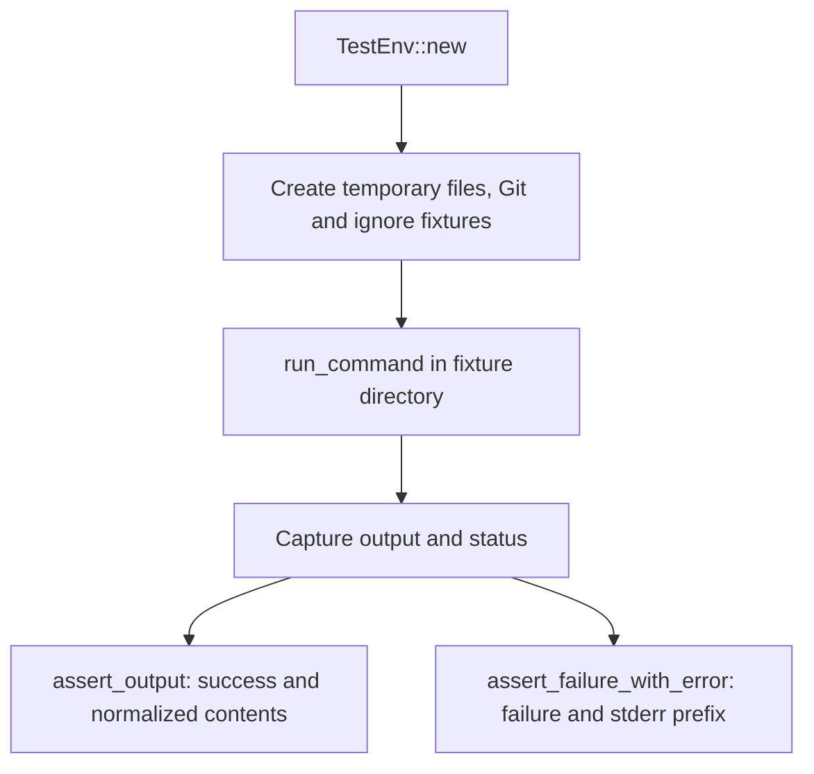

## Overview

This repository builds a Rust binary named `fd` from `src/main.rs`, packaged as `fd-find`. Cargo declares edition 2024 and Rust 1.90.0 as the minimum supported version. The development loop is to build, run unit and integration tests, then apply the formatting and lint checks used by CI. [[Quickstart]] covers initial installation; [[fd Overview]] connects the runtime systems a contributor may change.

Sources: [Cargo.toml:16-31](repo://Cargo.toml#L16-L31), [README.md:734-747](repo://README.md#L734-L747), [.github/workflows/CICD.yml:42-84](repo://.github/workflows/CICD.yml#L42-L84)

## Local build and feature choices

Run the repository's documented build and test commands from its root. The development profile keeps line-table debug information for the package and disables dependency debug information. A separate `debugging` profile inherits development settings but enables full debug information. The release profile enables LTO, strips output and uses one codegen unit.

Sources: [README.md:734-746](repo://README.md#L734-L746), [Cargo.toml:79-92](repo://Cargo.toml#L79-L92)

```bash
cargo build
cargo test
```

Sources: [README.md:738-743](repo://README.md#L738-L743)

| Feature | Effect |
| --- | --- |
| `completions` | Enable the optional `clap_complete` dependency and completion-generation CLI path |
| `use-jemalloc` | Enable the optional `tikv-jemallocator` dependency, subject to target gates |
| `base` | Enable `use-jemalloc` |
| Default features | Enable `completions` |

Sources: [Cargo.toml:46-46](repo://Cargo.toml#L46-L46), [Cargo.toml:65-71](repo://Cargo.toml#L65-L71), [Cargo.toml:94-98](repo://Cargo.toml#L94-L98), [src/main.rs:38-54](repo://src/main.rs#L38-L54), [src/main.rs:78-81](repo://src/main.rs#L78-L81)

Allocator support is gated in both Cargo and the entry point, and comments require the target lists to remain synchronized. The excluded targets include Windows, Android, macOS, several BSD and Unix targets, 32-bit musl and riscv64. The stated allocator motivation is performance; Cargo comments document a macOS allocator issue as the reason for keeping that target disabled. Feature selection alone does not bypass these target conditions.

Sources: [Cargo.toml:65-71](repo://Cargo.toml#L65-L71), [src/main.rs:38-54](repo://src/main.rs#L38-L54)

## Formatting, linting and CI coverage

CI runs formatting and all-target, all-feature Clippy checks on stable Rust. Clippy warnings fail that lint job. A separate minimum-version job obtains its toolchain version from Cargo metadata and runs locked Clippy and tests with the workflow's `MSRV_FEATURES` value. These checks distinguish a stable-toolchain lint pass from minimum-version compatibility.

Sources: [.github/workflows/CICD.yml:29-40](repo://.github/workflows/CICD.yml#L29-L40), [.github/workflows/CICD.yml:42-84](repo://.github/workflows/CICD.yml#L42-L84)

```bash
cargo fmt -- --check
cargo clippy --all-targets --all-features -- -Dwarnings
```

Sources: [.github/workflows/CICD.yml:52-64](repo://.github/workflows/CICD.yml#L52-L64)

The build matrix covers Linux GNU and musl targets, Windows GNU and MSVC, and Intel and ARM macOS. Linux cross targets use `cross`; other jobs use Cargo. Matrix builds use locked release compilation, and tests run for the selected target. ARM-family targets restrict testing to the binary target through the workflow's test-option branch, so their jobs do not exercise the complete integration suite.

Sources: [.github/workflows/CICD.yml:94-114](repo://.github/workflows/CICD.yml#L94-L114), [.github/workflows/CICD.yml:160-162](repo://.github/workflows/CICD.yml#L160-L162), [.github/workflows/CICD.yml:182-198](repo://.github/workflows/CICD.yml#L182-L198)

## Integration fixture lifecycle

`TestEnv` creates a temporary working tree from directory and file lists. It creates a `.git` directory so Git ignore rules apply, adds a symlink fixture, and writes `.fdignore` and `.gitignore` fixtures. The Windows fixture comments note that creating symlinks requires the corresponding privilege. The executable comes from `CARGO_BIN_EXE_fd`, using the runtime environment value if present and Cargo's compile-time value otherwise.

Sources: [tests/testenv/mod.rs:13-62](repo://tests/testenv/mod.rs#L13-L62), [tests/testenv/mod.rs:75-79](repo://tests/testenv/mod.rs#L75-L79), [tests/testenv/mod.rs:147-157](repo://tests/testenv/mod.rs#L147-L157)

`run_command` invokes that binary with its current directory inside the temporary tree. Without a dedicated global-ignore fixture it adds `--no-global-ignore-file`; with one, it sets `XDG_CONFIG_HOME` to the fixture directory containing `fd/ignore`. It also sets `LS_COLORS` to an empty string for consistent color output, then captures the subprocess output. These controls keep the tested ignore and color inputs explicit.

Sources: [tests/testenv/mod.rs:65-73](repo://tests/testenv/mod.rs#L65-L73), [tests/testenv/mod.rs:169-175](repo://tests/testenv/mod.rs#L169-L175), [tests/testenv/mod.rs:300-315](repo://tests/testenv/mod.rs#L300-L315)



Sources: [tests/testenv/mod.rs:28-62](repo://tests/testenv/mod.rs#L28-L62), [tests/testenv/mod.rs:147-157](repo://tests/testenv/mod.rs#L147-L157), [tests/testenv/mod.rs:218-244](repo://tests/testenv/mod.rs#L218-L244), [tests/testenv/mod.rs:262-315](repo://tests/testenv/mod.rs#L262-L315), [tests/testenv/mod.rs:320-342](repo://tests/testenv/mod.rs#L320-L342)

## Assertions and behavior boundaries

`assert_output` checks successful execution and compares normalized output. Normalization replaces NUL delimiters with visible `NULL` records, maps separators to the platform separator, and sorts lines; an optional mode also sorts whitespace-separated words within each line. These assertions intentionally do not establish output ordering. [[Result Output]] explains the runtime's conditional sorting, while [[Command Execution]] explains command and batch ordering.

Sources: [tests/testenv/mod.rs:114-134](repo://tests/testenv/mod.rs#L114-L134), [tests/testenv/mod.rs:218-249](repo://tests/testenv/mod.rs#L218-L249), [tests/testenv/mod.rs:262-275](repo://tests/testenv/mod.rs#L262-L275)

For exact byte comparisons, `assert_output_raw` is available on Unix excluding macOS and compares captured stdout directly. Failure helpers can require unsuccessful status and an expected stderr prefix; the underlying error helper normalizes indentation and checks the prefix rather than exact stderr equality. Choose the existing assertion whose contract matches the behavior being verified, especially when testing invalid UTF-8 or diagnostic changes.

Sources: [tests/testenv/mod.rs:252-257](repo://tests/testenv/mod.rs#L252-L257), [tests/testenv/mod.rs:278-297](repo://tests/testenv/mod.rs#L278-L297), [tests/testenv/mod.rs:320-342](repo://tests/testenv/mod.rs#L320-L342)

## Completion generation and installation

With completion support compiled in, `--gen-completions` is an exclusive option handled before search setup. An omitted shell value is inferred from the environment or produces an error. `print_completions` builds the same `Opts` command used for normal parsing, derives the program name from the invoked executable stem and writes generated completions to stdout. The repository README documents Bash, Zsh, Fish and PowerShell installation examples.

Sources: [src/cli.rs:690-692](repo://src/cli.rs#L690-L692), [src/cli.rs:775-785](repo://src/cli.rs#L775-L785), [src/main.rs:75-83](repo://src/main.rs#L75-L83), [src/main.rs:114-129](repo://src/main.rs#L114-L129), [README.md:762-778](repo://README.md#L762-L778)

The Makefile defaults to a locked release build and `target/release/fd`. Its `completions` target generates Bash, Fish and PowerShell files from the executable, while copying the checked-in Zsh and `fdfind` completion variants. `install` places the binary, completions and `doc/fd.1` under the configured destination and prefix; the default prefix is `/usr/local`.

Sources: [Makefile:1-52](repo://Makefile#L1-L52)

## Contribution expectations

The repository's contribution guide asks contributors to discuss proposed changes in an issue before opening a pull request, compile and test changes, and add behavioral changes to the appropriate subsection of the upcoming changelog. It also asks contributors to review and understand AI-assisted changes and disclose their extent. These are the repository's contribution expectations alongside the build and validation workflow above.

Sources: [CONTRIBUTING.md:10-24](repo://CONTRIBUTING.md#L10-L24), [CONTRIBUTING.md:30-46](repo://CONTRIBUTING.md#L30-L46)
