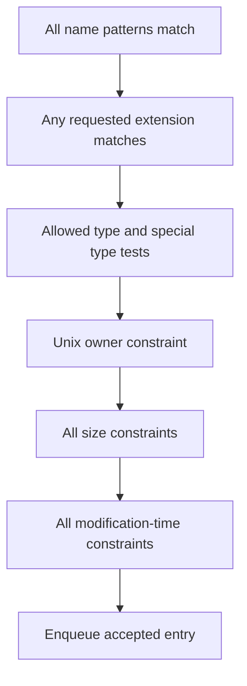

## Overview

Entry filters narrow the stream after filename or full-path matching. The callback applies extensions, file types, Unix ownership, sizes and modification times in that order, skipping an entry as soon as a constraint fails. [[Search Patterns]] describes the preceding match; [[Traversal and Ignore Rules]] describes visibility and directory descent. These predicates select results without independently pruning the tree.

Sources: [src/walk.rs:514-591](repo://src/walk.rs#L514-L591), [src/walk.rs:600-611](repo://src/walk.rs#L600-L611)

## Filter pipeline and metadata

Name checks come first because they do not require metadata. An entry that fails a required pattern never reaches the extension set or metadata filters. Once all enabled filters pass, the sender can compute a color style and enqueue the result. [[Result Output]] consumes those entries, while explicit pruning is performed only after a successful send.

Sources: [src/walk.rs:514-541](repo://src/walk.rs#L514-L541), [src/walk.rs:544-611](repo://src/walk.rs#L544-L611)

Sources: [src/walk.rs:519-611](repo://src/walk.rs#L519-L611)

`DirEntry::metadata` caches `Option<Metadata>` in `OnceCell`, including an unsuccessful lookup. Normal entries ask the underlying walker entry for metadata; recovered broken symlinks use `symlink_metadata`. Owner, size and time filters reject entries when the information they require is unavailable. A metadata failure in one of these checks skips the entry without creating a new `WorkerResult::Error` in that branch.

Sources: [src/dir_entry.rs:89-96](repo://src/dir_entry.rs#L89-L96), [src/walk.rs:544-591](repo://src/walk.rs#L544-L591)

## Extensions

`--extension`, or `-e`, is repeatable. Configuration strips leading dots from each value, escapes its regex characters and constructs a case-insensitive `RegexSet` of suffix expressions. Every expression requires a character before the separating dot and anchors at the end of the filename. The callback accepts an entry if any extension expression matches its filename; extension matching remains case-insensitive even when the main name pattern uses smart case or explicit sensitivity.

Sources: [src/cli.rs:380-393](repo://src/cli.rs#L380-L393), [src/main.rs:361-373](repo://src/main.rs#L361-L373), [src/walk.rs:526-535](repo://src/walk.rs#L526-L535)

An extension constraint applies to all entry types, including directory names. Add `--type file` when that distinction matters. For names without an extension, CLI help suggests the ordinary pattern `^[^.]+$`; the extension option itself expects a suffix to build into its set. Extension alternatives combine with the main patterns by intersection: both stages must pass.

Sources: [src/cli.rs:380-393](repo://src/cli.rs#L380-L393), [src/walk.rs:519-541](repo://src/walk.rs#L519-L541)

## File types, executable entries and emptiness

Repeated `--type` values enable allowed base kinds. `FileTypes::should_ignore` checks the entry's type against those flags and rejects unknown types. Executable and empty are additional constraints over the selected kinds, with special defaults supplied while constructing configuration. The table groups the supported type choices by how they affect selection.

Sources: [src/main.rs:333-360](repo://src/main.rs#L333-L360), [src/filetypes.rs:20-42](repo://src/filetypes.rs#L20-L42), [src/cli.rs:802-823](repo://src/cli.rs#L802-L823)

| Type values | Selection behavior |
| --- | --- |
| `file`, `f` | Enable regular files |
| `directory`, `dir`, `d` | Enable directories |
| `symlink`, `l` | Enable symbolic links |
| `socket`, `s`; `pipe`, `p`; `block-device`, `b`; `char-device`, `c` | Enable the corresponding special entry kind |
| `executable`, `x` | Enable regular files and require the executable-access check |
| `empty`, `e` | Require emptiness; enable both files and directories if neither was explicitly selected |

Sources: [src/cli.rs:802-823](repo://src/cli.rs#L802-L823), [src/main.rs:333-360](repo://src/main.rs#L333-L360), [src/filetypes.rs:20-42](repo://src/filetypes.rs#L20-L42)

Executable matching calls `faccess::PathExt::executable`; the CLI describes it as executability by the current effective user. Empty-file matching uses metadata length zero. Empty-directory matching reads the directory and requires no first entry, so contents hidden by ignore rules still make a directory nonempty. Unreadable directories, unsupported kinds and missing metadata fail the emptiness check. Windows helpers return false for the Unix special kinds.

Sources: [src/filetypes.rs:20-42](repo://src/filetypes.rs#L20-L42), [src/cli.rs:814-816](repo://src/cli.rs#L814-L816), [src/filesystem.rs:44-99](repo://src/filesystem.rs#L44-L99)

## Size constraints

`--size`, or `-S`, parses a signed or unsigned integer quantity followed by a required unit. `SizeFilter::from_string` rejects invalid forms with a diagnostic pointing to help. Units are case-insensitive: `b` means bytes; `k`, `m`, `g` and `t` use powers of 1000; `ki`, `mi`, `gi` and `ti` use powers of 1024. The larger units may include a trailing `b`, such as `kb` or `mib`.

Sources: [src/cli.rs:395-417](repo://src/cli.rs#L395-L417), [src/filter/size.rs:15-65](repo://src/filter/size.rs#L15-L65)

| Size expression | Comparison |
| --- | --- |
| `+1k` | At least 1000 bytes |
| `-1ki` | At most 1024 bytes |
| `100b` | Exactly 100 bytes |

Sources: [src/filter/size.rs:15-25](repo://src/filter/size.rs#L15-L25), [src/filter/size.rs:33-73](repo://src/filter/size.rs#L33-L73)

All repeated size constraints must hold, which permits inclusive lower and upper bounds in one search. Size checks apply only when `entry_path.is_file()` succeeds; directories are rejected when size constraints are enabled. The callback obtains the file length from cached metadata and rejects the entry if that lookup fails. Size comparison therefore does not measure directory contents.

Sources: [src/walk.rs:557-575](repo://src/walk.rs#L557-L575), [src/filter/size.rs:68-73](repo://src/filter/size.rs#L68-L73)

## Modification times

`--changed-within` selects modification times strictly after its threshold; `--changed-before` selects times strictly before. Startup converts each supplied value to a `TimeFilter`, returning an error for invalid dates or durations. When both options are present, both comparisons must pass. Unlike size filtering, this callback checks any entry with an available modification timestamp rather than first requiring a regular file.

Sources: [src/main.rs:496-519](repo://src/main.rs#L496-L519), [src/filter/time.rs:49-61](repo://src/filter/time.rs#L49-L61), [src/walk.rs:577-591](repo://src/walk.rs#L577-L591)

Parsing first tries a duration span and subtracts it from the current zoned time. It next tries an absolute timestamp, then a civil date/time resolved in the system time zone with the later ambiguity resolution. Finally, `@` followed by unsigned epoch seconds is accepted. CLI help documents date-only input as midnight and examples such as `2weeks`; tests also cover explicit offsets and require the `@` prefix for numeric epoch input.

Sources: [src/filter/time.rs:12-15](repo://src/filter/time.rs#L12-L15), [src/filter/time.rs:28-46](repo://src/filter/time.rs#L28-L46), [src/cli.rs:419-429](repo://src/cli.rs#L419-L429), [src/filter/time.rs:135-200](repo://src/filter/time.rs#L135-L200)

## Unix ownership

`--owner`, or `-o`, is available on Unix and accepts `user:group`, with either side optional. Each side may be a numeric ID or a name resolved through the operating system. Prefix either side with `!` for inequality. The parser rejects more than one colon and reports unrecognized names; an empty string or `:` produces a no-op filter that configuration removes.

Sources: [src/cli.rs:460-473](repo://src/cli.rs#L460-L473), [src/filter/owner.rs:18-67](repo://src/filter/owner.rs#L18-L67), [src/filter/owner.rs:85-102](repo://src/filter/owner.rs#L85-L102), [src/main.rs:268-269](repo://src/main.rs#L268-L269)

The owner predicate compares both configured sides against metadata UID and GID using logical AND. Ignored sides always pass. Thus `!john:students` means a user other than `john` *and* the group `students`, as in the CLI example; it does not negate the whole pair. Matching ownership is followed by size and time checks before an entry can be sent onward.

Sources: [src/cli.rs:460-467](repo://src/cli.rs#L460-L467), [src/filter/owner.rs:69-82](repo://src/filter/owner.rs#L69-L82), [src/filter/owner.rs:89-100](repo://src/filter/owner.rs#L89-L100), [src/walk.rs:544-591](repo://src/walk.rs#L544-L591)
