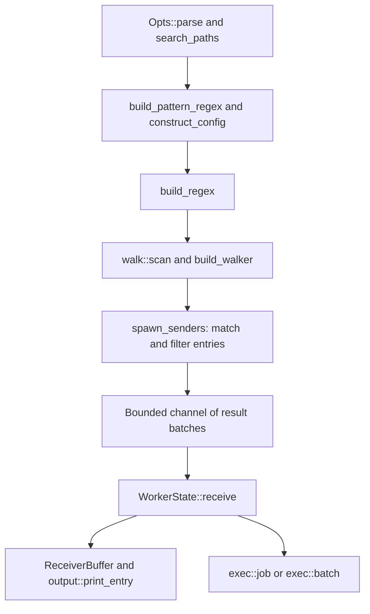

## Overview

`fd` finds filesystem entries by name or full path, using regular expressions, glob patterns, or literal matching. Its command-line interface hides hidden entries and respects Git ignore rules by default. Searches can print paths or pass the matches to external commands. The Cargo package is named `fd-find`; its executable is `fd`, with its entry point in `src/main.rs`.

Sources: [src/cli.rs:21-45](repo://src/cli.rs#L21-L45), [src/main.rs:75-112](repo://src/main.rs#L75-L112), [src/walk.rs:408-439](repo://src/walk.rs#L408-L439), [Cargo.toml:16-31](repo://Cargo.toml#L16-L31)

Start with [[Quickstart]] to build the checkout and run a search. The runtime has one startup path: parse options, choose search roots, compile patterns and configuration, then hand those values to the scanner. Command execution uses that same search path; it changes how accepted entries are consumed.

Sources: [src/main.rs:75-112](repo://src/main.rs#L75-L112), [src/walk.rs:408-439](repo://src/walk.rs#L408-L439), [README.md:734-747](repo://README.md#L734-L747)

## Parts of the system

| Area | What it does | Documentation |
| --- | --- | --- |
| First search | Build the binary and supply a pattern and roots | [[Quickstart]] |
| Search interpretation | Convert regex, glob and literal inputs; choose filename or absolute-path matching | [[Search Patterns]] |
| Tree selection | Configure ignores, hidden entries, depth, links and pruning in a parallel walk | [[Traversal and Ignore Rules]] |
| Entry selection | Apply extensions, types, ownership, size and modification times | [[Entry Filters]] |
| Printed results | Buffer or stream matches, render templates and terminal output, and set search status | [[Result Output]] |
| External actions | Run per-entry jobs or batches of path arguments | [[Command Execution]] |
| Contributor workflow | Build, test, check formatting and lint, and generate completions | [[Development]] |

Sources: [src/main.rs:218-231](repo://src/main.rs#L218-L231), [src/walk.rs:347-403](repo://src/walk.rs#L347-L403), [src/walk.rs:514-591](repo://src/walk.rs#L514-L591), [src/walk.rs:198-245](repo://src/walk.rs#L198-L245), [src/walk.rs:408-439](repo://src/walk.rs#L408-L439), [README.md:734-778](repo://README.md#L734-L778), [.github/workflows/CICD.yml:43-64](repo://.github/workflows/CICD.yml#L43-L64)

## From invocation to result

Sources: [src/main.rs:75-112](repo://src/main.rs#L75-L112), [src/walk.rs:408-459](repo://src/walk.rs#L408-L459), [src/walk.rs:514-541](repo://src/walk.rs#L514-L541), [src/walk.rs:600-651](repo://src/walk.rs#L600-L651), [src/walk.rs:251-265](repo://src/walk.rs#L251-L265)

Startup resolves a base directory before collecting roots, so relative search paths follow that directory; [[Quickstart]] introduces that invocation shape. Pattern preparation then converts all required expressions and builds the byte regular expressions explained in [[Search Patterns]]. A startup error returns through `main`, which prints the error and exits with the general-error status.

Sources: [src/main.rs:62-112](repo://src/main.rs#L62-L112), [src/main.rs:131-147](repo://src/main.rs#L131-L147), [src/main.rs:541-555](repo://src/main.rs#L541-L555)

The scanner constructs an `ignore::WalkBuilder`, adds further roots, and builds a parallel walker. [[Traversal and Ignore Rules]] follows this stage. Each sender first checks the search string, then applies the predicates documented in [[Entry Filters]]. Accepted entries cross a bounded channel to a separate receiver, allowing traversal and consumption to proceed concurrently.

Sources: [src/walk.rs:347-365](repo://src/walk.rs#L347-L365), [src/walk.rs:398-403](repo://src/walk.rs#L398-L403), [src/walk.rs:514-591](repo://src/walk.rs#L514-L591), [src/walk.rs:600-645](repo://src/walk.rs#L600-L645)

The receiver either renders entries through [[Result Output]] or schedules the external actions in [[Command Execution]]. Per-entry execution creates a pool of receiver jobs, batch execution consumes an iterator of results, and ordinary output uses a buffered stdout writer. This dispatch happens after selection, so the consumers receive the same accepted-entry stream.

Sources: [src/walk.rs:408-439](repo://src/walk.rs#L408-L439), [src/exec/job.rs:11-64](repo://src/exec/job.rs#L11-L64)

## Design decisions across the flow

Name matching precedes metadata-dependent work because it does not require metadata. `DirEntry` caches metadata and color style in `OnceCell`, so later consumers can reuse a computed value. This ordering matters when reading the filters: adding a size or owner constraint introduces metadata work only after the name and extension checks have passed.

Sources: [src/walk.rs:514-591](repo://src/walk.rs#L514-L591), [src/dir_entry.rs:17-31](repo://src/dir_entry.rs#L17-L31), [src/dir_entry.rs:89-108](repo://src/dir_entry.rs#L89-L108)

Parallel discovery does not imply a stable presentation order. The output receiver initially buffers entries so a fast search can sort them. A deadline or buffer-size threshold switches it to streaming; stopping sorts only if buffering is still active. Command help explicitly disclaims execution and batch argument order. [[Result Output]] and [[Command Execution]] explain the consequences for their consumers.

Sources: [src/walk.rs:26-35](repo://src/walk.rs#L26-L35), [src/walk.rs:198-245](repo://src/walk.rs#L198-L245), [src/walk.rs:269-292](repo://src/walk.rs#L269-L292), [src/cli.rs:895-899](repo://src/cli.rs#L895-L899), [src/cli.rs:933-934](repo://src/cli.rs#L933-L934)

The worker channel and sender batches bound queued work. Sender comments identify backpressure as the reason for limiting a batch; when several per-entry command receivers are active, batch size becomes one to distribute work evenly. The automatically selected thread count also stops at 64 to limit startup overhead on machines with many CPUs.

Sources: [src/walk.rs:90-120](repo://src/walk.rs#L90-L120), [src/walk.rs:449-457](repo://src/walk.rs#L449-L457), [src/walk.rs:636-645](repo://src/walk.rs#L636-L645), [src/cli.rs:788-800](repo://src/cli.rs#L788-L800)

Path presentation preserves protection against leading dashes. Execution and NUL-delimited output retain the current-directory prefix by default because a bare leading dash can become a downstream option. Even when prefix stripping is requested, `DirEntry::stripped_path` keeps the original path when the stripped form starts with a dash. This behavior belongs to the presentation stage, alongside the shared path templates described in [[Result Output]].

Sources: [src/cli.rs:674-680](repo://src/cli.rs#L674-L680), [src/main.rs:389-390](repo://src/main.rs#L389-L390), [src/dir_entry.rs:56-79](repo://src/dir_entry.rs#L56-L79), [src/fmt/mod.rs:109-140](repo://src/fmt/mod.rs#L109-L140)
