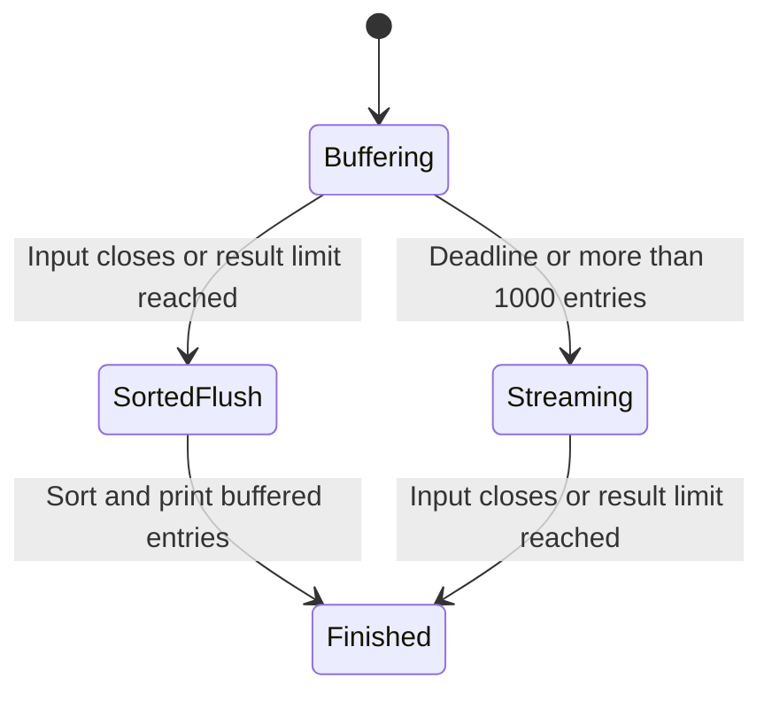

## Overview

Without an external command, `WorkerState::receive` locks stdout, wraps it in `BufWriter`, and passes the result stream to `ReceiverBuffer`. The receiver controls initial sorting, streaming, result limits and quiet mode, then calls `output::print_entry` for each displayed entry. Selection has already happened through [[Search Patterns]] and [[Entry Filters]]. [[Command Execution]] uses different consumers for external actions.

Sources: [src/walk.rs:408-439](repo://src/walk.rs#L408-L439), [src/walk.rs:198-245](repo://src/walk.rs#L198-L245), [src/walk.rs:251-265](repo://src/walk.rs#L251-L265)

## Buffering, sorting and streaming

The receiver starts in buffering mode, with a deadline 100 milliseconds after construction unless `--max-buffer-time` supplies another duration. It switches to streaming when that deadline expires or its buffer grows beyond 1000 entries. While buffering, it waits only until the deadline; while streaming, it waits for the next batch without a timeout. These thresholds make sorted output conditional on how quickly the search finishes.

Sources: [src/walk.rs:124-127](repo://src/walk.rs#L124-L127), [src/walk.rs:151-194](repo://src/walk.rs#L151-L194), [src/walk.rs:208-218](repo://src/walk.rs#L208-L218), [src/walk.rs:240-245](repo://src/walk.rs#L240-L245), [src/cli.rs:559-564](repo://src/cli.rs#L559-L564)

Sources: [src/walk.rs:198-245](repo://src/walk.rs#L198-L245), [src/walk.rs:269-292](repo://src/walk.rs#L269-L292)

Stopping while still buffering sorts `DirEntry` values by their paths and then prints them. An earlier transition to streaming prints the accumulated buffer in arrival order and prints subsequent entries directly. When streaming has no queued batch ready, it flushes before waiting. Consequently neither a large search nor a result-limited search promises the alphabetically first matches: discovery order determines which entries are received before the limit.

Sources: [src/walk.rs:208-245](repo://src/walk.rs#L208-L245), [src/walk.rs:269-292](repo://src/walk.rs#L269-L292), [src/dir_entry.rs:125-136](repo://src/dir_entry.rs#L125-L136)

## Limits and exit status

`--max-results count` stops after that many accepted entries; zero is normalized to no limit. `-1` supplies a limit of one. Quiet mode returns immediately on the first accepted entry without printing it, and returns the opposite result when the channel closes without any match. Execution options conflict with quiet mode and result limits, so these are ordinary-search receiver behaviors.

Sources: [src/cli.rs:29-30](repo://src/cli.rs#L29-L30), [src/cli.rs:566-601](repo://src/cli.rs#L566-L601), [src/cli.rs:759-763](repo://src/cli.rs#L759-L763), [src/walk.rs:203-225](repo://src/walk.rs#L203-L225), [src/walk.rs:281-292](repo://src/walk.rs#L281-L292)

| Result | Numeric exit status |
| --- | --- |
| Ordinary search finishes, including zero matches | 0 |
| Quiet search finds a match | 0 |
| Quiet search finds no match | 1 |
| General error | 1 |
| Interrupt represented as `KilledBySigint` | 130; Unix exit also attempts to raise SIGINT with its default handler |

Sources: [src/walk.rs:281-292](repo://src/walk.rs#L281-L292), [src/exit_codes.rs:14-43](repo://src/exit_codes.rs#L14-L43)

## Rendering and path presentation

`print_entry` optionally opens a terminal hyperlink, chooses custom-format, colorized or uncolorized rendering in that priority order, closes the hyperlink, and appends a newline or NUL. Ordinary rendering appends a separator for directory entries. Custom formatting writes only the generated template before the final record delimiter, so the ordinary trailing-directory separator is not added through that branch.

Sources: [src/output.rs:17-85](repo://src/output.rs#L17-L85), [src/output.rs:131-155](repo://src/output.rs#L131-L155)

For default-root searches, current-directory prefix stripping is automatic for ordinary output and disabled by default for execution or `--print0`. `--strip-cwd-prefix` accepts `auto`, `always` or `never`, with a missing value meaning `always`; it conflicts with explicit roots. `DirEntry::stripped_path` keeps the original path if stripping would expose a leading dash, preserving downstream option protection even when stripping is enabled.

Sources: [src/main.rs:389-390](repo://src/main.rs#L389-L390), [src/cli.rs:674-680](repo://src/cli.rs#L674-L680), [src/cli.rs:765-772](repo://src/cli.rs#L765-L772), [src/cli.rs:835-843](repo://src/cli.rs#L835-L843), [src/dir_entry.rs:56-79](repo://src/dir_entry.rs#L56-L79)

`--path-separator` changes displayed separators. When it is absent, Windows with a nonempty `MSYSTEM` environment value defaults to `/`; other configurations use the platform default. Windows rejects a separator longer than one byte. Ordinary string rendering replaces the native separator, while template placeholders rebuild path components with the requested separator and leave literal template text unchanged.

Sources: [src/main.rs:234-264](repo://src/main.rs#L234-L264), [src/filesystem.rs:123-135](repo://src/filesystem.rs#L123-L135), [src/output.rs:12-14](repo://src/output.rs#L12-L14), [src/output.rs:147-155](repo://src/output.rs#L147-L155), [src/fmt/mod.rs:109-140](repo://src/fmt/mod.rs#L109-L140), [src/fmt/mod.rs:143-195](repo://src/fmt/mod.rs#L143-L195)

## Shared format templates

`--format` parses a `FormatTemplate`, shared with command argument substitution. The parser finds placeholders and escaped braces with a lazily initialized Aho-Corasick matcher. A string with no placeholders becomes fixed text; otherwise it becomes a sequence of text and path tokens. Generation returns an `OsString`, retaining path values until the output renderer chooses its string representation.

Sources: [src/main.rs:374-377](repo://src/main.rs#L374-L377), [src/fmt/mod.rs:41-140](repo://src/fmt/mod.rs#L41-L140), [src/output.rs:75-85](repo://src/output.rs#L75-L85)

| Placeholder | Generated value |
| --- | --- |
| `{}` | Entire presented path |
| `{/}` | Basename |
| `{//}` | Parent directory; `.` for a basename with an empty parent |
| `{.}` | Path with the final extension removed |
| `{/.}` | Basename with the final extension removed |
| `{{` and `}}` | Literal opening and closing braces |

Sources: [src/fmt/mod.rs:27-35](repo://src/fmt/mod.rs#L27-L35), [src/fmt/mod.rs:58-89](repo://src/fmt/mod.rs#L58-L89), [src/fmt/mod.rs:112-140](repo://src/fmt/mod.rs#L112-L140), [src/fmt/input.rs:6-31](repo://src/fmt/input.rs#L6-L31)

Extension removal uses `file_stem`, so it removes the last extension rather than every dot-separated suffix. The helper's tests preserve a hidden basename such as `.foo`. Parent and basename substitutions operate on the presented path supplied by the caller; they do not perform a new search or change the process working directory.

Sources: [src/fmt/input.rs:6-31](repo://src/fmt/input.rs#L6-L31), [src/fmt/input.rs:56-72](repo://src/fmt/input.rs#L56-L72), [src/output.rs:75-78](repo://src/output.rs#L75-L78)

## Colors and hyperlinks

`--color` defaults to `auto`. Auto requires terminal stdout, ANSI support, and no nonempty `NO_COLOR`; Windows attempts to enable ANSI support or accepts a set `TERM`. Enabled colors use `LS_COLORS` if available, otherwise the built-in palette. Senders compute entry styles in parallel, and the colored renderer styles parent components as directories and the basename with the cached entry style.

Sources: [src/cli.rs:520-530](repo://src/cli.rs#L520-L530), [src/main.rs:271-292](repo://src/main.rs#L271-L292), [src/walk.rs:593-598](repo://src/walk.rs#L593-L598), [src/output.rs:95-129](repo://src/output.rs#L95-L129)

Hyperlinks default to `never`; a bare `--hyperlink` means `auto`, which follows whether color is enabled. `always` forces hyperlinks when printing paths. `PathUrl` constructs an absolute file URL and percent-encodes bytes outside its allowed set, including non-ASCII bytes; on Windows it converts backslashes to slashes. If absolute-path construction fails, the renderer prints the entry without a hyperlink. Command execution does not use this renderer.

Sources: [src/cli.rs:532-548](repo://src/cli.rs#L532-L548), [src/main.rs:293-297](repo://src/main.rs#L293-L297), [src/hyperlink.rs:7-40](repo://src/hyperlink.rs#L7-L40), [src/output.rs:17-42](repo://src/output.rs#L17-L42), [src/walk.rs:408-439](repo://src/walk.rs#L408-L439)

## Terminal escaping and pipe bytes

Terminal rendering escapes control characters except tabs, plus the listed invisible, bidirectional and format characters. It emits hexadecimal escape text and borrows the original string when no escaping is needed. `maybe_sanitize` gates this behavior on terminal stdout. Custom-format and colored output convert paths to lossy strings before sanitization; this terminal behavior prevents filenames from injecting escape sequences into displayed output.

Sources: [src/sanitize.rs:1-55](repo://src/sanitize.rs#L1-L55), [src/output.rs:75-85](repo://src/output.rs#L75-L85), [src/output.rs:95-129](repo://src/output.rs#L95-L129)

On Unix, uncolorized, unformatted nonterminal output without a custom separator writes the original filename bytes, preserving invalid UTF-8 for downstream tools. Selecting a custom separator uses the lossy string branch instead. `--print0` changes the final delimiter to NUL, which can distinguish records containing newlines when the raw-byte branch is active.

Sources: [src/output.rs:38-42](repo://src/output.rs#L38-L42), [src/output.rs:141-181](repo://src/output.rs#L141-L181), [src/cli.rs:266-276](repo://src/cli.rs#L266-L276)

## Output failures and interrupts

`ReceiverBuffer::print` reports non-broken-pipe write errors as general errors; its flush path returns a general error on any flush failure. When processing ends, it sets the quit flag used by traversal. Colored printing installs a Ctrl-C handler that requests shutdown on the first interrupt and exits immediately on the second; printing checks the interrupt flag, attempts a flush, and returns the interrupt status.

Sources: [src/walk.rs:173-179](repo://src/walk.rs#L173-L179), [src/walk.rs:251-265](repo://src/walk.rs#L251-L265), [src/walk.rs:295-301](repo://src/walk.rs#L295-L301), [src/walk.rs:621-633](repo://src/walk.rs#L621-L633), [src/walk.rs:648-651](repo://src/walk.rs#L648-L651)
