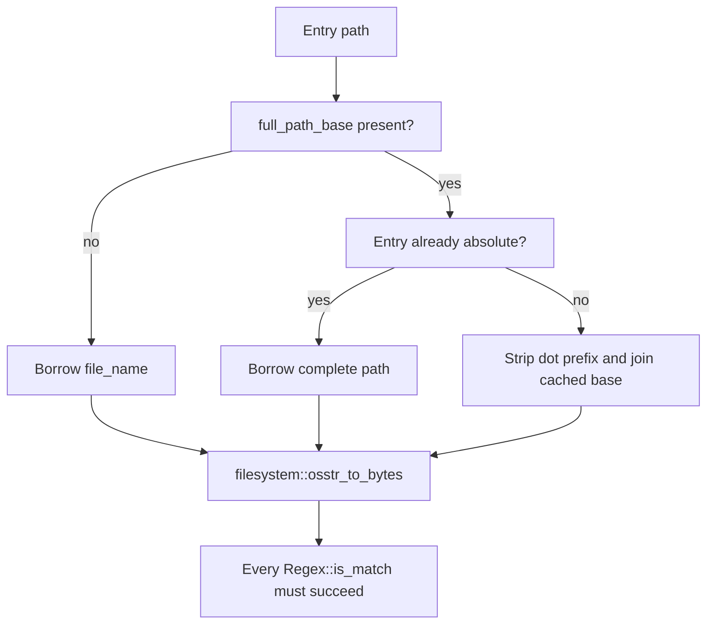

## Overview

Every accepted entry must match the positional pattern and every additional `--and` pattern. Startup converts these inputs into regular-expression strings, derives one search configuration, and compiles byte regular expressions before starting the walk. [[Quickstart]] introduces the invocation forms; this page follows how those arguments become a match decision. [[Traversal and Ignore Rules]] describes which entries reach that decision.

Sources: [src/main.rs:89-111](repo://src/main.rs#L89-L111), [src/walk.rs:514-524](repo://src/walk.rs#L514-L524), [src/cli.rs:200-211](repo://src/cli.rs#L200-L211)

## Pattern inputs and conversion

The positional pattern defaults to an empty string. A pattern beginning with a dash needs the `--` end-of-options marker, as in the CLI's example `fd -- '-foo'`. Additional `--and` values explicitly permit leading hyphens. The parser exposes these as `pattern` and `exprs`; startup chains the extra expressions with the positional one and applies the same conversion to every value.

Sources: [src/cli.rs:200-211](repo://src/cli.rs#L200-L211), [src/cli.rs:628-639](repo://src/cli.rs#L628-L639), [src/main.rs:89-100](repo://src/main.rs#L89-L100)

| Mode | Conversion in `build_pattern_regex` | Matching consequence |
| --- | --- | --- |
| Default regex | Copy the expression unchanged | Anchors and other regex syntax retain their meaning |
| `--glob`, `-g` | Build a glob with `literal_separator(true)` and use its regex | Glob syntax supplies the expression; separators are literal boundaries |
| `--fixed-strings`, `-F` | Escape regex syntax | The input is a literal substring |
| `--exact` | Escape and wrap with `^` and `$` | The complete candidate must equal the literal input, subject to case settings |

Sources: [src/main.rs:218-231](repo://src/main.rs#L218-L231), [src/cli.rs:153-198](repo://src/cli.rs#L153-L198)

An empty pattern bypasses glob conversion, so an omitted pattern remains a match-all expression even with glob mode. `--exact` conflicts with both glob and fixed-string modes. `--regex` overrides glob selection. These are CLI choices made before the shared regular-expression builder runs; the walker does not contain a separate glob-matching branch.

Sources: [src/main.rs:218-231](repo://src/main.rs#L218-L231), [src/main.rs:106-111](repo://src/main.rs#L106-L111), [src/cli.rs:163-198](repo://src/cli.rs#L163-L198), [src/walk.rs:519-524](repo://src/walk.rs#L519-L524)

## Smart case and compilation

`construct_config` makes the whole search case-sensitive when `--case-sensitive` is set or any converted expression has an uppercase character, unless `--ignore-case` is active. This decision is shared across the required expressions: uppercase in one `--and` value can affect the positional pattern too. The explicit case flags override each other in the CLI.

Sources: [src/main.rs:248-255](repo://src/main.rs#L248-L255), [src/cli.rs:130-151](repo://src/cli.rs#L130-L151), [src/main.rs:106-109](repo://src/main.rs#L106-L109)

Uppercase detection parses the expression with `regex_syntax` and examines its high-level representation. It looks inside literals, character classes, captures, repetitions, concatenations and alternatives. It therefore avoids treating the uppercase `A` in the anchor `\A` as an uppercase filename character; the helper's tests exercise that distinction. A parse failure returns false from this helper, leaving actual syntax rejection to compilation.

Sources: [src/regex_helper.rs:4-37](repo://src/regex_helper.rs#L4-L37), [src/regex_helper.rs:90-95](repo://src/regex_helper.rs#L90-L95), [src/main.rs:541-555](repo://src/main.rs#L541-L555)

`build_regex` applies the shared case setting and enables `dot_matches_new_line(true)`. If compilation fails, its error includes suggestions to try fixed strings, exact matching or glob syntax. All expressions are compiled before `walk::scan` is called, so a malformed expression aborts startup rather than producing partial search results.

Sources: [src/main.rs:106-111](repo://src/main.rs#L106-L111), [src/main.rs:541-555](repo://src/main.rs#L541-L555)

## Candidate names and full paths

Without `--full-path`, `search_str_for_entry` returns only the last filename component. With that flag, configuration caches the current directory in `full_path_base`. An already absolute entry path is used directly; a relative entry has a leading dot component removed and is joined to that cached base. Consequently full-path matching sees an absolute candidate even when the displayed result is relative. [[Result Output]] explains presentation separately.

Sources: [src/main.rs:301-308](repo://src/main.rs#L301-L308), [src/main.rs:310-312](repo://src/main.rs#L310-L312), [src/walk.rs:656-678](repo://src/walk.rs#L656-L678), [src/cli.rs:213-224](repo://src/cli.rs#L213-L224)

Sources: [src/walk.rs:514-524](repo://src/walk.rs#L514-L524), [src/walk.rs:656-678](repo://src/walk.rs#L656-L678)

Unix and Redox candidate conversion borrows the original filename bytes. Windows conversion uses the path's lossy string representation and returns its bytes. Matching then calls `all` over the regular expressions; the first failing expression skips the entry. Extension and metadata constraints only run after this step, as detailed in [[Entry Filters]].

Sources: [src/filesystem.rs:102-115](repo://src/filesystem.rs#L102-L115), [src/walk.rs:517-541](repo://src/walk.rs#L517-L541)

## Composing required patterns

Repeated `--and` options express intersection: all patterns must match the same candidate string. They also inherit glob or fixed-string conversion and the common case setting. The integration tests combine glob patterns `*foo` and `c*`, literal expressions, explicit case settings, and full-path component constraints. Full-path expressions can match different components of the one absolute candidate.

Sources: [src/main.rs:94-109](repo://src/main.rs#L94-L109), [src/walk.rs:519-524](repo://src/walk.rs#L519-L524), [tests/tests.rs:216-291](repo://tests/tests.rs#L216-L291)

## Diagnostics before traversal

`ensure_search_pattern_is_not_a_path` checks both the primary and additional patterns unless full-path matching is enabled. A forward slash always triggers rejection in filename mode, because it is a path separator on supported platforms and has no regex meaning. On Windows, a native backslash triggers the additional diagnostic only if the pattern resolves to an existing directory: backslashes also introduce legitimate regex escapes.

Sources: [src/main.rs:149-180](repo://src/main.rs#L149-L180), [src/main.rs:185-201](repo://src/main.rs#L185-L201)

The diagnostic suggests either a match-all pattern followed by a directory root or `--full-path` with the supplied expression. This distinguishes searching a directory's contents from matching path components. The root syntax follows [[Quickstart]]; ignore and visibility controls continue to apply in both cases.

Sources: [src/main.rs:203-215](repo://src/main.rs#L203-L215), [src/main.rs:310-320](repo://src/main.rs#L310-L320)

On Unix, startup also checks for expressions that require a leading dot while hidden entries are excluded. The helper recognizes a limited form: a start anchor followed by a literal beginning with a dot. Its comments explicitly say more elaborate expressions such as an alternation of hidden names may escape detection. If any expression triggers the check, startup asks for `--hidden` or an adjusted pattern; the heuristic does not automatically change visibility.

Sources: [src/main.rs:521-538](repo://src/main.rs#L521-L538), [src/regex_helper.rs:39-79](repo://src/regex_helper.rs#L39-L79)
