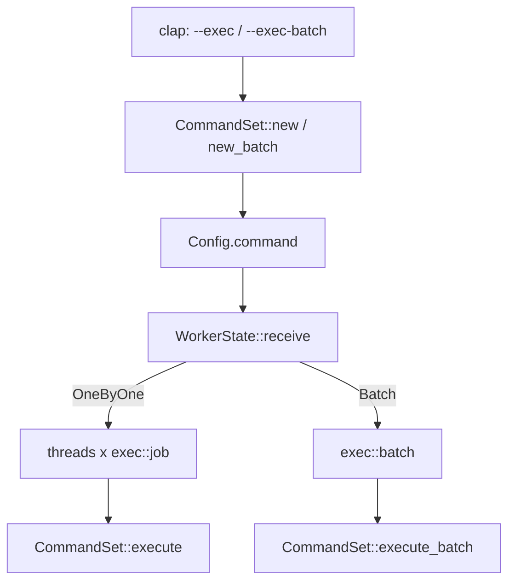

## Overview

`--exec` (`-x`) runs a command once per result, and `--exec-batch` (`-X`) runs it with many results as arguments. `--list-details` is built on the batch form. The command line is parsed once at startup into a `CommandSet`; at run time the receiver side of the walk hands entries to it instead of printing them. The walk that produces the entries is in [[Parallel Directory Traversal]].

Sources: [src/exec/mod.rs:20-34](repo://src/exec/mod.rs#L20-L34), [src/walk.rs:406-433](repo://src/walk.rs#L406-L433)

Sources: [src/cli.rs:861-880](repo://src/cli.rs#L861-L880), [src/walk.rs:406-433](repo://src/walk.rs#L406-L433)

## Parsing the command

`Exec` implements clap's argument traits by hand because clap's derive API cannot get grouped values. It reads the occurrences of `exec`, and, if there are none, of `exec_batch`, and builds `CommandSet::new` or `CommandSet::new_batch`; an error becomes a clap `InvalidValue` error. Both options take all following arguments up to a `;` terminator, accept hyphen-leading values, and conflict with each other and with `--list-details`.

Sources: [src/cli.rs:855-880](repo://src/cli.rs#L855-L880), [src/cli.rs:882-952](repo://src/cli.rs#L882-L952)

The whole group `execs` (`--exec`, `--exec-batch`, `--list-details`) also conflicts with `--max-results`, `--quiet` and `--max-one-result`.

Sources: [src/cli.rs:23-31](repo://src/cli.rs#L23-L31)

Each occurrence becomes a `CommandTemplate`, a list of `FormatTemplate` arguments. `CommandTemplate::new` enforces three rules:

Sources: [src/exec/mod.rs:219-256](repo://src/exec/mod.rs#L219-L256)

- there must be at least one argument, otherwise fd would try to execute each result;
- in batch mode the first argument must be a fixed program, not a placeholder;
- if no argument contains a placeholder, `{}` is appended as a last argument.

Sources: [src/exec/mod.rs:219-256](repo://src/exec/mod.rs#L219-L256)

Several `--exec` occurrences produce several templates, executed in order for each result. For `new_batch`, each template may hold only one placeholder-bearing argument ("Only one placeholder allowed for batch commands").

Sources: [src/exec/mod.rs:35-70](repo://src/exec/mod.rs#L35-L70)

## Placeholder templates

`FormatTemplate::parse` scans for the tokens `{{`, `}}`, `{}`, `{/}`, `{//}`, `{.}` and `{/.}` with an Aho-Corasick automaton. The doubled braces are escapes for a literal `{` or `}`. A string with no token parses to `FormatTemplate::Text`; otherwise it becomes `Tokens`, an ordered list of `Token`s and literal text.

Sources: [src/fmt/mod.rs:13-107](repo://src/fmt/mod.rs#L13-L107)

| Token | Replaced by |
| --- | --- |
| `{}` | the path |
| `{/}` | basename |
| `{//}` | parent directory (`.` if the path has none) |
| `{.}` | path without extension |
| `{/.}` | basename without extension |

Sources: [src/fmt/mod.rs:112-141](repo://src/fmt/mod.rs#L112-L141), [src/fmt/input.rs:1-32](repo://src/fmt/input.rs#L1-L32)

`generate` builds the result as an `OsString`, so non-UTF-8 paths survive. With `--path-separator`, `replace_separator` rewrites the separators inside the substituted path tokens only; literal text in the template is left alone. The same templates drive `--format`, as shown in [[Result Delivery and Output]].

Sources: [src/fmt/mod.rs:109-150](repo://src/fmt/mod.rs#L109-L150), [src/output.rs:69-86](repo://src/output.rs#L69-L86)

## One command per result

For `OneByOne` mode, `receive` spawns `config.threads` scoped threads that share the channel receiver; each runs `exec::job` over the results it receives, and the exit codes are combined with `merge_exitcodes`. This is why command order is not guaranteed. The sender batch limit drops to 1 here so work spreads evenly across the job threads, as described in [[Parallel Directory Traversal]].

Sources: [src/walk.rs:412-433](repo://src/walk.rs#L412-L433), [src/walk.rs:449-457](repo://src/walk.rs#L449-L457)

`job` buffers the commands' output only when more than one thread runs. For each entry it prints a walk error if `--show-errors` is set, otherwise generates and runs the commands with the entry's `stripped_path`, and merges the exit codes: any failure makes the final result `GeneralError`.

Sources: [src/exec/job.rs:8-44](repo://src/exec/job.rs#L8-L44)

`execute` generates one `argmax::Command` per template and calls `execute_commands`. That function runs the commands in order and stops at the first one that exits non-zero. With buffering on, it captures stdout and stderr with `Command::output` and the output is written later, under both locks, so output from two threads does not interleave. With a single thread it spawns the command and waits, so the user can see and interact with intermediate output.

Sources: [src/exec/mod.rs:76-88](repo://src/exec/mod.rs#L76-L88), [src/exec/command.rs:9-99](repo://src/exec/command.rs#L9-L99)

With `--print0`, `OutputBuffer` also writes a `\0` after each result's output, even when nothing was captured.

Sources: [src/exec/command.rs:30-56](repo://src/exec/command.rs#L30-L56)

## One command for all results

For `Batch` mode `receive` calls `exec::batch` directly on the receiver thread. It flattens the channel into a stream of stripped paths, printing walk errors if requested, and calls `execute_batch` with `config.batch_size` (`0` means unlimited).

Sources: [src/walk.rs:412-415](repo://src/walk.rs#L412-L415), [src/exec/job.rs:46-64](repo://src/exec/job.rs#L46-L64), [src/config.rs:96-98](repo://src/config.rs#L96-L98)

`CommandBuilder::new` splits the template into the arguments before the placeholder (`pre_args`), the placeholder argument, and the arguments after it (`post_args`). `push` adds one path argument. Before adding, it finishes the current command if the batch size limit has been reached, or if `args_would_fit` from the `argmax` crate says the argument would exceed the operating system's argument-length limit. `finish` appends `post_args`, runs the command, and starts a new one with `pre_args`. Several commands are fed the same paths and each has its own `CommandBuilder`.

Sources: [src/exec/mod.rs:90-121](repo://src/exec/mod.rs#L90-L121), [src/exec/mod.rs:123-208](repo://src/exec/mod.rs#L123-L208)

Batch commands inherit stdin, stdout and stderr. If any run exits non-zero the builder records `GeneralError`, and `execute_batch` merges the builders' codes.

Sources: [src/exec/mod.rs:164-171](repo://src/exec/mod.rs#L164-L171), [src/exec/mod.rs:191-203](repo://src/exec/mod.rs#L191-L203)

## Errors

`handle_cmd_error` prints "Command not found: <program>" when the failure is `NotFound` and a command is known, and otherwise "Problem while executing command: ...". Both return `GeneralError`.

Sources: [src/exec/command.rs:101-115](repo://src/exec/command.rs#L101-L115)

## --list-details

`--list-details` builds an `ls` batch command at startup through `determine_ls_command` and `CommandSet::new_batch`, so it follows the batch path above. The program and options depend on the platform:

Sources: [src/main.rs:412-494](repo://src/main.rs#L412-L494)

| Platform | Command |
| --- | --- |
| Linux and other Unix | `ls -l -h -d` with `--color=always` or `--color=never` |
| macOS and BSDs, GNU `gls` present | the same options with `gls` |
| macOS and BSDs, no `gls` | BSD `ls -l -h -d`, plus `-G` for colour except on NetBSD and OpenBSD |
| Windows | GNU `ls` only if `ls --version` runs; otherwise an error |

Sources: [src/main.rs:395-494](repo://src/main.rs#L395-L494)

The command uses short options, which the code comments say is for platforms such as BusyBox.

Sources: [src/main.rs:412-428](repo://src/main.rs#L412-L428)
