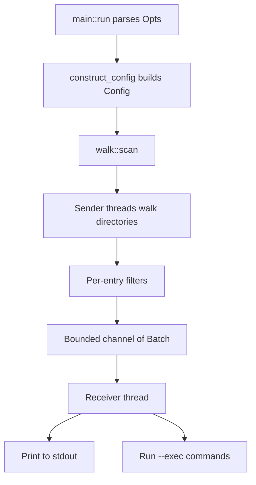

## Overview

`fd` is a command-line program that finds entries in the filesystem. The crate is published as `fd-find` and builds one binary, `fd`, described in its manifest as "a simple, fast and user-friendly alternative to find".

Sources: [Cargo.toml:1-30](repo://Cargo.toml#L1-L30)

Out of the box `fd` skips hidden entries and entries ignored by `.gitignore`, and it matches case-insensitively unless the pattern contains an uppercase letter. The CLI's own description says as much.

Sources: [src/cli.rs:23-31](repo://src/cli.rs#L23-L31)

## Parts

| Area | What it does | Page |
| --- | --- | --- |
| Startup | Parses arguments, validates them, builds regexes and the `Config` | [[Startup and Configuration]] |
| Walk | Runs the ignore-aware parallel directory walk on sender threads | [[Parallel Directory Traversal]] |
| Filters | Extension, type, owner, size and time checks applied to each entry | [[Entry Filters]] |
| Output | Buffers, sorts and prints results, sanitizes names, picks the exit code | [[Result Delivery and Output]] |
| Exec | Runs `--exec` / `--exec-batch` commands built from placeholders | [[Command Execution]] |
| Building and testing | Build, run and test instructions | [[Quickstart]] |

Sources: [src/main.rs:1-16](repo://src/main.rs#L1-L16)

## Main flow

Sources: [src/main.rs:75-112](repo://src/main.rs#L75-L112), [src/walk.rs:616-653](repo://src/walk.rs#L616-L653)

1. `run` parses `Opts`, normalizes the search paths, turns every pattern into a regex and builds a `Config` ([[Startup and Configuration]]).
2. `walk::scan` builds a parallel walker honouring the ignore rules and spawns the sender threads ([[Parallel Directory Traversal]]).
3. Each sender runs the per-entry filter chain before it queues an entry ([[Entry Filters]]).
4. Surviving entries cross a bounded channel in batches to the receiver, which either prints them or hands them to command jobs ([[Result Delivery and Output]], [[Command Execution]]).

Sources: [src/main.rs:75-112](repo://src/main.rs#L75-L112), [src/walk.rs:406-440](repo://src/walk.rs#L406-L440), [src/walk.rs:616-653](repo://src/walk.rs#L616-L653)

## Cross-cutting design decisions

**Patterns are byte regexes.** Patterns compile with `regex::bytes`, and candidate names are converted to bytes, so file names that are not valid UTF-8 can still be matched.

Sources: [src/main.rs:541-555](repo://src/main.rs#L541-L555), [src/walk.rs:519-524](repo://src/walk.rs#L519-L524)

**Smart case.** The search is case-sensitive only if `--case-sensitive` is given or a pattern holds an uppercase literal; `--ignore-case` wins over both.

Sources: [src/main.rs:248-256](repo://src/main.rs#L248-L256)

**Backpressure and bounded memory.** The channel between walker and receiver holds `2 * threads` batches, and a `BatchSender` flushes at a size limit "to provide some backpressure". Per-entry work that can run on many threads, such as computing the colour style, runs on the sender side ("Compute colors in parallel").

Sources: [src/walk.rs:90-98](repo://src/walk.rs#L90-L98), [src/walk.rs:593-598](repo://src/walk.rs#L593-L598), [src/walk.rs:636](repo://src/walk.rs#L636)

**Sorted output when the search is fast.** The receiver buffers results for a short time (default 100 ms). If the walk ends within that window the buffer is sorted before printing; otherwise it switches to streaming.

Sources: [src/walk.rs:124-127](repo://src/walk.rs#L124-L127), [src/walk.rs:281-293](repo://src/walk.rs#L281-L293)

**Hostile file names are neutralised on terminals.** Output to a terminal escapes control, bidi and zero-width characters, while pipes and files get raw bytes. Error messages go through the same sanitizer.

Sources: [src/sanitize.rs:1-55](repo://src/sanitize.rs#L1-L55), [src/error.rs:1-9](repo://src/error.rs#L1-L9)

**The `./` prefix is stripped, unless that would create an option.** When no search path is given, `./` is removed from results, but a result that would then start with `-` keeps its `./` so downstream tools do not read it as a flag.

Sources: [src/dir_entry.rs:56-71](repo://src/dir_entry.rs#L56-L71), [src/cli.rs:765-774](repo://src/cli.rs#L765-L774)

**One `Config` value, no globals.** Every flag is resolved once in `construct_config` into the `Config` struct, which the walker and receiver read; only the allocator choice is a global.

Sources: [src/config.rs:13-60](repo://src/config.rs#L13-L60), [src/main.rs:38-55](repo://src/main.rs#L38-L55)
