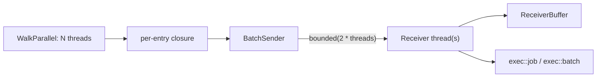

## Overview

`walk::scan` is where a search happens. It builds a parallel walker from the `ignore` crate, runs a closure on every walker thread (the "senders") that decides whether an entry is a result, and sends the results over a bounded channel to a receiver, which prints them or runs commands. The `Config` and regexes it works from come from [[Startup and Configuration]].

Sources: [src/walk.rs:616-653](repo://src/walk.rs#L616-L653), [src/walk.rs:680-687](repo://src/walk.rs#L680-L687)

`scan` wraps the patterns and config in a `WorkerState`, which also owns two atomic flags: `quit_flag` stops the walk cleanly, and `interrupt_flag` records that Ctrl-C was pressed.

Sources: [src/walk.rs:305-328](repo://src/walk.rs#L305-L328)

## Threads and channel

### Thread layout

Sources: [src/walk.rs:406-440](repo://src/walk.rs#L406-L440), [src/walk.rs:636-646](repo://src/walk.rs#L636-L646)

`scan` creates `bounded(2 * config.threads)` and, inside `thread::scope`, spawns the receiver with `self.receive(rx)` and then calls `spawn_senders`, which blocks in `walker.run` until the walk ends. When the senders finish, their `tx` clones drop, the channel closes, and the receiver's loop ends. `scan` returns `KilledBySigint` if the interrupt flag was set, otherwise the receiver's exit code.

Sources: [src/walk.rs:636-653](repo://src/walk.rs#L636-L653)

### Batching

Sending one entry at a time over a channel would be costly, so each sender owns a `BatchSender`. A `Batch` is a shared `Mutex<Option<Vec<WorkerResult>>>`. The first item pushed into an empty batch sends the batch handle over the channel; later items are appended to the same vector under the lock. The receiver takes the whole vector with `into_iter`, which leaves `None`, and the next `send` sees `needs_flush` and starts a new batch. A batch is also replaced when it reaches `limit` items, "to provide some backpressure".

Sources: [src/walk.rs:47-122](repo://src/walk.rs#L47-L122)

The limit is `0x100` (256) entries. When per-result `--exec` jobs run on more than one thread it is 1, so results are handed out to the job threads one at a time instead of piling into one thread's batch.

Sources: [src/walk.rs:449-457](repo://src/walk.rs#L449-L457)

## Building the walker

### Walker options

`build_walker` maps `Config` fields onto `ignore::WalkBuilder`:

Sources: [src/walk.rs:347-365](repo://src/walk.rs#L347-L365)

| `WalkBuilder` call | `Config` source |
| --- | --- |
| `hidden` | `ignore_hidden` |
| `ignore` | `read_fdignore` |
| `parents` | `read_parent_ignore` and (`read_fdignore` or `read_vcsignore`) |
| `git_ignore`, `git_global`, `git_exclude` | `read_vcsignore` |
| `require_git` | `require_git_to_read_vcsignore` |
| `follow_links` | `follow_links` |
| `same_file_system` | `one_file_system` |
| `max_depth` | `max_depth` |
| `threads` | `threads` |

Sources: [src/walk.rs:347-365](repo://src/walk.rs#L347-L365), [src/walk.rs:402](repo://src/walk.rs#L402)

All search roots go to one walker: the first path creates the builder, and `paths[1..]` are added afterwards.

Sources: [src/walk.rs:352](repo://src/walk.rs#L352), [src/walk.rs:398-400](repo://src/walk.rs#L398-L400)

### Ignore sources

When `.fdignore` files are enabled, `add_custom_ignore_filename(".fdignore")` makes the walker read them in every directory. The global ignore file is `<config dir>/fd/ignore`, where the config directory comes from `etcetera::choose_base_strategy`; it is added only if it exists as a file. Files given with `--ignore-file` are added after that. For both, a `Partial` error (some lines were malformed but the rest loaded) is ignored; any other error is printed as a "Malformed pattern" message.

Sources: [src/walk.rs:367-396](repo://src/walk.rs#L367-L396)

### Excludes

Each `--exclude` pattern was prefixed with `!` in `construct_config`, which makes it an override ignore rule. `build_overrides` adds them to an `OverrideBuilder` rooted at the first search path; a bad pattern gives "Malformed exclude pattern".

Sources: [src/main.rs:380](repo://src/main.rs#L380), [src/walk.rs:330-345](repo://src/walk.rs#L330-L345)

## The per-entry closure

### Steps

`spawn_senders` calls `walker.run` with a factory: each walker thread gets its own `BatchSender` and its own closure. The closure runs these steps for every entry, in order, and returns early with `WalkState::Continue` as soon as one rejects the entry:

Sources: [src/walk.rs:443-475](repo://src/walk.rs#L443-L475)

1. If `quit_flag` is set, return `WalkState::Quit`.
2. If the entry is a directory containing any `--ignore-contain` file (for example a cache-dir tag), return `Skip`, which prunes the whole subtree. The file type is checked first to avoid extra syscalls.
3. Skip the root entry itself (`depth() == 0`).
4. Convert the entry into a `DirEntry`, or deal with the error as described below.
5. Reject entries shallower than `min_depth`.
6. Run the filters ([[Entry Filters]]).
7. Pre-compute the colour style if results are being printed in colour.
8. Send the entry; if the channel is closed, return `Quit`.
9. With `--prune`, return `Skip` so the subtree under a match is not entered.

Sources: [src/walk.rs:459-484](repo://src/walk.rs#L459-L484), [src/walk.rs:508-512](repo://src/walk.rs#L508-L512), [src/walk.rs:593-611](repo://src/walk.rs#L593-L611)

### Errors and broken symlinks

A walk error for a path that is `NotFound` but is itself a symlink is a broken symlink, not a failure, so it becomes `DirEntry::broken_symlink` and goes through the filters like any entry. Any other error is sent as `WorkerResult::Error`, and the receiver prints it only with `--show-errors`.

Sources: [src/walk.rs:485-506](repo://src/walk.rs#L485-L506), [src/walk.rs:227-231](repo://src/walk.rs#L227-L231)

### What the pattern is matched against

`search_str_for_entry` returns the string the regexes see. Without `--full-path` it is the file name. With it, the path is made absolute by joining `full_path_base` with the entry path after removing a leading `./`; an absolute entry path is used as is. All patterns must match the same string.

Sources: [src/walk.rs:514-524](repo://src/walk.rs#L514-L524), [src/walk.rs:656-678](repo://src/walk.rs#L656-L678)

### DirEntry

`DirEntry` wraps either an `ignore::DirEntry` or a broken-symlink path, so both look the same to the filters and printers. Metadata and colour style are computed lazily in `OnceCell`s: a filter that needs `metadata()` pays for the `stat` once, and nothing is read for entries rejected by the name match. For a broken symlink, `metadata()` uses `symlink_metadata`, and `depth()` is `None`, which is why the `min_depth` check treats a missing depth as too shallow.

Sources: [src/dir_entry.rs:11-47](repo://src/dir_entry.rs#L11-L47), [src/dir_entry.rs:82-109](repo://src/dir_entry.rs#L82-L109), [src/walk.rs:508-512](repo://src/walk.rs#L508-L512)

## Stopping the walk

Ctrl-C handling is installed only when results are printed in colour (`ls_colors` set and `is_printing`). The handler sets `quit_flag`, and uses `fetch_or` on `interrupt_flag` so a second Ctrl-C exits immediately with `KilledBySigint`. The receiver also sets `quit_flag` when it stops (for example at `--max-results`), so the senders see it at the next entry. The code that reacts on the output side is in [[Result Delivery and Output]].

Sources: [src/walk.rs:621-634](repo://src/walk.rs#L621-L634), [src/walk.rs:174-181](repo://src/walk.rs#L174-L181), [src/walk.rs:459-462](repo://src/walk.rs#L459-L462)

When the receiver is the command runner, it either consumes the whole channel in one batch job or runs `threads` job threads that share the receiver; see [[Command Execution]].

Sources: [src/walk.rs:406-440](repo://src/walk.rs#L406-L440)
