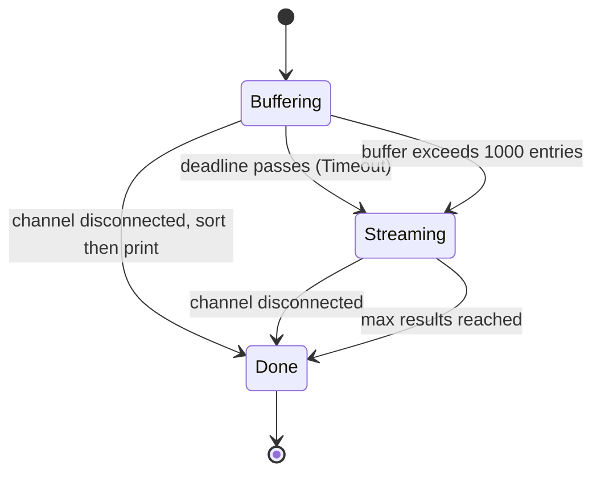

## Overview

When no command is given, the receiver runs on the thread that called `scan`. It takes batches off the channel, decides when to sort and when to stream, prints each entry through `output::print_entry`, and returns an `ExitCode`. The senders that feed it are described in [[Parallel Directory Traversal]]; for `--exec` the receiver is replaced by the job runners in [[Command Execution]].

Sources: [src/walk.rs:406-440](repo://src/walk.rs#L406-L440), [src/walk.rs:129-171](repo://src/walk.rs#L129-L171)

## Buffering, then streaming

`ReceiverBuffer` starts in `Buffering` mode with a deadline of `max_buffer_time` from now (default 100 ms; set with `--max-buffer-time`). While buffering, `recv` waits only until the deadline, and received entries are pushed into a vector.

Sources: [src/walk.rs:124-171](repo://src/walk.rs#L124-L171), [src/walk.rs:183-195](repo://src/walk.rs#L183-L195)

Sources: [src/walk.rs:198-249](repo://src/walk.rs#L198-L249), [src/walk.rs:269-293](repo://src/walk.rs#L269-L293)

The reason for the two modes is in the code: a search that ends before the deadline gets its results sorted (`self.buffer.sort()` in `stop`), while a slow search starts printing as soon as the deadline passes, so a long search shows results as they appear. `DirEntry` orders by path.

Sources: [src/walk.rs:281-293](repo://src/walk.rs#L281-L293), [src/dir_entry.rs:116-139](repo://src/dir_entry.rs#L116-L139)

`stream` switches the mode, prints everything buffered, and flushes. In streaming mode, stdout is flushed only when the channel is empty, so output is batched while results arrive quickly but never held back while the walker is idle.

Sources: [src/walk.rs:235-238](repo://src/walk.rs#L235-L238), [src/walk.rs:269-279](repo://src/walk.rs#L269-L279)

## Stopping conditions

`poll` handles each result in a batch, and each of these ends the loop by returning an `Err(ExitCode)` that `process` turns into a stop:

Sources: [src/walk.rs:174-181](repo://src/walk.rs#L174-L181)

| Condition | Behaviour | Exit code |
| --- | --- | --- |
| `--quiet` and a first entry arrives | Returns at once without printing | `HasResults(true)` |
| `--max-results` / `--max-one-result` reached | `stop`: sorts and prints what is buffered | `Success` |
| Channel disconnected (walk finished) | `stop` | `Success`, or `HasResults(count > 0)` in quiet mode |
| Ctrl-C seen while printing | Flushes and returns | `KilledBySigint` |
| Write error other than `BrokenPipe` | Prints "Could not write to output" | `GeneralError` |

Sources: [src/walk.rs:174-181](repo://src/walk.rs#L174-L181), [src/walk.rs:198-267](repo://src/walk.rs#L198-L267), [src/walk.rs:281-293](repo://src/walk.rs#L281-L293)

When `process` gets an error code it first sets `quit_flag`, which the sender closures check, so the walk stops too. Entries that arrive as `WorkerResult::Error` are printed through `print_error` only if `--show-errors` is set.

Sources: [src/walk.rs:174-181](repo://src/walk.rs#L174-L181), [src/walk.rs:227-231](repo://src/walk.rs#L227-L231)

## Exit codes

`ExitCode` has four variants mapped to process statuses: `Success` is 0, `GeneralError` is 1, `KilledBySigint` is 130, and `HasResults(bool)` is 0 when there were results and 1 when there were none.

Sources: [src/exit_codes.rs:6-23](repo://src/exit_codes.rs#L6-L23)

`ExitCode::exit` for `KilledBySigint` on Unix first restores the default SIGINT handler and raises SIGINT again, so the parent shell sees the process as killed by the signal rather than as a normal exit with status 130. `merge_exitcodes` is used by the exec runners: any non-zero code yields `GeneralError`.

Sources: [src/exit_codes.rs:30-51](repo://src/exit_codes.rs#L30-L51)

## Printing an entry

`print_entry` writes one entry, choosing the formatter in this priority: a `--format` template, then colourised output when `ls_colors` is set, otherwise plain. Around it, a hyperlink wrapper is added when `config.hyperlink` is true and the path can be made absolute, and the entry ends with a NUL when `--print0` is set or a newline otherwise.

Sources: [src/output.rs:17-43](repo://src/output.rs#L17-L43)

The three formatters differ as follows:

Sources: [src/output.rs:26-32](repo://src/output.rs#L26-L32)

| Formatter | Used when | What it does |
| --- | --- | --- |
| `print_entry_format` | `--format` given | Fills the template (same placeholders as `--exec`) from the stripped path and prints the result with no trailing slash |
| `print_entry_colorized` | colour is on | Paints the directory part with the `di` style and the file name with the entry's own style, then, for directories, a trailing slash in the directory style |
| `print_entry_uncolorized` | otherwise | Prints the path; on Unix with output that is not a terminal and no custom separator it writes the raw bytes |

Sources: [src/output.rs:69-86](repo://src/output.rs#L69-L86), [src/output.rs:89-139](repo://src/output.rs#L89-L139), [src/output.rs:142-182](repo://src/output.rs#L142-L182)

Raw bytes on pipes mean that file names that are not valid UTF-8 reach downstream tools unchanged. The path printed is `stripped_path`, so the leading `./` is removed when `strip_cwd_prefix` is on, unless that would leave a leading `-`.

Sources: [src/output.rs:167-182](repo://src/output.rs#L167-L182), [src/dir_entry.rs:56-71](repo://src/dir_entry.rs#L56-L71)

For directories, `print_trailing_slash` appends `actual_path_separator`, painted in the directory style when colour is on. A custom `--path-separator` replaces the platform separator in the printed path.

Sources: [src/output.rs:12-14](repo://src/output.rs#L12-L14), [src/output.rs:45-66](repo://src/output.rs#L45-L66), [src/output.rs:142-156](repo://src/output.rs#L142-L156)

## Terminal safety

A file name can contain escape sequences or invisible characters that rewrite what a terminal displays. The `sanitize` module escapes them, but only when the output is an interactive terminal: `maybe_sanitize` returns the input unchanged otherwise.

Sources: [src/sanitize.rs:1-55](repo://src/sanitize.rs#L1-L55)

`needs_escape` is true for any control character (except tab), soft hyphen, the Mongolian vowel separator, zero-width and directional marks, bidi embedding and override characters, word-joiner and related invisible formats, the byte-order mark, interlinear annotation characters and language tags. Such a character is written as `\xNN` if its code point is at most 0xFF and `\u{NNNN}` otherwise.

Sources: [src/sanitize.rs:6-46](repo://src/sanitize.rs#L6-L46)

Every printing path above calls `maybe_sanitize` with `config.interactive_terminal`, and `print_error` does the same for stderr using its own terminal check, so error messages that echo a file name are also safe.

Sources: [src/output.rs:80-85](repo://src/output.rs#L80-L85), [src/output.rs:120-129](repo://src/output.rs#L120-L129), [src/error.rs:5-9](repo://src/error.rs#L5-L9)

## Hyperlinks

With `--hyperlink`, each entry is wrapped in an OSC 8 sequence whose target is a `file://` URL. `PathUrl` makes the path absolute, prefixes the host name (read once on Unix), and percent-encodes every byte except ASCII letters, digits and `/ : - . _ ~`; on Windows a backslash becomes `/`.

Sources: [src/output.rs:17-24](repo://src/output.rs#L17-L24), [src/hyperlink.rs:5-57](repo://src/hyperlink.rs#L5-L57)

Percent-encoding every non-ASCII byte avoids guessing whether bytes belong to a valid UTF-8 sequence, which the code's comment gives as the reason, since Windows paths may not be valid UTF-8.

Sources: [src/hyperlink.rs:24-41](repo://src/hyperlink.rs#L24-L41)
