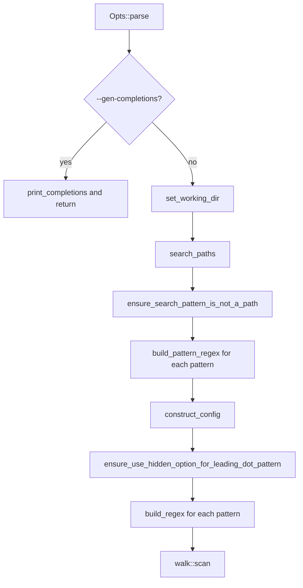

## Overview

Before any directory is read, `fd` turns its command line into two things: a list of compiled regexes and a single `Config` value. `run` in `main.rs` does this in a fixed order, and fails early, with a readable message, on input that could never produce results. The result goes to `walk::scan`, described in [[Parallel Directory Traversal]].

Sources: [src/main.rs:62-111](repo://src/main.rs#L62-L111)

`main` calls `run` and maps its `Result`: `Ok` carries an `ExitCode` that is used as the process exit status, and `Err` is printed as `[fd error]: ...` and exits with the general-error code.

Sources: [src/main.rs:62-73](repo://src/main.rs#L62-L73), [src/error.rs:5-9](repo://src/error.rs#L5-L9)

## The startup sequence

Sources: [src/main.rs:75-112](repo://src/main.rs#L75-L112)

The positional pattern and every `--and` expression are processed alike: each is chained together and the entry name has to match all of them (the walker checks `patterns.iter().all(...)`).

Sources: [src/main.rs:89-100](repo://src/main.rs#L89-L100), [src/walk.rs:519-524](repo://src/walk.rs#L519-L524)

## Search paths

`Opts::search_paths` picks the roots in this order: the `--path` option values, then the positional paths, and otherwise the current directory, which is first checked to still exist. A root that is not a directory is reported with `print_error` and dropped; `run` bails with "No valid search paths given." only if nothing is left.

Sources: [src/cli.rs:696-721](repo://src/cli.rs#L696-L721), [src/main.rs:84-87](repo://src/main.rs#L84-L87)

`normalize_path` rewrites each root: with `--absolute-path` it becomes absolute, `.` becomes `./` (a workaround for a ripgrep issue noted in the comment), and `-` becomes `./-` so the walker does not treat it as an option.

Sources: [src/cli.rs:723-736](repo://src/cli.rs#L723-L736)

`--base-directory` is applied before this by `set_working_dir`, which changes the process's working directory and fails if the path is not a directory.

Sources: [src/main.rs:131-146](repo://src/main.rs#L131-L146)

## Turning patterns into regexes

### Pattern translation

`build_pattern_regex` picks one of four translations, in this priority:

Sources: [src/main.rs:218-232](repo://src/main.rs#L218-L232)

| Option | Resulting regex |
| --- | --- |
| `--glob` (non-empty pattern) | the regex of a `globset` glob built with `literal_separator(true)` |
| `--exact` | `^` + escaped pattern + `$` |
| `--fixed-strings` | the escaped pattern |
| none | the pattern unchanged |

Sources: [src/main.rs:218-232](repo://src/main.rs#L218-L232)

Compilation happens last, in `build_regex`, with `regex::bytes::RegexBuilder`: it is case-insensitive unless `Config::case_sensitive` is set, and `.` matches newlines, because file names can contain them. A syntax error is returned with a note that suggests `--fixed-strings`, `--exact` or `--glob`.

Sources: [src/main.rs:541-555](repo://src/main.rs#L541-L555)

### Smart case

`construct_config` decides case sensitivity once for all patterns: it is on when `--ignore-case` is absent and either `--case-sensitive` is set or any pattern contains an uppercase literal. `pattern_has_uppercase_char` parses the pattern into the regex-syntax HIR and inspects literals and character classes, so an escape such as `\Acargo` or `carg\x6F` does not count as uppercase text.

Sources: [src/main.rs:248-256](repo://src/main.rs#L248-L256), [src/regex_helper.rs:4-37](repo://src/regex_helper.rs#L4-L37), [src/regex_helper.rs:78-86](repo://src/regex_helper.rs#L78-L86)

## Early validation

Three checks run before the walk, each of which turns a silent "no results" into an error:

Sources: [src/main.rs:169-216](repo://src/main.rs#L169-L216)

- `ensure_search_pattern_is_not_a_path` rejects a pattern that contains `/` unless `--full-path` is given, because without it patterns are matched against file names only. On Windows a pattern containing the native `\` is rejected only if it names an existing directory, since `\` is also the regex escape. The error suggests `fd . '<dir>'` or `--full-path`.
- `ensure_use_hidden_option_for_leading_dot_pattern` runs on Unix after the config exists and errors when hidden files are filtered and a pattern is detected as matching only a leading dot. `pattern_matches_strings_with_leading_dot` only detects `^\.`-style anchored patterns, as its comment says.
- `check_path_separator_length` requires `--path-separator` to be one byte on Windows.

Sources: [src/main.rs:169-216](repo://src/main.rs#L169-L216), [src/main.rs:234-246](repo://src/main.rs#L234-L246), [src/main.rs:521-539](repo://src/main.rs#L521-L539), [src/regex_helper.rs:39-72](repo://src/regex_helper.rs#L39-L72)

## Building the Config

### Ignore flags

`construct_config` consumes `Opts` and fills every field of `Config`. Most are direct flag copies; the ignore switches fold the `-u`/`-uu` ripgrep-style aliases into the base flags:

Sources: [src/main.rs:313-320](repo://src/main.rs#L313-L320), [src/config.rs:22-38](repo://src/config.rs#L22-L38)

| `Config` field | True unless |
| --- | --- |
| `ignore_hidden` | `--hidden` or the `-u` alias |
| `read_fdignore` | `--no-ignore` or the alias |
| `read_vcsignore` | `--no-ignore`, the alias or `--no-ignore-vcs` |
| `read_global_ignore` | `--no-ignore`, the alias or `--no-global-ignore-file` |
| `read_parent_ignore` | `--no-ignore-parent` |

Sources: [src/main.rs:313-320](repo://src/main.rs#L313-L320), [src/cli.rs:743-745](repo://src/cli.rs#L743-L745)

How these reach the walker is explained in [[Parallel Directory Traversal]].

Sources: [src/walk.rs:347-365](repo://src/walk.rs#L347-L365)

### Colour and hyperlinks

`--color auto` enables colour only if ANSI is supported, `NO_COLOR` is unset or empty, and stdout is a terminal. When colour is on, `LS_COLORS` from the environment is used, falling back to the built-in `DEFAULT_LS_COLORS` string. `--hyperlink auto` follows the colour decision.

Sources: [src/main.rs:270-296](repo://src/main.rs#L270-L296), [src/main.rs:56-60](repo://src/main.rs#L56-L60)

### Depth, threads and result limits

`max_depth` and `min_depth` fall back to `--exact-depth` when not set. The thread count is `--threads` or `available_parallelism` capped at 64, with a single thread if the parallelism cannot be read. `max_results` ignores a value of 0 and otherwise falls back to 1 when `--max-one-result` is set.

Sources: [src/cli.rs:747-763](repo://src/cli.rs#L747-L763), [src/cli.rs:789-801](repo://src/cli.rs#L789-L801)

### Prefix stripping

`strip_cwd_prefix` only applies when no search path was given. With `auto` it is on unless output is NUL-separated or a command is being run; `always` and `never` override that.

Sources: [src/cli.rs:765-774](repo://src/cli.rs#L765-L774), [src/main.rs:390](repo://src/main.rs#L390)

### Filters and commands

File types, extensions, size and time limits, and the owner constraint are parsed here and stored on `Config`; the extensions become a case-insensitive `RegexSet` of `.\.ext$` patterns. `--format` is parsed into a `FormatTemplate`. The details of each filter are on [[Entry Filters]]. The command comes from `--exec`/`--exec-batch`, or for `--list-details` from `determine_ls_command`, which picks `ls`, `gls` or a BSD `ls` per platform; see [[Command Execution]].

Sources: [src/main.rs:266-269](repo://src/main.rs#L266-L269), [src/main.rs:333-377](repo://src/main.rs#L333-L377), [src/main.rs:395-410](repo://src/main.rs#L395-L410), [src/main.rs:412-494](repo://src/main.rs#L412-L494)

When `--full-path` is set, the current directory is read once into `full_path_base` so the walker can build absolute candidate paths.

Sources: [src/main.rs:301-308](repo://src/main.rs#L301-L308), [src/walk.rs:656-678](repo://src/walk.rs#L656-L678)
