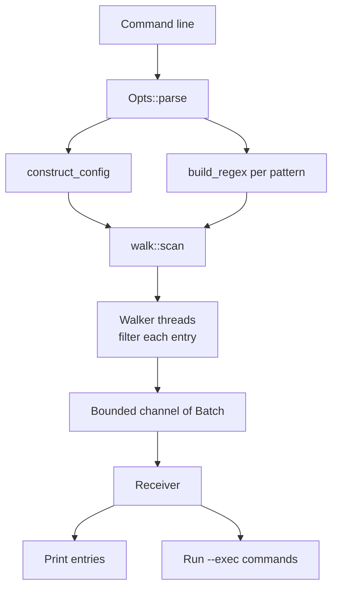

## Overview

`fd` is a command-line program that finds entries in the filesystem. It is a Rust binary (`src/main.rs`) built on the `ignore` crate's parallel directory walker, the `regex` crate for matching and `clap` for arguments. Its defaults are opinionated: hidden files and anything matched by ignore files are skipped, and the pattern is a regular expression that matches the file name.

Sources: [src/main.rs:1-36](repo://src/main.rs#L1-L36), [src/walk.rs:1-24](repo://src/walk.rs#L1-L24)

The whole program is one pipeline. `run` parses the command line, builds one `Config` and a list of compiled regexes, and calls `walk::scan`. That function starts walker threads that filter entries and a receiver that either prints them or runs commands on them.

Sources: [src/main.rs:75-112](repo://src/main.rs#L75-L112), [src/walk.rs:616-653](repo://src/walk.rs#L616-L653)

## Parts of the program

| Area | What it does | Page |
| --- | --- | --- |
| Startup | Parses arguments, resolves search paths, derives the `Config` | [[Startup and Configuration]] |
| Patterns | Turns regex, glob, fixed-string and exact patterns into byte regexes, smart case | [[Pattern Matching]] |
| Traversal | Configures the parallel walker: ignore files, hidden files, depth, symlinks | [[Directory Traversal and Ignore Rules]] |
| Filters | Extension, type, owner, size and time checks on each entry | [[Entry Filters]] |
| Delivery | Batches results to the receiver, buffers and sorts, prints, sets the exit code | [[Result Pipeline and Output]] |
| Commands | `--exec` and `--exec-batch`, placeholder templates | [[Command Execution]] |
| First steps | Build and run | [[Quickstart]] |

Sources: [src/main.rs:75-112](repo://src/main.rs#L75-L112), [src/walk.rs:443-614](repo://src/walk.rs#L443-L614)

## Main flow

Sources: [src/main.rs:75-112](repo://src/main.rs#L75-L112), [src/walk.rs:636-646](repo://src/walk.rs#L636-L646)

1. `Opts::parse` reads the arguments and `construct_config` derives the `Config`; see [[Startup and Configuration]].
2. Each pattern goes through `build_pattern_regex` and `build_regex`; see [[Pattern Matching]].
3. `build_walker` sets up the parallel walk; see [[Directory Traversal and Ignore Rules]].
4. Each walker thread applies the filters before sending anything; see [[Entry Filters]].
5. Matches cross a bounded channel in batches to the receiver, which prints them; see [[Result Pipeline and Output]].
6. With `--exec`, the receiver side is a pool of command runners instead; see [[Command Execution]].

Sources: [src/main.rs:94-111](repo://src/main.rs#L94-L111), [src/walk.rs:347-404](repo://src/walk.rs#L347-L404), [src/walk.rs:408-440](repo://src/walk.rs#L408-L440)

## Design decisions

**Smart case.** Matching is case-insensitive unless `--case-sensitive` is given or a pattern contains an uppercase literal; `--ignore-case` overrides both.

Sources: [src/main.rs:248-255](repo://src/main.rs#L248-L255)

**Ignore by default.** Hidden files, `.fdignore`, VCS ignore files and the global ignore file are all honoured unless a flag turns them off. The `-u`-style alias (`rg_alias_ignore`) turns several of them off at once.

Sources: [src/main.rs:313-320](repo://src/main.rs#L313-L320)

**Parallel walk, ordered when cheap.** Walking runs on a thread pool, so the order of discovery is arbitrary. The receiver holds results back for a short time (100 ms by default) and sorts them if the search finishes within that window; after that it streams in arrival order. This gives sorted output for quick searches without delaying output for slow ones.

Sources: [src/walk.rs:124-128](repo://src/walk.rs#L124-L128), [src/walk.rs:269-293](repo://src/walk.rs#L269-L293)

**Bytes, not strings.** Patterns are compiled with `regex::bytes` and matched against the raw bytes of file names, so names that are not valid UTF-8 can still match.

Sources: [src/main.rs:541-545](repo://src/main.rs#L541-L545), [src/walk.rs:519-524](repo://src/walk.rs#L519-L524)

**Terminal safety.** When stdout is a terminal, control and invisible characters in file names are escaped before printing, so a hostile file name cannot inject escape sequences. When output is piped, the raw bytes are written.

Sources: [src/sanitize.rs:1-58](repo://src/sanitize.rs#L1-L58), [src/output.rs:167-182](repo://src/output.rs#L167-L182)

**Bounded memory.** Batches go through a channel bounded to twice the thread count, which makes fast walkers wait for the receiver instead of queueing without limit.

Sources: [src/walk.rs:90-98](repo://src/walk.rs#L90-L98), [src/walk.rs:636](repo://src/walk.rs#L636)

**Optional allocator and completions.** jemalloc and shell completions are Cargo features; completions are on by default.

Sources: [Cargo.toml:94-98](repo://Cargo.toml#L94-L98), [src/main.rs:38-54](repo://src/main.rs#L38-L54)
