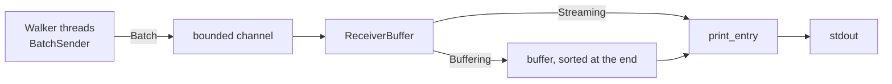

## Overview

Matches leave the walker threads through a bounded channel and are consumed by a single receiver. Without `--exec` that receiver is `ReceiverBuffer`, which prints entries; with `--exec` the same channel feeds command runners instead (see [[Command Execution]]). This page follows an entry from the sender closure's `tx.send` to bytes on stdout and then to the process exit code.

Sources: [src/walk.rs:406-440](repo://src/walk.rs#L406-L440), [src/walk.rs:616-653](repo://src/walk.rs#L616-L653)

Sources: [src/walk.rs:198-249](repo://src/walk.rs#L198-L249), [src/walk.rs:269-293](repo://src/walk.rs#L269-L293), [src/walk.rs:636-646](repo://src/walk.rs#L636-L646)

## Batches and backpressure

Sending one channel message per entry would be slow, so each walker thread owns a `BatchSender`. A `Batch` is an `Arc<Mutex<Option<Vec<WorkerResult>>>>`: the sender pushes into the vector, and the receiver later takes the whole vector out. A `WorkerResult` is either an `Entry` or an `ignore::Error`.

Sources: [src/walk.rs:37-72](repo://src/walk.rs#L37-L72)

The batch is put on the channel when its first item is added (`items.len() == 1`), not when it is full, so the receiver can start on a batch while it is still being filled. `needs_flush` starts a fresh batch when the current one holds `limit` items or the receiver already took it (the `Option` is `None`).

Sources: [src/walk.rs:90-121](repo://src/walk.rs#L90-L121)

The channel is `bounded(2 * config.threads)`, so when the receiver is slower than the walkers, the walkers block in `send`. The batch limit is `0x100` (256) results, except that with `--exec` in one-by-one mode and more than one thread it is 1, so that work spreads evenly over the command runners.

Sources: [src/walk.rs:449-457](repo://src/walk.rs#L449-L457), [src/walk.rs:636](repo://src/walk.rs#L636)

## Buffering, then streaming

`ReceiverBuffer` starts in `Buffering` mode with a deadline of `max_buffer_time` (100 ms by default, configurable with `--max-buffer-time`) and a buffer sized for 1000 entries. It has two ways to leave that mode:

Sources: [src/walk.rs:124-171](repo://src/walk.rs#L124-L171)

- the deadline passes with no batch (`recv_deadline` times out), or the buffer exceeds `MAX_BUFFER_LENGTH` (1000): `stream()` switches to `Streaming`, prints the buffered entries in arrival order, and flushes;
- the channel disconnects first, meaning the walk is done: `stop()` sorts the buffer (by path, through `DirEntry`'s `Ord`) before streaming it.

Sources: [src/walk.rs:183-195](repo://src/walk.rs#L183-L195), [src/walk.rs:240-247](repo://src/walk.rs#L240-L247), [src/walk.rs:269-286](repo://src/walk.rs#L269-L286)

So a search that finishes within the window prints sorted; a longer one prints in arrival order from then on. In `Streaming` mode the receiver waits indefinitely for the next batch, and flushes stdout whenever no further batch is waiting.

Sources: [src/walk.rs:197-249](repo://src/walk.rs#L197-L249)

## Stopping early

`process` loops on `poll` until `poll` returns an `Err(ExitCode)`; the `Err` carries the final code, and `process` also sets `quit_flag` so the walkers stop.

Sources: [src/walk.rs:173-181](repo://src/walk.rs#L173-L181), [src/walk.rs:459-462](repo://src/walk.rs#L459-L462)

- `--quiet`: the first entry returns `HasResults(true)` at once, with nothing printed.
- `--max-results`: after each entry, when `num_results` reaches the limit, `stop()` runs (sort if still buffering, print, exit code).
- A closed channel: `stop()` returns `HasResults(num_results > 0)` for quiet mode or `Success` otherwise.
- Filesystem errors are printed only when `--show-errors` is set.

Sources: [src/walk.rs:198-249](repo://src/walk.rs#L198-L249), [src/walk.rs:281-293](repo://src/walk.rs#L281-L293)

## Ctrl-C

When output is being printed in colour, `scan` installs a `ctrlc` handler. The first press sets `quit_flag` and `interrupt_flag`; a second press exits at once with `KilledBySigint`. After each printed entry, `print` checks `interrupt_flag`, flushes and returns `KilledBySigint`; `scan` also reports it if the flag is set at the end.

Sources: [src/walk.rs:621-634](repo://src/walk.rs#L621-L634), [src/walk.rs:252-267](repo://src/walk.rs#L252-L267), [src/walk.rs:648-652](repo://src/walk.rs#L648-L652)

## Exit codes

`ExitCode` maps to process codes: `Success` is 0, `HasResults(b)` is 0 if true and 1 if false, `GeneralError` is 1 and `KilledBySigint` is 130. For `KilledBySigint` on Unix, `exit` first restores the default SIGINT handler and raises SIGINT, so the parent shell sees a real signal death. `merge_exitcodes` turns any non-zero code in a list into `GeneralError`, which is how several command runners report one result.

Sources: [src/exit_codes.rs:6-51](repo://src/exit_codes.rs#L6-L51)

Failures outside the walk reach `main` as errors: it prints them through `print_error` as `[fd error]: ...` on stderr and exits with `GeneralError`. A broken pipe on stdout is not reported as an error.

Sources: [src/main.rs:62-73](repo://src/main.rs#L62-L73), [src/error.rs:5-9](repo://src/error.rs#L5-L9), [src/walk.rs:252-258](repo://src/walk.rs#L252-L258)

## Printing an entry

### Layout of one entry

`print_entry` writes one entry in this order: an optional hyperlink prefix, the entry itself, the hyperlink suffix, and then `\0` with `--print0` or a newline. The entry body is chosen by the first match of: a `--format` template, colour from `LS_COLORS`, plain text.

Sources: [src/output.rs:17-43](repo://src/output.rs#L17-L43)

### Colour and trailing slash

The colourised path is written in two parts. The parent portion, including its separator, is painted with the directory style; the final component with the entry's own style, computed earlier on the walker thread. A directory then gets a trailing separator (`actual_path_separator`), painted with the directory style when colour is on and unstyled otherwise. A custom `--path-separator` replaces `std::path::MAIN_SEPARATOR` in the parent part.

Sources: [src/output.rs:12-14](repo://src/output.rs#L12-L14), [src/output.rs:45-66](repo://src/output.rs#L45-L66), [src/output.rs:89-139](repo://src/output.rs#L89-L139)

The uncoloured path differs by platform. On Unix, if stdout is a terminal or a path separator was set, the path is converted to a string and sanitised. If output is piped, the raw bytes of the path are written, so file names that are not valid UTF-8 reach downstream tools intact. Other platforms always use the string path.

Sources: [src/output.rs:142-182](repo://src/output.rs#L142-L182)

With `--format`, the `FormatTemplate` renders the stripped path (the same placeholders `--exec` uses, see [[Command Execution]]) and the result is written as a lossy string.

Sources: [src/output.rs:68-86](repo://src/output.rs#L68-L86)

### Hyperlinks

When `Config::hyperlink` is on, the entry is wrapped in the OSC 8 escape sequences, `ESC ] 8 ; ; URL ESC \` before and `ESC ] 8 ; ; ESC \` after. `PathUrl` builds a `file://` URL from the host name (on Unix, `gethostname`) and the absolute path, percent-encoding every byte except ASCII letters, digits and `/ : - . _ ~`. If the path cannot be made absolute, no link is written.

Sources: [src/output.rs:17-24](repo://src/output.rs#L17-L24), [src/hyperlink.rs:1-60](repo://src/hyperlink.rs#L1-L60)

### Terminal sanitisation

A file name is data controlled by whoever created the file, so printing it raw to a terminal could inject escape sequences. `maybe_sanitize` calls `sanitize_for_terminal` only when the output is a terminal; piped output is left alone. Every character that is a control character or an invisible or direction-changing format character (soft hyphen, zero-width characters, bidi overrides, tag characters, BOM) is replaced by `\xNN` or `\u{NNNN}`; tab is kept. If nothing needs escaping, the original string is borrowed without a copy. Error messages go through the same function, with stderr's terminal state.

Sources: [src/sanitize.rs:1-58](repo://src/sanitize.rs#L1-L58), [src/error.rs:5-9](repo://src/error.rs#L5-L9)
