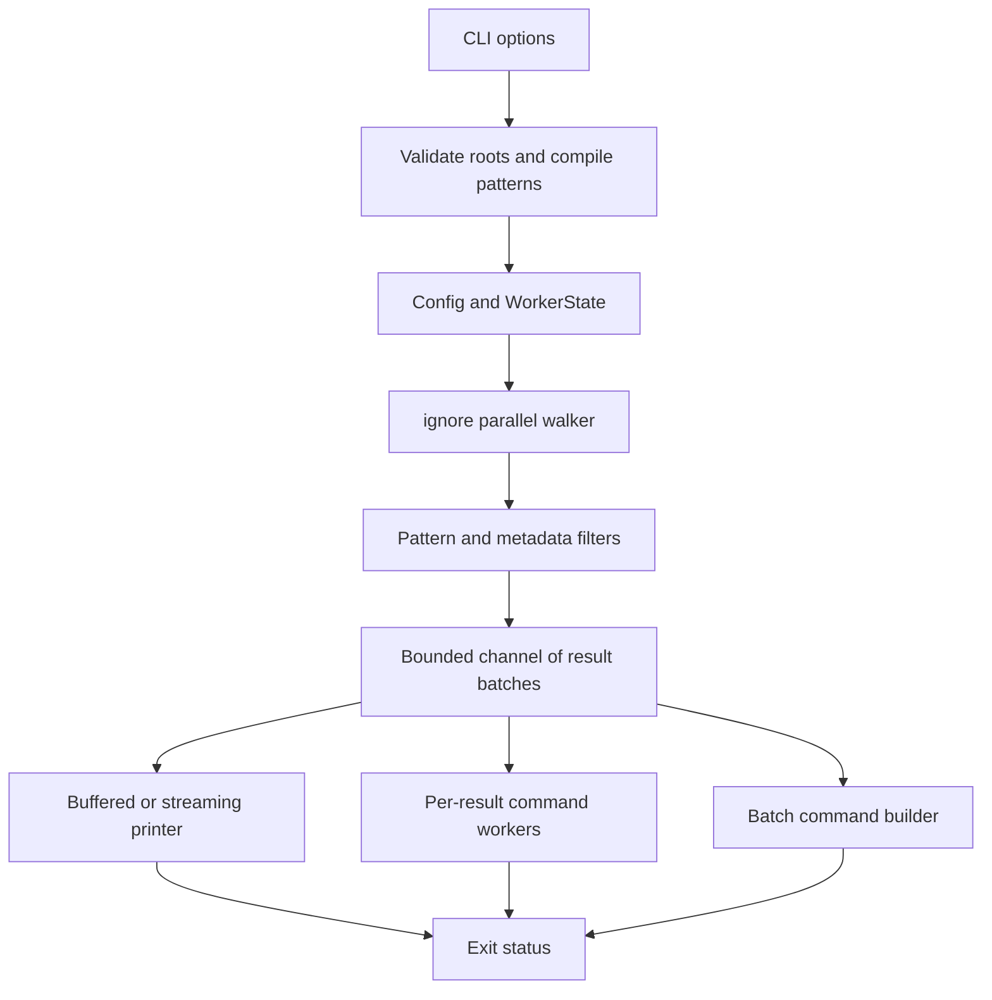

# Search pipeline and concurrency

`fd` is a single command-line process. `main.rs` translates user intent into a `Config` and compiled byte regexes; `walk.rs` owns traversal and the lifetime of the producer and consumer threads. Configuration and results live in memory for one invocation. There is no search database to refresh: each invocation walks the filesystem.

## Startup and ownership

`run` parses `Opts`, handles completion generation as an early return, changes the working directory if requested, and resolves directory roots. It rejects an empty set of valid roots and diagnoses path-like filename patterns before compiling the primary pattern and every `--and` expression. `construct_config` resolves defaults, environment-sensitive presentation, filters, and optional commands. `walk::scan` creates the `WorkerState` that owns this configuration, compiled regexes, and shared quit/interrupt flags. See [search semantics](../concepts/search-semantics.md) for the user-visible rules. [Source](../../src/main.rs#L75-L112), [state](../../src/walk.rs#L305-L328).

The `ignore` crate owns traversal and ignore-file interpretation. `WorkerState::build_walker` supplies hidden-file policy, ignore sources, overrides, symlink and filesystem-boundary controls, roots, depth, and thread count. The default count follows available parallelism, capped at 64, with a one-thread fallback; an explicit `--threads` value overrides that default. [Walker setup](../../src/walk.rs#L347-L404), [thread selection](../../src/cli.rs#L755-L799).

## Producing results

Each walker callback first checks cancellation. Directory marker exclusion (`--ignore-contain`) runs before root suppression, so even a root containing a marker can stop traversal. Root entries themselves are not returned. Selected missing-target symlink errors are recovered as `DirEntry::broken_symlink`; other walk errors travel downstream as `WorkerResult::Error`.

For an eligible entry, filters run in this order: minimum depth; all name/path regexes; extension; type; Unix owner; size; modification time. This puts name matching before metadata-dependent work. A matched entry is sent before `--prune` returns `Skip`, so pruning suppresses descent below matches. Colored printing precomputes styles in the producers. [Callback](../../src/walk.rs#L459-L613).

`DirEntry` wraps either an `ignore::DirEntry` or a broken-symlink path. Its `OnceCell` caches retain metadata lookup results, including failure, and styles for that entry. These are per-entry caches rather than persistent filesystem state. [Entry ownership](../../src/dir_entry.rs#L11-L39), [lazy lookup](../../src/dir_entry.rs#L82-L109).

## Transport and consumption

The channel capacity is twice the configured thread count. Producers send shared batches; the consumer takes each batch's vector once. The usual producer batch limit is 256 entries. Parallel per-result execution reduces it to one so multiple command receivers can share work. The bounded channel and batch limit provide backpressure when consumers are slower than traversal. [Batch transport](../../src/walk.rs#L47-L121), [limits](../../src/walk.rs#L443-L457), [channel lifecycle](../../src/walk.rs#L616-L653).

The receiver selects exactly one mode:

| Mode | Consumer behavior |
| --- | --- |
| Normal listing | One locked, buffered stdout writer; a short initial accumulation may be sorted before output. |
| Per-result execution | A pool with the configured thread count consumes cloned receivers; worker statuses are merged. |
| Batch execution | One receiver passes matching paths to the batch command builders. |

See [output and pipelines](../integrations/output-and-pipelines.md) for sorting and encoding, and [command execution](../workflows/command-execution.md) for process lifetime and argument limits. [Receiver dispatch](../../src/walk.rs#L406-L439).

## Termination and failures

Normal listing ends when senders disconnect. Quiet mode stops at its first result; a result limit also stops reception. The receiver sets the quit flag on termination, and callbacks stop on that flag or channel-send failure. Walk errors are printed only when `--show-errors` is enabled and do not automatically make a listing fail. Startup errors instead propagate to `main` and produce a general error exit. [Receiver control](../../src/walk.rs#L173-L249), [startup errors](../../src/main.rs#L62-L72).

The custom Ctrl-C handler is installed only for colored printing. Its first signal sets quit and interrupt flags; a second exits immediately. The final scan result checks the interrupt flag, and Unix exit handling restores and raises SIGINT. [Signal lifecycle](../../src/walk.rs#L616-L653), [exit handling](../../src/exit_codes.rs#L25-L43).

## Changing the pipeline

A new search behavior usually spans `Opts`, `construct_config`, `Config`, and the walker callback. Keep inexpensive rejection ahead of metadata work and distinguish “exclude this entry” (`Continue`) from “exclude its subtree” (`Skip`). Test the externally visible result through the integration harness; `test_single_and_multithreaded_execution` checks equivalent results at one and sixteen threads, while `walk.rs` unit tests exercise filename/full-path construction. Follow the [testing guide](../testing/contributor-guide.md).
