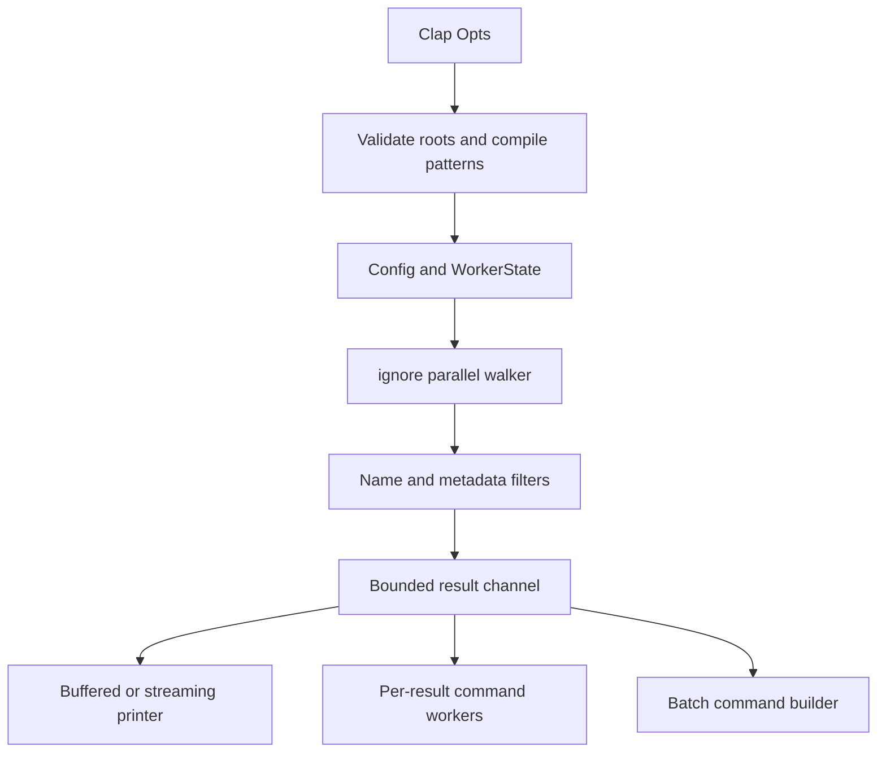

# Search pipeline and state ownership

`fd` is a single Rust binary that searches filesystem entry names. Its main boundary is between search workers, which discover and filter entries, and receivers, which print results or execute commands. The normal search keeps its state in memory for one invocation; ignore files and the filesystem are inputs, not a persistent search index.

## From arguments to a scan

`main` calls `run`, prints chained setup errors, and exits through `ExitCode`. `run` parses `Opts` with Clap, handles completion generation before search setup, changes to `--base-directory` if requested, and resolves search roots. It then validates patterns, converts each pattern to a regex expression, constructs `Config`, compiles byte regexes, and enters `walk::scan`. See [main.rs](../../src/main.rs#L70-L118).

Root selection uses positional paths first, then `--search-path`, then `./`. Invalid explicit roots produce diagnostics and are discarded; valid roots can still be searched. If none remain, startup fails. `--absolute-path` normalizes roots for absolute results; `--full-path` instead controls what text is matched and caches the working directory for that purpose. See [cli.rs](../../src/cli.rs#L696-L735) and [pattern semantics](../concepts/patterns-and-filters.md).

## Ownership and dependency boundaries

`Config` is the resolved runtime policy: ignore switches, depth and result limits, filter objects, presentation settings, and an optional shared `CommandSet`. `WorkerState` owns that configuration and the compiled regexes, plus shared atomic quit and interrupt flags. Scoped threads borrow this state, and the receiver is joined before the scan returns. The channel capacity is twice the configured thread count. See [config.rs](../../src/config.rs#L13-L142) and [walk.rs](../../src/walk.rs#L305-L327).

| Component | Responsibility and boundary |
| --- | --- |
| `clap`, `cli.rs`, `main.rs` | Parse user input, resolve defaults and reject invalid setup before walking. |
| `ignore`, `walk.rs` | Traverse roots in parallel and apply traversal policy; fd adds its matching and metadata predicates. |
| `crossbeam-channel` | Transfer batches of entries or walk errors with bounded buffering. |
| `DirEntry` | Wrap normal entries and recovered broken symlinks, caching metadata and color style lazily with `OnceCell`. |
| `output`, `fmt`, `lscolors` | Render paths, optional templates and styles. |
| `exec`, `argmax` | Expand command arguments, execute processes and bound batches by argument capacity. |

Metadata and style caching belong to each entry, not to a repository-wide cache. Name matching precedes metadata-dependent filtering, so rejected names avoid later metadata work. Styles are precomputed by workers only when printing colored results. See [dir_entry.rs](../../src/dir_entry.rs#L18-L109) and [walk.rs](../../src/walk.rs#L514-L600).

## Receiver selection and lifetime

With no command, one receiver owns buffered stdout and `ReceiverBuffer`. With `--exec`, a pool of receivers consumes entries and aggregates command statuses. With `--exec-batch`, one receiving path feeds command builders. These are mutually selected branches; printing limits and sorting in `ReceiverBuffer` should not be assumed to apply to execution. See [walk.rs](../../src/walk.rs#L408-L439).

The default thread count follows available parallelism, falls back to one, and is capped at 64. An explicit `--threads` value overrides it. The same count configures traversal and the per-result execution pool. Channel closure and quit flags coordinate completion; the scan waits for the receiver and translates a recorded interrupt into the final interrupt status. See [cli.rs](../../src/cli.rs#L755-L799) and [walk.rs](../../src/walk.rs#L616-L652).

## Making changes

For a new search option, trace `Opts` → `construct_config` → the owning walker or receiver branch. Put cheap name predicates ahead of metadata work. For command or formatting behavior, follow the shared template layer as well as the consumer: a change can affect both output and execution.

`test_single_and_multithreaded_execution` compares searches with one and sixteen threads. Unit tests in `walk.rs` verify filename versus full-path text construction. Use the [build and test guide](../operations/build-test-release.md) for focused commands.

Continue with [traversal and ignore rules](traversal-and-ignores.md), [output and pipelines](../workflows/output-and-pipelines.md), or [command execution](../workflows/command-execution.md).
