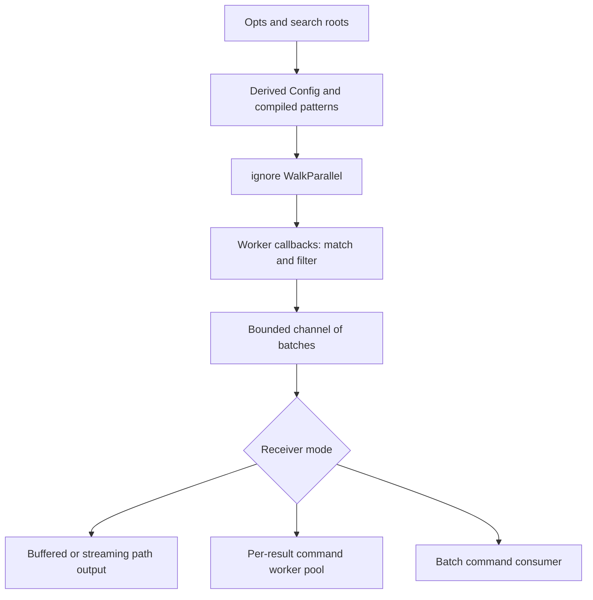

# Search pipeline and concurrency

`fd` is a single executable whose orchestration lives in `src/main.rs`. The CLI owns argument parsing, `Config` holds derived runtime policy, and `walk::WorkerState` owns the compiled patterns and cancellation flags for one scan. There is no persistent search database: entries arrive from a filesystem traversal during each invocation.

## From arguments to a scan

`run` parses `Opts`, handles completion generation before searching, applies `--base-directory`, resolves roots, and rejects an empty set of valid roots. It then checks patterns for misplaced path separators, translates pattern modes, constructs `Config`, checks for hidden-only patterns, compiles byte regexes, and calls `walk::scan`.

Configuration construction is the integration seam for new CLI behavior. It resolves smart case, ignore switches, terminal capabilities, metadata constraints, formatting, command templates, and output path policy before any worker runs. Patterns and configuration are then borrowed by the scoped worker threads; command sets are shared through `Arc`.

See [patterns and paths](../search/patterns-and-paths.md) for the matching contract and [traversal and ignores](../search/traversal-and-ignores.md) for walker configuration.

## Producer and consumer ownership

`WorkerState::scan` builds an `ignore::WalkParallel`, creates a channel with capacity `2 * config.threads`, starts the receiver in a scoped thread, and runs the walker producers. Each producer checks the shared quit flag, handles marker-directory exclusion and root suppression, and evaluates name matching before metadata filters. Only accepted entries are sent downstream. Directory pruning happens after a match has been sent.

`BatchSender` sends a shared batch when its first item arrives. Producers can append until the receiver takes its vector or the size limit is reached. The usual limit is 256 entries; parallel per-result command execution lowers it to one so work spreads across receivers. The bounded channel and batch limit provide backpressure when consumers are slower than traversal.

The same `--threads` value configures traversal and, for `-x`, the number of command workers. The default comes from available parallelism, capped at 64, with a fallback of one. Consequently, `-j 1` changes both search parallelism and command stdio behavior; see [command execution](../workflows/command-execution.md).

The receiver chooses one of three paths:

- Plain output uses a single `ReceiverBuffer` and a locked, buffered stdout writer.
- `-x` clones the channel receiver into a pool; each result is consumed by one worker and its command set runs there.
- `-X` passes one flattened iterator into the batch executor.

Plain output initially buffers for opportunistic sorting, then streams if the search exceeds its time or size budget. Ordering is therefore not a global guarantee. The [output page](../output/rendering-and-formatting.md) explains those thresholds and presentation rules.

## Completion, errors, and cancellation

Normal completion closes producer senders; the receiver drains the channel and joins before `scan` returns. Quiet mode stops at the first match and returns success, or returns failure when the channel ends without a match. The plain-output receiver also enforces the result limit. On an early receiver stop, it sets the quit flag and drops its receiver, allowing producers to stop on either the flag or a failed send.

Traversal errors travel as `WorkerResult::Error`. Consumers print them only when `--show-errors` is enabled and otherwise continue; these events do not themselves turn a search into a failed exit. Setup and compilation errors instead propagate through `anyhow`, receive the fd error prefix, and exit with status 1. Command consumers aggregate child failures into status 1 while continuing other results.

The custom Ctrl-C handler is installed specifically for colored path printing. The first interrupt sets both cancellation flags; a second exits immediately. The final scan result honors the interrupt flag. `ExitCode` maps success to 0, quiet/no-match and general errors to 1, and interruption to 130. On Unix, the interruption exit path attempts to restore and raise SIGINT so parent processes can observe signal termination.

## Where to verify or extend behavior

Follow a new option through `cli::Opts`, `main::construct_config`, `Config`, and its producer or receiver consumer. Avoid moving presentation-only policy into matching: full-path matching and printed path selection are independent.

Focused regression anchors include `test_single_and_multithreaded_execution`, `test_quiet`, and `test_max_results` in `tests/tests.rs`. The last explicitly accepts either of two matches when limited to one, documenting nondeterministic discovery order. Unit tests in `src/exit_codes.rs` cover failure aggregation; tests in `src/walk.rs` verify selection of the string to match.
